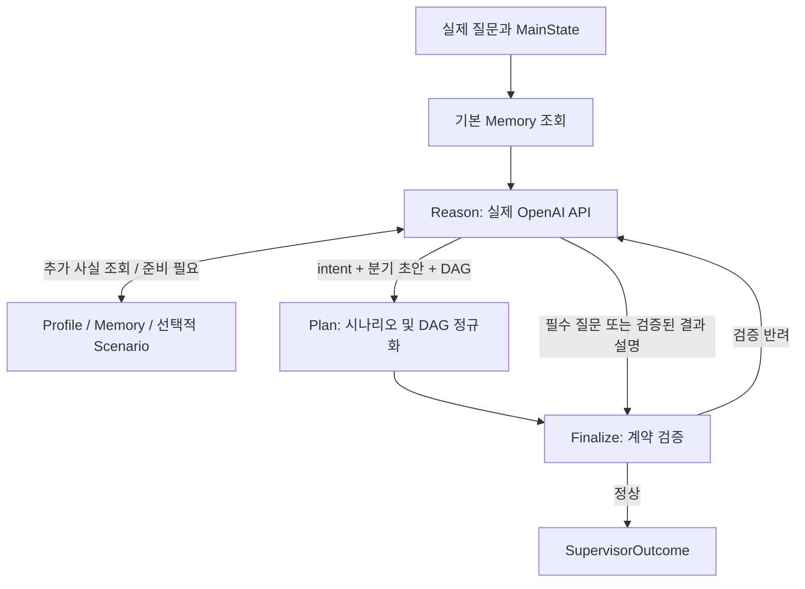

# Supervisor v15 — 토큰 및 LLM 호출 최적화

기준: GitHub main `fb9f4d6f89c2cfbe222cd51770ab4d6dc42154cd` (PR #7, Supervisor v2 분기 전략 수정 / 기존 v14), State/Profile State v3.4.

## 1. 적용 및 실행

이번 ZIP은 기존 main의 변경 파일만 담은 패치다. 프로젝트 루트에 압축을 풀고 동일 경로의 파일만 덮어쓴다. Supervisor 폴더를 삭제하지 않는다. 변경 범위는 `backend/agent/supervisor/` 및 기존 `docs/Supervisor_Developer_Guide.md` 설명 문서에 한정한다. `agent/state.py`, `agent/shared/`, `agent/profile/`, `agent/memory/`, 다른 Agent, 환경 설정 및 공용 테스트는 수정하지 않는다.

기존 `backend/.env` 또는 PowerShell 환경변수에 실제 API 키와 접근 권한이 있는 모델을 설정한다. 다음 값은 형식 예시이며 실제 값으로 대체한다. 키를 코드나 GitHub에 저장하지 않는다.

```dotenv
OPENAI_API_KEY=your_api_key
OPENAI_MODEL=your_model_id
```

`OPENAI_MODEL`은 Responses API 및 함수 호출을 지원하는 모델 ID여야 한다. 환경변수가 이미 설정돼 있으면 `.env`보다 우선한다. 프로젝트의 기존 LangGraph, langchain-core, Pydantic v2, python-dotenv를 사용한다. OpenAI SDK나 langchain-openai를 추가로 설치할 필요는 없다.

프로젝트 루트에서 다음 명령을 실행하거나 VS Code에서 `supervisor_main.py`를 직접 실행한다.

```powershell
& .\backend\.venv\Scripts\python.exe .\backend\agent\supervisor\supervisor_main.py
```

질문을 입력하면 실제 OpenAI API를 사용한다. 고정 정답, scripted decider, 가짜 사용자 금융정보, 자동 Mock 대체는 없다. API 요청 실패/키 미설정/지원하지 않는 모델/계약 오류는 실패로 출력한다. API 비용이 발생할 수 있다.

```powershell
cd backend
uv run python agent/supervisor/supervisor_main.py --question "5년 뒤 전세자금을 마련하려면?"
uv run python agent/supervisor/supervisor_main.py --state-file input.json --question "현재 자산으로 5년 계획을 세워줘" --state-output next_state.json --output result.json
```

`--state-file`만 주면 파일에 이미 포함된 사용자 질문과 turn을 실행한다. `--question`을 함께 주면 새 turn으로 초기화하되 저장된 프로필과 대화는 유지한다. 추가 질문 응답으로 같은 turn을 재개할 때는 상위 Entry Router가 구성한 State를 `--state-file`로 전달한다. 로컬 CLI는 인증된 서버 Context Loader를 대체하지 않는다. 실제 운영에서는 반드시 인증된 사용자 범위의 신뢰할 수 있는 State를 전달한다.

## 2. 내부 배치

```text
supervisor/
├── supervisor_main.py    # Supervisor 조립, 실행, 추적, 공개 반환
├── state.py              # SupervisorWorkingState: 내부 전용 State
├── contracts.py          # 결정·작업·도구 입출력, DAG 검증
├── graph.py              # 4개 노드 연결 및 부모 Graph Command 어댑터
├── runtime.py            # 직접 질문/JSON 입력, 실제 API, 최종 State 출력
├── nodes/
│   ├── reason.py         # 유일한 LLM 판단 노드
│   ├── tools.py          # Profile/Memory/Scenario 호출
│   ├── plan.py           # 전체 실행 계획 후보 정규화
│   └── finalize.py       # 계약 검증 및 다음 경로 반환
├── llm/
│   ├── openai_api.py     # OPENAI_API_KEY / OPENAI_MODEL, Responses API
│   ├── adapter.py        # 구조화 DecisionSchema, 기존 ChatModel 어댑터
│   └── prompts.py        # 작업 계획·정보 안전·도구 판단 지침
├── tools/
│   ├── integration.py    # 팀 Profile/Memory MVP 공개 함수 연결
│   ├── ports.py          # 인증 바인딩과 도구 계약 검증
│   ├── memory.py         # 새 turn 기본 조회, 상세 조회 병합
│   ├── profile_fields.py # 공용 모델 import 없는 v3.4 필드 검사
│   └── scenarios.py      # 가상 상태 준비 및 분기 검사
└── testing/
    └── test_contracts.py # 최소 오프라인 계약 검사
```

내부 State는 `source`, `decision`, `observations`, 호출 횟수, `candidate_patch`, 검증 오류, `main_patch`, `next_node`를 관리한다. 내부 State는 외부 MainState에 추가하지 않는다. 상위 공용 파일을 import하거나 수정할 필요가 없다. 연결된 외부 Agent의 공개 API만 선택적으로 import한다.

## 3. 실제 실행 흐름과 출력



기본 실행에서는 실제 LangGraph를 사용한다. Supervisor는 `policy/product/fund` 전체 업무 DAG와 각 작업의 `objective`, `depends_on`, `scenario_id`를 확정한다. 정상적인 실행에서는 Dispatcher/Collector가 그 DAG를 소비한다. Supervisor는 전문 Agent를 실제로 실행하거나 결과를 조작하지 않는다.

- `node_trace`: 실제 API가 반환한 구조화 결정 요약, 실제 도구 입출력, 계획 후보, 검증 결과.
- `supervisor_return.next_node`: `plan_validator`, `ask_user`, `final_advice` 중 다음 경로.
- `supervisor_return.state_patch`: 상위 Graph에 반영할 부분 업데이트.
- `main_state_after_supervisor`: 원본 MainState와 부분 업데이트를 합친 결과.
- `execution_waves`: 계획의 정적 병렬/순차 단계. 실제 실행 결과가 아니다.
- `scenario_execution`: 분기 있는 경우 공통 작업 ID, 각 분기 작업 ID, 필요한 공통 선행 ID, 종료 작업 및 국소 실행 단계. Plan trace와 실행 보고서에만 포함되며 MainState에는 추가하지 않는다.
- `llm_calls`, `llm_usage`, `llm_usage_totals`: 실제 API 호출 횟수, 호출별 토큰 사용량 및 확인 가능한 합계. 응답에 있는 경우 캐시 입력/추론 토큰도 표시한다.
- `llm_input_sizes`: 호출별 프롬프트·Context·함수 스키마의 UTF-8 바이트 크기. 토큰 수와는 다르다.

`--quiet`는 실시간 로그를 생략한다. `--output`은 실행 보고서 전체, `--state-output`은 합성 MainState만 저장한다. 외부 전달에는 `SupervisorOutcome.update`와 `next_node`를 사용한다. trace에는 사용자 금융정보가 포함될 수 있으므로 민감정보가 들어간 로그를 공개하지 않는다. 운영에서는 trace_sink를 연결하지 않는 것이 기본이다.

## 4. 시나리오별 실행 계획

재무 행동 또는 경제적 가정이 달라 독립 결과가 필요한 비교는 2~3개의 시나리오로 분리한다. 하나의 가상 조건도 한 분기로 표현할 수 있다. 단순 후보 비교/개념 설명은 분기하지 않는다. 각 시나리오에 필요한 전체 DAG를 최초에 배정한다. 같은 순서·Agent를 각 분기에 재사용하는 것도 허용한다. 작업 ID는 다르게 지정한다. 상품 탐색·추천 및 정책 자격 판단도 독립 분기를 기본으로 한다. 공통 조회는 동일 특정 계약/상품 조건처럼 분기에 영향을 받지 않는 사실 조회를 두 개 이상 분기가 직접 또는 간접적으로 사용하는 경우에만 `scenario_id=null`로 공유한다. 분기가 존재하면 공통 Fund 작업은 금지한다. 조회 조건의 의미적 동일성은 프롬프트와 실제 결과 검증으로 확인한다. 모든 분기에 최소 한 개의 독립 작업이 있어야 하며, 교차 분기 의존과 공통 작업의 분기 결과 의존을 금지한다. 분기별 계산은 Fund 등 전문 Agent가 자기 분기만 수행하며, 상위 비교 준비 및 Final Advice가 결과를 종합한다.

`submit_plan`의 `intent`에는 `purpose`, `operation`, `supplied_values`, `profile_update_status`가 필수이다. `compare`에는 `analysis_mode`도 필요하다. 경제적 행동/가정 비교(`strategy_compare`)와 복수 재무 로드맵 비교(`compare`+`roadmap`)는 독립 시나리오 2~3개를 요구한다. 단순 동일조건 상품 비교는 `candidate_compare`로 비분기 계획이 가능하다. 이 규칙은 기존 MainState 필드를 활용하며 새 최상위 필드를 만들지 않는다.

예: 월 30만 원 vs 40만 원의 5년 후 자금 비교. 추가 사실 조회가 필요 없으면 Reason이 `submit_plan` 한 번으로 `intent`, `scenario_state` 초안, `execution_plan`을 같이 제출한다. Plan은 기존 도구와 동일한 검사 함수(`prepare_verified_scenarios`)를 실행한다. 각 분기의 `assumptions.horizon_months=60`, 가상 `holding_actions=[{"action":"subscribe","target_criteria":{"monthly_contribution_krw":300000},"status":"hypothetical"}]`를 준비한다(두 번째 분기는 400000). ID를 생략하거나 null/빈 문자열로 주면 Python이 명시 ID와 충돌하지 않는 `s_01`, `s_02` 등의 ID를 부여한다. 명시 중복·잘못된 ID 및 미확인 실제 계약 참조는 반려하고, 동시 제출에서는 명시한 ID를 각 작업에서 참조하며, ID 생략 시 생성된 ID와 참조가 일치해야 한다. 참조가 모호하면 반려한다. 평가 기간과 상품 계약 만기(`term_months`)는 구분한다. 금리를 확인하지 않았다면 만들지 않는다. 현재 상품 탐색이 필요하면 `product_300 → fund_300`과 `product_400 → fund_400`을 각 분기에 독립 배정한다. 동일 특정 상품의 약관/금리를 조회하는 경우만 예외적으로 공유할 수 있다. 단순 원금/사용자가 제시한 금리 계산이면 Product를 생략할 수 있다.

각 분기는 같은 평가 기준으로 계산하되, 다른 상품을 선택하는 전략 비교에서는 적용 상품과 금리의 차이를 밝힌다. 상품을 찾지 못한 정상 조회 결과는 확인된 범위의 원금 계산을 막지 않으며, 금리 의존 총액은 미확정으로 표시한다. 실제 필수 선행 작업 실패는 Dispatcher/Collector의 재계획 대상으로 처리해야 한다. 상위 Dispatcher는 같은 Agent라도 task별로 별도 실행 ID 및 Local State를 사용하고, 해당 분기 `holding_actions`만 `profile_view`에 합성한다. 시나리오 간 비교는 Final Advice의 책임이다.

```powershell
uv run python agent/supervisor/supervisor_main.py --question "30만원 적금과 40만원 적금은 5년 뒤 총 금액이 얼마나 차이 나?" --output result.json --state-output next_state.json
```

**LLM 호출과 프롬프트 최적화:**

- 단순 시나리오 생성은 별도의 LLM 왕복 없이 Plan 내부에서 정규화한다. 기존 `prepare_scenarios` 도구는 호환성을 위해 유지한다. 실제 Profile/Memory 조회, 필수 정보 부족, 검증 반려가 있으면 기존 반복 흐름을 사용한다.
- 프롬프트는 Agent의 역할과 판단 규칙만 설명하고, `objective`는 작업 목적과 필요한 결과·고유 제약을 1~2문장으로 요청한다. 전문 Agent의 내부 처리 규칙을 반복하지 않는다. Dispatcher가 전달하지 않는 필수 조건(예: 평가 기간)은 명시해야 한다.
- Reason은 요약이 있으면 최근 4개, 없으면 최근 8개의 대화 메시지를 전달하며, 최신 사용자 질문은 반드시 보존한다. 프로필 가용 여부는 그룹화하고 현재 run의 결과·검수만 포함한다. 성공한 Scenario 요청의 중복 원문과 중복 기억 본문을 제거한다. 상세 기억이 병합 상한을 넘으면 아직 포함되지 않은 항목만 추가한다. 원본 State·도구 관찰·안전 검증은 그대로 유지한다.
- 단일 제출은 **추가 조회·반려가 없고 모델이 유효한 초안을 한 번에 반환할 때** 한 번의 LLM 호출로 끝난다. API 실제 비용/토큰은 입력과 모델에 따라 달라진다. 출력의 `llm_usage_totals`를 비교한다.

위 명령은 실제 API를 호출한다. 코드가 강제하는 것은 intent·분기 coverage·DAG 의존성 등 구조적 계약이고, 자연어 업무 목적의 의미적 정확성은 실제 모델 평가가 필요하다. `scenario_execution`은 계획을 보여주는 진단 정보이며 운영 Dispatcher는 `execution_plan.tasks[]`를 소비한다.

## 5. 실제 Profile / Memory MVP 연동

Profile은 `agent.profile.profile_agent.run_profile_agent()`를 사용하며 `current_profile`을 신뢰된 실제 State에서 구성한다. `ProfileResult.profile`은 추출된 값, `changes`는 저장 후보, `missing_info`는 미확인 값이다. 현재 MVP는 일부 월소득/비상금 목표 표현을 처리하며 실제 DB 조회·저장은 아직 포함하지 않는다. 미확인 금액을 임의 생성하지 않는다. 읽기 전용 `get_profile_fields`가 제공되면 필요한 경로만 조회한다.

Memory는 팀의 `retrieve_memory_for_supervisor(service, request, authenticated_user_id=...)`에 연결한다. 이전 `scope`, `type`, `summary` 계약 대신 `query`, `limit`, `memory_types`와 `retrieval_status`, `retrieved[]`를 사용한다. 각 기억은 `memory_id`, `memory_type`, `content`, `source_ref`, 선택적 `target_ref`, `metadata`를 유지한다.

| 기억 유형 | 의미 |
|---|---|
| consultation_summary | 과거 상담 요약 |
| recommendation | 과거 추천 이력 |
| user_decision | 수락·거절·변경 |
| user_preference | 사용자 선호 및 제약 |

기본 기억은 새 turn 시작 시 자동 조회하고, 같은 turn의 기본 조회 결과를 재사용한다. 현재 Memory MVP의 부분문자열 검색 한계 때문에 전체 질문과 제한된 관련 키워드(최대 5개), 선호 표현(최대 5개)을 조회하고 ID 기준으로 병합한다. `no_match`는 기억 자체가 없다는 뜻이 아니다. 모든 유효 선호를 반드시 가져오는 기능은 Memory 담당자의 인증된 활성 선호 조회 서비스가 추가된 후 `load_memory_context` 포트를 교체하여 제공한다. Memory는 현재 프로필이나 실제 계약의 근거가 아니다.

직접 실행에서는 기존 Memory MVP가 설치되어 있으면 **빈 인메모리 서비스**를 생성한다. 임의 기억을 생성하지 않는다. 별도로 제공한 실제 기록을 같은 프로세스에서 검색하고 싶다면 `--memory-file`에 팀 `MemoryWriteRequest` 형식의 JSON 배열을 전달한다. 이는 로컬 테스트용 입력 적재이지 운영 Memory DB 접근이나 지속 저장이 아니다. 프로세스 종료 후 기록은 남지 않는다. 운영 Memory Writer는 실제 답변 전달 이후 별도 서비스에서 수행한다.

## 6. 상위 Graph에 연결

```python
from agent.supervisor import Supervisor, build_main_supervisor_node
from agent.supervisor.tools.integration import bind_mvp_ports

# 서비스와 사용자 ID는 서버 인증 결과를 바탕으로 요청별 바인딩한다.
ports = bind_mvp_ports(
    memory_service=memory_service,
    authenticated_user_id=authenticated_user_id,
    get_profile_fields=profile_read_service,  # 구현 전에는 None
)
supervisor = Supervisor(ports=ports)  # 실제 OpenAI API 기본 연결
supervisor_node = build_main_supervisor_node(supervisor)
```

`Supervisor.run(main_state)`가 `SupervisorOutcome`을 반환한다. 부모 Graph의 `supervisor` 노드에서는 `Command(update=outcome.update, goto=outcome.next_node)`를 사용한다. 같은 사용자의 MemoryService 인스턴스를 재사용하며 LLM에 인증 ID를 결정하게 하지 않는다. `plan_validator`, `ask_user`, `final_advice`는 상위 Graph에 존재해야 한다. 이 ZIP은 상위 Graph나 다른 Agent를 수정하지 않는다.

## 7. 최소 검사

```powershell
uv run python agent/supervisor/supervisor_main.py --regression
```

기존 대형 Mock 사례, scripted 정답, 가상 전문 Agent 실행, `--case` / `--all` / `--simulate-dispatch`는 v12에서 제거된 상태를 유지한다. 위 옵션은 API 호출 없이 스키마·intent·시나리오별 DAG/격리/반려·Memory·HTTP 요청/실패 경계를 검사한다. LangGraph가 설치된 환경에서는 테스트 전용 부모 State를 사용해 실제 `Command` 이동도 검사한다. HTTP 단위 검사는 전송 경계를 대체하여 검사하므로 실제 API 성공을 보증하지 않는다. 팀 Profile·Memory 모듈이 있는 프로젝트에서는 두 실제 MVP 연동 검사도 실행된다. 실제 모델 평가에는 기본 실행 또는 `--question`, `--state-file`을 사용한다.

제작 환경에는 실제 API 키와 LangGraph가 없어 운영 모델 호출과 실제 그래프 실행을 검증하지 않았다. 로컬 오프라인 검사 결과와 미실행 항목을 아래에 기록한다.

- 오프라인 계약 검사 25개 중 22개 통과(기존 19개 유지 + 6개 추가). 한 번의 HTTP 계약 호출로 분기/DAG 반환, ID 복구와 잘못된 참조 반려, 기준 계약 참조 검증, 추가 Memory 조회 왕복 유지, Context의 필수값/권한 격리 및 기억 중복 제거를 검사했다.
- 실제 Profile/Memory MVP 연동 2개 및 부모 LangGraph Command 이동 1개: 제작 환경에 해당 모듈이 없어 미실행.
- 실제 OpenAI API 호출 및 실제 전문 Agent 실행: 미검증. 기본 실행은 실제 API만 사용한다.
- 동일한 2분기 적금 비교의 제어된 계약 입력으로 비교한 값(실제 토큰이 아님): 시스템 프롬프트 UTF-8 16,533 → 7,540 bytes, LLM 호출 2 → 1, 프롬프트·스키마·Context 합계 46,582 → 12,575 bytes. API 내부 직렬화 오버헤드와 출력 토큰을 제외했다.
