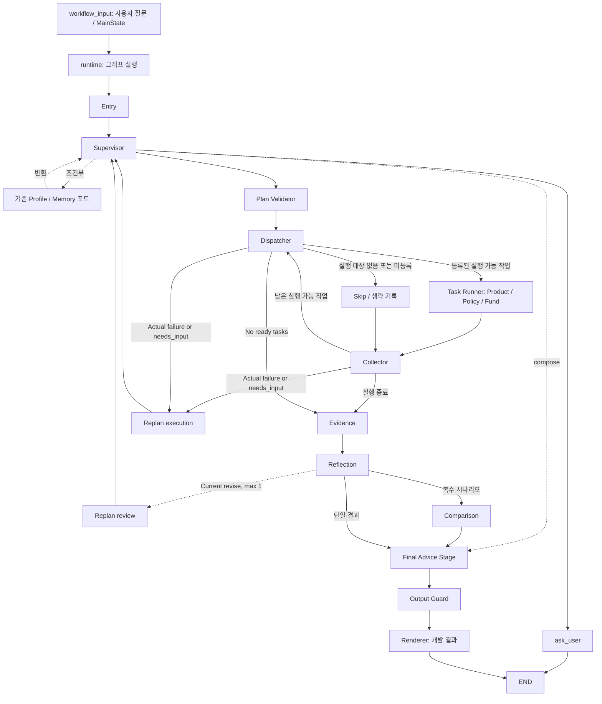

# LangGraph · Langfuse 개발 안내

> 기준: 2026-11-25 `main` (`855561ccddf9baa8b380138561de566c5ef3caf7`) 기반 연결 패치. 전체 설계는 [멀티에이전트_설계안.md](./멀티에이전트_설계안.md), 공용 계약은 [State_설계안.md](./State_설계안.md)를 따른다.

## 1. 개발 현황

이 문서는 **이 패키지의 연결 코드를 적용한 이후**를 기준으로 한다. 현재는 **최상위 실행 그래프와 기존 Supervisor를 연결한 개발용 구조**다. 실제 LLM으로 작업 계획을 수립하고, 실행 가능한 작업을 동적으로 배정한다. 전문 Agent, 검수 및 최종 답변은 미연결 상태이며 가짜 결과를 생성하지 않는다. 이번 패치는 Supervisor의 기존 규약에 맞춘 연결 개선이다. Supervisor 내부 코드와 개별 Agent는 수정하지 않는다.

| 파일 | 역할 |
|---|---|
| `backend/agent/workflow_input.py` | 질문 입력, 진행 노드 및 결과 출력, 환경 점검 |
| `backend/agent/workflow.py` | 전체 LangGraph 조립, 조건부 분기, `Send` 병렬 실행 |
| `backend/agent/workflow_control.py` | 작업 의존성, 실행 상태, 최신 결과 수집 |
| `backend/agent/runtime.py` | 그래프 컴파일 및 캐싱, Langfuse 콜백 연결 |
| `backend/services/observability.py` | 기존 Langfuse 초기화, 환경 설정, 민감정보 마스킹 |
| `backend/tests/test_workflow_*.py` | 실행 제어, 입력·출력, 통합 연결 검사 |

기존 `MainState`, 전문 Agent 공통 계약, Supervisor 내부 코드, Profile/Memory 및 개별 Agent 폴더는 변경하지 않는다. `workflow_report`는 개발용 내부 채널로, 공용 MainState 계약에 추가하지 않는다.

## 2. LangGraph 실행 구조



- Supervisor의 `execution_plan.tasks[]`와 `depends_on`을 기준으로 실행하며, Agent별 순서를 고정하지 않는다.
- 미등록 Agent는 `skipped` (`agent_not_registered`), 필수 선행 작업의 결과가 없으면 `skipped` (`dependency_unavailable`)로 기록한다. 독립 작업은 계속 진행한다.
- 등록된 작업은 `Send`로 배정하고, Collector에서 `task_id`, `run_id`, `plan_revision`, `scenario_id`를 확인하여 최신 결과만 반영한다.
- 기본 Agent Registry는 비어 있다. 기본 Supervisor factory는 `bind_mvp_ports()`를 호출하지만 인증 PostgreSQL Memory는 자동 연결하지 않는다. main의 `agent/memory/memory_integration.py`에 있는 인증 포트 생성 기능은 향후 서비스 진입점에서 사용자별로 주입한다. 추후 `build_workflow(agents=...)`의 `AgentBinding`으로 업무별 입력 변환(`prepare`)과 실제 실행(`invoke`)을 연결한다. 공용 실행 계약이 변경되면 연결 계층도 조정해야 한다.
- Validator는 기존 validate_intent_scenarios와 validate_candidate_limits를 사용한다.
- Dispatcher는 현재 revision/run/scenario의 직접 선행 결과와 검증된 작업별 답변을 자동 전달한다. Adapter는 profile_view 선택에 집중하며 필수 선행 결과를 바꿀 수 없다.
- Product/Policy에는 서버 candidate_limit를 주입한다. 기본 3개, 종류별 전체 6개 이내에서 분기별로 min(3, 6 // 활성 분기 수)를 배정한다. 완료 검색 결과의 data.candidates 배열은 필수이며 빈 배열은 정상이다. 초과·누락 결과는 실패 처리하고 후속 Fund에 전달하지 않는다.
- 실제 실패 또는 needs_input 발생 시 독립 실행 가능 작업을 먼저 처리한 뒤 Supervisor에 최대 1회 재계획을 요청한다. 미등록 skipped는 재계획 대상이 아니다. 검수 반려는 기존 review_retry_count 규약을 사용하는 경로만 연결했다.
- Evidence/Reflection 및 금융 최종 답변은 미구현이다. 가짜 검수 결과를 생성하지 않는다.

## 3. 실행 방법

전체 업데이트 ZIP은 프로젝트 루트에 압축을 풀어 기존 상대 경로에 그대로 덮어쓴다. 문서 전용 ZIP은 `docs/`만 덮어쓰며 코드 변경은 포함하지 않는다. 별도 적용 스크립트는 필요 없다. 현재 main `855561c`의 변경 대상 경로를 기준으로 제작했으며, 이후 로컬 수정이 있다면 먼저 `git diff`를 확인한다. `.env`, `pyproject.toml`, `uv.lock`, `runtime.py` 및 Supervisor/개별 Agent 코드는 유지한다.

```powershell
# 전체 연결 코드 적용 후 저장소 루트에서
cd backend
uv sync --locked
uv run --locked python -m agent.workflow_input
```

VSCode에서 `backend/.venv` 인터프리터를 선택한 후 `backend/agent/workflow_input.py`를 직접 실행해도 된다. 이 파일은 질문 1건의 전체 실행을 검증하는 용도이며, 향후 실제 서비스용 Chat/API는 별도로 `runtime`을 사용한다.

| 옵션 | 기능 |
|---|---|
| `--question "질문"` | 질문을 직접 전달 |
| `--check-env` | Python, 패키지 버전, 모듈 import 및 환경변수 존재 확인(API 미호출) |
| `--no-langfuse` | 이번 실행에서만 추적 비활성화 |
| `--quiet` | 진행 로그 생략, 최종 JSON 출력 |
| `--state-file 경로` | 신뢰할 수 있는 로컬 MainState 입력 |
| `--state-output 경로` | 전체 MainState를 로컬 JSON으로 저장 |

실행 과정은 `stream_mode=["updates", "values"]`, `subgraphs=True`, `version="v2"`의 단일 스트림으로 수집한다. 하위 이벤트가 전파되면 Supervisor 내부 노드도 표시한다. 별도 `invoke`를 다시 실행하지 않는다.

개발 출력에는 intent, 최초 invalid 반려 이유, plan 검증 오류 및 retry 사유를 표시한다. 최초 invalid의 정확한 원인은 이전 로그만으로 확정할 수 없으며, 재실행한 로그로 확인한다.

최종 출력은 실행 계획, 시나리오, 작업별 상태 및 생략 사유, 추가 질문, 실행 시간 등을 포함한다. `connection_check_completed`는 연결 검사 종료를 뜻한다. 이때 `phase=failed`, `final_advice=null`은 금융상담이 아직 완료되지 않았음을 나타낸다. `waiting_for_user`는 추가 정보가 필요한 경우다.


## 4. Langfuse 연결 및 관측 범위

`workflow_input.py` → `runtime.get_workflow()` → 기존 `services/observability.py`의 `get_langfuse_handler()` → 컴파일된 그래프의 `callbacks` → Langfuse Cloud.

`backend/.env`에 기존 설정을 사용한다. US 프로젝트 기준 주소는 아래와 같으며 API 키는 실제 값으로 설정하되 커밋하지 않는다.

```dotenv
OPENAI_API_KEY=...
OPENAI_MODEL=...
LANGFUSE_ENABLED=true
LANGFUSE_PUBLIC_KEY=...
LANGFUSE_SECRET_KEY=...
LANGFUSE_BASE_URL=https://us.cloud.langfuse.com
LANGFUSE_TRACING_ENVIRONMENT=development
```

| 항목 | 현재 연결 범위 |
|---|---|
| 최상위 실행 추적 | Runtime의 공통 콜백으로 연결 |
| 노드 실행 경로·시간·오류 | 콜백 이벤트가 전달되는 범위에서 추적 |
| Supervisor 내부 실행 | 하위 그래프 컨텍스트 전파에 의존 |
| 모델별 토큰·비용 | Supervisor는 `urllib` 직접 호출이므로 별도 계측 필요 |
| 민감정보 보호 | 기존 관측 속성 허용 목록 및 마스킹 유지 |
| 종료 시 전송 | 실행점에서 `get_client().flush()` 요청 |
| RAGAS / 자체 품질 평가 | 미연결; 추후 평가 점수 연동 |

`LANGFUSE_ENABLED=false`로 설정해도 그래프는 실행된다. 실제 Cloud 수신은 Langfuse 대시보드에서 확인한다. `flush` 성공만으로 서버 수신을 보장하지 않는다. 개발 데이터에는 실제 개인정보를 사용하지 않으며, 계획/시나리오 및 `--state-output` 파일에도 금융정보가 포함될 수 있으므로 커밋하거나 외부에 공유하지 않는다.

## 5. 점검 및 후속 개발

```powershell
# backend 폴더에서
uv run --locked python -m agent.workflow_input --check-env
uv run --locked python -m agent.workflow_input --no-langfuse
uv run --locked python -m unittest discover -s tests -p "test_workflow_*.py" -v
```

- 제어 테스트 17개는 실제 후보 결과 검증 함수와 격리된 테스트 환경에서 통과했다. 실행점 테스트 7개 및 Python 구문 검사도 통과했다. 실제 LangGraph 통합 테스트 9개와 API/Cloud 재실행은 제작 환경의 의존성 제한으로 수행하지 못했다. 로컬에서 아래 테스트 명령으로 확인한다.
- 기존 잠금 버전: LangGraph 1.2.23, langchain-core 1.8.4, Langfuse 5.2.0. 의존성 선언/잠금 파일은 변경하지 않았다.
- 다음 단계: 실제 Agent Adapter 등록 → 실제 검수 판단 연결 및 제한 재계획 통합 검증 → 최종 답변과 서비스 진입점 연결 → LLM 사용량 계측 및 평가 점수 연동.

참고: [LangGraph Streaming](https://docs.langchain.com/oss/python/langgraph/streaming), [Langfuse Python SDK](https://langfuse.com/docs/observability/sdk/upgrade-path/python-v4-to-v5).
