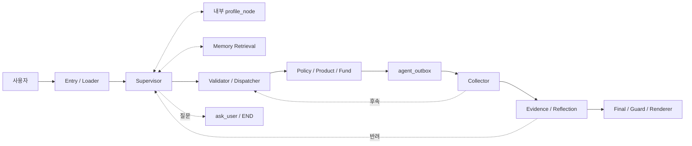

# 청년 금융 Multi-Agent State 설계안

> **기준일:** 2026-11-24  
> **역할:** LangGraph `MainState`의 **최상위 Key, 생명주기, 실행·반환·검증·시나리오 계약**을 정의한다.  
> **프로필 세부 정본:** [`Profile_State_설계안.md`](./Profile_State_설계안.md) — `BasicProfile`, `FinancialProfile`, `Goal`, `Holding`, `Liability`의 모든 세부 필드와 조회·저장 규칙.  
> **실행 그래프 정본:** [`멀티에이전트_설계안.md`](./멀티에이전트_설계안.md) — Supervisor 및 전문 Agent의 노드 위치·역할·흐름.

**핵심 결정:** 기존 20개 최상위 Key, 병렬 `agent_outbox`, Supervisor 내부 조건부 `profile_node`, `policy/product/fund`, Evidence/Reflection, Final/Guard/Renderer, 후속 A/B를 유지한다. 프로필 DB와 MainState의 두 프로필은 **동일한 논리 스키마**를 공유하되, LLM 입력으로 전체 State를 보내지 않는다. `housing` Agent와 부동산 매물 검색은 없다.

## 0. 개발자 빠른 읽기 순서

1. **§1:** 20개 MainState Key와 생존 범위
2. **§2:** 프로필 State의 위치 및 별도 정본 참조
3. **§3:** `intent`, `scenario_state`, 추가 질문, 실제 저장 변경
4. **§4:** 실행 계획과 병렬 결과·근거 검증 계약
5. **§5~§7:** 최종 출력/기억·생명주기·보안
6. **§8~§9:** 선언 예시와 수용 테스트

---

## 1. Main Supervisor State — 최상위 20개 Key

`MainState`는 `TypedDict(total=False)`로 선언한다. 모든 Key를 모든 요청에서 채울 필요는 없고, **상담을 넘어 유지할 값과 요청별 초기화할 값**을 구분한다.

| Key | 타입 | 범위 | 주요 작성자 / 기능 |
|---|---|---|---|
| `messages` | `Annotated[list[BaseMessage], add_messages]` | 상담 | Entry / 현재 대화 |
| `conversation_summary` | `str` | 상담 | 긴 대화 요약 |
| `consultation_id` | `str` | 상담 | 스레드 식별 |
| `turn_id` | `str` | 요청·재개 | 요청 식별; 추가 질문 답변 시 유지 |
| `phase` | `str` | 요청 | `planning / executing / waiting_for_user / composing / completed / failed` |
| `basic_profile` | `BasicProfile` | 상담 | 기본정보·저장 목표 스냅샷 |
| `financial_profile` | `FinancialProfile` | 상담 | 소득·지출·자산·부채·선택적 보유 내역 스냅샷 |
| `scenario_state` | `dict[str, Any] \| None` | 요청·조건부 | 임시 비교 분기·가정·준비 결과 |
| `memory` | `dict[str, Any]` | 상담 참조·조건부 조회 | 과거 상담/선택·직전 답변 참조 |
| `intent` | `dict[str, Any] \| None` | 요청 | 목적, 이번 입력, 실제 저장 의도 |
| `execution_plan` | `dict[str, Any] \| None` | 요청 | 작업·선행 의존·실행 ID |
| `pending_input` | `list[dict[str, Any]]` | 요청·조건부 | 추가 질문과 재개 대상 |
| `agent_results` | `dict[str, dict[str, Any]]` | 요청 | Collector가 수락한 최신 결과 |
| `review_results` | `dict[str, dict[str, Any]]` | 요청 | Evidence·Reflection 검수 |
| `superseded_results` | `dict[str, dict[str, Any]]` | 요청 | 이전 실행 참조·오류 요약 |
| `final_advice` | `dict[str, Any] \| None` | 요청 | 검증된 상담 내용·화면 참조 |
| `post_response` | `dict[str, Any] \| None` | 후속·조건부 | A 시뮬레이션 / B 대시보드 |
| `basic_profile_changes` | `list[dict[str, Any]]` | 요청 | 승인 대상 실제 기본 프로필 변경 |
| `financial_profile_changes` | `list[dict[str, Any]]` | 요청 | 승인 대상 실제 금융 프로필 변경 |
| `memory_candidates` | `list[dict[str, Any]]` | 요청 | 실제 전달 답변의 장기기억 후보 |

**내부 채널:** `agent_outbox: Annotated[list[dict], append_outbox]`는 전문 Agent 병렬 수집 전용이며 **위 20개 공용 Key에 포함하지 않는다**. 인증된 사용자 ID, 권한·동의·토큰은 Runtime Context/보안 저장소에서 다룬다.

**phase:** `planning`(분류/계획) → `executing`(전문 작업) → `composing`(검증 결과로 답변) → `completed`. 필수 답변이 없으면 `waiting_for_user`와 END, 불가하면 `failed`. Profile 내부 단계·재시도 상세를 최상위 `phase`에 추가하지 않는다.

## 2. 프로필 State — 상세 정의의 분리

| MainState 필드 | 이 문서의 최소 계약 | 상세 정의 |
|---|---|---|
| `basic_profile` | 사용자의 **실제 기본 프로필 및 저장된 복수 목표**의 현재 스냅샷. 새 turn에서 저장 목표를 지우지 않는다. | [`Profile_State_설계안.md` §2](./Profile_State_설계안.md) |
| `financial_profile` | 실제 금융 프로필 현재 스냅샷. 기존 요약 7개 값 유지, `holdings[]`/`liabilities[]`는 **선택적**이다. | [`Profile_State_설계안.md` §3](./Profile_State_설계안.md) |

- **동일 스키마:** 프로필 저장 서비스와 State는 공통 `BasicProfile`·`FinancialProfile` 타입을 재사용한다(프로필 정본 §3.6). 별도 요약/상세 모델을 중복 유지하지 않으며 부분 로딩은 허용한다.
- **다른 역할:** 서비스 DB는 실제 원본이고 MainState는 상담 당시의 복사본이다. 스키마 공유가 자동 동기화를 뜻하지는 않는다. 저장 성공 후 버전 확인·재조회로 갱신한다.
- **모든 데이터를 항상 로드하지 않는다:** 프로필의 일부 섹션만 로드한 State가 허용된다. 미로딩, 미확인 `null`, 확인된 `0`, 빈 상세 목록 `[]`은 다르다.
- **LLM에 전체 State를 주지 않는다:** Dispatcher는 필요한 미로딩 값을 읽기 전용 Tool로 일괄 조회하고 실제값 → `supplied_values` → 해당 `overrides`를 병합한 뒤 허용된 필드만 `profile_view`로 투영한다. 일회성 `age`는 Policy View에 전달할 수 있다. 세부 규칙은 프로필 정본 §4~§6 참조.
- **상품·가입 이력:** `financial_profile.holdings[]`는 동일 사용자별 계약 서비스의 선택적 현재 개요다. 정밀 비교는 **동일 기준일 스냅샷(`baseline_ref`)**으로 검증한다. 저장 계약의 `holding_ref = holding_id`, 저장 목표의 `goal_ref = goal_id`이다(프로필 정본 §2.2·§3.5). `memory`는 실제 가입의 근거 저장소가 아니다.
- **프로필 저장:** `basic_profile_changes`/`financial_profile_changes`에 기록하고, Supervisor 내부 `profile_node`만 승인된 저장 서비스 사용. 전문 Agent가 직접 쓰지 않는다.

### 프로필 입력 세 종류

| 사례 | 반영 위치 | 영속 저장 |
|---|---|---|
| “월급 320만 원이야, 계산해줘” | `intent.supplied_values` | 아니오 |
| “내 월급을 350만 원으로 저장해줘” | `*_profile_changes` → 저장 성공 → 두 프로필 스냅샷 재조회 | 예 |
| “내년에 월급이 350만 원이라면?” | `scenario_state.scenarios[].overrides` | 아니오 |
| “주택 마련 목표를 추가해줘” | 저장 승인 시 대상 목표만 추가/병합 | 승인 시에만 |
| “3% 적금 해지 후 5% 적금으로 옮긴다면?” | 시나리오 `holding_actions` | 실제 가입·해지 없음 |

---

## 3. 요청별 상태 계약

### 3.1 `intent`

```json
{
  "purpose": "financial_roadmap",
  "operation": "new",
  "analysis_mode": "roadmap",
  "strategy_preference": null,
  "supplied_values": {"monthly_net_income_krw": 3200000},
  "profile_update_status": "not_needed",
  "target_advice_ref": null
}
```

| 필드 | 규칙 |
|---|---|
| `purpose` | 사용자가 이루려는 목적. Agent 이름이 아님 |
| `operation` | `new / continue / revise / compare / explain` |
| `analysis_mode` | 선택: `candidate_compare / strategy_compare / roadmap`; 시나리오 분기 여부와 별개 |
| `strategy_preference` | 사용자가 명시한 제약만(대출 제외, 기존 상품 유지 등) |
| `supplied_values` | 이번 상담에 일회성으로 제공한 실제 값·목표. 추정치를 사용자 진술처럼 저장하지 않음 |
| `profile_update_status` | `not_needed / pending / waiting / done`. **실제 프로필 영속 변경**의 상태만 의미 |
| `target_advice_ref` | 과거 답변 이어쓰기·수정 대상 |

`supplied_values.goals`는 **부분 추가/수정/전체 교체 의도**를 해석해 저장 목표와 병합한다. 단순 dict 덮어쓰기나 배열 교체로 기존 `basic_profile.goals[]`를 지우면 안 된다. 목표의 상세 타입·ID·날짜 정밀도는 프로필 정본을 따른다.

### 3.2 `scenario_state` — 실제 프로필 1개, 임시 분기 N개

임시 재무 상태로 별도 계산해야 할 때에만 생성한다(기본 최대 3개). **상품 후보 5개**나 **동일 조건의 전략 비교**는 곧바로 시나리오 5개를 뜻하지 않는다.

```json
{
  "baseline_ref": "holding_snapshot_001",
  "scenarios": [
    {
      "id": "s_keep", "label": "기존 3% 적금 유지", "overrides": {},
      "assumptions": {"horizon_months": 24,
        "holding_actions": [{"holding_ref": "holding_01", "action": "keep"}]}
    },
    {
      "id": "s_switch", "label": "해지 후 다른 적금 가상 가입", "overrides": {},
      "assumptions": {"horizon_months": 24,
        "holding_actions": [
          {"holding_ref": "holding_01", "action": "terminate"},
          {"action": "subscribe", "target_criteria": {"annual_rate_pct": 5.0, "term_months": 24}, "status": "hypothetical"}
        ]}
    }
  ]
}
```

- `baseline_ref`: 인증 사용자의 동일 기준일·버전 실제 가입 현황 참조. 조회 서비스가 발급하고 Supervisor가 사용한다. 없으면 관련 자료의 출처·기준일을 전달한다.
- `scenarios[].overrides`: 허용된 **대표 기본/금융 프로필 필드**의 임시 변경. Goal 변경은 의도적으로 적용하며 저장 목표 원본은 변경하지 않는다.
- `assumptions.holding_actions`: 실제 계약의 `keep/terminate` 및 가상 `subscribe` 등의 경제적 행동. **금융 거래 명령이 아니다.**
- `assumptions.horizon_months`: 분기 비교 시 동일 평가 기간. 종료일·현재 시점 등 비교 기준도 일치해야 한다.
- **View 우선순위:** 필요한 실제 프로필 → `intent.supplied_values` → 해당 `overrides`를 병합한 후 허용 필드만 투영한다. `holding_baseline`(동일 실제 사실) 및 가상 `holding_actions`를 View에 별도로 합성한다. 출처와 실제/가정을 구분하며 **State에 View를 여러 벌 저장하지 않는다.**
- **Supervisor 소유:** 분기 초안 작성 → Profile Node의 사실 조회/정규화 → Supervisor가 최종 분기와 계획 확정. Profile은 Fund를 직접 호출하지 않는다.

#### Profile Node 준비 결과의 전달

별도 내부 LangGraph 노드(`supervisor → profile_node → supervisor`)로 구현하면 기존 `scenario_state.preparation`을 **임시 통신 공간**으로 사용한다.

```json
{
  "preparation": {
    "branch_requests": [
      {"id": "s_keep", "holding_actions": [{"holding_ref": "holding_01", "action": "keep"}]},
      {"id": "s_switch", "holding_actions": [{"holding_ref": "holding_01", "action": "terminate"}]}
    ],
    "status": "requested"
  }
}
```

Profile Node가 `baseline_ref / branch_specs / missing_inputs / status="prepared"`를 같은 `scenario_state.preparation` 아래에 기록한다. 준비 결과의 `branch_specs[]`에는 분기 `id`, `status`(`ready / conditional`), 검증·정규화된 `holding_actions[]`를 담는다. `conditional`은 추가 조건이 필요한 분기이지 상품 자격 판정이 아니다. 조회로 해결되는 조건은 Product/Policy에 배정하고 사용자만 제공할 수 있는 필수값만 질문한다. Supervisor가 확인 후 `scenarios[]`를 확정하고 `preparation`을 제거한다. **중첩 dict 자동 병합을 가정하지 않는다.** Profile 호출이 같은 Supervisor 함수 내부라면 준비 결과를 로컬 반환값으로 받아도 된다.

### 3.3 `pending_input`

```json
[{"id": "ask_01", "question": "세전 연소득을 알려주시겠어요?", "fields": ["annual_gross_income_krw"], "target": "task_policy_01", "scenario_id": null, "status": "pending"}]
```

- `target`: `profile` / `supervisor` / 전문 작업 ID. `status`: `pending / resolved`. 필요하면 `answers{}`.
- 실제로 답변이 없으면 진행할 수 없는 **중요 필드만** 질문한다. 단순 탐색이면 `needs_check`로 진행 가능.
- `ask_user → END`; 다음 사용자 메시지를 Entry Router가 분류하고 **같은 `turn_id`**로 재개한다. Profile Node 자체 `interrupt`를 만들지 않는다.
- 특정 분기 질문은 `scenario_id`와 연결한다. 가입 여부·과거 납입 등 동일한 사실은 분기별로 반복 질문하지 않는다.

### 3.4 `basic_profile_changes` / `financial_profile_changes`

```json
{"basic_profile_changes": [{"change_id": "change_goal_01", "field": "goals", "value": [{"goal_id": "goal_01", "goal_type": "savings", "target_amount_krw": 10000000, "target_date": "2029-12-31", "target_date_precision": "year", "priority": 1, "status": "active"}], "status": "pending"}]}
```

- 상태: `pending / needs_confirmation / applied / rejected / failed`.
- 사용자 명시 지시 또는 저장 UI 승인 시에만 적용. `change_id`로 중복 실행 방지. 저장 서비스는 프로필 `version`으로 충돌 검증 후 재조회한다.
- 목표 일부 수정 시 **대상 `goal_id`(기존 결과의 `goal_ref`와 동일)**를 확인해 기존 목표와 병합한다. `field="goals"`의 `value`는 부분 변경 의도를 합성한 완전한 목록으로 처리한다. 미로딩 목표를 유실시키지 않으며 사용자 승인 없이 다른 목표를 삭제하지 않는다.
- 실제 보유상품의 등록/수정도 승인·버전 검증 대상이며, **시나리오 `holding_actions`를 저장 호출로 해석하지 않는다**.
- `*_profile_changes`는 새로운 요청에서 초기화하며 프로필 자체와 저장 목표는 유지한다.

---

## 4. 실행 계획·전문 결과·검수

### 4.1 `execution_plan`

```json
{
  "revision": 1, "review_retry_count": 0,
  "tasks": [
    {"task_id": "product_terms", "agent": "product", "objective": "기존 적금 및 신규 후보 계약·해지 조건 확인", "scenario_id": null, "depends_on": [], "status": "pending", "run_id": null},
    {"task_id": "fund_keep", "agent": "fund", "objective": "기존 계약 유지 시 24개월 현금흐름", "scenario_id": "s_keep", "depends_on": ["product_terms"], "status": "pending", "run_id": null},
    {"task_id": "fund_switch", "agent": "fund", "objective": "해지 후 교체 시 24개월 현금흐름", "scenario_id": "s_switch", "depends_on": ["product_terms"], "status": "pending", "run_id": null}
  ]
}
```

- 작업 `status`: `pending / running / completed / needs_input / failed / skipped`.
- 허용 전문 Agent: **`policy / product / fund`**. `housing`은 허용하지 않는다. 전세/주담대는 Product.
- `depends_on`은 **필수 선행**만 표기. Fund 단독 실행 허용. 공통 Product/Policy 조건 조회는 한 번 실행하여 분기별 Fund가 결과 재사용.
- `run_id`는 Dispatch 시 부여. `revision`은 입력·가정·작업 구성이 바뀔 때 증가하며 단순 네트워크 재시도는 새 `run_id`만 부여한다.
- 변경된 분기 및 이에 의존한 작업 결과/검수는 무효화하고 재실행. Reflection에 의한 재계획은 원칙적으로 1회(`review_retry_count`).
- 복잡한 기간 패치/필드별 입력 해시/공용 호출 예산 장부는 만들지 않는다. 재시도 및 호출 상한은 서버 설정에 둔다.

### 4.2 전문 Agent 입력 — 필요한 범위만 전달

| 키 | 의미 |
|---|---|
| `task_id`, `run_id`, `plan_revision`, `scenario_id` | 작업·분기 최신성 확인 |
| `objective`, `user_query` | 작업 목적과 필요한 질의 부분 |
| `profile_view` | Dispatcher가 **선택된 프로필 필드만** 구성. 전체 MainState·계좌 원문을 LLM에 전달하지 않는다 |
| `profile_view.holding_baseline`(선택) | 실제 계약 시점·납입 이력의 **필요 사실/참조·as_of**만 조회해 전달 |
| `profile_view.holding_actions`(선택) | 해당 분기 임시 경제적 행동. 저장/실행 명령 아님 |
| `upstream_results` | 수락된 선행 작업의 관련 데이터 |
| `extra_answers` | 특정 정책/상품에만 필요한 이번 상담 입력 |
| `prior_advice` | 이전 상담 수정 요청 때만 필요한 부분 |
| `revision_feedback` | 검증 반려 후 재실행 시만 `previous_run_id, previous_output_ref?, issues[]` |

필드 선택 규칙과 Tool API는 프로필 정본을 따른다. 기본적인 필드 선택은 Python의 whitelist/Field Set으로 처리하며, 누락한 상세만 읽기 전용 Profile Tool로 **묶어서 호출**한다.

### 4.3 전문 Agent 출력 — 최소 Envelope

```json
{
  "task_id": "task_fund_01", "run_id": "run_01", "plan_revision": 1,
  "scenario_id": null, "status": "completed", "summary": "월 현금흐름을 계산함",
  "data": {"metrics": [{"name": "monthly_surplus", "value": 1050000, "unit": "KRW/month", "as_of": "2026-11-24", "evidence_ref": "calc_cashflow_01", "value_kind": "estimated"}]},
  "evidence_refs": ["calc_cashflow_01"], "warnings": [], "needed_fields": []
}
```

- 전문 Agent는 자기 내부 `data` 구조를 소유한다. 기본 Envelope만 공통으로 고정한다.
- Policy: `data.candidates[]`의 `eligibility.status`(`eligible / ineligible / needs_check`), `checks[]`, `key_attributes.benefits[]`, 공식 URL·개별 근거.
- Product: `data.candidates[]`의 유형·상품 금리·기간·한도·상환/수익·공식 URL·미확인 가입조건. 실제 상품 존재/적용금리 검증.
- Fund: 현금흐름, `roadmap[]`, 필요 시 `strategy_options[]`, `metrics[]`; `actual / estimated / planned / assumed` 구분.
- 중요한 정책 혜택·상품 금리·한도·자격·계산 수치에는 단위, 기준일(해당 시), 개별 `evidence_ref` 연결. 확정 불가 시 `needs_check`/경고.
- 대출 원금은 지원금·수익·월소득이 아니다. 정책 혜택과 상품 이자의 **중복 합산 금지**.
- `candidate_id`는 `task_id + run_id` 안에서 고유하다. `needed_fields`는 진행 불가 또는 확정 판단에 필요한 경우만 사용하며 일반 안내를 불필요하게 막지 않는다. 전문 Agent는 **`agent_outbox`에만 출력**하고 `agent_results`를 병렬로 직접 수정하지 않는다.

### 4.4 Collector·검증·반려

- Collector가 `task_id + run_id + plan_revision + scenario_id`를 검사해 현재 유효한 결과만 `agent_results[task_id]`에 채택.
- `review_results[task_id] = {target_run_id, evidence?: {status, issues[]}, reflection?: {status, issues[]}}`이며 두 검사는 서로의 값을 덮어쓰지 않는다. `status`는 `passed / needs_check / revise`.
- 반려 시 Dispatcher가 이전 오류 요약을 `revision_feedback`에 담는다. `superseded_results[old_run_id]`는 이전 출력 참조(존재 시)와 오류만 보관하며 전문 전체 본문을 복제하지 않는다.
- 저장·checkpoint의 실제 `previous_output_ref`가 없는 경우 이를 임의 생성하지 않는다.
- 비교는 **동일한 `baseline_ref`/현재 기준일/평가 종료일**을 검사한다. 기납입 원금·해지 환급액·월 적립액 중복 계산 및 시나리오 교차 사용을 차단한다.

---

## 5. 기억·최종 답변·후속 출력

### 5.1 `memory`

```json
{"last_advice_ref": "advice_001", "retrieval_status": "not_requested", "retrieved": []}
```

- 과거 맥락이 필요할 때만 Memory Retrieval 실행. `retrieval_status`: `found / no_match / failed / access_denied`.
- 사용자의 과거 추천 `accepted/rejected/changed`를 `type="user_decision", target_ref, decision, reason?, source_ref` 등으로 필요할 때만 기록.
- 기억에서 발견된 “가입했어”라는 발화는 **현재 실제 가입 사실을 증명하지 않는다**. 실제 보유·납입은 인증 가입 서비스에서 확인한다.
- 최근 답변 수정은 `last_advice_ref`/checkpoint 사용. 과거 금리를 현재 사실로 재사용 금지.

### 5.2 `final_advice`

```json
{
  "advice_id": "advice_001", "summary": "현재 확인된 금융상황을 바탕으로 안내합니다.",
  "sections": [
    {"title": "월 현금흐름", "body": "확인된 값으로 계산했습니다.",
     "metrics": [{"name": "monthly_surplus", "value": 1050000, "unit": "KRW/month", "value_kind": "estimated", "source_task_id": "task_fund_01", "source_run_id": "run_01", "evidence_ref": "calc_cashflow_01"}],
     "evidence_refs": ["calc_cashflow_01"]}
  ],
  "warnings": [], "validation": "passed"
}
```

추천 섹션에만 선택적 `candidate_refs[]`를 둔다:

```json
{"title":"추천 상품·정책","candidate_refs":[{"source_task_id":"task_product_01","source_run_id":"run_product_01","candidate_id":"product_001"}]}
```

- `candidate_refs`의 실행·후보 ID는 최신 `agent_results[source_task_id]`에 존재해야 하며 검수된 결과만 표시한다.
- Final은 수치·혜택·금리·URL·후보를 새로 검색하거나 재계산하지 않는다. 검증된 Agent 결과를 요약하고 참조한다.
- Renderer는 `candidate_refs`로 기존 후보를 찾아 카드/표로 표시한다. 원문에 없는 공식 URL·출처를 만들지 않는다.
- 화면 수치 공통형: `name/value/unit/source_task_id/source_run_id`, 해당 시 `as_of`, `value_kind`, `scenario_id`, `goal_ref`, `evidence_ref`. 저장 목표의 `goal_ref`는 `Goal.goal_id`와 같은 값이며 일회성 목표에 영속 참조를 만들지 않는다.
- 분기 비교는 동일 기간·근거·가정/실제 구분이 통과된 뒤 설명한다.

### 5.3 `memory_candidates`, `post_response`, 대시보드

- `memory_candidates`: **실제 전달한** 질문·답변·가정과 사용자가 명시한 추천 결정만 저장 후보로 기록. Memory Writer 실패는 첫 답변을 막지 않는다.
- `post_response`: 후속 요청 시만 `{modes, base_advice_ref, result_refs}`. 첫 답변에서 A 시뮬레이션/B 대시보드를 자동 실행하지 않는다.
- 검증된 답변의 재표시용 Snapshot은 **Renderer 전달 후 서비스 계층**에서 `advice_ref` 기준으로 보관. 화면에 표시된 후보의 최소 값과 근거·가정·metrics만 저장하며 새 Agent/State Key는 만들지 않는다.
- 목표 진행 실적(`goal_ref`, `as_of`, `actual_amount_krw`)은 별도 서비스에 저장한다(`goal_ref = goal_id`). 계획/추정과 구분하며 총자산 전액을 목표 실적으로 간주하지 않는다.
- 추천 수락, 목표 반영, 실제 상품 가입·정책 신청·수급은 각각 별도 행위이며 자동 연계하지 않는다.

---

## 6. 표준 실행 경계

**노드 연결과 변경 책임은 [`멀티에이전트_설계안.md` §1](./멀티에이전트_설계안.md)의 실행 그래프를 정본으로 한다.** State의 이동·갱신만 요약하면 다음과 같다.



- 비교 준비(`scenario_state.preparation`)는 Supervisor↔Profile 내부 왕복에서만 사용한다.
- Agent의 병렬 결과는 Collector 하나만 `agent_results`에 반영하며 `review_results`는 검수 노드가 순차 갱신한다.
- A/B는 첫 답변 후 **다음 사용자 요청**에서만 시작한다.

## 7. 생명주기·데이터 안전 규칙

| 상황 | 처리 |
|---|---|
| 새 대화 | 인증 사용자·`consultation_id` 확정, 필요한 실제 프로필 스냅샷 로드 |
| 새 turn | `turn_id` 새 발급; `intent`, `scenario_state`, `execution_plan`, `pending_input`, `agent_results`, `review_results`, `superseded_results`, `final_advice`, `post_response`, `*_profile_changes`, `memory_candidates` 초기화 |
| 추가 입력 재개 | 같은 `turn_id`, 해당 질문·작업·시나리오 복원. 기존 실행 무조건 초기화하지 않음 |
| 실제 프로필 변경 | 명시적 저장 승인 → 저장 성공/버전 검사 → 해당 두 프로필 최신 스냅샷 재조회 |
| 목표 관리 | 저장 `basic_profile.goals[]`는 다음 turn에서도 유지. 특정 목표만 추가·수정·삭제, 다른 목표 보존 |
| 시나리오 수정 | 원본 프로필 보존; 영향을 받는 작업의 `run_id`·구 결과·검수 무효화 |
| 답변 완료 | 사용자에게 전달한 뒤 `memory.last_advice_ref` 갱신, Snapshot·Memory는 서비스 후처리 |

**필수 규칙:** `null` ≠ `0`; 누락 ≠ 미확인 ≠ 빈 배열. 연·월/세전·세후 구분. 생활비·상환액·기존 적금 납입액 중복 차감 금지. `total_assets_krw`와 `available_assets_krw` 동일 가정 금지. 실제 보유상품 스냅샷·출처·기준일 확인. 사용자 미확인 정책 자격 `needs_check`. 가상 가입·해지 실거래 실행 금지. 입력·출력에서 주민번호, 계좌 전체번호, 인증 토큰·비밀번호 금지. **State checkpoint**는 접근 통제·암호화·보존·삭제 정책 적용.

## 8. LangGraph State 선언 — 최소 뼈대

```python
from typing import Annotated, Any, TypedDict
from langgraph.graph.message import add_messages
from langchain_core.messages import BaseMessage
from .shared.profile_models import BasicProfile, FinancialProfile


def append_outbox(old: list[dict] | None, new: list[dict] | None) -> list[dict]:
    old, new = list(old or []), list(new or [])
    reset_idx = [i for i, x in enumerate(new) if x.get("__reset__")]
    return new[reset_idx[-1] + 1:] if reset_idx else old + new


class MainState(TypedDict, total=False):
    messages: Annotated[list[BaseMessage], add_messages]
    conversation_summary: str
    consultation_id: str
    turn_id: str
    phase: str
    basic_profile: BasicProfile          # 공통 모델: 프로필 정본 §3.6
    financial_profile: FinancialProfile  # DB 서비스와 같은 타입
    scenario_state: dict[str, Any] | None
    memory: dict[str, Any]
    intent: dict[str, Any] | None
    execution_plan: dict[str, Any] | None
    pending_input: list[dict[str, Any]]
    agent_results: dict[str, dict[str, Any]]
    review_results: dict[str, dict[str, Any]]
    superseded_results: dict[str, dict[str, Any]]
    final_advice: dict[str, Any] | None
    post_response: dict[str, Any] | None
    basic_profile_changes: list[dict[str, Any]]
    financial_profile_changes: list[dict[str, Any]]
    memory_candidates: list[dict[str, Any]]
    agent_outbox: Annotated[list[dict[str, Any]], append_outbox]  # 내부 채널
```

`agent_outbox`를 제외한 병렬 노드가 reducer 없는 Key에 동시 쓰지 않는다. 새 turn 키는 **명시적으로** 초기화해야 하며, `TypedDict(total=False)`가 자동 삭제해 주는 것은 아니다.

## 9. 최소 수용 테스트

1. 프로필 없이 일반 Policy/Product 안내가 가능하고 불필요한 개인 데이터 조회가 없다.
2. `basic_profile`·`financial_profile`의 DB/State 필드명·타입이 프로필 정본과 일치한다.
3. 저장 목표 복수 목록이 새 turn·다른 Agent 실행 뒤에도 보존된다. 승인한 대상 목표만 수정된다.
4. Profile 입력이 `intent.supplied_values` / 영속 저장 / `scenario_state.overrides`로 정확히 분리된다.
5. `holdings` 미로딩·빈 목록·미확인 값을 구별하고, 요약 잔액과 보유상품 금액을 중복 더하지 않는다.
6. 3% 기존 적금 유지 vs 가상 5% 교체에서 `baseline_ref`가 공통이며 `profile_node`는 계약 사실만 준비한다.
7. Supervisor만 최종 `scenarios[]`·`execution_plan`을 확정하고 `scenario_state.preparation` 임시값을 제거한다.
8. Product 공통 조회 결과를 `s_keep/s_switch`의 Fund 작업에서 재사용한다.
9. `policy/product/fund`만 실행되고 `housing` 작업은 거부된다. Fund 단독 로드맵이 가능하다.
10. 전문 Agent LLM 입력에는 업무별 `profile_view`만 들어가고 전체 State를 전달하지 않는다.
11. Collector가 최신 `task_id/run_id/plan_revision/scenario_id`만 수락하며, Evidence·Reflection은 구별된다.
12. 정책 미확인 자격은 `needs_check`, 5% 가정은 실제 적용금리로 확정하지 않는다.
13. 추천 후보 `candidate_refs`가 최신 수락 후보와 일치하고 검증된 값·근거·공식 URL만 표시한다.
14. 첫 답변 이후 A/B와 Snapshot·Memory 저장이 조건부로 처리되며, 저장 실패를 성공으로 표기하지 않는다.
15. 금융값의 영속 저장은 승인·버전 검증·`change_id` 멱등성을 만족한다.
16. 질문 대기 시 같은 `turn_id`와 대상 작업으로 재개하고, 다른 시나리오의 실행을 불필요하게 중단하지 않는다.
17. 반려 사유·실제 조회 가능한 구 출력 참조만 재실행에 전달하고 새 `run_id`의 검수로 교체한다.
18. 실제 계약의 기납입 원금과 환급액을 한 번만 반영하며, 신규 적금 월 납입 한도와 정책 환수·우대 소멸 조건을 검증한다.
19. 저장 목표의 `goal_ref = goal_id`, 실제 계약의 `holding_ref = holding_id` 연결이 정확하다. 일회성 참조는 영속 사실로 사용하지 않는다.
20. 일회성 나이·소득 및 선택 분기 가정을 병합한 후 허용 필드만 전달한다. 날짜 정밀도와 `null/0/[]`가 보존된다.
21. 동일 기준일·종료일이 아닌 분기는 비교를 제한하고, 실패한 분기의 수치와 실제 가입·수급 미확정 값을 확정 표시하지 않는다.
22. 검증된 목표 실적과 계획/가정은 구분하며, 과거 Snapshot 조회에 실패하면 복원했다고 표시하지 않는다.

세부 비교 회귀 테스트와 평가·호출 제한은 [`멀티에이전트_설계안.md` §13~§14](./멀티에이전트_설계안.md) 참조.

---

**문서 경계:** 프로필 **상세 타입/조회/저장**은 `Profile_State_설계안.md`, Agent **노드·역할·실행 경로**는 `멀티에이전트_설계안.md`가 정본이다. 이 문서에서 그 내용을 중복 정의하지 않는다.
