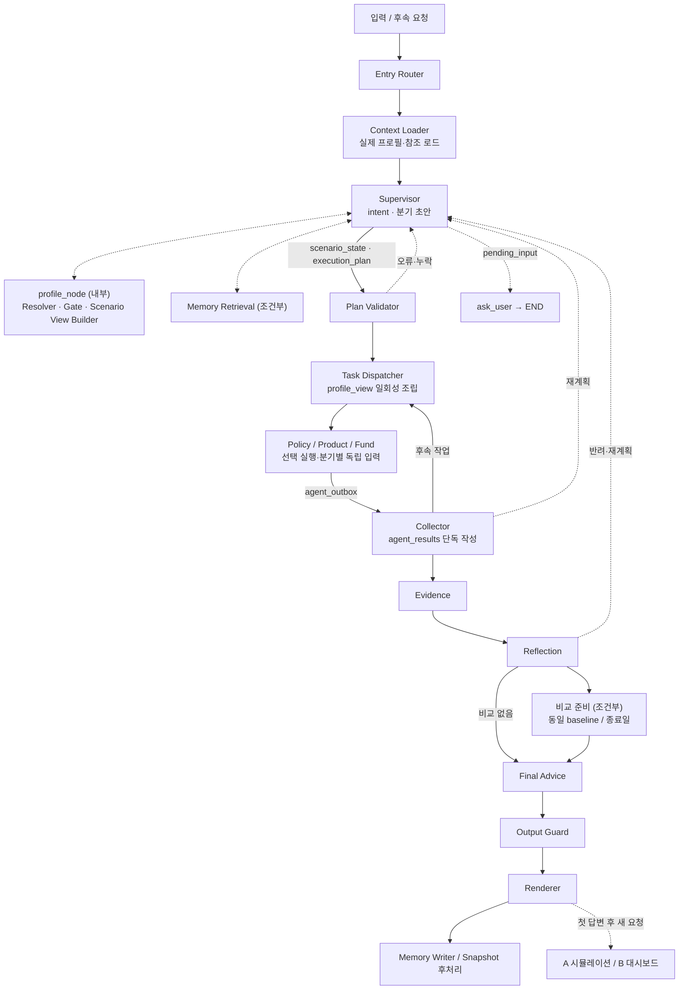

# 청년 금융 Multi-Agent State 압축 설계안 v3.3

> **목표:** 개발자가 **단일 실제 프로필 → 선택적 임시 시나리오 프로필 → 전문 실행 → 검증·비교**를 일관된 State 계약으로 구현할 수 있게 한다. 공용 최상위 State **20개는 유지**한다.
>
> **문서 분담:** 이 파일은 **State / 입출력 / 생명주기 / 검증 계약**의 기준이다. 노드 배치·메인 실행 흐름·책임 구분은 [`멀티에이전트_설계안.md`](./멀티에이전트_설계안.md)의 **§1 그래프**를 단일 표준으로 사용한다.
>
> **v3.3 변경:** Supervisor가 비교 분기 초안을 제시하고, Supervisor 내부 `profile_node`의 **Scenario View Builder**가 실제 가입 현황을 확인하여 분기별 **변경 명세**를 준비한다. Supervisor만 최종 `scenario_state.scenarios[]`와 `execution_plan`을 확정한다. Profile Node가 **별도 LangGraph 노드**로 실행되면 준비 응답은 기존 `scenario_state.preparation`에 임시 전달한다. Dispatcher는 작업 직전에 임시 `profile_view`를 생성한다.
>
> **유지:** 기존 `policy/product/fund` 전문 Agent, `agent_outbox → Collector`, Evidence/Reflection, Final/Guard/Renderer, 후속 A/B, 저장 목표 `basic_profile.goals[]`, 추천 후보 `final_advice.sections[].candidate_refs[]`를 유지한다. `housing` Agent는 없다.
>
> **저장 경계:** 실제 상품 가입·납입 내역은 서비스 DB(예: Neo4j)의 **사용자별 계약/가입 기록**을 기준으로 한다. `memory`는 과거 대화·선택 참조이고 **실제 가입의 근거 저장소가 아니다**. 가상 유지·해지·가입 행동은 절대 실제 계약을 실행하지 않는다.

### 개발자를 위한 빠른 읽기 순서

1. **§1~§2**: 기존 20개 Main State와 실제 프로필 유지 규칙
2. **§3.1~§3.6**: 비교 요청 해석, 시나리오 정의, Profile Node의 임시 프로필 준비 계약
3. **§4**: `execution_plan.tasks[]`, Dispatcher → Agent → Collector 계약, 공통/분기별 조회 결과 재사용
4. **§5~§7**: Final 연결, 근거 검증, 초기화/재개/보안
5. **§8~§10**: Python State 선언, 구현 변경표, 필수 회귀 테스트

### v3.2 대비 확정된 변경만 요약

| 구분 | v3.3 처리 | 비고 |
|---|---|---|
| 실제 프로필 | 1개 유지, 저장된 목표도 보존 | 기존 `basic_profile`, `financial_profile` |
| 임시 프로필 | 시나리오별 변경 명세와 실행 시점 View | 새 Main State Key 없음 |
| 시나리오 | `scenario_state.scenarios[]`에 `assumptions.holding_actions[]` 선택 추가 | 필요 시 최대 3개 |
| 실제 계약 시점 | 서비스 저장소의 `baseline_ref`/`as_of`로 공통 기준 고정 | 과거 납입 기간 소실 방지 |
| 후보 vs 전략 | Product/Policy 후보, Fund `data.strategy_options[]`(선택) | 후보 한 개마다 시나리오 생성 금지 |
| 전문 계산 | Product는 계약·금리·해지 조건, Policy는 혜택·환수, Fund는 현금흐름 | Profile은 손익 계산하지 않음 |
| 결과 비교 | `scenario_id`로 분기 격리; 동일 평가 시점/초기 자산 검증 | 기존 Collector/Reflection 활용 |

---

## 0. 설계 범위와 핵심 판단

### 0.1 구현하려는 서비스

- **Policy Agent:** 청년 지원금·세제 혜택·이자 지원 등 정책의 **혜택 탐색·조건부 자격 검토·예상 수혜 효과 및 공식 안내/신청 URL** 제공
- **Product Agent:** 대출·적금·예금 등 금융상품의 **금리·기간·한도·예상 수익/상환 부담 비교**, 정책 연계 상품의 실제 상품 조건 분석
- **Fund Agent:** 소득·지출·자산·부채를 활용한 **기초 재무 진단과 사용자가 입력한 목표(`goals[]`)별 자금 계획**. 단독 실행 또는 선택적 연계
- 사용자가 요청할 때만 **가정 시나리오 비교**, 지난 상담 이어가기, A(시뮬레이션)/B(대시보드) 제공
- 공식 정책·상품 자료는 **Neo4j/원문 저장소의 출처 참조**로 연결. 전문 Agent는 외부 API를 직접 조회하지 않는 기존 수집/적재 방식을 따른다.

**범위 경계:** 주택 마련·전세 보증금은 **사용자 금융 목표**로 유지한다. 전세대출·주택담보대출은 Product, 주거 관련 지원 정책은 Policy, 필요 자금·저축 계획은 Fund 담당이다. **부동산 매물·시세·입지 검색 및 Housing Agent는 제외한다.**

**Main State에 설계하지 않는 것:** 근로·계좌·소득원별 상세 이력 장부(단, 필요한 가입·납입 기록은 별도 사용자 서비스에서 조회), 금융기관 수준의 소득 인정액 자동 판정, 거래 내역 수집, 다수 소득원의 기간별 중첩 계산, 복잡한 프로필 기간 패치 엔진, 자동 대출 승인·계약·정책 신청 실행.

### 0.2 핵심 원칙

1. **처음부터 모든 항목을 입력받지 않는다.** 일반 안내는 프로필 없이도 가능하다.
2. 공용 프로필은 **현재 상담에 필요한 대표값**만 저장한다. 직업·고용 형태·입사일·계약 만료일 등은 기본값으로 수집하지 않는다.
3. **Supervisor 내부 Profile Node**가 개인화 상담에 필요한 최소 프로필의 등록·누락·변경을 점검한다. 특정 정책·상품에서만 필요한 요건은 **해당 전문 Agent가 그때 질문**하며, 공용 프로필 스키마를 늘리지 않는다.
4. **일회성 입력 / 저장된 실제 프로필 / 가상 시나리오**를 분리한다. 일회성 입력과 가정은 자동으로 영속 저장하지 않는다.
5. 모르는 값은 `null` 또는 미기재로 둔다. **미확인 ≠ 0**이며, 정보를 임의 추정해 자격·대출 가능 여부를 확정하지 않는다.
6. **세후 월소득**(생활비·저축 계산)과 **세전 연소득**(필요한 정책 조건)은 별개로 다룬다. 한쪽을 다른 쪽의 확정값으로 자동 환산하지 않는다.
7. Main Supervisor는 **분기·조율**만, 전문 Agent는 **탐색·계산**을, Final Advice는 **검증된 결과 설명**을 담당한다.
8. 정책 **혜택·지원 기간·자격**, 상품 금리·한도·가입 조건의 주요 주장은 **해당 값·단위(해당 시)·출처·기준일**을 전문 Agent 결과에 연결한다. 공식 URL은 원본에 있을 때만 표시한다.
9. 같은 요청의 검증 반려는 **이전 출력 참조와 반려 사유만** 다음 실행에 전달한다. 기존 출력 전문을 공용 State에 복제하지 않는다.
10. 대시보드의 차트 수치·근거는 기존 Agent 결과와 `final_advice`에서 읽고, **장기 보관·실적 이력은 State가 아닌 서비스 계층**에서 수행한다.
11. **사용자가 등록·저장한 목표(`basic_profile.goals[]`)는 Agent 구성과 무관하게 유지**한다. 새 turn에서 목표를 초기화하지 않으며, 새 목표 추가/일부 수정 때문에 다른 목표가 사라지지 않도록 한다. 일회성 목표와 저장 목표는 구분한다.
12. Policy/Product 결과는 필요할 때만 Fund에 연결하고, **정책 혜택·상품 이자 중복 합산 및 대출 원금의 지원금/소득 오인**을 방지한다. 추천 수락·목표 계획 반영·실제 가입/신청 상태는 서로 구분한다.
13. **하나의 저장된 실제 프로필**에서 여러 임시 View를 만든다. `keep/terminate/subscribe`와 같은 행동은 시뮬레이션 명세일 뿐, 실제 해지·가입 명령이 아니다.
14. 가입 시점·경과 기간·납입 원금·약정 만기는 **가입 현황 서비스의 과거 사실**로 조회한다. Profile은 정규화만 하고, 실제 상품 조건은 Product, 손익 계산은 Fund 담당이다.
15. **후보/전략/시나리오를 구분한다.** 유사 상품은 후보로 묶고, 서로 다른 조합은 Fund의 전략 결과로 보관한다. 별도 재무 상태에서 독립 실행해야 할 때에만 `scenario_state`를 구성한다.
16. Profile Node는 Fund Agent를 직접 호출하지 않는다. 읽기 전용 조회/정규화 도구는 공유할 수 있으나, 전문 검색·시뮬레이션은 Supervisor의 계획과 Collector 검증 경로를 거친다.


### 0.3 입력 수준

| 상담 종류 | 우선 필요한 정보 | 없으면 |
|---|---|---|
| 청년 정책 혜택·금융상품의 일반 설명 | 질문만 | 일반 설명 가능 |
| 나에게 맞는 정책 혜택/상품 탐색 | 연령·지역·대략적 목표 등 **해당 후보 필터에 필요한 값만** | 조건부 후보 또는 추가 질문 |
| 대출·적금·예금 비교 | 상품 유형·금액/기간 등 요청에 필요한 정보 | 확인 가능한 조건만 비교하고 미확정 사항 표시 |
| 기본 자산·예산 진단 | 월소득, 월 생활비, 알려진 부채 상환액 | 계산 가능한 범위만 안내 |
| 목표 등록·저장/수정 | 사용자가 지정한 목표 유형·금액/기한(알려진 것)과 저장 의사 | 모르는 값은 `null`, 저장 의사는 필요 시 확인 |
| 장기 목표 로드맵 | 저장된 목표 또는 이번 상담 목표, 재무 상황 | 목표가 불명확한 부분은 질문 또는 일반 계획 |
| 특정 정책 **자격 확인** | 해당 정책 원문의 필수 조건(예: 세전 소득, 무주택 여부 등) | `needs_check`로 표시하고 필요한 조건만 질문 |
| 기존 가입 적금 유지 + 추가 가입 | 기존 계약의 현재 납입액·남은 기간과 신규 납입 가능액 | 단일 프로필·단일 실행으로 가능, **별도 시나리오는 필수가 아님** |
| 기존 가입 적금 유지 vs 해지 후 교체 | 실제 계약 기준일/과거 납입액, 약정·중도해지 조건, 신규 상품 조건 | **분기별 임시 View**로 비교; 필수 미확인 값만 질문 |
| 복수 목표·복수 방법 | 목표 간 가용액 공유·우선순위, 필요할 때만 상품/혜택 조회 | Fund의 공동 제약 분석; 모든 후보를 시나리오로 만들지 않음 |


위 항목도 **서비스 전체의 회원가입 필수 입력**을 뜻하지 않는다. 각 요청에 필요한 경우에만 수집한다.

---

## 1. Main Supervisor State — 최상위 구조

### 1.1 최상위 State 20개 — 타입·생존 범위·작성 주체

> **선언된 20개 Key를 매 요청 모두 채우는 것은 아니다.** `TypedDict(total=False)`를 사용하며, 상담 중 유지되는 정보와 요청별로 초기화하는 정보를 분리한다. `agent_outbox`는 별도의 내부 병렬 수집 채널이다.

| Main State Key | 타입 | 생존 범위 | 내용 · 주 작성 주체 |
|---|---|---|---|
| `messages` | `Annotated[list[BaseMessage], add_messages]` | 상담 | 현재 스레드 메시지 · 입출력 계층 |
| `conversation_summary` | `str` | 상담·조건부 | 긴 대화 요약 · 요약 처리 |
| `consultation_id` | `str` | 상담 | 스레드 식별 · Entry Router/서비스 |
| `turn_id` | `str` | 요청(추가 입력 재개 시 유지) | 요청 식별 · Entry Router |
| `phase` | `str`(enum) | 요청 | 진행 단계 · 제어 노드 |
| `basic_profile` | `dict[str, Any]` | 상담 | 기본정보·**사용자가 저장한 목표(`goals[]`)** · Context Loader/내부 Profile Node |
| `financial_profile` | `dict[str, Any]` | 상담 | 소득·지출·자산·부채 · Context Loader/내부 Profile Node |
| `scenario_state` | `dict[str, Any] \| None` | 요청·조건부 | Supervisor의 비교 분기·가정; Profile Node는 `preparation` 임시 부분만 갱신 가능 |
| `memory` | `dict[str, Any]` | 상담 참조 + 요청별 조회 | 직전 답변과 과거 맥락 · Loader/Memory Retrieval |
| `intent` | `dict[str, Any] \| None` | 요청 | 목적·이번 입력·저장 상태 · Supervisor/내부 Profile Node |
| `execution_plan` | `dict[str, Any] \| None` | 요청·조건부 | 작업·의존성·실행 ID · Supervisor/Dispatcher/Collector |
| `pending_input` | `list[dict[str, Any]]` | 요청·조건부 | 추가 질문과 재개 대상 · Supervisor/내부 Profile Node/Collector |
| `agent_results` | `dict[str, dict[str, Any]]` | 요청·조건부 | 전문 Agent의 최신 유효 결과 · Collector |
| `review_results` | `dict[str, dict[str, Any]]` | 요청·조건부 | 실행별 Evidence/Reflection 검증·반려 사유 · 검증 노드(순차) |
| `superseded_results` | `dict[str, dict[str, Any]]` | 요청·조건부 | 이전 실행의 조회 참조·최소 오류 요약 · Collector |
| `final_advice` | `dict[str, Any] \| None` | 요청(후속 참조 가능) | 검증된 상담 답변 · Final Advice/Guard |
| `post_response` | `dict[str, Any] \| None` | 후속·조건부 | A/B 요청과 기준 답변 · 후속 처리 |
| `basic_profile_changes` | `list[dict[str, Any]]` | 요청·조건부 | 실제 기본 프로필 저장 변경 · 내부 Profile Node |
| `financial_profile_changes` | `list[dict[str, Any]]` | 요청·조건부 | 실제 금융 프로필 저장 변경 · 내부 Profile Node |
| `memory_candidates` | `list[dict[str, Any]]` | 요청·조건부 | 실제 전달 답변의 기억 후보 · Memory Writer |

- `agent_outbox: Annotated[list[dict], append_outbox]`는 **내부 병렬 수집 채널**이며 위 20개 공용 Key에 포함하지 않는다.
- 인증 사용자 ID·토큰·권한·동의 상태는 **Runtime Context/보안 저장소**에서 관리한다.
- 세부 원자료·프로필 감사 이력·정책 조건 원문, **목표-추천 후보의 영속 연결(`goal_ref`, `candidate_id`)**은 State가 아니라 **서비스/Neo4j/원문 저장소**에서 관리한다.

### 1.2 진행 상태

`phase`: `planning / executing / waiting_for_user / composing / completed / failed`

- `planning`: 요청 분류, 필요 시 Profile·Memory 호출, 실행 계획 작성
- `executing`: 전문 Agent 실행 및 필요한 결과 검수
- `waiting_for_user`: 필요한 질문을 보내고 **END**. 다음 입력에서 동일 `turn_id`로 재개
- `composing`: 검증된 결과로 답변 생성·표시 검사
- `completed`: 첫 답변 전달 완료
- `failed`: 진행 불가. 확인된 부분만 안내

상세 Profile 내부 단계, 각 재시도 카운터, Evidence/Reflection의 개별 단계를 최상위 `phase`에 복제하지 않는다.

---

## 2. 프로필: 평평하고 간단하게

### 2.1 `basic_profile` — 기본 정보

| 필드 | 타입 | 의미 | 기본 수집 여부 |
|---|---|---|---|
| `age` | `int \| null` | 사용자가 알려 준 나이 | 개인화 필요 시 |
| `region` | `str \| null` | 거주 지역(예: 서울) | 지역 정책 상담 시 |
| `household_size` | `int \| null` | 가구원 수 | 필요한 경우 |
| `owns_home` | `bool \| null` | 주택 소유 여부 | 정책·주거 관련 대출 조건 상담 시 |
| `has_regular_income` | `bool \| null` | 정기적인 소득 유무 | 재무 상담 시 |
| `goals` | `list[goal]` | **사용자가 입력·저장한 복수 금융 목표** | 목표 등록·수정/계획 시 |
| `risk_tolerance` | `str \| null` | 위험 성향(선택) | 상품 상담에서 필요할 때 |

**제외:** 고용 이력, 가구원별 상세 정보, 주거 이력, 세부 선호 카테고리, 목표별 자산 할당 기록.

**목표(`goals[]`)의 최소 형식 — v3.0과 동일하게 유지**

> **Housing Agent를 제거해도 `home_purchase`를 삭제하지 않는다.** 목표 타입은 사용자의 자금 목표를 나타내며 Agent 이름이나 부동산 검색 기능을 뜻하지 않는다. 적금·예금·대출은 목표 달성을 돕는 상품이며, 사용자 목표 자체는 Product/Policy/Fund보다 상위의 프로필 정보다.

| 필드 | 의미 |
|---|---|
| `type` | `home_purchase / savings / emergency_fund / debt_payoff / other` |
| `amount_krw` | 목표 금액. 모르면 `null` |
| `amount_type` | 주택 **총가격**인지 필요한 **자기자금**인지 등 금액의 의미. 금액이 있으면 명시 |
| `target_year` | 목표 연도. 모르면 `null` |
| `priority` | 복수 목표에 우선순위가 있을 때만 선택 |

목표 ID, 상태 이력, 제약 객체, 자산 배정 목록은 **공용 State에 두지 않는다**. 동일한 목표를 반복 저장·수정해야 하는 경우의 안정적인 `goal_ref`는 **프로필/목표 저장 서비스**에서 관리하고, 대시보드 수치와 연결할 때만 참조한다. 상담 중 일회성 목표는 `goal_ref` 없이도 다룬다.

**목표 유지·변경 규칙**
- 사용자가 **저장**한 목표는 기존 `basic_profile.goals[]`를 통해 다음 turn에서도 읽으며, 새 요청 초기화 시 `goals[]`를 비우지 않는다. 다른 Agent를 실행하거나 주택 관련 대출을 검색하더라도 목표 목록 자체가 변경되지는 않는다.
- **신규 목표 추가**는 기존 목표 보존을 기본으로 한다. **기존 목표 수정·삭제**는 어느 목표인지 사용자 의도로 식별한 경우에만 적용한다. 목표가 여러 개이고 대상이 모호하면 확인한다. `goals[]` 전체를 빈 목록/부분 목록으로 **무심코 덮어쓰지 않는다**.
- 입력 페이지의 **저장** 동작이나 사용자의 명시적 저장 지시가 있으면 Supervisor 내부 Profile Node와 저장 서비스를 통해 등록·수정한다. 단순 상담 중 말한 목표는 `intent.supplied_values`에 임시 반영하고 영속 저장하지 않는다.
- `home_purchase`의 `amount_type`은 **주택 총가격**과 **필요 자기자금**을 구별한다. Fund는 필요한 자금을 계획하고 Product는 관련 금융상품을 비교하되, 부동산 매물 검색은 하지 않는다.
- 목표에 Policy/Product 후보를 **반영**하는 것, 추천을 **수락**하는 것, 실제 **상품 가입·정책 신청/수급**은 다른 행위다. 목표-추천 연결은 명시적 목표 반영 승인 후 서비스의 `goal_ref`·`candidate_id`로 관리한다.

### 2.2 `financial_profile` — 금융 정보

| 필드 | 타입 | 의미 |
|---|---|---|
| `monthly_net_income_krw` | `int \| null` | 세후 월평균 소득 |
| `annual_gross_income_krw` | `int \| null` | 세전 연소득. **필요할 때만 입력** |
| `monthly_living_expenses_krw` | `int \| null` | 월 생활비(월 대출 상환액은 **제외**) |
| `total_assets_krw` | `int \| null` | 사용자가 파악하는 총자산 |
| `available_assets_krw` | `int \| null` | 목표에 사용할 수 있는 자금 |
| `total_debt_krw` | `int \| null` | 남은 부채 총액 |
| `monthly_debt_payment_krw` | `int \| null` | 월 부채 원리금 상환액 |

**제외:** 계좌별 목록·소득원별 레코드·기간별 집계/이력·부채별 금리/만기/상환 스케줄·자산별 소유권/유동성 등급·`cashflow.period_summaries`·공용 프로필의 세부 검증 상태.
**기존 가입 상품은 예외적으로 서비스 저장소에 별도 관리한다.** 이는 `financial_profile`에 계좌별 목록을 넣겠다는 의미가 아니다. 사용자에게 속한 가입·계약 기록(`holding_ref`, 가입일, 계약/납입 이력, 상태, 자료 출처, 조회 시점)은 조회 서비스가 보관하고, Profile Node는 **관련 일부만 조회해 정규화**한다. 이미 `total_assets_krw`에 포함된 적금 잔액을 Fund가 다시 더하지 않도록 한다.


**계산 규칙**

- 월 가용액 = `monthly_net_income_krw - monthly_living_expenses_krw - monthly_debt_payment_krw`
- 월 생활비가 이미 상환액을 포함한다면 **한 번만 빼도록 사용자에게 확인**한다.
- 부채 상환액이 **미확인**이면 이를 `0`으로 간주해 확정 월 가용액을 만들지 않는다. 사용자가 부채가 없다고 명시한 경우만 `0`을 쓴다.
- 총자산과 사용 가능 자금은 구분한다. `available_assets_krw`를 모르면 `total_assets_krw` 전체를 가용 자금으로 가정하지 않는다.
- 위 파생값은 **Fund Agent 또는 계산 도구에서 필요할 때 산출**한다. 프로필에 중복 저장하지 않는다.
- 복수 소득원·상세 상환표가 필요한 고급 계산은 **v3.3 기본 범위 밖**이며, 별도 도구 또는 확장 기능으로 다룬다.
- `financial_profile`은 **현재 대표값**만 유지한다. 과거 잔액·월별 실적은 대시보드가 필요할 때 기존 서비스 저장소에서 조회하며, State에 시계열 목록을 새로 만들지 않는다.

### 2.3 간단한 예시

```json
{
  "basic_profile": {
    "age": 27,
    "region": "서울",
    "household_size": 1,
    "owns_home": false,
    "has_regular_income": true,
    "goals": [
      {
        "type": "home_purchase",
        "amount_krw": 80000000,
        "amount_type": "required_equity",
        "target_year": 2031
      },
      {
        "type": "savings",
        "amount_krw": 10000000,
        "amount_type": "savings_goal",
        "target_year": 2028
      }
    ],
    "risk_tolerance": null
  },
  "financial_profile": {
    "monthly_net_income_krw": 3200000,
    "annual_gross_income_krw": null,
    "monthly_living_expenses_krw": 1800000,
    "total_assets_krw": 15000000,
    "available_assets_krw": 15000000,
    "total_debt_krw": 10000000,
    "monthly_debt_payment_krw": 350000
  }
}
```

> 금액은 구조 설명을 위한 가상값이다. `null` 항목을 채우기 위해 불필요한 질문을 하지 않는다. 나이는 입력 시점 기준 정보이므로 자격의 기준일과 어긋나거나 경계 연령이면 해당 정책 판단 과정에서 재확인한다.

### 2.4 개인정보 입력과 저장의 구분

| 입력 | 사용할 위치 | 실제 프로필 영속 변경 |
|---|---|---|
| "월급은 320만 원이고 생활비는 180만 원이야. 계산해줘." | Supervisor → 필요 시 내부 Profile Node에서 입력 정리 → `intent.supplied_values` | **하지 않음**. 별도 저장 요청/동의가 있을 때만 |
| 입력 페이지에서 **저장** 버튼을 누르거나 "내 월급을 350만 원으로 저장해줘" | Supervisor 내부 Profile Node → 확인·저장 → 새 스냅샷 | **함** |
| "내년에 월급이 350만 원이면?" | `scenario_state.scenarios[].overrides` | **하지 않음** |
| "5년 뒤 집 마련 자금 8천만 원을 모으고 싶어. 계산해줘." | `intent.supplied_values.goals`(이번 상담 목표) → 필요 시 Fund/Product | **하지 않음**. 저장 의사 없으면 일회성 목표 |
| 목표 입력 화면의 **저장** 또는 "이 목표를 저장해줘" | 내부 Profile Node → 목표 저장 서비스 → 갱신된 `basic_profile.goals[]` 재조회 | **함**. 기존 다른 목표는 보존 |
| "저장된 목표의 기한을 2032년으로 바꿔줘" | 내부 Profile Node에서 대상 목표 확인 → 저장 서비스에서 해당 목표만 수정 → 재조회 | **함**. 다른 목표는 보존 |
| "추천 적금을 이 목표에 반영해줘" | Supervisor가 대상 목표·후보·반영 의사를 확인한 뒤 서비스/필요 시 Profile Node 처리 | **반영에 승인 필요**. 실제 가입 아님 |
| "대출에 근속 기간이 필요하대." | Product Agent의 추가 입력 View | 기본 프로필에 새 필드 등록 **하지 않음** |
| 개인화 상담에 필요한 기본정보가 아직 없음 | Supervisor → 내부 Profile Node에서 **등록 상태·현재 상담에 필요한 최소 필드**만 점검 → 필요 시 `pending_input` | 저장하려면 사용자의 저장 의사를 확인. 일반 안내는 등록 없이도 진행 |

이번 상담에 명시한 실제 정보가 기존 저장 프로필과 다르면, **이번 상담에서는 새로 입력한 값이 우선**하되 저장 프로필을 자동 수정하지 않는다. 두 값의 충돌로 중요한 자격 판단이 달라진다면 확인 질문을 한다.

---

## 3. 이번 요청의 간단한 상태

### 3.1 `intent`

```json
{
  "purpose": "financial_roadmap",
  "operation": "new",
"analysis_mode": "roadmap",

  "supplied_values": {
    "monthly_net_income_krw": 3200000,
    "monthly_living_expenses_krw": 1800000
  },
  "profile_update_status": "not_needed",
  "target_advice_ref": null
}
```

| 필드 | 용도 |
|---|---|
| `purpose` | 질문의 핵심 목적. Agent 이름이 아니라 업무 목적 |
| `operation` | `new / continue / revise / compare / explain` |
| `analysis_mode` | 선택값: `candidate_compare / strategy_compare / roadmap`. 없으면 기존 `purpose`·`operation`으로 판단. 시나리오 분기 여부와 별개 |
| `strategy_preference` | 사용자가 명시한 경우에만 적용하는 선택적 전략 제한(예: 대출 제외, 기존 적금 유지) |

| `supplied_values` | **이번 상담에 한해** 사용자가 말한 실제 값·조건(선택) |
| `profile_update_status` | `not_needed / pending / waiting / done` |
| `target_advice_ref` | 이전 상담 수정·설명 시 대상 답변 참조(필요할 때만) |

- v2.4의 `change_signals[]`, 신호별 `resolution`, `missing_information`, `comparison_mode`, 다중 출력 목적 장부를 **삭제**한다.
- `profile_update_status`는 **영속 저장 요청에 대한 처리 상태**이며, 단순 등록 여부 점검이나 일회성 입력 처리의 완료 플래그가 아니다. 저장 중복은 `change_id`로 방지하고, 입력 대기는 `pending_input`으로 관리한다.
- Supervisor는 필요 시 **내부 Profile Node**를 호출해 기본 등록 여부·공통 필수값 누락·새 프로필성 입력을 확인한다. 단순 가정의 `scenario_state` 작성과 실행 계획은 Supervisor 책임이며, 실제/가상 구분이 모호할 때 Profile Node가 해석을 돕는다.
- `supplied_values`는 사용자가 명시한 값만 기록하고 추론한 값을 사용자 진술처럼 넣지 않는다.
- **목표 입력의 일회성 사용:** `supplied_values.goals`는 이번 상담에서 명시한 목표에 한해 사용한다. 저장 목표를 함께 활용할 때는 **추가/수정/전체 교체라는 사용자 의도에 따라** `profile_view.goals`를 구성한다. 일반 딕셔너리 덮어쓰기로 기존 `basic_profile.goals[]`를 삭제하지 않는다.
- **목표 저장·변경은** `intent.profile_update_status`와 `basic_profile_changes[]`로 기존 프로필 변경 절차를 따른다. 별도 `goal_state`나 새 최상위 Key는 만들지 않는다.
- **비교의 차원:** `analysis_mode`는 **어떤 결과(후보/전략/로드맵)를 원하는지**이고, `scenario_state`는 **어떤 재무 가정 또는 행동 차이를 분기해서 실행할지**이다. 후보 5개는 시나리오 5개가 아니다. 조건이 같아도 상품 조합을 비교할 수 있다.
- **Supervisor 계획 두 단계:** 초기에 비교 분기 초안을 작성한다. **별도 `profile_node`로 이동해야 하면** 기존 `scenario_state.preparation.branch_requests[]`로 요청을 전달하고, 같은 Supervisor 노드 안에서 Profile 도구를 호출하는 경우에는 로컬 인자로 전달한다. Profile 응답을 검토한 뒤 최종 `scenario_state.scenarios[]`·`execution_plan`을 확정하며 `preparation`은 삭제한다. 신규 공용 최상위 Key는 만들지 않는다.


### 3.2 `scenario_state` — 사용자 실제 프로필 1개, 실행 분기 N개

**가정·행동 변경이 없으면 `None`**이다. 하나의 기본 프로필에서 **서로 다른 임시 재무 상태로 분석해야 할 때**에만 사용하며, 기본 최대 3개다. 단순 상품 후보 검색이나 기존 상품 유지 + 추가 적금 추천은 시나리오 없이도 가능하다.

```json
{
  "baseline_ref": "holding_snapshot_001",
  "scenarios": [
    {
      "id": "s_keep",
      "label": "기존 3% 적금 유지",
      "overrides": {},
      "assumptions": {
        "horizon_months": 24,
        "holding_actions": [
          {"holding_ref": "holding_01", "action": "keep"}
        ]
      }
    },
    {
      "id": "s_switch",
      "label": "기존 적금 해지 후 새 적금 가입",
      "overrides": {},
      "assumptions": {
        "horizon_months": 24,
        "holding_actions": [
          {"holding_ref": "holding_01", "action": "terminate"},
          {
            "action": "subscribe",
            "target_criteria": {"annual_rate_pct": 5.0, "term_months": 24},
            "status": "hypothetical"
          }
        ]
      }
    }
  ]
}
```

> **예시 데이터:** 위 `holding_ref`·`baseline_ref`는 설명용 ID다. `annual_rate_pct=5.0`은 사용자가 제시한 목표 조건이고, **상품 존재·가입 자격·실제 적용 금리를 확인한 값이 아니다**. Product 조회 후 수락된 `candidate_id`를 Fund 작업의 `upstream_results`에서 선택/연결한다. 조회 전에는 존재하지 않는 후보 ID를 임의로 생성하지 않는다.

| 필드 | 규칙 | 작성 주체 |
|---|---|---|
| `baseline_ref` (선택) | 인증 사용자의 실제 가입 현황을 **동일 기준일·버전으로 고정**한 조회 가능한 참조. 사용할 수 없으면 필요한 값의 출처·기준일을 각 작업 입력에 명시 | Context Loader/조회 서비스 → Supervisor 참조 |
| `scenarios[].id / label` | 같은 요청 안에서 유일한 ID 및 표시명 | Supervisor |
| `overrides` | 소득·지출 등 허용된 대표 프로필 필드의 **시나리오 전용 변경** | Supervisor, Profile 해석 참조 |
| `assumptions.holding_actions[]` | 기존 계약 `keep/terminate`, 가상 신규 `subscribe` 등의 **경제적 행동 가정** | Profile이 유효성·참조 확인 후 Supervisor가 확정 |
| `assumptions.horizon_months` | 분기간 동일 평가 기간(필요 시) | Supervisor |
| `assumptions`의 기타 값 | 미래 금리·기간 등 프로필이 아닌 가정 | Supervisor |

**생성·실행 규칙**

1. Supervisor는 질문에서 분기 초안을 결정한다. Profile Node는 저장 프로필·기존 가입 상태를 조회하고, 제안된 분기의 `holding_ref`, 행동 유형과 필수 정보의 **정합성만 확인·정규화**한다.
2. Profile Node는 `ScenarioPreparation`(§3.6)을 준비한다. 별도 LangGraph 노드라면 기존 `scenario_state.preparation`을 통해 Supervisor에 전달하고, **Supervisor가 최종 `scenarios[]`를 확정**한다. **실제 저장 프로필을 복제·변경하지 않는다.**
3. Dispatcher가 전문 작업 직전에 `profile_view = 실제 프로필 + supplied_values + 해당 overrides + 읽기 전용 holding snapshot + scenario actions`를 **일회성으로** 조립한다. `holding_snapshot`은 서비스에서 권한 검증 후 조회하고, 시나리오 간에는 불변이다.
4. Profile은 기존 계약의 가입일·경과 1년·과거 납입액 등 **실제 사실**만 정리한다. Product가 중도해지·우대 조건을 확인하고 Fund가 손익·미래 현금흐름을 계산한다.
5. `holding_actions`는 가입/해지 **실행 명령이 아니다**. 이 값으로 가입 상태/부채/실제 적금 계약을 저장하거나 외부 금융기관에 요청하지 않는다.
6. 시나리오가 바뀌면 해당 분기에 연결된 작업의 `run_id` 및 검수를 무효화한다. 모든 분기는 같은 실제 기준 시점에서 출발하고, 비교할 수 없는 조건·시점은 Final에 경고로 표시한다. 분기 조합이 3개를 초과하면 필요한 경우만 우선 평가하거나 후속 요청으로 나눈다.

**후보·전략·시나리오의 구분**

- **후보(Candidate):** Product/Policy가 반환한 개별 상품·정책. 후보 수만큼 시나리오를 만들지 않는다.
- **전략(Strategy):** 상품 조합 또는 목표 달성 방법. Fund `data.strategy_options[]`는 필요할 때만 사용한다.
- **시나리오(Scenario):** 서로 다른 미래 행동/가정을 적용해 **독립된 임시 금융 상태로 계산할 필요가 있는 실행 분기**. 동일한 유지/해지 계산 결과를 `strategy_options`에 다시 복제하지 않고 `scenario_id`로 연결한다.

### 3.3 `pending_input`

Supervisor 내부 Profile Node나 전문 Agent가 **현재 상담에 꼭 필요한 값**을 얻지 못했을 때만 만든다.

```json
[
  {
    "id": "ask_01",
    "question": "해당 정책의 자격을 확인하려면 세전 연소득이 필요해요. 알려주실 수 있나요?",
    "fields": ["annual_gross_income_krw"],
    "target": "task_policy_01",
    "scenario_id": null,
    "status": "pending"
  }
]
```

**필드:** `id`, `question`, `fields[]`, `target`, 선택 `scenario_id`, `status(pending/resolved)`, 필요 시 `answers{}`.

- `target`은 `profile`(**Supervisor 내부 Profile Node로 복귀**)·`supervisor` 또는 전문 작업 ID다.
- 재개는 **다음 사용자 메시지 → Entry Router → Supervisor → 해당 작업**으로 처리한다.
- `pending_input`의 일시적 답변은 해당 작업 입력에만 전달한다. 근속 개월·혼인 세부 요건 등은 **기본 프로필에 자동 추가하지 않는다**.
- 여러 질문을 해야 할 때도 동일 목적의 항목만 묶어 묻는다.
- 기존 가입 여부·1년 납입액·현재 잔액·만기일 등 **비교 수치에 결정적이지만 확인되지 않은 항목만** 묻는다. 다른 시나리오에서 이미 확인한 동일한 사실은 다시 묻지 않는다.
- 특정 시나리오에만 필요한 질문이라면 기존 `scenario_id`를 반드시 채운다. 선택적으로 `holding_ref`나 `candidate_id`를 붙일 수 있지만 이를 새 공용 목록으로 만들지 않는다.
- 체크리스트/서류 준비는 **사용자가 신청을 진행하겠다는 의사를 보였을 때만** 별도 서비스에서 활성화한다. `pending_input`은 가입 절차 체크리스트가 아니라 **현재 상담에 필요한 질문**이다.

- **삭제:** `signal_ids`, `change_ids`의 복합 연결, 필드별 기간/레코드 ID, `resume_ref`, 상세 입력 타입 레지스트리.

### 3.4 `basic_profile_changes` / `financial_profile_changes`

**프로필을 실제로 저장·변경할 때만** 사용하는 일시적 목록이다.

```json
{
  "financial_profile_changes": [
    {
      "change_id": "change_01",
      "field": "monthly_net_income_krw",
      "value": 3500000,
      "status": "applied"
    }
  ]
}
```

- 상태: `pending / needs_confirmation / applied / rejected / failed`.
- 명시적 저장 지시나 입력 페이지의 저장 동작은 사용자 승인으로 취급할 수 있다. 해석이 모호하거나 충돌하면 확인을 요청한다.
- 저장 서비스는 `change_id`로 **중복 저장을 방지**하고, 성공 후 프로필을 다시 읽는다.
- 저장 원본의 버전/감사로그는 **서비스 저장소**에서 처리하며 State에 레코드별 이력으로 복제하지 않는다.
- **목표 등록/수정/삭제도 `basic_profile_changes[]`를 이용**한다. `field="goals"`를 사용할 경우 해당 저장 명령이 적용된 **완전한 목표 목록**을 `value`로 전달하고, 부분 편집만 보고 나머지 목표를 지우지 않도록 저장 서비스에서 대상 `goal_ref`(가능한 경우)를 확인·병합한다. 새 Main State Key를 만들지 않는다.
- 시나리오의 가정값은 이 목록에 넣지 않는다. 새 요청에서는 이전 변경 후보를 초기화하되 **성공적으로 저장된 `basic_profile.goals[]`는 초기화하지 않는다**.

### 3.5 Supervisor 내부 `profile_node` — Resolver / Gate / Scenario View Builder

`profile_node`는 기존 **Supervisor Graph 안의 조건부 LangGraph 노드 한 개**다. 내부 Resolver·Gate·Scenario View Builder는 함수 또는 LangChain 체인 단계이며 별도의 상위 Agent/전문 Agent가 아니다.

| 내부 처리 | 조건 | 입력 / 반환 | 금지 경계 |
|---|---|---|---|
| **Resolver** | 개인화·등록·실제/가상 구분·가입 정보 해석 필요 | `messages`, `intent`, 등록된 기본/금융 프로필, 필요한 `pending_input` → 정규화/누락 판정 | 이력에서 실제 가입을 임의 확정하지 않음 |
| **Gate** | 사용자가 프로필/목표의 **실제 저장**을 지시·승인했을 때 | `*_profile_changes`, 저장 결과와 재조회된 프로필 | 임시 시나리오로 프로필 자동 저장 금지 |
| **Scenario View Builder** | Supervisor가 서로 다른 행동/가정을 비교하기 위해 명시적으로 준비 요청 | `ScenarioPreparation` 초안, 동일 기준 `baseline_ref`, 부족 항목 → Supervisor 반환 | 실제 자금 계산, 상품 검색, Fund Agent 직접 호출 금지 |

**시나리오 준비를 위한 읽기 전용 공통 도구(예시)**

- `get_holdings_snapshot(user_context, as_of)`: 계약·가입 기록, 상품 식별, 납입 상태를 **인증된 사용자 범위에서만** 조회
- `get_contribution_history(holding_ref)`: 실제 납입 이력·누적 납입원금·가입/만기 기준일 등 필요한 사실 조회
- `normalize_holding_inputs(...)`: 날짜·금액·상태·출처를 통일하며, 모르는 값은 `None` 유지
- `build_scenario_profile_view(...)`: 현재 작업의 임시 입력을 조립하는 **순수 함수**. 저장 작업·이자 계산 없음

Profile Node가 Fund Agent 또는 Fund의 **금융 계산 도구**를 내부에서 호출하지 않는다. 읽기 전용 계약 조회·정규화 유틸리티는 Profile, Dispatcher, Fund가 공통 사용해도 되지만, `calculate_early_termination` 등 수익 계산은 **Supervisor → Dispatcher → Fund → Collector** 경로로만 호출한다.

Profile Node는 최종 시나리오 정의를 확정하거나 `execution_plan.tasks[]`를 만들지 않는다. 데이터가 불완전해도 분기를 미리 버리지 않고 **필요 시 `pending_input` 또는 미확정 경고**를 제안한다. 최종 수용·재계획 책임은 Supervisor에 있다.

### 3.6 Supervisor ↔ Profile Node 시나리오 준비 계약 (임시 전달 계약)

**입력 — `ScenarioPreparationRequest` (Main State 최상위 Key 아님)**

```json
{
  "purpose": "compare_existing_savings",
  "branch_requests": [
    {"id": "s_keep", "label": "기존 적금 유지", "holding_actions": [{"holding_ref": "holding_01", "action": "keep"}]},
    {"id": "s_switch", "label": "중도해지 후 교체", "holding_actions": [{"holding_ref": "holding_01", "action": "terminate"}, {"action": "subscribe", "target_criteria": {"annual_rate_pct": 5.0, "term_months": 24}}]}
  ]
}
```

**출력 — `ScenarioPreparation` (Profile Node가 작성, 아래의 명시적 전달 경계에 따라 Supervisor로 전달)**

```json
{
  "baseline_ref": "holding_snapshot_001",
  "branch_specs": [
    {"id": "s_keep", "status": "ready", "holding_actions": [{"holding_ref": "holding_01", "action": "keep"}]},
    {"id": "s_switch", "status": "conditional", "holding_actions": [{"holding_ref": "holding_01", "action": "terminate"}, {"action": "subscribe", "target_criteria": {"annual_rate_pct": 5.0, "term_months": 24}}]}
  ],
  "missing_inputs": ["월 납입액 또는 납입 내역", "기존 계약 중도해지 조건 확인 필요"]
}
```

- `status=conditional`은 **준비 가능한 분기이지만 정확한 계산/실행에는 추가 조건 확인이 필요**하다는 뜻이다. 상품 자격의 `eligible` 확정과 혼용하지 않는다.
- 실제 가입 여부가 확인되지 않았으면 기록의 `source=user_reported/verified`를 구분하며, 저장된 가입 기록이 없는 경우 일회성 사용자 입력으로 진행할 수 있다. 사용자가 '가입하고 싶다'고만 했다면 **가입 완료로 취급하지 않는다**.
- `missing_inputs` 중 조회로 해결되는 계약 조건은 Product 작업으로 배정하고, 사용자만 알 수 있는 필수값만 `pending_input`에서 묻는다.
- **기존 독립 LangGraph 노드(`supervisor → profile_node → supervisor`) 방식:** Supervisor는 먼저 `scenario_state.preparation={"branch_requests": [...], "status":"requested"}`를 작성해 Profile에 전달한다. Profile은 같은 기존 Key의 `preparation`을 `{"baseline_ref":..., "branch_specs":..., "missing_inputs":..., "status":"prepared"}`로 갱신한다. Supervisor가 복귀해 검사한 뒤 `scenario_state={"baseline_ref":..., "scenarios":[...]}`를 확정하면서 **`preparation`을 제거**한다.
- **Supervisor 안에서 도구/Runnable로 호출하는 방식:** 동일 함수가 `ScenarioPreparation`을 직접 반환하므로 노드 사이 전달용 `preparation` 필드가 필요 없다. **현재 v3.2의 별도 `profile_node`를 유지한다면 위의 첫 번째 방식을 사용**한다.
- **LangGraph 구현 주의:** `scenario_state`는 top-level dict Key이므로 노드가 업데이트할 때 중첩 dict가 자동 병합된다고 가정하면 안 된다. 현재 준비 내용 전체를 보존해 갱신하고, Dispatcher에는 `status="prepared"` 중간값이 아닌 **Supervisor가 확정한 `scenarios[]`만** 전달한다. `prepared_profiles` 등 신규 최상위 Key는 추가하지 않는다.

## 4. 실행 계획·전문 결과·검수

### 4.1 `execution_plan`

```json
{
  "revision": 1,
  "review_retry_count": 0,
  "tasks": [
    {
      "task_id": "task_fund_01",
      "agent": "fund",
      "objective": "현재 소득과 지출로 5년 목표 자금 계획",
      "scenario_id": null,
      "depends_on": [],
      "status": "pending",
      "run_id": null
    }
  ]
}
```

**공통 필드:** `revision`, 필요할 때의 `review_retry_count`(최대 1회), `tasks[]`의 `task_id / agent / objective / scenario_id / depends_on / status / run_id`.

- `status`: `pending / running / completed / needs_input / failed / skipped`.
- `depends_on`은 필수 선행만 표현한다. 선택 선행은 Supervisor가 해당 결과를 **실제로 필요한 경우**에만 추가한다.
- `tasks[].agent` 허용값은 **`policy / product / fund`**다. **`housing`은 허용하지 않는다**. Product는 전세·주택담보대출을 포함한 금융상품만 취급하며 부동산 자체 검색은 하지 않는다.
- 단일 예산·목표 계획 상담은 **Fund 하나만 실행**할 수 있다. Product/Policy를 반드시 선행하지 않는다. 정책·상품 효과가 필요한 경우에만 승인 결과를 Fund의 `upstream_results`로 전달한다.
- `run_id`는 Dispatch 때 새로 부여하고, `revision`은 같은 요청 안에서 **사용된 입력·시나리오·작업 구성**이 바뀔 때 증가한다.
- 변경 영향 범위를 복잡하게 계산하지 않는다. 변경된 시나리오의 **관련 작업 전체**를 재실행하고, 구 `run_id`의 결과·검수는 더 이상 유효하게 사용하지 않는다. 검증 반려에 따른 재실행은 **Dispatcher가 기존 `review_results`의 오류를 `revision_feedback`으로 전달한 뒤**, Collector가 교체 시 이전 결과 참조·오류 요약만 보관하고 구 검수를 무효화한다.
- 단순 재시도는 새 `run_id`로 구분한다. `revision`은 기존 규칙대로 **입력·시나리오·작업 구성이 바뀔 때만** 올린다. 교체 전 남은 구 결과도 현재 작업 `run_id`와 다르면 Final에 전달하지 않는다.
- **삭제:** `template_id` 필수화, `soft_depends_on/soft_wait_policy`, 필드별 입력 해시·서명, 기간별 Profile Slice 추적, 계획 내부의 상세 `budgets{}`와 다수 카운터.

**서버 설정으로 관리할 기본 상한:** 최대 시나리오 3개, 단일 Agent 일시 오류 재시도 1회, Reflection 재계획 1회, Output Guard 재작성 1회, 전체 작업 수/호출비용 상한. 매 요청마다 State에 모든 카운터를 만들지 않는다. Reflection 재계획 횟수만 `execution_plan.review_retry_count`로 재개 시에도 유지한다.
### 4.1.1 기존 적금 1년 유지 vs 해지 후 교체 — 실제 작업 계획 예시

```json
{
  "revision": 1,
  "review_retry_count": 0,
  "tasks": [
    {"task_id": "product_terms", "agent": "product", "objective": "기존 3% 계약 및 신규 5% 후보의 약정·해지·가입 조건 확인", "scenario_id": null, "depends_on": [], "status": "pending", "run_id": null},
    {"task_id": "fund_keep", "agent": "fund", "objective": "기존 계약 유지 시 24개월 후 자산과 현금흐름", "scenario_id": "s_keep", "depends_on": ["product_terms"], "status": "pending", "run_id": null},
    {"task_id": "fund_switch", "agent": "fund", "objective": "기존 해지 후 새 상품 가입 시 24개월 후 자산과 현금흐름", "scenario_id": "s_switch", "depends_on": ["product_terms"], "status": "pending", "run_id": null}
  ]
}
```

- **공통 조회는 1회:** 계약/신규 상품 조건이 동일하다면 `product_terms`를 한 번 실행하고, Collector가 수락한 결과를 각 Fund 작업의 `upstream_results`에서 재사용한다. 필요할 때만 `policy` 후속 작업을 추가한다.
- **분기별 실행은 의존 완료 후:** `depends_on`을 만족하는 Fund 작업을 `Send` 등으로 독립 발행하며, `scenario_id`와 `run_id`로 결과를 격리한다. Product/Policy가 Fund를 직접 호출하지 않는다.
- **계획 조정은 Supervisor:** 신규 상품이 없거나 해지 조건이 불명확하면 후보를 확정하지 않는다. 필요 시 Supervisor가 부분 재계획 또는 질문을 수행한다.
- **단일 상담 Fast Path:** 기존 적금을 유지한 채 추가 적금을 찾는 요청은 Product 후보 검색(+필요 시 Fund 월 가용액 계산)만으로 충분할 수 있다. 무조건 `scenario_state`를 생성하지 않는다.


### 4.2 전문 Agent의 최소 공통 입출력

**입력 (Dispatcher 생성, Agent마다 필요한 부분만)**

| 필드 | 의미 |
|---|---|
| `task_id`, `run_id`, `plan_revision`, `scenario_id` | 현재 작업 식별·교차 실행 결과 차단 |
| `objective`, `user_query` | 업무 목적 + 필요한 사용자 원문 |
| `profile_view` | 저장 프로필(`goals[]` 포함) + 이번 요청값 + 가정(해당 시). **필요 필드만**, 목표는 명시된 추가/수정 의도로 병합 |
| `profile_view`의 선택적 `holding_baseline` | 동일 `baseline_ref`에서 조회한 실제 계약의 **참조·가입일·납입 사실·상태·출처·as_of**. 전체 과거 거래를 전달하지 않음 |
| `profile_view`의 선택적 `holding_actions` | 현재 `scenario_id`에 해당하는 `keep/terminate/subscribe` **가상 행동**. 실제 저장 변경이 아님 |

| `upstream_results` | 필수 선행 작업의 관련 결과(있을 때만) |
| `extra_answers` | 이번 상담에 추가로 받은 정책/상품 전용 값(있을 때만) |
| `prior_advice` | 이전 **상담** 결과 수정 요청에서 필요한 부분만(있을 때만) |
| `revision_feedback` | 같은 **요청의 검증 반려 후 재실행** 시만: `previous_run_id`, 선택 `previous_output_ref`, `issues[]` |

**출력 (Collector를 통해 공용에 반영)**

```json
{
  "task_id": "task_fund_01",
  "run_id": "run_01",
  "plan_revision": 1,
  "scenario_id": null,
  "status": "completed",
  "summary": "월 가용액과 목표까지의 적립 가능성을 계산함",
  "data": {
    "metrics": [
      {"name": "monthly_surplus", "value": 1050000, "unit": "KRW/month",
       "as_of": "2026-11-19", "evidence_ref": "calc_cashflow_01", "value_kind": "estimated"}
    ],
    "roadmap": []
  },
  "evidence_refs": ["calc_cashflow_01"],
  "warnings": [],
  "needed_fields": []
}
```

- `data`의 내부 구조는 Agent가 담당하며 **공용에서 다시 세부 고정하지 않는다**. 다만 **주요 정책 혜택·금액·기간·자격, 상품 금리·한도·가입 조건, 핵심 계산값**은 해당 `data` 항목에서 값/판정, 단위(해당 시), 자료 기준일(해당 시), 개별 `evidence_ref`를 찾을 수 있어야 한다. 단순 설명이나 모든 사용자 프로필 값에 같은 구조를 강제하지 않는다.
- **Policy의 `data.candidates[]`:** 자격 상태(`eligible/ineligible/needs_check`), 조건별 `checks[]`, `key_attributes.benefits[]`(혜택 종류·금액·기간·근거), 미확인 조건, 확인된 공식 안내/신청 URL 및 추천 이유를 필요 범위에서 제공한다. 각 `candidate_id`는 **해당 작업 실행(`task_id + run_id`) 안에서 고유**해야 한다.
- **Product의 `data.candidates[]`:** 대출·적금·예금의 상품 유형·금리/한도/기간·예상 수익/상환 부담·미확인 가입 조건·공식 URL·근거를 제공한다. 정책 연계 상품은 확인 가능한 상품/정책 참조로만 연결한다.
- **Fund의 `data.roadmap[]`:** 사용자가 입력한 목표와 계획 지표를 연결하며, 선택적으로 반영한 정책 혜택/상품 효과가 **실제인지·계획인지·가정인지** 구분한다. `goals[]`나 상품의 영속 상세 장부를 공용에 중복 생성하지 않는다.
- **Fund의 선택 `data.strategy_options[]`:** 동일 기준 프로필에서 상품 후보/목표 달성 방법을 비교할 때만 작성한다. 실제 가입·해지에 따른 **별개 시나리오 계산**이 존재한다면 결과 전문을 복제하지 않고 `scenario_id`로 해당 Fund 출력에 연결한다.
- **기존 적금 기간:** 1년 기납입 사실·누적 납입 원금은 `holding_baseline`에서 읽고, 중도해지 금리·환급 방식은 Product 결과에서 읽는다. **Fund는 지금부터 비교 기간 종료일까지의 순자산·현금흐름을 계산**하며 과거 납입액을 신규 납입으로 두 번 더하지 않는다.

- **표·차트에 쓰는 수치가 있을 때만** 기존 `data.metrics[]`를 활용한다. **같은 수치를 별도 필드와 `metrics[]`에 중복 기록할 필요는 없다.** 공통 최소 형식은 `name`, `value`, `unit`; 필요한 항목에만 `as_of`(기준일), `value_kind`(`actual/estimated/planned/assumed`), `goal_ref`, `evidence_ref`를 붙인다. `scenario_id`와 `task_id/run_id`는 **기존 AgentOutput 외피에서 확인**하므로 `data.metrics[]` 전체에 중복 기록하지 않는다. 다른 Agent의 후보·자격 상세 `data` 구조는 그대로 유지한다.
- 예시(가상의 상품 금리 한 항목): `"annual_rate": {"value": 3.5, "unit": "%/year", "as_of": "2026-11-01", "evidence_ref": "source_rate_01"}`. 기존 후보/`metrics` 구조 안에 넣으면 되고, **새 공용 `claims` 장부를 만들지 않는다**.
- `evidence_refs`는 **계산 근거 또는 Neo4j/원문 자료의 실제 조회 가능한 ID**를 가리킨다. 위 Fund 예시처럼 **중요 수치 하나와 근거 하나가 1:1이면** 목록의 단일 ID로도 연결할 수 있으나, 중요한 값이 여러 개라면 각 항목에 `evidence_ref`를 붙인다. 단순 ID 나열만으로 검증 통과가 아니며, Evidence가 중요 주장과 해당 원문·계산 입력의 일치 및 적용 조건을 확인한다. 미확인 값은 `needs_check` 또는 경고로 남긴다.
- `needed_fields`는 진행이 불가능하거나 **사용자가 자격 확정을 원할 때**만 채운다. 단순 안내에서는 미확인 조건을 경고로 남겨도 된다. 모든 필수 요건이 확인되지 않았다면 자격은 `needs_check`이지 `eligible` 확정이 아니다.
- 정책·상품의 **공식 URL은 원문에서 확보된 경우만** 표시한다. Policy/Product가 동일한 정책 금융상품을 참조하더라도 혜택·이자를 **이중 계산하지 않는다**. 대출 원금·대출 가능 한도를 현금 지원이나 실제 소득으로 계산하지 않는다.
- Collector는 현재 작업의 `task_id + run_id + plan_revision + scenario_id` 일치 여부를 확인한다. 구 실행 결과는 반영하지 않는다.
- 전문 Agent가 공용 `agent_results`를 병렬로 직접 수정하지 않는다. `agent_outbox` → **Collector 단독 수락** 경계를 유지한다.

**전문 Agent별 최소 책임**

| Agent | 반드시 책임지는 내용 | 공용이 강제하지 않는 것 |
|---|---|---|
| **Policy (메인)** | 지원금·세제/이자 지원 혜택, 후보별 `eligible / ineligible / needs_check`, 혜택 금액/기간·근거/기준일·공식 URL | 정책별 세부 인정소득 계산 방식, 모든 정책 조건의 공용 필드 통합 |
| **Product (메인)** | 대출·적금·예금 상품 후보, 금리·한도·예상 수익/상환 부담, 가입 조건·근거·공식 URL, 정책 연계 참조 | 부동산 매물/시세 검색, 모든 상품별 세부 계산 구조의 공용 고정 |
| **Fund (지원/단독)** | 월 현금흐름·저축/부채·**사용자 입력 목표(`goals[]`)**에 대한 로드맵, 실제/계획/가정 구분 | 모든 Policy/Product 검색 선행, 목표/가입 내역 상세 장부의 공용 저장 |

### 4.3 `agent_results`, `review_results`, `superseded_results`

- `agent_results`: `{task_id: AgentOutput}`. **현재 작업 `run_id`와 일치하는 수락 결과만 유효**하며, 구 실행 결과는 Final에 전달하지 않는다.
- `review_results`: `{task_id: {target_run_id, evidence?, reflection?}}`. 두 검사는 각자의 항목만 갱신해 서로의 오류를 덮어쓰지 않는다. 각 항목은 간단히 `{status: "passed|needs_check|revise", issues: [...]}`로 표현한다.

```json
{
  "task_fund_01": {
    "target_run_id": "run_01",
    "evidence": {"status": "passed", "issues": []},
    "reflection": {"status": "revise", "issues": ["정책 혜택과 상품 이자 효과를 중복 반영"]}
  }
}
```

- 검증 대상이 바뀌면 **새 `target_run_id`로 교체하고 기존 검사 항목은 초기화**한다. 전체 시나리오 검토가 필요하면 `overall`에 검토 대상 `run_id` 목록을 포함해 구 검증 재사용을 막는다.
- `superseded_results`: 재실행 시 `{old_run_id: {task_id, previous_output_ref?, reason, issues[]?}}` 정도만 보관한다. `issues[]`는 다음 실행에 필요한 오류 요약이며 **이전 출력 본문은 공용 State에 복제하지 않는다**.
- **반려 → 재실행:** Dispatcher가 교체 전 `agent_results`·`review_results`에서 `revision_feedback = {previous_run_id, previous_output_ref?, issues[]}`를 만든다. Collector는 기존 결과의 조회 참조와 오류 요약을 `superseded_results`에 남기고 새 결과로 교체하며 이전 검수를 지운다. 이후 Evidence/Reflection을 새 `run_id` 기준으로 재검증한다.
- `previous_output_ref`는 **동일 사용자의 실행 결과 저장소 또는 checkpoint 이력에서 실제 조회 가능한 참조**여야 한다. 이를 구현하지 않았다면 이전 출력 *본문* 조회는 불가능하므로 참조를 억지로 만들지 않고 `issues[]`만으로 수정한다. 보관·접근권한·만료는 서비스 책임이다.
- Evidence/Reflection은 필요 시 호출한다. 단순 단일 Agent 결과의 형식·출처 검사는 규칙으로 끝낼 수 있지만, **금리·한도·자격 등 중요한 단정**은 해당 근거와 조건까지 확인해야 `passed`로 판정한다.
- **분기 비교를 검수할 때:** 같은 인증 사용자/같은 `baseline_ref`(또는 동일한 기준 실제 스냅샷), 동일 `as_of`와 평가 종료일, 기존 원금·환급금의 일회성 반영, 신규 적금 납입 상한, 미확인 금리의 가정 표시를 확인한다. 한 분기의 결과를 다른 `scenario_id`에 사용하지 않는다.


---

## 5. 기억·최종 답변·후속 출력

### 5.1 `memory`

```json
{
  "last_advice_ref": "advice_001",
  "retrieval_status": "not_requested",
  "retrieved": []
}
```

- Supervisor가 과거 상담·저장 계획·기억이 **실제로 필요한 경우에만** Memory Retrieval을 부른다.
- 조회 시 `retrieval_status`를 `found / no_match / failed / access_denied` 등으로 표시하고, `retrieved[]`에는 **관련 요약과 참조 ID**만 담는다.
- **사용자의 과거 추천 수락·거절·변경**이 검색되면 해당 항목에만 `type="user_decision"`, `target_ref`(추천 후보 또는 답변), `decision`(`accepted/rejected/changed`), `reason`(사용자가 밝힌 이유), `source_ref`(발화 참조)를 붙인다. 일반 기억에는 이 필드들을 억지로 만들지 않는다. **사용자 거절과 Evidence/Reflection의 검증 반려는 구분**한다.
- 같은 스레드의 "방금 답변에서 바꿔줘"는 `last_advice_ref`로 대상을 식별하고 필요할 때 답변 본문을 조회한다. Memory Writer 저장이 실패했더라도 **해당 스레드의 checkpoint 이력**에서 직전 전달 답변을 조회할 수 있도록 한다.
- 저장 프로필(`basic_profile.goals[]` 포함)이 현재 실제 금융 사실과 **저장된 목표**의 기준이며, **과거 기억의 금액은 현재 값으로 간주하지 않는다**. 과거 추천 수락 기억을 목표 저장/실제 가입 완료로 간주하지 않는다.
- **삭제:** `retrieval.requests[]` 감사 장부, 다층 `handoff/conflicts/prior_outcomes` 목록, 소스별 상세 조회 이력. 조회·접근 감사는 서비스 로그에서 관리한다.

### 5.2 `final_advice`

```json
{
  "advice_id": "advice_001",
  "summary": "현재 확인된 소득과 지출을 기준으로 목표 저축 계획을 안내합니다.",
  "sections": [
    {
      "title": "월 현금흐름",
      "body": "입력한 금액을 바탕으로 계산했습니다.",
      "metrics": [
        {
          "name": "monthly_surplus",
          "value": 1050000,
          "unit": "KRW/month",
          "as_of": "2026-11-19",
          "value_kind": "estimated",
          "source_task_id": "task_fund_01",
          "source_run_id": "run_01",
          "evidence_ref": "calc_cashflow_01"
        }
      ],
      "evidence_refs": ["calc_cashflow_01"]
    }
  ],
  "warnings": [],
  "validation": "passed"
}
```

**추천 후보가 있을 때만 추가하는 섹션 예시 (선택 필드 1개)**

```json
{
  "title": "추천 정책·금융상품",
  "body": "조건부 적합성을 검토한 후보입니다.",
  "candidate_refs": [
    {"source_task_id": "task_policy_01", "source_run_id": "run_policy_01", "candidate_id": "policy_001"},
    {"source_task_id": "task_product_01", "source_run_id": "run_product_01", "candidate_id": "product_001"}
  ]
}
```

- `candidate_refs[]`는 **선택적 참조 목록**이다. 각 항목은 현재 수락된 `agent_results[source_task_id]`의 `run_id` 및 `data.candidates[].candidate_id`와 일치해야 한다. 추천 후보가 없는 일반 상담·Fund 단독 상담에서는 생략한다.
- Final Advice는 **최종 화면에 표시할 후보를 선택하는 일만** 한다. 후보의 혜택·금리·조건·추천 이유·공식 URL·`evidence_ref`는 기존 Agent 결과를 읽으며 `final_advice`에 복제하지 않는다. 새 `claims[]`, `render_candidates[]`, 출처 상세 State를 만들지 않는다.
- Renderer는 위 참조로 후보를 찾아 카드/표에 표시한다. 중요한 항목의 `evidence_ref`는 기존 원문 조회 서비스에서 **자료명·기관·기준일·근거 부분·원문 URL 중 실제 확보된 정보**로 해석한다. 신청 URL과 근거 URL은 구분하며, 조회할 수 없는 상세 정보는 만들어 내지 않는다.

- Final Advice는 **Agent의 계산 결과를 다시 계산하거나 새로운 정책 혜택·상품·금리를 만들어 내지 않는다**. Policy/Product 결과의 추천 이유·자격/가입 상태·혜택·조건·확인된 공식 URL을 필요한 섹션에 연결하고, 사용자 목표 및 Fund의 계획을 함께 설명할 수 있다.
- **`final_advice.sections[].metrics[]`만** 화면·대시보드 공통 수치 형식으로 통일한다: 기본 `name/value/unit/source_task_id/source_run_id`, 중요 수치의 `evidence_ref`, 필요 시 `as_of`·`value_kind`·`scenario_id`·`goal_ref`. `value_kind`는 실제 입력·실적(`actual`), 계산 추정(`estimated`), 목표 계획(`planned`), 가상 조건(`assumed`)을 구별할 때 사용한다. `actual`도 사용자 입력만으로 외부 검증이 완료됐다는 뜻은 아니다. 차트에 필요 없는 일반 서술에는 이 필드를 강제하지 않는다.
- Final Advice는 **현재 `run_id`로 채택된 Agent 결과의 수치만** 위 형식으로 연결하며 임의로 새 금액을 만들지 않는다. 시점이 중요한 금리·정책 조건은 Agent `data`의 기준일을 그대로 표시한다. 명시적인 `goal_ref`가 없는 일회성 목표를 억지로 식별하지 않는다.
- **복수 실행 시나리오 비교:** 섹션의 `metrics[].scenario_id`로 `s_keep`, `s_switch` 등 분기를 연결한다. 별도 결과 장부를 만들지 않으며, 동일한 과거 계약 사실과 평가 종료일을 사용했는지 Compare 단계에서 검사한 뒤 최종 요약을 작성한다. **실제 순자산과 대출 실행금을 구분**하며, 아직 가입하지 않은 상품은 `assumed/planned`로 표시한다.

- Output Guard는 **`candidate_refs[]`의 작업·실행·후보 ID가 현재 승인 결과와 일치하는지**와 해당 후보의 검증 상태를 확인한다. 기존 `agent_results`와 `review_results`의 `run_id` 일치, 값·단위·출처·기준일의 연결, 가정의 실제 사실 오용, `needs_check`를 확정 자격으로 표현하는 일, **정책/상품 혜택 중복 집계·대출 원금의 지원금 오인**도 검사한다. 중요한 근거가 확인되지 않은 수치·자격은 **확정 표현으로 출력하지 않는다**. 자유 서술 전체의 진실을 규칙만으로 보장할 수는 없다.
- Renderer는 `sections`를 텍스트·표·출처 링크로 표시한다. `candidate_refs[]`가 있는 섹션만 **현재 검증된 후보**의 혜택·조건·자격·추천 이유·공식 안내/신청 URL을 카드/표로 표시한다. 출처 상세는 기존 `evidence_ref`를 통해 필요할 때 조회하고, 없는 URL·근거를 만들어 내지 않는다. 일반 설명에는 비어 있는 `evidence_refs`를 억지로 채우지 않는다.
- **삭제:** `supported_claims[]`와 `render_sections[]`의 중복 구조, 각 섹션의 중첩 claim 매핑, 불필요한 `change_summary` 상세 스키마. 단, 중요한 수치의 **Agent 결과 연결**은 유지한다.

### 5.3 `memory_candidates` / `post_response`

- `memory_candidates`: 실제 답변을 전달한 뒤 저장이 필요한 경우에만 `{advice_ref, question, assumptions}` 정도를 구성한다. 사용자가 과거 추천에 대해 명시적으로 수락·거절·변경했다면 **해당 결정에 한해** `{target_ref, decision, reason, source_ref}`를 선택적으로 덧붙인다. **추천 결정 기억은 목표 반영의 저장 성공이나 상품 가입/정책 수급 확정이 아니다.** 초안·오류 답변이나 사용자에게 확인되지 않은 거절 이유는 저장하지 않는다. 실제 저장·보존/삭제·동의 정책은 Memory Writer/서비스 책임이다.
- `post_response`: 사용자가 첫 답변 후 A(시뮬레이션) 또는 B(대시보드)를 요청했을 때만 `{modes, base_advice_ref, result_refs}`를 둔다. 저장된 상담 결과는 **`base_advice_ref`로 재조회**하고, `result_refs`는 필요할 때 그 결과/시뮬레이션 참조에 사용한다.
- A/B는 기본 답변 완료를 기다리게 하지 않는다. 제품/대출 추천을 하지 않고 **Fund 단독 로드맵**으로 끝나는 상담도 정상 경로다.

### 5.4 대시보드용 영속 결과·실적 — Main State 밖에서 관리

- **검증된 상담 결과 Snapshot:** Output Guard 통과 후 Renderer가 실제 답변을 전달하면 **기존 출력 후처리 서비스**가 `advice_ref`(=`final_advice.advice_id`)를 키로, 검증된 `final_advice.sections[]`(수치·로드맵·후보 비교 등)와 그 화면에 필요한 **수락 Agent 결과의 최소 부분**, 시나리오 가정·중요 근거 참조·경고만 저장한다. 수치는 `sections[].metrics[]`를 재사용해 중복 저장하지 않는다. **새 LangGraph 노드·Agent·State Key는 만들지 않는다.** 사용자별 접근 권한과 기준일·보존 정책은 서비스가 적용하며, 기존 Neo4j 저장 영역을 활용할 수 있다. 화면에서 열 근거 ID와 계산 근거는 **후속 조회 때도 유효한 참조**여야 하며, 원문이나 계산 근거의 보존·만료를 저장 서비스가 책임진다. **실제로 화면에 표시한 후보만** `candidate_refs[]`와 함께 이름·핵심 혜택/조건·추천 이유·판정·표시 근거·URL의 최소 표시값으로 Snapshot에 보존한다. 전체 Agent 출력이나 원문을 복제하지 않는다. 나중에 원문 조회가 불가능하면 과거 저장 표시값임을 밝히고 새로 검증한 것처럼 출력하지 않는다.
- **재조회:** 후속 B 요청은 `post_response.base_advice_ref` → 결과 저장 서비스 조회 → 기존 Renderer/대시보드 서비스로 표시한다. 저장되지 않았거나 조회가 실패하면 **해당 결과를 복원한 척하지 않는다**. 가능할 때만 동일 스레드 checkpoint를 조회하고, 그렇지 않으면 결과를 재생성하거나 다시 상담해야 한다고 안내한다. Snapshot 저장 실패는 첫 답변을 막지 않되 후속 조회 가능 여부는 기록한다(서비스 로그).
- **목표·실적:** **사용자 승인으로 저장된 `basic_profile.goals[]`는 유지**하며, 저장 서비스가 발급한 `goal_ref`로 실제 실적(`goal_ref`, `as_of`, `actual_amount_krw`)을 별도 보관한다. **계획/추정 수치와 실적을 혼합하지 않고**, 목표 달성률은 해당 목표에 실제 배정된 금액이 확인될 때만 산출한다. `total_assets_krw`나 `available_assets_krw` 전액을 목표 달성 실적으로 자동 계산하지 않는다.
- **추천과 목표 연계:** 추천을 사용자가 목표 계획에 반영하도록 **명시적으로 승인**한 경우에만 서비스가 `goal_ref`와 확인된 `candidate_id`/`advice_ref`를 연결하고, 목표 금액·기한 등이 실제로 바뀌면 Profile Node에서 `basic_profile.goals[]`를 재조회한다. 단순 수락/시나리오/추천만으로 가입·신청·지급 확정이나 저장된 목표의 변경으로 처리하지 않는다.
- **역할 경계:** `memory_candidates`는 대화 기억, Snapshot은 **검증된 답변의 재표시**, 실적 저장은 **사용자가 확인한 목표 진행 기록**이다. 이 세 기능을 하나의 중첩 State로 합치지 않고, 서비스가 각각 필요한 참조를 조회한다. `post_response` 구조는 늘리지 않는다.

---

## 6. 표준 실행 그래프와 Main State 경계

**노드의 순서·경로는 [`멀티에이전트_설계안.md`](./멀티에이전트_설계안.md) §1이 표준**이다. 이 그림은 상태를 어디서 읽고 쓰는지만 축약해 보인다. Profile의 임시 View Builder는 **기존 내부 노드의 처리 단계**이며 Main State Key/전문 Agent를 추가하지 않는다.



**State 권한 요약**

- **Supervisor:** `intent`, 최종 `scenario_state.scenarios[]`, `execution_plan`에 대한 업무 계획 책임. Profile Node는 분기 준비 중에만 기존 `scenario_state.preparation`을 임시 갱신할 수 있고, 최종 시나리오를 직접 확정하지 않는다.
- **Profile Node:** 실사용 프로필의 조회/승인된 변경과 `pending_input`, 필요 시 시나리오 준비 명세. 실제 금융 상품의 해지·가입을 수행하지 않는다.
- **Dispatcher:** 저장 프로필 + 상담 입력 + 가정 + 동일한 계약 스냅샷을 조립하여 `profile_view`를 만든다. **임시 View는 결과 State에 복제·영속 저장하지 않는다.**
- **전문 Agent:** 각자 `agent_outbox`에만 기록. Collector가 `task_id/run_id/plan_revision/scenario_id`의 최신성 확인 후 `agent_results` 반영.
- **Evidence/Reflection:** 중요 수치·출처·가정/실제 혼용을 검수. Compare는 같은 시점·초기 계약 상태로 정렬된 경우만 비교한다.
- **Final/Renderer:** 검증된 결과와 기존 후보 참조만 활용. Snapshot 및 실제 목표·가입 이력 관리는 State 바깥 서비스가 맡는다.

## 7. 생명주기·재개·안전 규칙

### 7.1 State 초기화와 유지

| 상황 | 처리 |
|---|---|
| 새로운 대화 시작 | `consultation_id` 발급, 저장 프로필이 있으면 **기존에 저장한 `basic_profile.goals[]`까지** 필요한 최소 정보로 로드 |
| 새 상담 요청 | `turn_id` 새로 발급. `intent`, `scenario_state`, `execution_plan`, `pending_input`, `agent_results`, `review_results`, `superseded_results`, `final_advice`, `post_response`, `*_profile_changes`, `memory_candidates` 초기화. **저장된 `basic_profile.goals[]`는 초기화하지 않음** |
| 목표 입력/수정 후 저장 승인 | `basic_profile_changes[]`로 변경 요청 → 서비스 저장/중복 확인 → `basic_profile.goals[]` 재조회. **다른 목표 유지** |
| 목표 일회성 사용/가정 | 이번 상담 목표는 `intent.supplied_values`에, 비교 가정은 `scenario_state`에 보관. 자동 영속 저장 없음 |
| 추가 질문에 대한 답변 | 같은 `turn_id`로 복귀. `pending_input` 답변을 해당 Agent에 전달 |
| 첫 답변 완료 | `final_advice`를 실제 전달한 뒤 `memory.last_advice_ref` 갱신. 검증된 결과의 **Snapshot은 서비스 후처리에서 저장**하고 필요 시 대화 기억 저장(각 저장의 실패는 별도 처리) |
| 다음 상담에서 과거 참조 | 저장된 답변 ID로 원본 조회. 필요 없으면 장기 기억 검색하지 않음 |

- **대기는 END 후 다음 메시지에서 재호출**한다. Supervisor 내부 Profile Node에서 `interrupt`를 사용하지 않는다.
- 같은 스레드에서 여러 사용자가 동시에 상태를 수정하지 않도록 **사용자 권한 검증과 스레드별 동시 실행 제어**를 서비스 계층에 둔다.
- 실제 프로필 저장은 중복 적용되지 않아야 하며, 완료 전에 저장 성공으로 표시하지 않는다.
- 출력에 없는 근거·계산값은 Final에서 생성하지 않는다.

### 7.2 공통 데이터 규칙

| 문제 | 최소 안전 규칙 |
|---|---|
| 금액 누락 | `null`은 미확인, `0`은 명시한 실제 0원 |
| 월/연 기준 | 필드명에 월/연 명시. 값이 애매하면 확인 |
| 세전/세후 | 별도 필드. 정책용 세전 연소득은 필요한 정책에서 추가 요청 |
| 가정값 | 시나리오 전용. 프로필 영속 저장 금지 |
| 가입 이력 및 기납입 1년 | 실제 가입 조회는 사용자 권한·정보 출처·기준일 검증. 조회 기록 없는 임의 가입 확정 금지 |
| 유지·해지·추가·교체 | `holding_actions`는 임시 분석 명세, **실제 계약 실행 금지**. Product 계약 조건과 Fund 계산 결과 구분 |
| 시나리오 비교 | 동일한 실제 기준 스냅샷/동일한 비교 종료일. 경과 납입금·환급액·월 적립액 중복 반영 금지 |
| 신규 상품 후보 | Product에서 실제 존재/자격/한도 검증 전까지 사용자 제시 5%는 목표 금리 가정 |

| 목표 유지/병합 | 저장 `basic_profile.goals[]`는 새 turn에도 유지. 목표 추가/부분 수정/삭제 시 명시한 대상만 반영, 다른 목표 보존. `home_purchase` 허용 |
| 정책 혜택/금융상품 경계 | 정책 자격·지원/세제 혜택은 Policy, 대출·적금·예금은 Product, 목표 자금 계획은 Fund. 부동산 검색 없음 |
| 특정 정책 요건 | 정책 원문 기준일·출처 확인, 모르면 `needs_check` |
| 혜택·상품 결과 | 실제/계획/가정 구분, 혜택·상품 이자 중복 합산 금지, 대출 원금의 지원금/소득 오인 금지, 공식 URL은 원문에 있는 것만 |
| 보증금/주거 자금 | 총자산에 포함된 자금을 다시 더하지 않음. 가용액 별도 |
| 월 생활비와 상환액 | 중복 차감 금지 |
| 출처 | 주요 정책·상품·계산 수치에 항목별 `evidence_ref`·기준일(해당 시) 및 최종 `source_task_id/source_run_id` 연결 |
| 화면 추천 후보 | 해당 섹션의 선택적 `candidate_refs[]`가 최신 `agent_results`의 작업·실행·후보 ID와 일치하고 검증된 내용만 표시 |
| 대시보드 수치 | 필요한 `metrics[]`에 한해 `name/value/unit` 통일, 시나리오·기준일·출처는 해당 시에만 부여 |
| 실적 vs 계획 | 계획·추정·가상과 실제 실적을 구분하고, 실적 이력은 State가 아닌 서비스 저장소에서만 관리 |
| 보안 | 계좌번호·비밀번호·주민번호·인증 토큰을 State/LLM/로그에 저장하지 않음 |
| 개인정보 최소화 | checkpoint의 금융값은 접근 권한·암호화·보존 기간·삭제 정책 적용 |

### 7.3 과도한 질문 방지

- **추천/일반 안내**는 미확인 조건을 경고로 표현할 수 있다.
- **정확한 자격 판정**이 필요하고 결과가 달라지는 필수 조건이 없으면 그때만 질문한다.
- 답변에 영향을 주지 않는 직업 분류·가입 시점·계좌 상세 등은 묻지 않는다.
- 전문 Agent가 생성한 추가 질문을 **공용 프로필 필드로 자동 승격하지 않는다**.
- 질문으로 해결할 수 없는 정보는 `needs_check`를 표시하고 현재 확인된 결과만 설명한다.
- 신청 체크리스트·서류 준비는 **사용자가 원할 때만** Policy/Product의 선택 결과를 바탕으로 별도 서비스에서 시작한다. 입력 확인용 `pending_input`은 신청 진행 동의가 아니다.


---

## 8. LangGraph State 선언 예시 — 최소 뼈대

```python
from typing import Annotated, Any, TypedDict
from langchain_core.messages import BaseMessage
from langgraph.graph.message import add_messages


# 같은 superstep의 병렬 Agent 출력만 모으는 내부 reducer.
RESET_OUTBOX = {"__reset__": True}


def append_outbox(old: list[dict] | None, new: list[dict] | None) -> list[dict]:
    old = list(old or [])
    new = list(new or [])
    resets = [i for i, item in enumerate(new) if item.get("__reset__")]
    return new[resets[-1] + 1:] if resets else old + new


class MainState(TypedDict, total=False):
    # 공용 최상위 Key 20개 (선언만 하고 모두 매번 채우지 않음)
    messages: Annotated[list[BaseMessage], add_messages]
    conversation_summary: str
    consultation_id: str
    turn_id: str
    phase: str

    basic_profile: dict[str, Any]  # 저장된 사용자 목표 goals[] 포함 (새 turn에도 유지)
    financial_profile: dict[str, Any]
    scenario_state: dict[str, Any] | None
    memory: dict[str, Any]
    intent: dict[str, Any] | None
    execution_plan: dict[str, Any] | None
    pending_input: list[dict[str, Any]]

    agent_results: dict[str, dict[str, Any]]
    review_results: dict[str, dict[str, Any]]
    superseded_results: dict[str, dict[str, Any]]
    final_advice: dict[str, Any] | None
    post_response: dict[str, Any] | None

    basic_profile_changes: list[dict[str, Any]]
    financial_profile_changes: list[dict[str, Any]]
    memory_candidates: list[dict[str, Any]]

    # 내부 병렬 채널: 공용 계약 외
    agent_outbox: Annotated[list[dict[str, Any]], append_outbox]
```

**구현 주의**

- `agent_results`·`execution_plan` 등 reducer 없는 Key는 **같은 superstep에서 중복 쓰지 않는다**. 전문 Agent는 `agent_outbox`만 쓰고 Collector 하나가 반영한다. Evidence/Reflection도 순차적으로 `review_results`를 병합한다.
- 내부 outbox는 Collector가 소비 후 `[RESET_OUTBOX]`로 비운다.
- 이 선언은 **State 형태만 보여 주는 뼈대**다. 실제 노드 연결·프로필 저장 서비스·입력 검증·모델 Schema는 별도 구현한다.
- 상태 Key를 선택적으로 둘 수 있다는 것과, **현재 존재하는 Key가 새 요청에서 자동 삭제된다는 것**은 다르다. 새 turn의 초기화 노드에서 **요청별 필드들만** 명시적으로 비운다. **`basic_profile.goals[]`와 저장된 다른 프로필 필드는 비우지 않는다.**
- 런타임에서 프로필·시나리오 값이 바뀌면 영향을 받는 작업의 `run_id`를 갱신하고, 기존 검수와 결과를 함께 폐기한다.

---

## 9. v3.3 개발 변경표 및 보존 규칙

| 구분 | 이번 구현 변경 | 유지/금지 |
|---|---|---|
| Supervisor | 비교 분기 초안 → Profile 준비 요청 → 확정 계획 | 새 Main State Key/Planner Agent 불필요 |
| Profile Node | `Scenario View Builder`, 읽기 전용 가입 현황 조회, 별도 노드일 때 `scenario_state.preparation` 임시 전달 | Fund Agent 직접 호출·손익 계산·최종 분기 확정 금지 |
| `scenario_state` | 선택 `baseline_ref`, `assumptions.holding_actions[]` | 가정이 없는 상담은 `None` 유지 |
| Dispatcher | 공통 Product/Policy 조회 재사용, 시나리오별 임시 `profile_view` 생성 | Full 임시 프로필 여러 개를 State에 저장하지 않음 |
| Product/Policy | 중도해지·새 가입 조건 / 정책 환수 조건 확인 | 상품 존재·가입 자격 임의 추정 금지 |
| Fund | 시나리오별 현금흐름·순손익, 선택적 `strategy_options[]` | 상품 검색/실제 가입 상태 변경 금지 |
| Collector / Review | 최신 `scenario_id/run_id` 검사, 동일 baseline 검증 | 이전 반려·근거·후속 A/B 계약 보존 |
| Final/Renderer | 후보 참조 및 시나리오별 metrics 비교 | 신규 독립 출력 장부 금지 |

**문서 표준:** 실행 그래프·Agent 역할은 `멀티에이전트_설계안.md`, 상태/입출력 계약은 이 `State_설계안.md`. 둘 다 v3.3이며 변경 사항은 함께 검토한다.

## 10. v3.3 최소 수용 테스트

1. **일반 안내:** 프로필 없이 정책·상품 소개 가능. 불필요한 Profile/Memory 호출 없음.
2. **전문 Agent 범위:** `policy/product/fund`만 실행. `housing` 거부; 전세대출·주담대는 Product, 매물/시세는 제외.
3. **혜택 추천:** Policy의 정책 후보에 혜택·추천 이유·자격 상태·근거/기준일·확인된 공식 URL이 포함됨.
4. **상품 추천:** Product 후보의 금리·상환/수익·조건·추천 이유·출처가 원본과 일치.
5. **정책 금융상품 연계:** 서로 검증된 ID로만 연결하고 동일 혜택을 이중 계산하지 않음.
6. **Fund 단독:** Policy/Product 없이 월 현금흐름·저축 목표 계획을 만들 수 있음.
7. **저장 목표 유지:** `home_purchase`, `savings` 등 저장 목표가 다음 turn과 다른 Agent 실행 후에도 그대로 남음.
8. **목표 부분 변경:** 승인한 목표 하나만 추가·수정·삭제; 다른 목표 보존. 대상이 불분명하면 확인.
9. **일회성/저장/가정 구분:** 일회성 목표·금액은 자동 저장하지 않으며 시나리오 값도 실제 프로필을 변경하지 않음.
10. **부족한 정보:** `null`을 `0`으로 보지 않고 세후 소득으로 세전 자격을 확정하지 않음; 필요한 정책 조건만 질문.
11. **질문 재개:** `pending_input` 답변은 동일 `turn_id`·해당 작업에만 연결하며 무관한 작업을 막지 않음.
12. **실행 최신성:** `task_id/run_id/plan_revision/scenario_id` 불일치 결과와 구 검증은 최종 출력에서 배제.
13. **검증·재실행:** Evidence/Reflection 판정이 독립적으로 유지되고 반려 사유는 재실행 Agent에 전달.
14. **추천 후보 선택:** `sections[].candidate_refs[]`가 현재 수락된 후보에 정확히 연결; 누락·중복·구 실행 참조는 Guard가 제거/반려.
15. **최종 근거 표시:** 후보의 실제 `evidence_ref`로 공식 자료의 확인 가능한 메타데이터·원문 링크를 표시; 링크가 없으면 만들어 내지 않음.
16. **불확실성:** `needs_check`를 확정 수급/가입으로 표시하지 않으며 혜택·금리·대출액은 검증된 수치만 사용.
17. **최종 화면:** 선택한 후보만 추천 이유·혜택/금리·조건·공식 URL과 함께 표시; Final은 새 후보/수치를 생성하지 않음.
18. **Snapshot 재표시:** 과거에 표시한 후보와 근거 참조만 최소 저장·재조회하며 저장 실패/출처 소실 시 허위 복원하지 않음.
19. **선택 후 계획:** 추천 수락·목표 반영·실제 가입/정책 신청을 구분; 대출금은 소득/지원금으로 처리하지 않음.
20. **선택적 기능과 규모:** 시나리오·A/B는 요청할 때만 실행. 목표 실적은 서비스에서 관리하고 **20개 Key·기존 그래프·노드 수를 유지**.
21. **단일 실제 프로필:** 비교 분기 2개를 만들더라도 `basic_profile/financial_profile`은 불변, 실제 가입 현황 저장소도 변경되지 않음.
22. **분기 준비:** Supervisor가 두 분기를 요청, Profile은 `baseline_ref/branch_specs/missing_inputs`를 기존 `scenario_state.preparation`으로 전달하고 Supervisor가 최종 `scenarios[]`를 확정.
23. **기존 1년 납입:** 최초 가입일·납입원금·현재 기준일이 두 Fund 분기에 동일하게 전달되고, 만기까지 남은 기간을 전기간으로 다시 계산하지 않음.
24. **공통 상품 조회:** 하나의 `product_terms` 실행 결과를 `fund_keep`/`fund_switch` 양쪽에서 재사용; 각각의 최신 `scenario_id` 유지.
25. **중도해지 계산:** Product에서 해지 조건과 신규 납입 한도 확인 후 Fund에서 환급금·재투자·현금흐름 계산; 기존 잔액 이중 계상 없음.
26. **미확정 신규 5%:** 실제 상품이 없거나 금리 조건 불명확하면 가정으로 표시하고 확정 추천/가입 가능으로 출력하지 않음.
27. **선택성:** 기존 적금 유지+추가 상품 검색은 불필요한 시나리오 없이 실행 가능; 사용자가 신청을 원하지 않으면 체크리스트/등록 작업 없음.
28. **동일 시점·실패:** 기준 스냅샷 또는 종료일이 다르면 비교 거부/경고; 한 분기 실패 시 검증된 다른 분기만 제한적으로 제시.


세부 Agent 평가 시나리오와 회귀 지표는 `멀티에이전트_설계안.md` §14를 따른다.

---

## v3.3 최종 결정

공용 State는 **실제 프로필 1개 + 선택적 `scenario_state` 분기 명세 + 전문 결과/검증**만 연결한다. Supervisor가 비교 분기를 정한 뒤, Profile Node가 실제 가입 현황을 이용해 임시 프로필 준비 명세를 반환하며, Supervisor가 계획을 확정한다. Product/Policy가 계약·정책 조건을 확인하고 Fund가 시나리오별 계산을 수행한다. **실제 계약/가입 상태는 서비스 저장소에만 보관**하고, 임시 프로필은 Dispatcher의 일회성 View로 처리한다. 최종 화면의 후보는 기존 `candidate_refs[]`와 시나리오별 검증된 `metrics[]`를 재사용한다.

**Housing Agent와 부동산 매물 검색은 제외하되, `basic_profile.goals[]`의 `home_purchase` 등 사용자 목표와 저장·부분 수정 규칙은 그대로 유지한다.**
