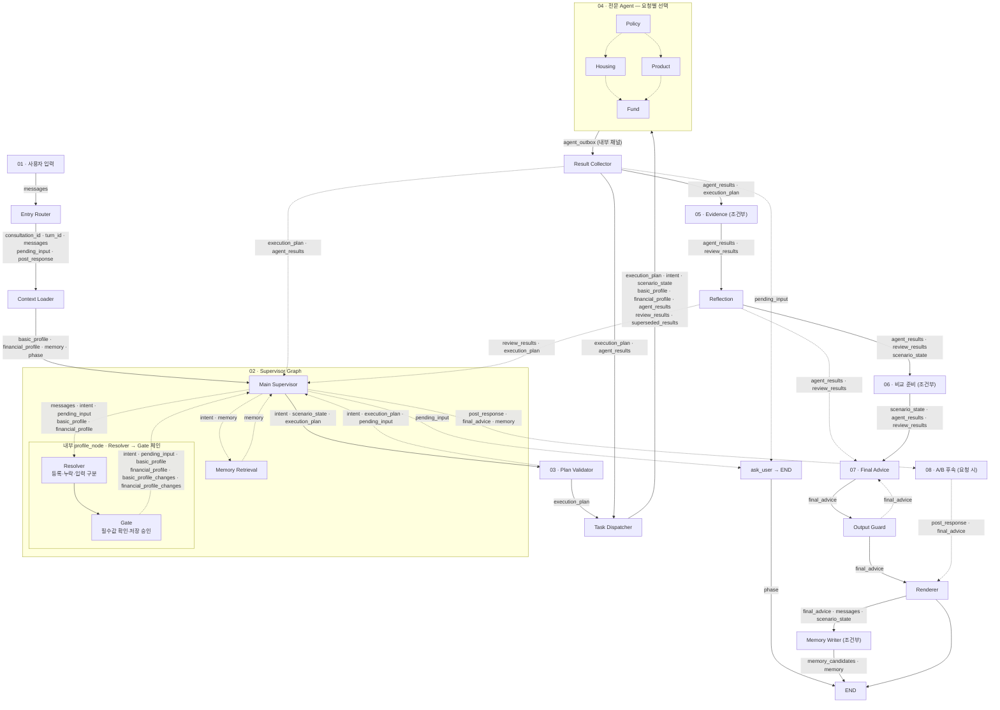

# 청년 금융 Multi-Agent State 압축 설계안 v3.0

> **목표:** 사용자가 간단한 정보만 입력해도 청년 금융 상담을 받을 수 있도록, 공용 State를 **최소 정보·단순 구조·필요 시 추가 질문** 중심으로 재설계한다.
>
> **문서 분담:** 이 문서는 **공용 State의 타입·필드·입출력 계약**을 정의한다. 노드 배치·분기·실행 경로의 표준은 [`청년금융_멀티에이전트_설계메모_v3.0.md`](./청년금융_멀티에이전트_설계메모_v3.0.md)의 **§1 그래프**다. 이 문서의 §6은 그 그래프에 최상위 State Key의 이동·갱신만 덧씌운 참조도다.
>
> **버전 원칙:** 기존 v2.4의 20개 최상위 Key 이름은 유지하되 **압축 설계안의 내부 스키마**를 v3.0의 원본으로 삼는다. 선언된 모든 Key를 매번 채우지 않는다. 과거 v2.4의 상세 프로필·패치·입력 서명 계약은 폐기한다.
>
> **Profile 구현 원칙:** 별도의 최상위 Profile Agent를 만들지 않고 **Supervisor Graph 내부의 조건부 `profile_node`**로 둔다. `profile_node` 안에서 Resolver → Gate를 함수 또는 LangChain 체인으로 구현한다. 필요한 경우만 호출해 Supervisor로 복귀하며, 독립 LangGraph Subgraph는 필수가 아니다.
>
> **최소 보완(4개):** 같은 요청의 재실행 피드백, Evidence/Reflection 판정 분리, 과거 추천에 대한 사용자 결정, 주요 금융 주장과 출처의 연결만 강화한다. **최상위 Key·기본 프로필·그래프 노드 수는 늘리지 않는다.**
>
> **대시보드 연계(3개):** 주요 수치의 표시 형식만 통일하고, 검증된 상담 결과 Snapshot과 목표별 실제 실적은 **State 밖의 기존 서비스 저장소(예: Neo4j)**에서 관리한다. Dashboard Agent나 새로운 Main State Key는 추가하지 않는다.

---

## 0. 설계 범위와 핵심 판단

### 0.1 구현하려는 서비스

- 청년 정책·전세/주택자금 대출의 **일반 안내 및 조건부 적합성 검토**
- 소득·지출·자산·부채를 활용한 **기초 재무 진단과 목표별 자금 계획**
- 적금·예금 등 금융상품의 **조건 검색 및 비교**
- 사용자가 요청할 때만 **가정 시나리오 비교**, 지난 상담 이어가기, A(시뮬레이션)/B(대시보드) 제공
- 공식 정책·상품 자료는 **Neo4j/원문 저장소의 출처 참조**로 연결

**설계하지 않는 것:** 근로·계좌·소득원별 상세 이력 관리, 금융기관 수준의 소득 인정액 자동 판정, 거래 내역 수집, 다수 소득원의 기간별 중첩 계산, 복잡한 프로필 기간 패치 엔진, 자동 대출 승인·계약 실행.

### 0.2 핵심 원칙

1. **처음부터 모든 항목을 입력받지 않는다.** 일반 안내는 프로필 없이도 가능하다.
2. 공용 프로필은 **현재 상담에 필요한 대표값**만 저장한다. 직업·고용 형태·입사일·계약 만료일 등은 기본값으로 수집하지 않는다.
3. **Supervisor 내부 Profile Node**가 개인화 상담에 필요한 최소 프로필의 등록·누락·변경을 점검한다. 특정 정책·상품에서만 필요한 요건은 **해당 전문 Agent가 그때 질문**하며, 공용 프로필 스키마를 늘리지 않는다.
4. **일회성 입력 / 저장된 실제 프로필 / 가상 시나리오**를 분리한다. 일회성 입력과 가정은 자동으로 영속 저장하지 않는다.
5. 모르는 값은 `null` 또는 미기재로 둔다. **미확인 ≠ 0**이며, 정보를 임의 추정해 자격·대출 가능 여부를 확정하지 않는다.
6. **세후 월소득**(생활비·저축 계산)과 **세전 연소득**(필요한 정책 조건)은 별개로 다룬다. 한쪽을 다른 쪽의 확정값으로 자동 환산하지 않는다.
7. Main Supervisor는 **분기·조율**만, 전문 Agent는 **탐색·계산**을, Final Advice는 **검증된 결과 설명**을 담당한다.
8. 정책·상품 금리, 한도, 가입 자격에 대한 주요 주장은 **해당 값·단위·출처·기준일**을 전문 Agent 결과에서 연결한다. 모든 프로필 값에 출처 이력을 달지는 않는다.
9. 같은 요청의 검증 반려는 **이전 출력 참조와 반려 사유만** 다음 실행에 전달한다. 기존 출력 전문을 공용 State에 복제하지 않는다.
10. 대시보드의 차트 수치·근거는 기존 Agent 결과와 `final_advice`에서 읽고, **장기 보관·실적 이력은 State가 아닌 서비스 계층**에서 수행한다.

### 0.3 입력 수준

| 상담 종류 | 우선 필요한 정보 | 없으면 |
|---|---|---|
| 청년 정책·대출의 일반 설명 | 질문만 | 일반 설명 가능 |
| 나에게 맞는 정책/상품 탐색 | 연령·지역·대략적 목표 등 **해당 후보 필터에 필요한 값만** | 조건부 후보 또는 추가 질문 |
| 기본 자산·예산 진단 | 월소득, 월 생활비, 알려진 부채 상환액 | 계산 가능한 범위만 안내 |
| 장기 목표 로드맵 | 목표 종류, 목표 금액/기한 중 알려진 것, 재무 상황 | 목표가 불명확한 부분은 질문 또는 일반 계획 |
| 특정 정책 **자격 확인** | 해당 정책 원문의 필수 조건(예: 세전 소득, 무주택 여부 등) | `needs_check`로 표시하고 필요한 조건만 질문 |

위 항목도 **서비스 전체의 회원가입 필수 입력**을 뜻하지 않는다. 각 요청에 필요한 경우에만 수집한다.

---

## 1. Main Supervisor State — 최상위 구조

### 1.1 최상위 State 20개 — 타입·생존 범위·작성 주체

> **선언된 20개 Key를 매 요청 모두 채우는 것은 아니다.** `TypedDict(total=False)`를 사용하며, 상담 중 유지되는 정보와 요청별로 초기화하는 정보를 분리한다. `agent_outbox`는 별도의 내부 병렬 수집 채널이다.

| Main State Key | 타입 | 생존 범위 | 내용 · 주 작성 주체 |
|---|---|---|---|
| `messages` | `Annotated[list[BaseMessage], add_messages]` | 상담 | 현재 스레드 메시지 · 입출력 계층 |
| `conversation_summary` | `str` | 상담·조건부 | 긴 대화 요약 · 요약 처리 |
| `consultation_id` | `str` | 상담 | 스레드 식별 · Entry Router/서비스 |
| `turn_id` | `str` | 요청(추가 입력 재개 시 유지) | 요청 식별 · Entry Router |
| `phase` | `str`(enum) | 요청 | 진행 단계 · 제어 노드 |
| `basic_profile` | `dict[str, Any]` | 상담 | 기본정보·목표 · Context Loader/내부 Profile Node |
| `financial_profile` | `dict[str, Any]` | 상담 | 소득·지출·자산·부채 · Context Loader/내부 Profile Node |
| `scenario_state` | `dict[str, Any] \| None` | 요청·조건부 | 가상 가정과 비교 시나리오 · Supervisor |
| `memory` | `dict[str, Any]` | 상담 참조 + 요청별 조회 | 직전 답변과 과거 맥락 · Loader/Memory Retrieval |
| `intent` | `dict[str, Any] \| None` | 요청 | 목적·이번 입력·저장 상태 · Supervisor/내부 Profile Node |
| `execution_plan` | `dict[str, Any] \| None` | 요청·조건부 | 작업·의존성·실행 ID · Supervisor/Dispatcher/Collector |
| `pending_input` | `list[dict[str, Any]]` | 요청·조건부 | 추가 질문과 재개 대상 · Supervisor/내부 Profile Node/Collector |
| `agent_results` | `dict[str, dict[str, Any]]` | 요청·조건부 | 전문 Agent의 최신 유효 결과 · Collector |
| `review_results` | `dict[str, dict[str, Any]]` | 요청·조건부 | 실행별 Evidence/Reflection 검증·반려 사유 · 검증 노드(순차) |
| `superseded_results` | `dict[str, dict[str, Any]]` | 요청·조건부 | 이전 실행의 조회 참조·최소 오류 요약 · Collector |
| `final_advice` | `dict[str, Any] \| None` | 요청(후속 참조 가능) | 검증된 상담 답변 · Final Advice/Guard |
| `post_response` | `dict[str, Any] \| None` | 후속·조건부 | A/B 요청과 기준 답변 · 후속 처리 |
| `basic_profile_changes` | `list[dict[str, Any]]` | 요청·조건부 | 실제 기본 프로필 저장 변경 · 내부 Profile Node |
| `financial_profile_changes` | `list[dict[str, Any]]` | 요청·조건부 | 실제 금융 프로필 저장 변경 · 내부 Profile Node |
| `memory_candidates` | `list[dict[str, Any]]` | 요청·조건부 | 실제 전달 답변의 기억 후보 · Memory Writer |

- `agent_outbox: Annotated[list[dict], append_outbox]`는 **내부 병렬 수집 채널**이며 위 20개 공용 Key에 포함하지 않는다.
- 인증 사용자 ID·토큰·권한·동의 상태는 **Runtime Context/보안 저장소**에서 관리한다.
- 세부 원자료·프로필 감사 이력·정책 조건 원문은 State가 아니라 **서비스/Neo4j/원문 저장소**에서 관리한다.

### 1.2 진행 상태

`phase`: `planning / executing / waiting_for_user / composing / completed / failed`

- `planning`: 요청 분류, 필요 시 Profile·Memory 호출, 실행 계획 작성
- `executing`: 전문 Agent 실행 및 필요한 결과 검수
- `waiting_for_user`: 필요한 질문을 보내고 **END**. 다음 입력에서 동일 `turn_id`로 재개
- `composing`: 검증된 결과로 답변 생성·표시 검사
- `completed`: 첫 답변 전달 완료
- `failed`: 진행 불가. 확인된 부분만 안내

상세 Profile 내부 단계, 각 재시도 카운터, Evidence/Reflection의 개별 단계를 최상위 `phase`에 복제하지 않는다.

---

## 2. 프로필: 평평하고 간단하게

### 2.1 `basic_profile` — 기본 정보

| 필드 | 타입 | 의미 | 기본 수집 여부 |
|---|---|---|---|
| `age` | `int \| null` | 사용자가 알려 준 나이 | 개인화 필요 시 |
| `region` | `str \| null` | 거주 지역(예: 서울) | 지역 정책 상담 시 |
| `household_size` | `int \| null` | 가구원 수 | 필요한 경우 |
| `owns_home` | `bool \| null` | 주택 소유 여부 | 주거·정책 상담 시 |
| `has_regular_income` | `bool \| null` | 정기적인 소득 유무 | 재무 상담 시 |
| `goals` | `list[goal]` | 목표 목록 | 목표 상담 시 |
| `risk_tolerance` | `str \| null` | 위험 성향(선택) | 상품 상담에서 필요할 때 |

**제외:** 고용 이력, 가구원별 상세 정보, 주거 이력, 세부 선호 카테고리, 목표별 자산 할당 기록.

**목표(`goals[]`)의 최소 형식**

| 필드 | 의미 |
|---|---|
| `type` | `home_purchase / savings / emergency_fund / debt_payoff / other` |
| `amount_krw` | 목표 금액. 모르면 `null` |
| `amount_type` | 주택 **총가격**인지 필요한 **자기자금**인지 등 금액의 의미. 금액이 있으면 명시 |
| `target_year` | 목표 연도. 모르면 `null` |
| `priority` | 복수 목표에 우선순위가 있을 때만 선택 |

목표 ID, 상태 이력, 제약 객체, 자산 배정 목록은 **공용 State에 두지 않는다**. 동일한 목표를 반복 저장·수정해야 하는 경우의 안정적인 `goal_ref`는 **프로필/목표 저장 서비스**에서 관리하고, 대시보드 수치와 연결할 때만 참조한다. 상담 중 일회성 목표는 `goal_ref` 없이도 다룬다.

### 2.2 `financial_profile` — 금융 정보

| 필드 | 타입 | 의미 |
|---|---|---|
| `monthly_net_income_krw` | `int \| null` | 세후 월평균 소득 |
| `annual_gross_income_krw` | `int \| null` | 세전 연소득. **필요할 때만 입력** |
| `monthly_living_expenses_krw` | `int \| null` | 월 생활비(월 대출 상환액은 **제외**) |
| `total_assets_krw` | `int \| null` | 사용자가 파악하는 총자산 |
| `available_assets_krw` | `int \| null` | 목표에 사용할 수 있는 자금 |
| `total_debt_krw` | `int \| null` | 남은 부채 총액 |
| `monthly_debt_payment_krw` | `int \| null` | 월 부채 원리금 상환액 |

**제외:** 계좌별 목록·소득원별 레코드·기간별 집계/이력·부채별 금리/만기/상환 스케줄·자산별 소유권/유동성 등급·`cashflow.period_summaries`·공용 프로필의 세부 검증 상태.

**계산 규칙**

- 월 가용액 = `monthly_net_income_krw - monthly_living_expenses_krw - monthly_debt_payment_krw`
- 월 생활비가 이미 상환액을 포함한다면 **한 번만 빼도록 사용자에게 확인**한다.
- 부채 상환액이 **미확인**이면 이를 `0`으로 간주해 확정 월 가용액을 만들지 않는다. 사용자가 부채가 없다고 명시한 경우만 `0`을 쓴다.
- 총자산과 사용 가능 자금은 구분한다. `available_assets_krw`를 모르면 `total_assets_krw` 전체를 가용 자금으로 가정하지 않는다.
- 위 파생값은 **Fund Agent 또는 계산 도구에서 필요할 때 산출**한다. 프로필에 중복 저장하지 않는다.
- 복수 소득원·상세 상환표가 필요한 고급 계산은 **v3.0 기본 범위 밖**이며, 별도 도구 또는 확장 기능으로 다룬다.
- `financial_profile`은 **현재 대표값**만 유지한다. 과거 잔액·월별 실적은 대시보드가 필요할 때 기존 서비스 저장소에서 조회하며, State에 시계열 목록을 새로 만들지 않는다.

### 2.3 간단한 예시

```json
{
  "basic_profile": {
    "age": 27,
    "region": "서울",
    "household_size": 1,
    "owns_home": false,
    "has_regular_income": true,
    "goals": [
      {
        "type": "home_purchase",
        "amount_krw": 80000000,
        "amount_type": "required_equity",
        "target_year": 2031
      }
    ],
    "risk_tolerance": null
  },
  "financial_profile": {
    "monthly_net_income_krw": 3200000,
    "annual_gross_income_krw": null,
    "monthly_living_expenses_krw": 1800000,
    "total_assets_krw": 15000000,
    "available_assets_krw": 15000000,
    "total_debt_krw": 10000000,
    "monthly_debt_payment_krw": 350000
  }
}
```

> 금액은 구조 설명을 위한 가상값이다. `null` 항목을 채우기 위해 불필요한 질문을 하지 않는다. 나이는 입력 시점 기준 정보이므로 자격의 기준일과 어긋나거나 경계 연령이면 해당 정책 판단 과정에서 재확인한다.

### 2.4 개인정보 입력과 저장의 구분

| 입력 | 사용할 위치 | 실제 프로필 영속 변경 |
|---|---|---|
| "월급은 320만 원이고 생활비는 180만 원이야. 계산해줘." | Supervisor → 필요 시 내부 Profile Node에서 입력 정리 → `intent.supplied_values` | **하지 않음**. 별도 저장 요청/동의가 있을 때만 |
| 입력 페이지에서 **저장** 버튼을 누르거나 "내 월급을 350만 원으로 저장해줘" | Supervisor 내부 Profile Node → 확인·저장 → 새 스냅샷 | **함** |
| "내년에 월급이 350만 원이면?" | `scenario_state.scenarios[].overrides` | **하지 않음** |
| "대출에 근속 기간이 필요하대." | 해당 전문 Agent의 추가 입력 View | 기본 프로필에 새 필드 등록 **하지 않음** |
| 개인화 상담에 필요한 기본정보가 아직 없음 | Supervisor → 내부 Profile Node에서 **등록 상태·현재 상담에 필요한 최소 필드**만 점검 → 필요 시 `pending_input` | 저장하려면 사용자의 저장 의사를 확인. 일반 안내는 등록 없이도 진행 |

이번 상담에 명시한 실제 정보가 기존 저장 프로필과 다르면, **이번 상담에서는 새로 입력한 값이 우선**하되 저장 프로필을 자동 수정하지 않는다. 두 값의 충돌로 중요한 자격 판단이 달라진다면 확인 질문을 한다.

---

## 3. 이번 요청의 간단한 상태

### 3.1 `intent`

```json
{
  "purpose": "financial_roadmap",
  "operation": "new",
  "supplied_values": {
    "monthly_net_income_krw": 3200000,
    "monthly_living_expenses_krw": 1800000
  },
  "profile_update_status": "not_needed",
  "target_advice_ref": null
}
```

| 필드 | 용도 |
|---|---|
| `purpose` | 질문의 핵심 목적. Agent 이름이 아니라 업무 목적 |
| `operation` | `new / continue / revise / compare / explain` |
| `supplied_values` | **이번 상담에 한해** 사용자가 말한 실제 값·조건(선택) |
| `profile_update_status` | `not_needed / pending / waiting / done` |
| `target_advice_ref` | 이전 상담 수정·설명 시 대상 답변 참조(필요할 때만) |

- v2.4의 `change_signals[]`, 신호별 `resolution`, `missing_information`, `comparison_mode`, 다중 출력 목적 장부를 **삭제**한다.
- `profile_update_status`는 **영속 저장 요청에 대한 처리 상태**이며, 단순 등록 여부 점검이나 일회성 입력 처리의 완료 플래그가 아니다. 저장 중복은 `change_id`로 방지하고, 입력 대기는 `pending_input`으로 관리한다.
- Supervisor는 필요 시 **내부 Profile Node**를 호출해 기본 등록 여부·공통 필수값 누락·새 프로필성 입력을 확인한다. 단순 가정의 `scenario_state` 작성과 실행 계획은 Supervisor 책임이며, 실제/가상 구분이 모호할 때 Profile Node가 해석을 돕는다.
- `supplied_values`는 사용자가 명시한 값만 기록하고 추론한 값을 사용자 진술처럼 넣지 않는다.

### 3.2 `scenario_state`

가정이나 비교가 없으면 `None`. 단일 가정이면 1개, 비교면 최대 3개까지 사용한다.

```json
{
  "scenarios": [
    {
      "id": "s1",
      "label": "현재 조건",
      "overrides": {},
      "assumptions": {}
    },
    {
      "id": "s2",
      "label": "내년 월소득 350만 원",
      "overrides": {
        "monthly_net_income_krw": 3500000
      },
      "assumptions": {
        "effective_year": 2027
      }
    }
  ]
}
```

- `overrides`는 **기본 프로필/금융 프로필의 허용된 대표 필드만** 대체한다. 별도 가정은 `assumptions`에 둔다.
- 시나리오 계산 View = `저장된 프로필` + `이번 상담 supplied_values` + `해당 시나리오 overrides` (오른쪽이 우선).
- 임시 금액은 실제 저장 프로필에 기록하지 않는다.
- **삭제:** `comparison_type`, `candidate_expansion_done`, `profile.base_versions`, 다단계 `patches[]`, 레코드 ID/기간 분할, `revision` 기준 부분 무효화. 시나리오 입력이 변경되면 해당 시나리오의 관련 작업을 간단히 재실행한다.
- 비교 시 다른 시나리오의 결과를 섞지 않으며, 연도·기준 조건이 달라 직접 비교할 수 없으면 한계를 명시한다.

### 3.3 `pending_input`

Supervisor 내부 Profile Node나 전문 Agent가 **현재 상담에 꼭 필요한 값**을 얻지 못했을 때만 만든다.

```json
[
  {
    "id": "ask_01",
    "question": "해당 정책의 자격을 확인하려면 세전 연소득이 필요해요. 알려주실 수 있나요?",
    "fields": ["annual_gross_income_krw"],
    "target": "task_policy_01",
    "scenario_id": null,
    "status": "pending"
  }
]
```

**필드:** `id`, `question`, `fields[]`, `target`, 선택 `scenario_id`, `status(pending/resolved)`, 필요 시 `answers{}`.

- `target`은 `profile`(**Supervisor 내부 Profile Node로 복귀**)·`supervisor` 또는 전문 작업 ID다.
- 재개는 **다음 사용자 메시지 → Entry Router → Supervisor → 해당 작업**으로 처리한다.
- `pending_input`의 일시적 답변은 해당 작업 입력에만 전달한다. 근속 개월·혼인 세부 요건 등은 **기본 프로필에 자동 추가하지 않는다**.
- 여러 질문을 해야 할 때도 동일 목적의 항목만 묶어 묻는다.
- **삭제:** `signal_ids`, `change_ids`의 복합 연결, 필드별 기간/레코드 ID, `resume_ref`, 상세 입력 타입 레지스트리.

### 3.4 `basic_profile_changes` / `financial_profile_changes`

**프로필을 실제로 저장·변경할 때만** 사용하는 일시적 목록이다.

```json
{
  "financial_profile_changes": [
    {
      "change_id": "change_01",
      "field": "monthly_net_income_krw",
      "value": 3500000,
      "status": "applied"
    }
  ]
}
```

- 상태: `pending / needs_confirmation / applied / rejected / failed`.
- 명시적 저장 지시나 입력 페이지의 저장 동작은 사용자 승인으로 취급할 수 있다. 해석이 모호하거나 충돌하면 확인을 요청한다.
- 저장 서비스는 `change_id`로 **중복 저장을 방지**하고, 성공 후 프로필을 다시 읽는다.
- 저장 원본의 버전/감사로그는 **서비스 저장소**에서 처리하며 State에 레코드별 이력으로 복제하지 않는다.
- 시나리오의 가정값은 이 목록에 넣지 않는다. 새 요청에서는 이전 변경 후보를 초기화한다.

### 3.5 Supervisor 내부 `profile_node` — 실행 범위만 정의

`profile_node`는 **Supervisor Graph에 등록되는 조건부 LangGraph 노드**다. 안쪽에서 `Resolver → Gate`를 일반 함수 또는 **LangChain Runnable 체인**으로 처리할 수 있지만, **별도의 최상위 Agent/독립 실행 Subgraph로 배치하지 않는다**.

| 구분 | 최소 계약 |
|---|---|
| 호출 결정 | Supervisor가 개인화에 필요한 **기본 프로필 등록·누락 확인**, 프로필성 입력/변경, 실제 저장 요청, 실제/가상 구분이 모호한 경우에만 호출. 일반 안내는 생략 |
| 입력 | 현재 `messages`의 관련 발화, `intent`, 저장된 `basic_profile`·`financial_profile`, 관련 `pending_input`(재개 시). 필요하면 Supervisor가 조회한 과거 정보만 전달 |
| Resolver(조건부) | 등록·필수값 상태, 일회성 실제 입력·저장 요청·가상 가정 구분, 값을 대표 필드로 정규화. 명확하면 규칙으로 처리하고 애매할 때만 LLM 사용 |
| Gate(규칙) | 상담에 **필요한 공통 필드만** 확인하고 `pending_input` 요청. 명시적 저장 지시 또는 승인 시에만 변경·저장(`change_id` 중복 방지)·스냅샷 재조회 |
| 공용 반영 후 복귀 | `intent.supplied_values`(일회성), `*_profile_changes`·`*_profile`·`intent.profile_update_status`(실제 저장), `pending_input`(누락·확인). 처리 후 반드시 Supervisor로 반환 |
| 담당하지 않음 | 전문 Agent의 정책별 근속·세부 자격 조건, 과거 기억 직접 조회, 시나리오 DAG 구성, 금리·대출·재무 계산 |

**기본 정보가 전혀 없는 사용자**도 일반 안내를 받는 데에는 Profile Node 호출이 필요 없다. 개인화 상담의 필수값이 없을 때만 최소한의 입력을 요청하며, 그 답변을 상담에 일회성으로 사용할지 프로필에 저장할지는 구분한다. 시나리오의 `overrides`는 Supervisor가 관리한다. 새로운 최상위 Key는 만들지 않는다.

---

## 4. 실행 계획·전문 결과·검수

### 4.1 `execution_plan`

```json
{
  "revision": 1,
  "review_retry_count": 0,
  "tasks": [
    {
      "task_id": "task_fund_01",
      "agent": "fund",
      "objective": "현재 소득과 지출로 5년 목표 자금 계획",
      "scenario_id": null,
      "depends_on": [],
      "status": "pending",
      "run_id": null
    }
  ]
}
```

**공통 필드:** `revision`, 필요할 때의 `review_retry_count`(최대 1회), `tasks[]`의 `task_id / agent / objective / scenario_id / depends_on / status / run_id`.

- `status`: `pending / running / completed / needs_input / failed / skipped`.
- `depends_on`은 필수 선행만 표현한다. 선택 선행은 Supervisor가 해당 결과를 **실제로 필요한 경우**에만 추가한다.
- 단일 예산 상담은 **Fund 하나만 실행**할 수 있다. Housing/Product/Policy를 반드시 선행하지 않는다.
- `run_id`는 Dispatch 때 새로 부여하고, `revision`은 같은 요청 안에서 **사용된 입력·시나리오·작업 구성**이 바뀔 때 증가한다.
- 변경 영향 범위를 복잡하게 계산하지 않는다. 변경된 시나리오의 **관련 작업 전체**를 재실행하고, 구 `run_id`의 결과·검수는 더 이상 유효하게 사용하지 않는다. 검증 반려에 따른 재실행은 **Dispatcher가 기존 `review_results`의 오류를 `revision_feedback`으로 전달한 뒤**, Collector가 교체 시 이전 결과 참조·오류 요약만 보관하고 구 검수를 무효화한다.
- 단순 재시도는 새 `run_id`로 구분한다. `revision`은 기존 규칙대로 **입력·시나리오·작업 구성이 바뀔 때만** 올린다. 교체 전 남은 구 결과도 현재 작업 `run_id`와 다르면 Final에 전달하지 않는다.
- **삭제:** `template_id` 필수화, `soft_depends_on/soft_wait_policy`, 필드별 입력 해시·서명, 기간별 Profile Slice 추적, 계획 내부의 상세 `budgets{}`와 다수 카운터.

**서버 설정으로 관리할 기본 상한:** 최대 시나리오 3개, 단일 Agent 일시 오류 재시도 1회, Reflection 재계획 1회, Output Guard 재작성 1회, 전체 작업 수/호출비용 상한. 매 요청마다 State에 모든 카운터를 만들지 않는다. Reflection 재계획 횟수만 `execution_plan.review_retry_count`로 재개 시에도 유지한다.

### 4.2 전문 Agent의 최소 공통 입출력

**입력 (Dispatcher 생성, Agent마다 필요한 부분만)**

| 필드 | 의미 |
|---|---|
| `task_id`, `run_id`, `plan_revision`, `scenario_id` | 현재 작업 식별·교차 실행 결과 차단 |
| `objective`, `user_query` | 업무 목적 + 필요한 사용자 원문 |
| `profile_view` | 저장 프로필 + 이번 요청값 + 가정(해당 시). **필요 필드만** |
| `upstream_results` | 필수 선행 작업의 관련 결과(있을 때만) |
| `extra_answers` | 이번 상담에 추가로 받은 정책/상품 전용 값(있을 때만) |
| `prior_advice` | 이전 **상담** 결과 수정 요청에서 필요한 부분만(있을 때만) |
| `revision_feedback` | 같은 **요청의 검증 반려 후 재실행** 시만: `previous_run_id`, 선택 `previous_output_ref`, `issues[]` |

**출력 (Collector를 통해 공용에 반영)**

```json
{
  "task_id": "task_fund_01",
  "run_id": "run_01",
  "plan_revision": 1,
  "scenario_id": null,
  "status": "completed",
  "summary": "월 가용액과 목표까지의 적립 가능성을 계산함",
  "data": {
    "metrics": [
      {"name": "monthly_surplus", "value": 1050000, "unit": "KRW/month",
       "as_of": "2026-11-19", "evidence_ref": "calc_cashflow_01", "value_kind": "estimated"}
    ],
    "roadmap": []
  },
  "evidence_refs": ["calc_cashflow_01"],
  "warnings": [],
  "needed_fields": []
}
```

- `data`의 내부 구조는 Agent가 담당하며 **공용에서 다시 세부 고정하지 않는다**. 다만 **주요 정책·상품 금리·한도·자격·핵심 계산값**은 그 `data`의 해당 항목에서 값/판정, 단위(해당 시), 자료 기준일(해당 시), 개별 `evidence_ref`를 찾을 수 있어야 한다. 단순 설명이나 모든 사용자 프로필 값에 같은 구조를 강제하지 않는다.
- **표·차트에 쓰는 수치가 있을 때만** 기존 `data.metrics[]`를 활용한다. **같은 수치를 별도 필드와 `metrics[]`에 중복 기록할 필요는 없다.** 공통 최소 형식은 `name`, `value`, `unit`; 필요한 항목에만 `as_of`(기준일), `value_kind`(`actual/estimated/planned/assumed`), `goal_ref`, `evidence_ref`를 붙인다. `scenario_id`와 `task_id/run_id`는 **기존 AgentOutput 외피에서 확인**하므로 `data.metrics[]` 전체에 중복 기록하지 않는다. 다른 Agent의 후보·자격 상세 `data` 구조는 그대로 유지한다.
- 예시(가상의 상품 금리 한 항목): `"annual_rate": {"value": 3.5, "unit": "%/year", "as_of": "2026-11-01", "evidence_ref": "source_rate_01"}`. 기존 후보/`metrics` 구조 안에 넣으면 되고, **새 공용 `claims` 장부를 만들지 않는다**.
- `evidence_refs`는 **계산 근거 또는 Neo4j/원문 자료의 실제 조회 가능한 ID**를 가리킨다. 위 Fund 예시처럼 **중요 수치 하나와 근거 하나가 1:1이면** 목록의 단일 ID로도 연결할 수 있으나, 중요한 값이 여러 개라면 각 항목에 `evidence_ref`를 붙인다. 단순 ID 나열만으로 검증 통과가 아니며, Evidence가 중요 주장과 해당 원문·계산 입력의 일치 및 적용 조건을 확인한다. 미확인 값은 `needs_check` 또는 경고로 남긴다.
- `needed_fields`는 진행이 불가능하거나 **사용자가 자격 확정을 원할 때**만 채운다. 단순 안내에서는 미확인 조건을 경고로 남겨도 된다. 모든 필수 요건이 확인되지 않았다면 자격은 `needs_check`이지 `eligible` 확정이 아니다.
- Collector는 현재 작업의 `task_id + run_id + plan_revision + scenario_id` 일치 여부를 확인한다. 구 실행 결과는 반영하지 않는다.
- 전문 Agent가 공용 `agent_results`를 병렬로 직접 수정하지 않는다. `agent_outbox` → **Collector 단독 수락** 경계를 유지한다.

**전문 Agent별 최소 책임**

| Agent | 반드시 책임지는 내용 | 공용이 강제하지 않는 것 |
|---|---|---|
| Policy | 정책 후보·조건별 `eligible / ineligible / needs_check`, 근거·기준일 | 세부 인정소득 계산 방식, 모든 정책의 조건 필드 통합 |
| Housing | 주거 비용·필요 자기자금·대출 후보와 미확인 조건 | 대출별 상환 스케줄 전체를 공용 프로필에 저장 |
| Product | 금융상품 후보·비교 근거·조건부 적합성 | 상세 검색/랭킹 알고리즘 |
| Fund | 월 현금흐름·저축/부채/복수 목표의 간단한 로드맵 | 모든 상품 검색 선행, 장기 회차별 모델 |

### 4.3 `agent_results`, `review_results`, `superseded_results`

- `agent_results`: `{task_id: AgentOutput}`. **현재 작업 `run_id`와 일치하는 수락 결과만 유효**하며, 구 실행 결과는 Final에 전달하지 않는다.
- `review_results`: `{task_id: {target_run_id, evidence?, reflection?}}`. 두 검사는 각자의 항목만 갱신해 서로의 오류를 덮어쓰지 않는다. 각 항목은 간단히 `{status: "passed|needs_check|revise", issues: [...]}`로 표현한다.

```json
{
  "task_housing_01": {
    "target_run_id": "run_01",
    "evidence": {"status": "passed", "issues": []},
    "reflection": {"status": "revise", "issues": ["월 상환액 중복 차감"]}
  }
}
```

- 검증 대상이 바뀌면 **새 `target_run_id`로 교체하고 기존 검사 항목은 초기화**한다. 전체 시나리오 검토가 필요하면 `overall`에 검토 대상 `run_id` 목록을 포함해 구 검증 재사용을 막는다.
- `superseded_results`: 재실행 시 `{old_run_id: {task_id, previous_output_ref?, reason, issues[]?}}` 정도만 보관한다. `issues[]`는 다음 실행에 필요한 오류 요약이며 **이전 출력 본문은 공용 State에 복제하지 않는다**.
- **반려 → 재실행:** Dispatcher가 교체 전 `agent_results`·`review_results`에서 `revision_feedback = {previous_run_id, previous_output_ref?, issues[]}`를 만든다. Collector는 기존 결과의 조회 참조와 오류 요약을 `superseded_results`에 남기고 새 결과로 교체하며 이전 검수를 지운다. 이후 Evidence/Reflection을 새 `run_id` 기준으로 재검증한다.
- `previous_output_ref`는 **동일 사용자의 실행 결과 저장소 또는 checkpoint 이력에서 실제 조회 가능한 참조**여야 한다. 이를 구현하지 않았다면 이전 출력 *본문* 조회는 불가능하므로 참조를 억지로 만들지 않고 `issues[]`만으로 수정한다. 보관·접근권한·만료는 서비스 책임이다.
- Evidence/Reflection은 필요 시 호출한다. 단순 단일 Agent 결과의 형식·출처 검사는 규칙으로 끝낼 수 있지만, **금리·한도·자격 등 중요한 단정**은 해당 근거와 조건까지 확인해야 `passed`로 판정한다.

---

## 5. 기억·최종 답변·후속 출력

### 5.1 `memory`

```json
{
  "last_advice_ref": "advice_001",
  "retrieval_status": "not_requested",
  "retrieved": []
}
```

- Supervisor가 과거 상담·저장 계획·기억이 **실제로 필요한 경우에만** Memory Retrieval을 부른다.
- 조회 시 `retrieval_status`를 `found / no_match / failed / access_denied` 등으로 표시하고, `retrieved[]`에는 **관련 요약과 참조 ID**만 담는다.
- **사용자의 과거 추천 수락·거절·변경**이 검색되면 해당 항목에만 `type="user_decision"`, `target_ref`(추천 후보 또는 답변), `decision`(`accepted/rejected/changed`), `reason`(사용자가 밝힌 이유), `source_ref`(발화 참조)를 붙인다. 일반 기억에는 이 필드들을 억지로 만들지 않는다. **사용자 거절과 Evidence/Reflection의 검증 반려는 구분**한다.
- 같은 스레드의 "방금 답변에서 바꿔줘"는 `last_advice_ref`로 대상을 식별하고 필요할 때 답변 본문을 조회한다. Memory Writer 저장이 실패했더라도 **해당 스레드의 checkpoint 이력**에서 직전 전달 답변을 조회할 수 있도록 한다.
- 저장 프로필이 현재 실제 금융 사실의 기준이며, **과거 기억의 금액은 현재 값으로 간주하지 않는다**.
- **삭제:** `retrieval.requests[]` 감사 장부, 다층 `handoff/conflicts/prior_outcomes` 목록, 소스별 상세 조회 이력. 조회·접근 감사는 서비스 로그에서 관리한다.

### 5.2 `final_advice`

```json
{
  "advice_id": "advice_001",
  "summary": "현재 확인된 소득과 지출을 기준으로 목표 저축 계획을 안내합니다.",
  "sections": [
    {
      "title": "월 현금흐름",
      "body": "입력한 금액을 바탕으로 계산했습니다.",
      "metrics": [
        {
          "name": "monthly_surplus",
          "value": 1050000,
          "unit": "KRW/month",
          "as_of": "2026-11-19",
          "value_kind": "estimated",
          "source_task_id": "task_fund_01",
          "source_run_id": "run_01",
          "evidence_ref": "calc_cashflow_01"
        }
      ],
      "evidence_refs": ["calc_cashflow_01"]
    }
  ],
  "warnings": [],
  "validation": "passed"
}
```

- Final Advice는 **Agent의 계산 결과를 다시 계산하거나 새로운 상품·금리를 만들어 내지 않는다**.
- **`final_advice.sections[].metrics[]`만** 화면·대시보드 공통 수치 형식으로 통일한다: 기본 `name/value/unit/source_task_id/source_run_id`, 중요 수치의 `evidence_ref`, 필요 시 `as_of`·`value_kind`·`scenario_id`·`goal_ref`. `value_kind`는 실제 입력·실적(`actual`), 계산 추정(`estimated`), 목표 계획(`planned`), 가상 조건(`assumed`)을 구별할 때 사용한다. `actual`도 사용자 입력만으로 외부 검증이 완료됐다는 뜻은 아니다. 차트에 필요 없는 일반 서술에는 이 필드를 강제하지 않는다.
- Final Advice는 **현재 `run_id`로 채택된 Agent 결과의 수치만** 위 형식으로 연결하며 임의로 새 금액을 만들지 않는다. 시점이 중요한 금리·정책 조건은 Agent `data`의 기준일을 그대로 표시한다. 명시적인 `goal_ref`가 없는 일회성 목표를 억지로 식별하지 않는다.
- Output Guard는 현재 `agent_results`와 `review_results`의 `run_id` 일치, 값·단위·출처·기준일의 연결, 가정의 실제 사실 오용, `needs_check`를 확정 자격으로 표현하는 일을 검사한다. 중요한 근거가 확인되지 않은 수치·자격은 **확정 표현으로 출력하지 않는다**. 자유 서술 전체의 진실을 규칙만으로 보장할 수는 없다.
- Renderer는 `sections`를 텍스트·표·출처 링크로 표시한다. 일반 설명에는 비어 있는 `evidence_refs`를 억지로 채우지 않는다.
- **삭제:** `supported_claims[]`와 `render_sections[]`의 중복 구조, 각 섹션의 중첩 claim 매핑, 불필요한 `change_summary` 상세 스키마. 단, 중요한 수치의 **Agent 결과 연결**은 유지한다.

### 5.3 `memory_candidates` / `post_response`

- `memory_candidates`: 실제 답변을 전달한 뒤 저장이 필요한 경우에만 `{advice_ref, question, assumptions}` 정도를 구성한다. 사용자가 과거 추천에 대해 명시적으로 수락·거절·변경했다면 **해당 결정에 한해** `{target_ref, decision, reason, source_ref}`를 선택적으로 덧붙인다. **초안·오류 답변이나 사용자에게 확인되지 않은 거절 이유는 저장하지 않는다.** 실제 저장·보존/삭제·동의 정책은 Memory Writer/서비스 책임이다.
- `post_response`: 사용자가 첫 답변 후 A(시뮬레이션) 또는 B(대시보드)를 요청했을 때만 `{modes, base_advice_ref, result_refs}`를 둔다. 저장된 상담 결과는 **`base_advice_ref`로 재조회**하고, `result_refs`는 필요할 때 그 결과/시뮬레이션 참조에 사용한다.
- A/B는 기본 답변 완료를 기다리게 하지 않는다. 제품/대출 추천을 하지 않고 **Fund 단독 로드맵**으로 끝나는 상담도 정상 경로다.

### 5.4 대시보드용 영속 결과·실적 — Main State 밖에서 관리

- **검증된 상담 결과 Snapshot:** Output Guard 통과 후 Renderer가 실제 답변을 전달하면 **기존 출력 후처리 서비스**가 `advice_ref`(=`final_advice.advice_id`)를 키로, 검증된 `final_advice.sections[]`(수치·로드맵·후보 비교 등)와 그 화면에 필요한 **수락 Agent 결과의 최소 부분**, 시나리오 가정·중요 근거 참조·경고만 저장한다. 수치는 `sections[].metrics[]`를 재사용해 중복 저장하지 않는다. **새 LangGraph 노드·Agent·State Key는 만들지 않는다.** 사용자별 접근 권한과 기준일·보존 정책은 서비스가 적용하며, 기존 Neo4j 저장 영역을 활용할 수 있다. 화면에서 열 근거 ID와 계산 근거는 **후속 조회 때도 유효한 참조**여야 하며, 원문이나 계산 근거의 보존·만료를 저장 서비스가 책임진다.
- **재조회:** 후속 B 요청은 `post_response.base_advice_ref` → 결과 저장 서비스 조회 → 기존 Renderer/대시보드 서비스로 표시한다. 저장되지 않았거나 조회가 실패하면 **해당 결과를 복원한 척하지 않는다**. 가능할 때만 동일 스레드 checkpoint를 조회하고, 그렇지 않으면 결과를 재생성하거나 다시 상담해야 한다고 안내한다. Snapshot 저장 실패는 첫 답변을 막지 않되 후속 조회 가능 여부는 기록한다(서비스 로그).
- **목표·실적:** 저장된 목표에 대해서만 서비스가 발급한 `goal_ref`로 실제 실적(`goal_ref`, `as_of`, `actual_amount_krw`)을 별도 보관한다. **계획/추정 수치와 실적을 혼합하지 않고**, 목표 달성률은 해당 목표에 실제 배정된 금액이 확인될 때만 산출한다. `total_assets_krw`나 `available_assets_krw` 전액을 목표 달성 실적으로 자동 계산하지 않는다.
- **역할 경계:** `memory_candidates`는 대화 기억, Snapshot은 **검증된 답변의 재표시**, 실적 저장은 **사용자가 확인한 목표 진행 기록**이다. 이 세 기능을 하나의 중첩 State로 합치지 않고, 서비스가 각각 필요한 참조를 조회한다. `post_response` 구조는 늘리지 않는다.

---

## 6. 표준 실행 그래프에 Main State 상호작용 표시

**노드의 위치·실행 순서·분기 기준은 에이전트 설계 메모 v3.0 §1이 표준**이다. 아래 그림은 **같은 연결 구조**에, 다음 단계가 주로 읽거나 직전 단계가 갱신하는 **최상위 State Key 이름만** 표시한다. 화살표의 Key는 공유 State에서의 참조/갱신 관계를 뜻하며 별도의 메시지 객체를 전송한다는 의미가 아니다. 모든 Key를 모든 경로에 전달해야 한다는 뜻도 아니다.



- **Profile Node는 `02 · Supervisor Graph` 안에서만 조건부 호출**된다. 그림의 Resolver/Gate 묶음은 **노드 내부 처리 단계**를 보여 줄 뿐 별도 LangGraph Subgraph나 상위 Agent가 아니다. 완료하면 Supervisor로 돌아간다.
- **Policy / Housing / Product / Fund 사이 점선은 가능한 선후행 관계이지 고정 호출 순서가 아니다.** 실제 의존성은 `execution_plan`이 정한다. Fund 단독 실행도 가능하다.
- **Collector 이후에는** 다음 작업 → Dispatcher, 경로 수정 → Supervisor, 필요한 정보 대기 → `ask_user`, 작업 완료 → Evidence/Reflection으로 분기한다. Evidence를 생략하는 단순 경로에서도 검수 결과는 필요 범위에서 확인한다.
- **비교가 없으면** Reflection → Final Advice로 바로 간다. **A/B는 첫 답변 이후 새 요청이 들어오면** Entry Router와 Supervisor를 거쳐 실행한다.
- `agent_outbox`는 그래프에 드러난 **유일한 비공용 내부 채널**이다. 전문 Agent 출력은 공용 `agent_results`에 직접 쓰이지 않고 Collector가 수락한다.
- **재실행 시** Dispatcher는 `review_results`와 필요한 이전 결과 참조로 `revision_feedback`을 일회성 생성한다. 화살표에는 약속대로 **최상위 Key 이름만** 표시한다.
- **대시보드 보완은 그래프 경로를 바꾸지 않는다.** 기존 Renderer가 답변을 전달한 후 서비스 후처리에서 결과 Snapshot을 보관한다. 후속 B는 기존 `post_response`/`memory`의 답변 참조로 이를 조회한다. 이 과정에서 추가되는 저장 데이터는 **Main State 화살표에 표현하지 않는다**.

**§4.2의 기존 전문 Agent 공통 입출력 계약과 전문 Agent별 결과 책임은 그대로 유효하다.** 이 그래프는 Agent의 도구/검색/계산 계약을 대체하지 않는다. 자세한 역할과 연결·배치, 시나리오별 경로는 에이전트 설계 메모를 참조한다.

## 7. 생명주기·재개·안전 규칙

### 7.1 State 초기화와 유지

| 상황 | 처리 |
|---|---|
| 새로운 대화 시작 | `consultation_id` 발급, 저장 프로필이 있으면 필요한 최소 필드만 로드 |
| 새 상담 요청 | `turn_id` 새로 발급. `intent`, `scenario_state`, `execution_plan`, `pending_input`, `agent_results`, `review_results`, `superseded_results`, `final_advice`, `post_response`, `*_profile_changes`, `memory_candidates` 초기화 |
| 추가 질문에 대한 답변 | 같은 `turn_id`로 복귀. `pending_input` 답변을 해당 Agent에 전달 |
| 첫 답변 완료 | `final_advice`를 실제 전달한 뒤 `memory.last_advice_ref` 갱신. 검증된 결과의 **Snapshot은 서비스 후처리에서 저장**하고 필요 시 대화 기억 저장(각 저장의 실패는 별도 처리) |
| 다음 상담에서 과거 참조 | 저장된 답변 ID로 원본 조회. 필요 없으면 장기 기억 검색하지 않음 |

- **대기는 END 후 다음 메시지에서 재호출**한다. Supervisor 내부 Profile Node에서 `interrupt`를 사용하지 않는다.
- 같은 스레드에서 여러 사용자가 동시에 상태를 수정하지 않도록 **사용자 권한 검증과 스레드별 동시 실행 제어**를 서비스 계층에 둔다.
- 실제 프로필 저장은 중복 적용되지 않아야 하며, 완료 전에 저장 성공으로 표시하지 않는다.
- 출력에 없는 근거·계산값은 Final에서 생성하지 않는다.

### 7.2 공통 데이터 규칙

| 문제 | 최소 안전 규칙 |
|---|---|
| 금액 누락 | `null`은 미확인, `0`은 명시한 실제 0원 |
| 월/연 기준 | 필드명에 월/연 명시. 값이 애매하면 확인 |
| 세전/세후 | 별도 필드. 정책용 세전 연소득은 필요한 정책에서 추가 요청 |
| 가정값 | 시나리오 전용. 프로필 영속 저장 금지 |
| 특정 정책 요건 | 정책 원문 기준일·출처 확인, 모르면 `needs_check` |
| 보증금/주거 자금 | 총자산에 포함된 자금을 다시 더하지 않음. 가용액 별도 |
| 월 생활비와 상환액 | 중복 차감 금지 |
| 출처 | 주요 정책·상품·계산 수치에 항목별 `evidence_ref`·기준일(해당 시) 및 최종 `source_task_id/source_run_id` 연결 |
| 대시보드 수치 | 필요한 `metrics[]`에 한해 `name/value/unit` 통일, 시나리오·기준일·출처는 해당 시에만 부여 |
| 실적 vs 계획 | 계획·추정·가상과 실제 실적을 구분하고, 실적 이력은 State가 아닌 서비스 저장소에서만 관리 |
| 보안 | 계좌번호·비밀번호·주민번호·인증 토큰을 State/LLM/로그에 저장하지 않음 |
| 개인정보 최소화 | checkpoint의 금융값은 접근 권한·암호화·보존 기간·삭제 정책 적용 |

### 7.3 과도한 질문 방지

- **추천/일반 안내**는 미확인 조건을 경고로 표현할 수 있다.
- **정확한 자격 판정**이 필요하고 결과가 달라지는 필수 조건이 없으면 그때만 질문한다.
- 답변에 영향을 주지 않는 직업 분류·가입 시점·계좌 상세 등은 묻지 않는다.
- 전문 Agent가 생성한 추가 질문을 **공용 프로필 필드로 자동 승격하지 않는다**.
- 질문으로 해결할 수 없는 정보는 `needs_check`를 표시하고 현재 확인된 결과만 설명한다.

---

## 8. LangGraph State 선언 예시 — 최소 뼈대

```python
from typing import Annotated, Any, TypedDict
from langchain_core.messages import BaseMessage
from langgraph.graph.message import add_messages


# 같은 superstep의 병렬 Agent 출력만 모으는 내부 reducer.
RESET_OUTBOX = {"__reset__": True}


def append_outbox(old: list[dict] | None, new: list[dict] | None) -> list[dict]:
    old = list(old or [])
    new = list(new or [])
    resets = [i for i, item in enumerate(new) if item.get("__reset__")]
    return new[resets[-1] + 1:] if resets else old + new


class MainState(TypedDict, total=False):
    # 공용 최상위 Key 20개 (선언만 하고 모두 매번 채우지 않음)
    messages: Annotated[list[BaseMessage], add_messages]
    conversation_summary: str
    consultation_id: str
    turn_id: str
    phase: str

    basic_profile: dict[str, Any]
    financial_profile: dict[str, Any]
    scenario_state: dict[str, Any] | None
    memory: dict[str, Any]
    intent: dict[str, Any] | None
    execution_plan: dict[str, Any] | None
    pending_input: list[dict[str, Any]]

    agent_results: dict[str, dict[str, Any]]
    review_results: dict[str, dict[str, Any]]
    superseded_results: dict[str, dict[str, Any]]
    final_advice: dict[str, Any] | None
    post_response: dict[str, Any] | None

    basic_profile_changes: list[dict[str, Any]]
    financial_profile_changes: list[dict[str, Any]]
    memory_candidates: list[dict[str, Any]]

    # 내부 병렬 채널: 공용 계약 외
    agent_outbox: Annotated[list[dict[str, Any]], append_outbox]
```

**구현 주의**

- `agent_results`·`execution_plan` 등 reducer 없는 Key는 **같은 superstep에서 중복 쓰지 않는다**. 전문 Agent는 `agent_outbox`만 쓰고 Collector 하나가 반영한다. Evidence/Reflection도 순차적으로 `review_results`를 병합한다.
- 내부 outbox는 Collector가 소비 후 `[RESET_OUTBOX]`로 비운다.
- 이 선언은 **State 형태만 보여 주는 뼈대**다. 실제 노드 연결·프로필 저장 서비스·입력 검증·모델 Schema는 별도 구현한다.
- 상태 Key를 선택적으로 둘 수 있다는 것과, **현재 존재하는 Key가 새 요청에서 자동 삭제된다는 것**은 다르다. 새 turn의 초기화 노드에서 요청별 필드들을 명시적으로 비운다.
- 런타임에서 프로필·시나리오 값이 바뀌면 영향을 받는 작업의 `run_id`를 갱신하고, 기존 검수와 결과를 함께 폐기한다.

---

## 9. v2.4 → v3.0 변경표

| 영역 | v2.4 | v3.0 |
|---|---|---|
| 최상위 State | 20개 고정 Key | **20개 이름 유지**, 대부분 조건부 사용 |
| 기본 프로필 | `personal/employment/household/housing/goals/preferences/metadata` | 나이·지역·가구·주택 소유·정기소득·목표·필요 시 위험선호 |
| 직업 | 고용 형태·직종·입사일·계약 기간 | **정기소득 여부** |
| 금융 프로필 | 계좌·자산·부채·소득원·기간 집계·현금흐름 | **월/연 소득·월 지출·총/가용 자산·부채·상환액** |
| 변경 감지 | `intent.change_signals[]` 장부 | `profile_update_status` + 필요 시 `*_profile_changes` |
| 임시 가정 | 레코드 단위 기간 패치·분할 ID | **대표 필드 override + 간단한 가정** |
| 작업 계획 | 복잡한 DAG, soft 의존, 입력 해시·다수 budget | 작업·필수 의존성·`run_id`·`revision` |
| 추가 입력 | 기간·레코드 ID·변경 신호 연결 | 질문·필드명·대상 작업 |
| Agent 입출력 | 다수 참조·기간·서명·검증 중첩 | 목적·필요 프로필·결과·근거·필요 추가값 |
| 검증 | 다층 claim/sub_review/output 계약 | **Agent 결과 단위 검증 + 구조화 핵심 수치**. Evidence/Reflection 분리 및 재실행 피드백 선택 추가 |
| 기억 | 조회별 감사 장부·다층 이전 결과 | 직전 답변 ID, 필요 시 관련 과거 요약 |
| 재실행 | 영향 필드별 정밀 부분 무효화 | **해당 시나리오 관련 작업 전체 재실행** |
| 후속 출력 | 상세 버전 참조·다중 후속 상태 | 요청한 A/B와 기준 답변 ID만 |
| 대시보드 연결 | 별도 명시 미흡 | **기존 metrics 최소 형식 정렬 + 검증된 결과 Snapshot·목표 실적의 서비스 저장**(Main State 추가 없음) |

**의도적으로 포기하는 것:** 기간별 급여·입사 시점 계산, 상환 스케줄 수준의 대출 모델, 모든 정책의 자격 자동 확정, 임의 필드에 대한 복잡한 기간 패치, 초정밀 캐시 재사용. 이런 요구가 실제로 발생하면 **해당 Agent 내부 기능으로 추가**하고, 공용 State를 즉시 복잡하게 만들지 않는다.

### 9.1 에이전트 설계 메모와의 관계

- **에이전트 설계 메모 v3.0 §1:** 실제 그래프의 노드 배치, 연결, 조건부 분기, 전문 Agent 호출 관계의 **단일 표준**.
- **State 압축 설계안 v3.0:** `MainState` 20개 Key, 간단한 내부 필드, Agent 공통 입출력, 노드들이 공유 State에서 읽거나 갱신하는 **Key 계약**의 단일 표준.
- **State §6 그림:** 메모의 표준 그래프를 읽기 쉽게 다시 표시한 **State Key 주석도**. 여기서 새 노드나 별도 라우팅을 정의하지 않는다.
- 각 전문 Agent 내부의 상세 `data`/후보/계산/근거 규칙은 메모에 유지하며, 예전 공용 키 `change_signals`, `input_signature`, `profile_slice`, `supported_claims` 등은 v3.0 공용 인터페이스에 재도입하지 않는다.

---

## 10. v3.0 최소 수용 테스트

1. **프로필 없는 일반 질문**: 내부 Profile Node 호출·불필요한 추가 질문 없이 Policy 안내.
1-1. **개인화 요청과 기본 프로필 미등록**: Supervisor 내부 Profile Node가 현재 상담의 최소 필드만 확인하고 필요 시 `pending_input`을 요청; 필수 정보가 없다고 일반 안내까지 막지 않음.
2. **Fund 단독 상담**: 세후 월소득·생활비만 있으면 계산 가능 범위를 출력; 상품 추천 불필요.
3. **미확인 부채 상환액**: `null`을 0원으로 보지 않고 부분 계산 또는 질문.
4. **일회성 입력**: 이번 상담에 값이 반영되지만 저장된 프로필은 바뀌지 않음.
5. **실제 저장 요청**: Supervisor → 내부 Profile Node → 저장 → Supervisor 복귀·스냅샷 갱신; 동일 `change_id` 중복 저장 없음.
6. **임시 월급 가정**: `scenario_state.overrides`만 변경되고 저장 프로필 불변.
7. **시나리오 2개 비교**: 서로 다른 입력/결과가 혼합되지 않고 조건 차이를 표시.
8. **정책 전용 추가 정보**: 근속 기간 등 입력해도 `basic_profile`에 새로운 영속 필드가 생기지 않음.
9. **이전 상담 수정**: 필요할 때만 Memory 조회, 현재 사실과 과거 정보 혼동 없음.
10. **구 실행 결과 차단**: `run_id`/`revision`이 다른 결과와 검수 결과를 폐기.
11. **근거 표시**: 정책·금리·수치의 주요 결과에 조회 가능한 출처 ID가 연결됨.
12. **첫 응답**: A/B를 요청하지 않으면 실행하지 않음.
13. **반려 사유 전달**: Reflection이 수치 중복을 반려하면 새 실행의 `revision_feedback.issues`에 전달; 기존 Output 본문은 참조로만 조회.
14. **검수 구분**: Evidence 통과·Reflection 반려가 같은 `task_id`에서 덮어써지지 않고, 새 `run_id`에는 이전 판정을 재사용하지 않음.
15. **사용자 거절 기억**: 과거 추천의 거절 대상·사용자 명시 이유만 조회하고, 검증 반려와 혼동하지 않음.
16. **정밀 근거**: 중요 수치의 단위·기준일·개별 근거 ID와 Final의 `source_run_id`가 최신 실행에 연결되지 않으면 확정 출력 차단.
17. **대시보드 수치 형식**: Final의 차트 수치가 `name/value/unit`과 유효 `source_task_id/source_run_id`를 유지하고, 서로 다른 단위를 합산하지 않음.
18. **결과 재조회**: 답변 전달·검증 통과 후 Snapshot을 저장하고, 다음 turn의 B 요청은 `base_advice_ref`로 실제 조회; 삭제·실패 시 임의 생성 금지.
19. **계획과 실적 분리**: 저장된 `goal_ref`의 실적만 달성률에 사용하고, 가상 시나리오/총자산을 실제 목표 달성액으로 간주하지 않음.
20. **경량성 유지**: 최상위 Key 20개·§6 그래프 노드·`post_response` 구조가 늘어나지 않음.

---

## v3.0 최종 결정

**공용 State는 '복잡한 금융 데이터 저장 구조'가 아니라 '간단한 사용자 정보 + 이번 상담 요청 + Agent 작업/결과 + 검증된 답변'만 연결하는 계약으로 사용한다.**

기본적으로 수집하지 않을 정보는 필드를 억지로 만들어 관리하지 않는다. 기본 프로필의 등록·누락·실제 변경은 **Supervisor 내부 Profile Node**가 조건부 처리하고, 정책별 세부 정보는 해당 전문 Agent가 **그 상담에 한해** 요청하고 사용한다. 대시보드는 **검증된 출력의 재조회와 선택적 실제 실적 기록을 서비스에서 처리**하며, Main State는 참조만 가진다. 이 구조로 일반적인 청년의 정책 안내, 금융상품 비교, 주거자금 상담, 단독 또는 복합 재무 로드맵을 제공하도록 설계한다.
