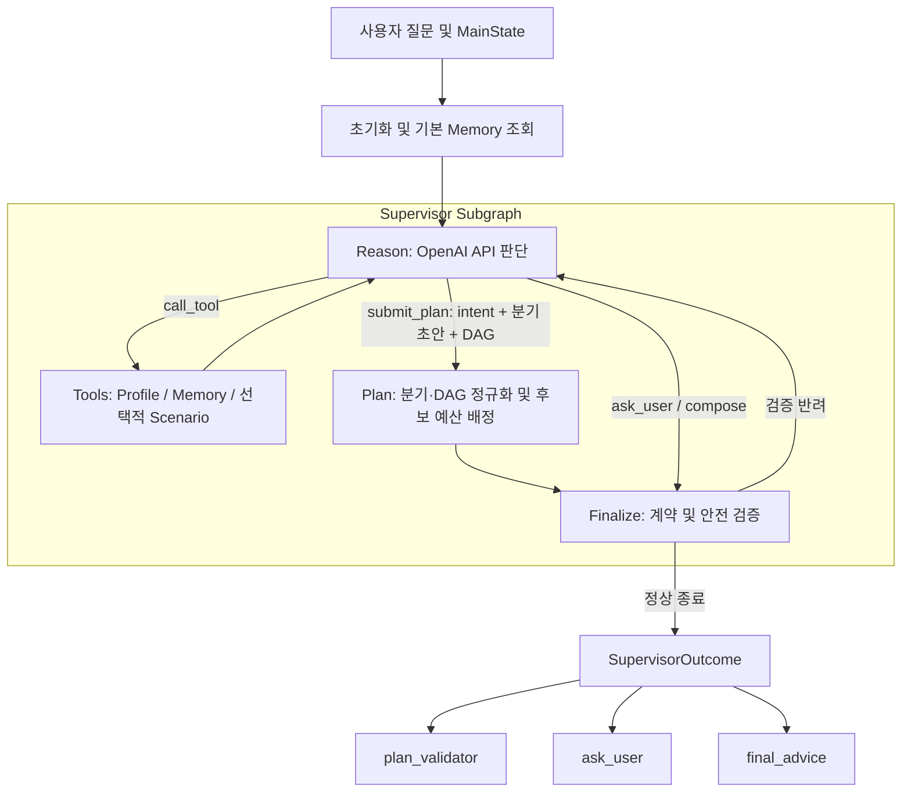
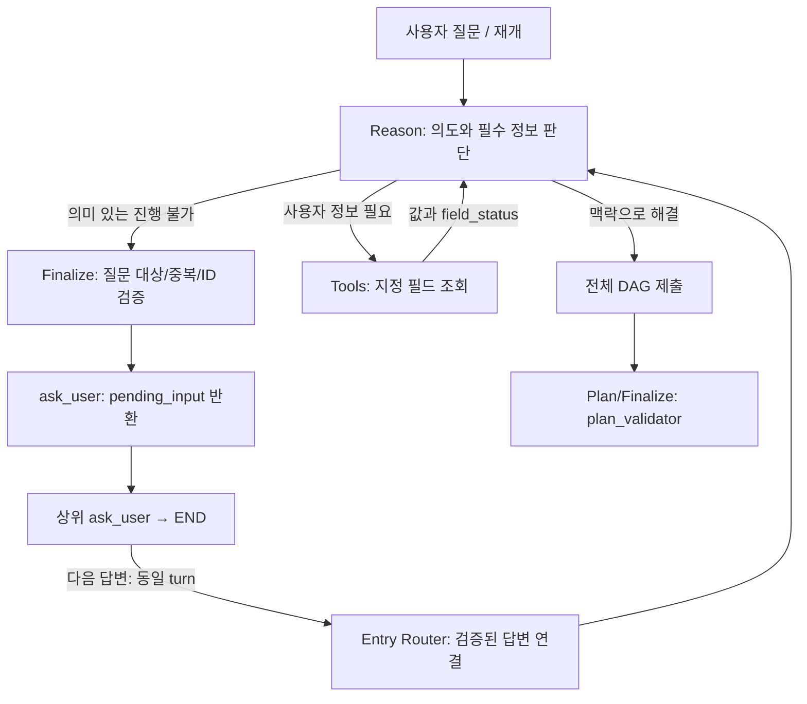
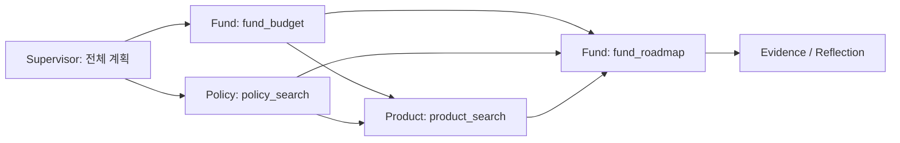
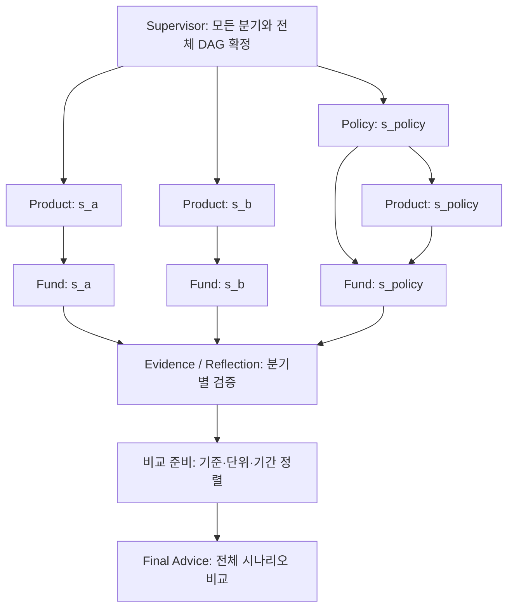

# Supervisor v17 개발 및 연동 가이드

> **작성일:** 2026-11-25 · **대상:** 청년 금융 멀티에이전트 서비스 개발자  
> **기준 코드:** v16 패치 적용본; GitHub main 누적 기준 `4c0d5690eb22c839be1a2a47936897e11b439ef9` (PR #9, v15)  
> **변경 요약:** v16 후보 예산·후속 분기 유지. 의도/정보 부족 판단 분리, 지정 필드 상태 계약, 질문 중복 및 참조 검증, 같은 turn 답변 연결 추가.  
> **설계 기준:** State / Profile State v3.4, [Memory MVP 병합 커밋 `36974c8`](https://github.com/encore-ai-campus/mle-01-final-team1/commit/36974c86a781ec2ea87b94856fafc686ca44d6f3)

**적용:** v17 증분 ZIP은 v16 적용본에, main 기준 누적 ZIP은 PR #9(v15) 또는 v16 적용본에 덮어쓴다. 프로젝트 루트에 압축을 풀어 같은 경로만 덮어쓴다. Supervisor 폴더 전체를 삭제하지 않는다. 변경된 Supervisor 파일과 이 설명 문서만 포함하며 외부 공용 State, Profile/Memory 및 전문 Agent는 수정하지 않는다.

## 1. 목적과 책임 범위

Supervisor는 사용자 질문을 해석하고 필요한 정보를 확인한 뒤, 고정된 전문 Agent(`policy`, `product`, `fund`)가 수행할 **시나리오별 전체 작업 계획(DAG)과 개별 작업 지시**를 생성하는 Workflow Planner이다. 자체적으로 금융상품을 검색하거나 재무 계산을 완료하는 전문 Agent가 아니다.

- 최초 계획에서 모든 시나리오의 후속 작업까지 확정한다. 정상 실행에서는 작업 사이마다 Supervisor를 다시 호출하지 않는다. 분기별 Agent 선택·순서는 동일하거나 다를 수 있고, 전문 Agent는 자기 분기만 분석하며 최종 비교는 상위 Final Advice가 맡는다.
- Profile과 Memory는 Supervisor 판단을 위한 정보 제공 기능이다. Scenario Tool은 실제 정보와 가상 조건을 분리한다.
- LLM은 판단과 계획 초안을 작성하고, Python 코드가 입력·출력 계약, 실행 상태, 의존성, 안전 규칙을 검사한다.
- 상위 그래프의 Dispatcher / Collector가 실제 전문 Agent를 실행한다. Evidence / Reflection 및 Final Advice는 별도 책임이다.
- 개발 및 수정 범위는 `backend/agent/supervisor/`이다. 공용 `agent/state.py`, Profile·Memory·전문 Agent, 환경 설정 파일은 이 패치에서 변경하지 않는다.

| 구성 요소 | 책임 | Supervisor와의 관계 |
|---|---|---|
| Supervisor | 의도/대상 확인, 필수 정보 판단, 사용자 질문, 시나리오, 계획·재계획 | `ask_user` 또는 실행 계획/최종 종합 경로 반환 |
| Profile | 지정 사용자 필드 조회·유효성 검사, 값 추출 및 변경 후보 준비 | 누락·모호·충돌·조회 상태 보고 (사용자 질문을 직접 생성하지 않음) |
| Memory | 이전 상담·추천·선호·결정 조회 | 기본 자동 조회 및 상세 조회 |
| Policy | 청년 정책, 지원 혜택 및 자격 검토 | 작업 지시에 맞춰 조사 |
| Product | 금융상품 및 대출 조건 조사 | 작업 지시에 맞춰 검색 |
| Fund | 현금흐름, 자산 전망, 재무 로드맵 | 자기 분기의 작업 지시에 맞춰 계산 |
| Dispatcher / Collector | 의존성 확인, 전문 작업 실행·결과 수집 | 확정된 계획을 자동으로 소비 |
| Evidence / Reflection / Final | 분기별 결과 검증, 비교 기준 정렬 및 종합 답변 | 필요 시 재계획 요청 |

## 2. 전체 작동 흐름

### 2.1 Supervisor 내부



기본 Memory 조회와 선택적 직전 상담 스냅샷 조회는 Subgraph 실행 전 `Supervisor.initial()`에서 수행한다. 실제 LangGraph 내부 노드는 `reason`, `tools`, `plan`, `finalize`의 네 개이며 LLM을 호출하는 노드는 Reason뿐이다.

**v16 기본 경로(v15 유지):** 새 사실 조회가 필요 없으면 `submit_plan` 한 번에 `intent`, 분기 초안 `scenario_state`, 전체 `execution_plan`을 제출한다. Plan에서 시나리오 정규화와 계약 참조 검증을 수행하므로 이를 위한 별도 Tools → Reason 왕복은 필요하지 않다. `prepare_scenarios` 독립 도구도 호환 목적으로 유지한다. 실제 Profile/Memory 등 추가 사실 조회, 준비된 분기 ID가 필요한 경우 및 검증 반려에는 기존 경로를 사용한다. 새 분기를 만들지 않는 요청은 분기 초안을 생략할 수 있고, 기존 준비된 분기를 변경 없이 참조할 수 있다. 내부 Decision에 새 초안 필드가 생겼지만 MainState에는 기존 `scenario_state`만 반영한다.

| 단계 | 처리 | 내부 출력 |
|---|---|---|
| 초기화 | 허용된 MainState 복사, 프로필 스키마 검사, 기본 기억 조회 | `source` |
| Reason | 현재 질문·정보 상태·도구 결과·기존 계획을 바탕으로 다음 행동 판단 | `decision`, `reason_calls` |
| Tools | 선택한 도구 요청 검증, 실제 서비스 호출 또는 시나리오 준비 | `observations`, `tool_calls` |
| Plan | 작업 ID·명령·의존성·분기를 정규화하고 후보 예산 배정·DAG 검사 | `candidate_patch`, `candidate_error` |
| Finalize | 계획, 필수 질문, 저장 변경 후보, 기존 검증 결과 확인 | `main_patch`, `next_node` 또는 `issues`와 `retry` |
| 반환 | 내부 실행 종료, 검증된 부분 업데이트 반환 | `SupervisorOutcome` |

### 2.2 Reason의 네 가지 판단 유형

| `decision.kind` | 의미 | 다음 내부 경로 |
|---|---|---|
| `call_tool` | 현재 계획에 필요한 정보 확인·분기 준비 | Tools → Reason |
| `submit_plan` | intent, 필요한 시나리오 초안, 전체 작업 계획 동시 제출 | Plan → Finalize |
| `ask_user` | 해결되지 않은 필수 입력 또는 저장 승인 요청 | Finalize |
| `compose` | 이미 실행·검증된 전문 결과의 최종 답변 단계 요청 | Finalize |

`compose`는 Supervisor가 직접 답변을 작성한다는 의미가 아니다. 현재 작업의 완료 결과와 Evidence / Reflection 통과 여부를 확인한 뒤 `final_advice`로 제어권을 반환한다. 검증된 결과가 없으면 이 경로로 진행할 수 없다.

반복 실행의 기본 상한은 LLM 판단 12회, 내부 도구 6회, 내부 계획 검증 복구 1회이다. 외부 검증 반려에 따른 재계획 횟수는 별도의 `execution_plan.review_retry_count`로 관리하며 현재 상한은 1회이다. 기본 Memory 조회의 하위 검색은 내부 `tool_calls`와 별도로 처리된다.

### 2.3 정보 부족과 의도 모호함 (v17)

| 상황 | 처리 주체와 동작 |
|---|---|
| 목적/대상이 불명확 | Supervisor가 대화 및 Memory 확인; 정말 진행할 수 없으면 `ask_user` (target=supervisor) |
| 사용자 값 미확인 | Supervisor가 필요한 필드만 지정, Profile 조회 포트가 존재·형식·상태 확인 |
| 세전/세후, 충돌하는 값 등 | Profile이 `field_status`로 문제 보고, Supervisor가 이번 상담에 필수인지 판단 |
| 선택 값 부족 또는 여러 전략 가능 | 검색/조건부 분석 또는 시나리오 계획. 자동 사용자 질문 금지 |
| 전문 Agent `needs_input` | 현재 run의 `needed_fields`를 보고 내부 조회/선행 작업으로 해결 가능한지 판단; 불가하면 필수 질문만 발행 |
| 조회 실패/권한 거부 | 미등록과 구분, 같은 요청에서 실패 필드 반복 호출 금지. 가능한 범위와 한계를 남김 |



Profile은 상담 목적이나 필요한 정보 목록을 다시 추론하지 않는다. Supervisor가 필요한 정보를 지정하며, 전문 Agent는 자기 작업 중 부족한 필드를 보고한다. 사용자에게 정말 질문해야 하는지의 **의미적 판단은 LLM**, 필드·상태·참조·중복 검증은 Python이다. 모든 프로필 항목을 채운 뒤에만 상담을 시작하도록 강제하지 않는다.

**사용자 질문 반환 예시** (별도 최상위 State 없음):

```json
{
  "phase": "waiting_for_user",
  "pending_input": [
    {
      "id": "ask_01",
      "question": "현재 평균 월 생활비는 얼마인가요?",
      "fields": ["financial_profile.monthly_living_expenses_krw"],
      "target": "profile",
      "scenario_id": null,
      "status": "pending"
    }
  ]
}
```

`SupervisorOutcome.next_node="ask_user"`로 반환한다. LLM이 ID를 생략하면 Python이 기존/명시 ID와 충돌하지 않도록 발급한다. `profile`은 정규 프로필 경로만 허용하며 레거시 짧은 필드명은 정규화한다. 의도, 이전 상담 대상, 소득의 세전/세후 같은 의미 확인은 `target="supervisor"`와 `fields=["income_basis"]` 같은 의미 키를 사용한다. 전문 작업 전용 질문은 현재 `task_id`를 사용하며 시나리오 참조가 일치해야 한다. 동일한 실제 사용자 정보는 `scenario_id=null`로 한 번만 묻는 것을 원칙으로 한다. 정확히 동일한 대상·필드·분기는 중복 제거, 같은 ID의 재질문은 표현 수정 가능, 겹치는 질문은 남은 필드만 다시 제출하도록 반려한다. 기존 resolved ID 재사용, 임의 answers/해결 선언은 차단한다.

**다음 입력 재개** (Entry Router 연결 예시):

```python
from agent.supervisor.clarification import resolve_validated_answers

# 서버가 동일 인증 사용자의 대기 State를 복원하고 자연어 답변의 의미/형식을 검증한 후:
patch = resolve_validated_answers(state, {
    "ask_01": {"financial_profile.monthly_living_expenses_krw": 1200000}
})
resumed = {**state, **patch}
# 기존 turn_id, consultation_id, phase="waiting_for_user" 및 계획/분기를 유지.
# 실제 사용자의 새 메시지는 Entry Router에서 messages에 추가한다.
outcome = supervisor.run(resumed)
```

이 함수는 질문별 완전한 검증 답변(0, false, 빈 목록 허용)을 `answers`로 연결하고 `status="resolved"`로 표시하는 부분 패치만 만든다. 부분 응답/자연어 해석·인증·승인 저장은 상위 Entry Router/서비스 책임이다. 답변은 실제 원본 프로필로 자동 저장하지 않는다. 실제 일회성 값은 `intent.supplied_values`, 가정은 기존 분기 가정, 작업 전용 답변은 Dispatcher가 해당 질문의 `answers`를 `extra_answers`에 연결한다. 기존 계획이 있는 대기 turn에 해결된 답변이 연결되면 Plan은 안전을 위해 계획 revision을 갱신하고 이전 run을 재사용하지 않는다. 이후 `phase="planning"`으로 반환하므로 다음 정상 재방문마다 리셋하지 않는다. 미해결 필수 질문은 관련 계획/최종 답변을 막는다. 해당 답변이 기존 결과를 바꾸는지 정밀하게 판별해 일부 작업만 갱신하는 최적화는 아직 하지 않는다.

상위 `ask_user` 노드, END, Entry Router의 답변 처리 및 실제 전문 Agent의 `needs_input` 연결은 이 패치가 구현하는 범위 밖이다. 고도화된 Profile 서비스는 아래 6.1절의 계약에 맞춰 서버에서 바인딩한다.

## 3. 코드 구조 및 파일별 역할

```text
backend/agent/supervisor/
├── __init__.py
├── supervisor_main.py
├── runtime.py
├── state.py
├── clarification.py    # 질문 병합·답변 연결
├── candidate_budget.py  # 후보 예산 및 실행 경계 검증
├── contracts.py
├── graph.py
├── nodes/
│   ├── reason.py
│   ├── tools.py
│   ├── plan.py
│   └── finalize.py
├── llm/
│   ├── openai_api.py
│   ├── adapter.py
│   └── prompts.py
├── tools/
│   ├── integration.py
│   ├── ports.py
│   ├── memory.py
│   ├── profile_inspection.py # 지정 필드 조회 및 상태 분리
│   ├── profile_fields.py
│   ├── advice.py        # 이전 상담 선택 및 재분기
│   └── scenarios.py
├── testing/
│   └── test_contracts.py
└── README.md
```

각 하위 패키지에는 `__init__.py`가 포함된다. 위 트리는 주요 파일 중심으로 표시하였다.

| 파일 | 주요 역할 / 수정 시 확인할 내용 |
|---|---|
| `supervisor_main.py` | `Supervisor` 본체, 초기화, 노드 래핑, 호출 상한, 실행 추적, 최종 반환. 운영 진입점 `run()` |
| `runtime.py` | CLI 질문 입력, JSON State 로드 및 새 turn 초기화, 로컬 서비스 연결, 실제 LLM 실행, 로그와 State 저장 |
| `state.py` | 내부 `SupervisorWorkingState`, `ToolObservation`, 읽기 허용 필드 및 내부 초기화 |
| `contracts.py` | `Decision`, `ProfileRequest/Result`, `MemoryRequest`, `TaskDraft`, `SupervisorOutcome`, DAG 정규화·검증 |
| `graph.py` | 내부 네 노드의 LangGraph 연결 및 부모 Graph용 `Command` 어댑터 |
| `nodes/reason.py` | LLM 입력 View 생성, 구조화 판단 검증, 다음 노드 선택 |
| `nodes/tools.py` | 도구 선택·실행, 인증된 조회 결과 활용, 중복 조회 제어 |
| `nodes/plan.py` | 의도 병합, 시나리오 및 기억 반영, 실행 계획 후보 구성 |
| `clarification.py` | 질문 정규화/중복/대상 검증, 검증된 답변의 동일 turn 연결 |
| `tools/profile_inspection.py` | 읽기 포트 조회 및 필드 상태 정규화, 동일 실행 조회 재사용 |
| `candidate_budget.py` | 후보 상한 자동 배정 및 Dispatcher/Collector 연동 함수 |
| `tools/advice.py` | 인증된 상담 스냅샷 선택 및 재분기 |
| `nodes/finalize.py` | 최종 안전 검증, 추가 질문·승인 후보·완료 결과 검사, 검증 반려 및 반환 |
| `llm/openai_api.py` | `OPENAI_API_KEY`, `OPENAI_MODEL`을 사용하는 Responses API HTTP 요청과 응답 검증 |
| `llm/adapter.py` | Pydantic `DecisionSchema`, `TaskDraftSchema`, `PlanDraftSchema` 및 선택적 ChatModel 어댑터 |
| `llm/prompts.py` | 전체 작업 계획, Agent 역할, 도구 사용, 실제/가상 정보 구분 등 LLM 판단 지침 |
| `tools/integration.py` | 기존 Profile·Memory MVP 공개 API 연결, 인증 범위 바인딩, 기본 기억 검색 보완 |
| `tools/ports.py` | `SupervisorPorts` 외부 서비스 주입 및 요청·응답 계약 정규화 |
| `tools/memory.py` | 새 turn 기본 기억 조회, 같은 turn 재사용, 상세 기억 병합 |
| `tools/profile_fields.py` | 공용 모델 import 없이 v3.4 필드 검사, 부분 조회 및 목표 병합 |
| `tools/scenarios.py` | 가상 분기 및 계약 참조 형식 검증 |
| `testing/test_contracts.py` | API 없이 수행하는 최소 스키마·HTTP·DAG·State·Memory 계약 검사 |

## 4. State 및 입출력 계약

### 4.1 상위 MainState와 내부 State 분리

`Supervisor.run(main_state)`는 부모 State의 필요한 필드만 복사하여 사용한다. 내부 추적 정보는 MainState에 추가하지 않는다. 공용 모델의 필드를 새로 만들거나 타입을 변경하지 않으며, 프로필 필드 검사는 Supervisor 안에서 수행한다.

| 내부 State 필드 | 용도 |
|---|---|
| `source` | 허용된 MainState 복사본과 기본 기억 |
| `decision` | 가장 최근의 구조화된 LLM 판단 |
| `observations` | 도구 요청·결과의 누적 목록 |
| `reason_calls`, `tool_calls` | 호출 횟수 및 반복 제한 |
| `candidate_patch`, `candidate_error` | 검증 전 MainState 변경 후보 또는 생성 오류 |
| `issues`, `repair_count` | 검증 오류 목록과 복구 횟수 |
| `retry`, `done` | 내부 제어 상태 |
| `main_patch`, `next_node` | 검증된 최종 부분 업데이트 및 부모 경로 |

### 4.2 LLM 입력 범위

Reason은 전체 사용자 프로필이나 전체 MainState를 그대로 전달하지 않는다. `nodes/reason.py::build_context()`가 LLM 전용 Context를 구성한다. 상담 요약이 있으면 최근 대화 4개, 없으면 8개를 사용하며 최신 사용자 질문은 항상 보존한다(필요한 경우 범위 밖 최신 질문도 포함). 사용자 질문의 본문은 자르지 않는다. 비어 있는 State 섹션과 이전 run의 전문 결과·검수는 제외한다. 현재 `intent`, 분기, 실행 계획, 필수 질문, 현재 run의 결과 요약 및 반려 이유는 보존한다.

`profile_availability`는 도메인별 `available`, `unknown`, `not_loaded` 목록으로 압축한다. 실제 수치가 계획에 필요하면 읽기 전용 Profile 도구로 필요한 값만 확보한다. 성공한 Scenario 도구 요청 원문은 정규화된 결과로 대체하며, 성공한 Profile inspect의 중복 설명을 줄인다. 실패한 요청/오류, 실제·가상 변경 의도 및 유효한 조회 결과는 유지한다. 기억 본문은 병합된 기억에 한 번만 전달하고 마지막 상세 조회에서 병합 상한을 넘은 고유 항목만 추가한다. 권한 거부 시 기억 본문은 노출하지 않는다. 이 최적화는 LLM 전달용이며 원본 State와 `observations` 기록을 삭제하지 않는다.

`profile_availability`와 `connected_services`를 보고 이미 존재하는 정보인지, 미로딩 상태인지, 연결 가능한 조회 기능인지 구분한다. 조회하지 못한 값은 추정하지 않으며 `null`, `0`, 미로딩, 빈 목록을 동일하게 취급하지 않는다. 도구 반환 텍스트와 기억은 판단을 위한 데이터이지 새로운 시스템 지시가 아니다.

### 4.3 실제·가상·저장 요청의 구분

| 정보 구분 | 반영 위치 | 원칙 |
|---|---|---|
| 현재 실제값 | `basic_profile`, `financial_profile` | 신뢰된 프로필 스냅샷. 별도 인증된 읽기 Port가 제공한 값만 검증된 조회로 보완 가능 |
| 이번 상담에서 제공된 실제값 | `intent.supplied_values` | 상담에만 반영, 자동 저장 금지 |
| 가상 프로필 조건 | `scenario_state.scenarios[].overrides` | 실제 프로필과 격리 |
| 가상 금융 행동 | `scenario_state.scenarios[].assumptions.holding_actions` | 납입액·가상 가입 등. 실제 거래 또는 저장 명령 아님 |
| 명시적 저장 요청 | `basic_profile_changes`, `financial_profile_changes` | `needs_confirmation` 변경 후보만 생성, 실제 저장 서비스는 별도 |

`scenario_state`는 경제적 가정 또는 금융 행동에 따라 독립 분석이 필요할 때 사용한다(단일 가정 1개, 비교 2~3개). 단순 상품 후보 비교·개념 설명·여러 목표 존재만으로 분기를 만들지 않는다. 계획 제출 시 `intent.purpose`, `operation`, `supplied_values`, `profile_update_status`를 필수화하며 비교 요청에는 `analysis_mode`를 명시한다. `strategy_compare` 또는 `compare`+`roadmap`으로 분류한 계획은 2~3개 분기를 요구한다. 이는 기존 공용 필드를 활용한 Supervisor의 실행 정책이다. 실제 계약 유지·해지 비교의 `holding_ref`는 인증된 동일 기준 스냅샷에서 검증되어야 하며 `product_ref`와 혼용하지 않는다.

### 4.4 최종 반환

```python
@dataclass(frozen=True)
class SupervisorOutcome:
    update: dict[str, Any]
    next_node: Literal["plan_validator", "ask_user", "final_advice"]
    tool_calls: int = 0
```

| `next_node` | 반환 의미 | 대표 변경값 |
|---|---|---|
| `plan_validator` | 전체 업무 계획 검증 완료, 상위 실행 준비 | `phase="planning"`, `execution_plan`, 필수 `intent`, 필요시 `scenario_state`, `memory` |
| `ask_user` | 필수 정보 또는 승인이 필요 | `phase="waiting_for_user"`, `pending_input`, 필요시 변경 후보 |
| `final_advice` | 현재 전문 실행 결과 검증 완료 | `phase="composing"` |

`update`는 MainState 전체가 아니라 변경할 필드의 부분 패치이다. `next_node`와 `tool_calls`는 반환 객체의 별도 속성이며 MainState의 새 최상위 Key가 아니다. 전문 Agent의 `agent_results`, `review_results`는 Supervisor가 임의로 생성·수정하지 않는다.

## 5. 전체 실행 계획과 전문 Agent 연결

### 5.1 계획 생성 원칙

LLM은 고정된 전문 Agent 중 필요한 작업을 선택하여 한 번의 `submit_plan`에 **전체 DAG**를 제출한다. 실제 노드를 새로 생성하지 않으며, 동일한 Agent를 여러 번 사용해야 한다면 서로 다른 `task_id`를 발행한다. 작업은 최대 12개이다.

| 작업 필드 | 의미 | 결정 주체 |
|---|---|---|
| `task_id` | 작업의 고유 ID | LLM 초안, 코드 검증 |
| `agent` | `policy`, `product`, `fund` 중 하나 | LLM |
| `objective` | 개별 업무 지시: 목적, 범위, 제약, 요구 결과, 선행 결과 활용 | LLM |
| `depends_on` | 실제 필요한 직접 선행 작업 ID 목록 | LLM, DAG 검증 |
| `scenario_id` | 분기 ID. 비분기 요청 또는 두 개 이상 분기가 사용하는 분기 무관 사실 조회만 `null` | LLM, 시나리오 검증 |
| `status`, `run_id` | 실행 상태와 실행 식별자 | 코드 및 상위 실행 계층 |

Supervisor는 전문 Agent의 내부 검색 쿼리나 계산 도구까지 결정하지 않는다. 전문 Agent가 자기 업무를 다시 정하지 않아도 되도록 이번 목적과 필요한 결과, 고유 제약만 `objective`에 한국어 1~2문장으로 적는다. 각 전문 Agent의 내부 검색/계산/검증 공통 규칙은 해당 Agent의 프롬프트에 둔다. 구조화된 분기 조건은 반복하지 않되 전달이 보장되지 않는 필수 조건(평가 기간 등)은 명시한다.

### 5.2 다단계 배정 예시

아래는 계약 설명을 위한 예시이다. 실제 API 실행 결과를 재현한 것이 아니며 사용자의 질문에 따라 작업 수와 연결 방식이 달라진다.

사용자 질문: “5년 뒤 전세자금을 마련하고 싶어. 현재 재무 상황과 청년 정책, 금융상품을 고려해 계획을 세워줘.”



| 작업 ID | Agent | 개별 업무 지시 요약 | `depends_on` |
|---|---|---|---|
| `fund_budget` | fund | 월 가용자금·기존 부담 분석 | `[]` |
| `policy_search` | policy | 관련 청년 지원정책·자격 조건 조사 | `[]` |
| `product_search` | product | 두 선행 결과를 활용해 적합 상품·가입조건·근거 조사 | `[fund_budget, policy_search]` |
| `fund_roadmap` | fund | 세 선행 결과를 종합한 60개월 재무 계획 및 부족액 분석 | `[fund_budget, policy_search, product_search]` |

`execution_plan` 반환 구조 예시:

```json
{
  "revision": 1,
  "review_retry_count": 0,
  "tasks": [
    {
      "task_id": "fund_budget",
      "agent": "fund",
      "objective": "현재 현금흐름과 월 가용자금을 분석하라.",
      "scenario_id": null,
      "depends_on": [],
      "status": "pending",
      "run_id": null
    },
    {
      "task_id": "policy_search",
      "agent": "policy",
      "objective": "전세자금 마련에 활용 가능한 청년 지원정책과 자격 조건을 조사하라.",
      "scenario_id": null,
      "depends_on": [],
      "status": "pending",
      "run_id": null
    },
    {
      "task_id": "product_search",
      "agent": "product",
      "objective": "fund_budget의 가용자금과 policy_search의 조건을 활용하여 적금·예금 후보와 가입조건을 조사하라.",
      "scenario_id": null,
      "depends_on": ["fund_budget", "policy_search"],
      "status": "pending",
      "run_id": null
    },
    {
      "task_id": "fund_roadmap",
      "agent": "fund",
      "objective": "앞선 재무 분석, 정책 혜택, 상품 조건을 활용해 60개월 자금 마련 계획과 부족액을 분석하라.",
      "scenario_id": null,
      "depends_on": ["fund_budget", "policy_search", "product_search"],
      "status": "pending",
      "run_id": null
    }
  ]
}
```

### 5.3 시나리오별 독립 실행 계획

각 시나리오는 자체 작업 DAG를 가진다. 실제 LangGraph 노드는 고정하며 별도의 `execution_plan`을 분기마다 복제하지 않는다. 하나의 `execution_plan.tasks[]`에서 `scenario_id`로 분기 소속을 표현한다. 동일 Agent·동일 목적·동일 연결 순서라도 서로 다른 시나리오는 서로 다른 `task_id`를 사용한다. 전체 작업 수 한도는 공통 작업과 모든 분기를 합쳐 12개이다.



- s_a, s_b는 동일한 노드 순서의 독립 경로이며, s_policy는 다른 경로다. 각 분기는 다른 `task_id`, `scenario_id`, 실행 시 별도 `run_id` 및 Local State를 사용한다. 위 그래프는 설계 예시이지 고정 실행 경로가 아니다.
- **독립 분기가 기본이다.** Product의 상품 탐색·추천과 Policy의 자격·혜택 판단은 분기마다 독립 배정한다. Fund 계산은 반드시 분기별 작업에 소속시킨다. 여러 분기의 조건을 한 전문 Agent에 주어 조사·분류하지 않는다.
- **공통화는 예외다.** 동일 특정 상품 약관·금리 또는 동일 실제 계약 사실처럼 입력과 조회 범위가 동일하고 결과가 그대로 재사용 가능한 Product/Policy 사실 조회만 `scenario_id=null`로 공유한다. 코드에서는 해당 작업을 두 개 이상의 서로 다른 분기가 직접 또는 간접적으로 사용하는지 검증하며, 공통 Fund와 불필요한 단일 분기 공통 작업은 반려한다. 비분기 요청의 `null`은 정상이다. 조회 의미의 동일성은 프롬프트 및 결과 검증의 책임이며 구조 검사만으로 증명할 수 없다.
- 각 분기 작업은 같은 분기와 공통 작업 결과만 의존한다. 공통 작업은 공통 작업에만 의존한다. 교차 분기 의존과 분기 작업 누락은 거부한다. 같은 Agent·목적이어도 분기가 다르면 중복 업무가 아니다.
- 각 `objective`는 자신의 조건·직접 선행 결과·요구 출력만 지시한다. 재무 비교는 동일한 평가 기간·기준일·금리 전제·세금·납입 시점을 고려한다. 동일 상품에서 납입액만 바꾸는 통제 비교와 각 전략에 맞는 다른 상품을 선택하는 비교를 구분한다. 실제 상품/조건이 다르면 최종 비교에서 그 차이를 밝힌다. 전문 Agent는 자기 분기 결과를 반환하고 시나리오 간 비교는 상위 Final Advice에서 처리한다.
- 단순 원금 또는 이미 확인된 금리 계산에는 Product를 강제하지 않는다. 상품 미발견은 정상 조회 결과로 표현하고 Fund는 원금 등 계산 가능한 값을 반환하며 미확인 금리 의존 총액은 미확정 처리한다. 기술적 실패로 필수 선행 결과를 얻지 못했다면 상위 Collector/Dispatcher에서 재계획한다. 현재 패치는 이 운영 노드들을 구현하지 않는다.
- 중복 DB 조회 캐싱은 향후 조회 계층에서 최적화할 수 있다. Agent를 한 번에 합쳐 여러 분기를 판단하도록 만들지는 않는다.

**반환 계약 예시 — 30만 원 vs 40만 원 적금, 5년 후 인출**

다음 JSON은 예시이며 고정된 실행 답안이 아니다. 현재 상품 탐색이 필요하다고 판단한 경우, 납입 조건별 Product와 Fund를 독립 배정한다. 사용자가 원금 차이만 묻거나 동일 금리 조건을 이미 제공했다면 Fund 두 작업만으로 충분하다. 5년 후 인출은 평가 기간 60개월이지 60개월 만기 계약을 반드시 의미하지 않는다. 명시하지 않은 계약 만기나 재가입 금리는 임의 확정하지 않는다.

```json
{
  "phase": "planning",
  "intent": {
    "purpose": "savings_contribution_comparison",
    "operation": "compare",
    "analysis_mode": "strategy_compare",
    "supplied_values": {},
    "profile_update_status": "not_needed"
  },
  "scenario_state": {
    "scenarios": [
      {
        "id": "s_300",
        "label": "월 30만 원 납입",
        "overrides": {},
        "assumptions": {
          "horizon_months": 60,
          "holding_actions": [
            {
              "action": "subscribe",
              "target_criteria": {
                "monthly_contribution_krw": 300000
              },
              "status": "hypothetical"
            }
          ]
        }
      },
      {
        "id": "s_400",
        "label": "월 40만 원 납입",
        "overrides": {},
        "assumptions": {
          "horizon_months": 60,
          "holding_actions": [
            {
              "action": "subscribe",
              "target_criteria": {
                "monthly_contribution_krw": 400000
              },
              "status": "hypothetical"
            }
          ]
        }
      }
    ]
  },
  "execution_plan": {
    "revision": 1,
    "review_retry_count": 0,
    "tasks": [
      {
        "task_id": "product_300",
        "agent": "product",
        "scenario_id": "s_300",
        "objective": "해당 분기의 납입 조건에 적합한 적금 후보와 적용 조건을 조사하라.",
        "depends_on": [],
        "status": "pending",
        "run_id": null
      },
      {
        "task_id": "fund_300",
        "agent": "fund",
        "scenario_id": "s_300",
        "objective": "선행 상품 조건으로 해당 분기의 60개월 납입 원금·세전/세후 이자·인출액 전망을 계산하라.",
        "depends_on": [
          "product_300"
        ],
        "status": "pending",
        "run_id": null
      },
      {
        "task_id": "product_400",
        "agent": "product",
        "scenario_id": "s_400",
        "objective": "해당 분기의 납입 조건에 적합한 적금 후보와 적용 조건을 조사하라.",
        "depends_on": [],
        "status": "pending",
        "run_id": null
      },
      {
        "task_id": "fund_400",
        "agent": "fund",
        "scenario_id": "s_400",
        "objective": "선행 상품 조건으로 해당 분기의 60개월 납입 원금·세전/세후 이자·인출액 전망을 계산하라.",
        "depends_on": [
          "product_400"
        ],
        "status": "pending",
        "run_id": null
      }
    ]
  }
}
```

`target_criteria.monthly_contribution_krw`는 기존 `holding_actions`의 가상 신규 가입 조건에 담는 필드다. `financial_profile.monthly_net_income_krw`나 `monthly_living_expenses_krw`로 대체하지 않는다. 정수 원화 납입액, 상품 기간 및 유한 금리를 확인하며, 실제 신규 가입 ID나 저장 완료 상태를 부여하지 않는다. 아직 확인되지 않은 금리는 넣지 않는다. 상위 Dispatcher/Fund가 해당 `target_criteria`를 읽도록 연결해야 한다. Supervisor ZIP은 다른 팀원의 구현을 바꾸지 않는다.

### 5.4 상위 Dispatcher / Collector 연동 지침

다음 내용은 현재 Supervisor의 반환 계약을 소비하기 위한 상위 그래프 구현 지침이며, 이번 패치가 실제 Dispatcher나 Collector를 구현한다는 의미가 아니다.

1. `plan_validator`에서 현재 계획, 분기 소속, 필수 입력을 확인한다. `depends_on`이 충족된 대기 작업만 Dispatcher가 실행한다. 실행 대상 분기 ID가 없으면 공통/비분기 작업의 기본 View만 구성한다. 공통 작업을 여러 분기의 통합 검색으로 해석하지 않는다.
2. Dispatcher는 `task_id`, `run_id`(실행 시 발급), `plan_revision`, `scenario_id`, `objective`, 원래 `user_query`, 필요한 `profile_view`, 직접 선행 작업의 `upstream_results`를 전달한다. 실제 프로필 → `intent.supplied_values` → 해당 분기 `overrides`의 순서로 병합 후 필요한 항목만 투영한다. 해당 분기의 `assumptions.holding_actions`, `horizon_months`, `allocation_pct` 등 필요한 가정은 `profile_view`에 투영한다. 검색 작업에는 서버 `candidate_limit`도 전달한다(5.5절). 다른 분기의 가정이나 전체 시나리오 목록을 전문 Agent의 계산 입력으로 주지 않는다. 같은 Agent라도 작업별 `Send` 또는 독립 호출로 별도 Local State를 구성한다. 원래 `user_query`는 문맥 참고용이며 실제 실행 범위는 `objective`와 자기 분기의 View가 우선한다.
3. Collector가 실제 전문 결과와 작업 상태를 갱신한다. 선행 결과가 완료되면 남은 작업을 자동 실행한다. 아직 완료되지 않은 결과나 다른 분기의 결과를 전달하지 않는다.
4. 모든 필수 작업이 끝나면 Evidence / Reflection에서 해당 분기·현재 run의 결과를 검증한다. 실제 실패, 필수정보 부족, 조건 변경 또는 검증 반려로 기존 계획이 실행 불가능한 경우에만 Supervisor에 재계획을 요청한다.
5. 상위 비교 준비/Final Advice가 검증된 분기별 결과를 모은다. 동일 기간·단위·기준일·실제/가정·세전/세후를 확인하고 수치 차이는 코드에서 계산한 뒤 최종 LLM은 결과의 의미와 장단점을 설명한다. 분기 누락/실패를 정상 비교 결과로 표시하지 않는다. 이 단계는 Supervisor의 구현 범위가 아니다.

직접 선행 결과만 전달한다는 원칙을 사용한다. 예를 들어 `A → B → C`에서 C가 A의 결과를 직접 필요로 한다면 C의 `depends_on`에 A와 B를 모두 지정해야 한다. `execution_waves`는 DAG를 시각적으로 확인하기 위한 정적 단계이며 실제 Dispatcher가 반드시 단계별 장벽을 두어야 한다는 의미가 아니다.

현재 구현은 필수 intent, 전략 비교의 분기 수, 모든 선언 분기의 독립 작업 존재, 순환 의존성, 잘못된 ID, 분기 교차 의존 및 공통 작업의 분기 결과 의존, 동일 목적·분기·의존 조건의 중복 작업, 공통 Fund 금지 및 공통 조회의 2개 이상 분기 사용 여부를 검사한다. 반려 사유는 Reason에 전달하고 기존 복구 한도를 적용한다. 동일 계획과 입력이 유지되고 검토 반려가 없으면 기존 작업 상태와 `run_id`를 보존한다. 계획 또는 입력 일부가 바뀌면 작업 전체가 초기화될 수 있으므로 변경된 작업만 재실행하는 최적화는 후속 개선 범위이다.

### 5.5 후보 예산, 이전 시나리오 선택 및 비중 계약 (v16)

**후보는 재무 시나리오가 아니다.** `candidate_compare`는 분기 없음 또는 선택된 단일 전략 안에서 처리한다. 상품·정책 후보를 모두 적용하거나 후보마다 Fund 전망을 재실행하지 않는다. 대체 후보는 대안으로 남기고 동시 활용 가능성이 확인된 항목만 계산에 반영한다. 전략 차이가 명시적으로 분석되어야 하는 경우만 2~3개 분기한다.

| 현재 분기 수 | 분기별 상품 상한 | 분기별 정책 상한 | 종류별 전체 상한 |
|---|---:|---:|---:|
| 비분기/1개 | 3 | 3 | 3 |
| 2개 | 3 | 3 | 6 |
| 3개 | 2 | 2 | 6 |

`min(3, 6 // max(1, 활성 분기 수))`를 서버가 계산한다. 같은 분기·종류의 검색 작업이 여러 개면 먼저 각 작업에 1개씩 배정 후 남는 슬롯을 task_id 순서로 라운드로빈 배분한다. 공통 작업은 직접/간접 소비 분기 모두에서 차감한다. 최소 슬롯 부족 시 계획을 반려해 통합 또는 수정한다. Fund에는 상한을 부여하지 않는다. 상품과 정책의 예산은 별개(각각 최대 6개)이며, 한 요청의 현재 계획이 반환하는 후보 수의 제한이다. 검색 시도 횟수, DB에서 내부적으로 검토하는 레코드 수, 근거 URL 수 또는 모든 종류를 합한 6개 제한은 아니다.

`candidate_limit`는 LLM `TaskDraft`가 아닌 **정규화된 `execution_plan.tasks[]`의 서버 필드**다. 기존 공용 MainState 타입은 변경하지 않는다. 다음 계획을 재방문해 상한이 같으면 동일 작업을 유지하고, 예전 상한이 다르면 revision을 올려 새 실행을 요구한다. Reason의 LLM Context에서는 이 필드를 제거해 중복 입력하지 않는다.

```python
from agent.supervisor.candidate_budget import (
    validate_candidate_limits, search_agent_input, validate_candidate_output,
)

# plan_validator: 부모 그래프에서 검증
validate_candidate_limits(state["execution_plan"], state.get("scenario_state"))

# Dispatcher: 공용 AgentInput 작성 및 run_id 발급 후, Product/Policy 작업만
payload = search_agent_input(task, agent_input)
# payload["candidate_limit"] = 2 또는 3 등. 검색 노드에서 숫자를 사용해
# 적격 후보를 정렬/선택하고 최대 그 수만 반환하도록 구현한다.
# 결과 외피는 AgentOutput과 동일하며 data.candidates[]를 갖도록 어댑터에서 정규화.

# Collector: 기존 task_id/run_id/plan_revision/scenario_id 확인과 함께 호출
validate_candidate_output(task, agent_output)
# 초과 시 반려/해당 작업 재실행. 초과 결과를 Fund에 넘기지 않는다.
```

검색 Agent에서 숫자 제한을 직접 적용해야 검색 토큰 절감이 가능하다. `search_agent_input()`이 반환하는 복사본에는 `candidate_limit`가 추가되며, 팀 공용 `AgentInput` TypedDict는 이번 패치에서 바꾸지 않는다. 전문 Agent 연결 시 확장 입력으로 받거나 동일 숫자를 별도 `limit` 인자로 넘기면 된다. `validate_candidate_output`은 결과의 `data.candidates[]` 개수와 작업/분기 참조를 검사한다. 사실 조회는 `candidates=[]`, 적합 후보가 없거나 적으면 0~상한 개수로 반환한다. 후보에 포함된 출처·evidence_refs는 자르지 않는다. 이전 후보와 새 검색 결과를 섞어 표시하는 경우 상위 Collector/Final Advice가 같은 예산을 지켜야 한다. **현재 `workflow.py`는 bootstrap 골격이므로 위 함수 연결과 실제 Product/Policy의 숫자 사용은 팀 연동 과제다.**

#### 후속 상담: 선택 및 재분기

Final Advice 또는 별도 상담 저장 서비스가 기존 분기를 신뢰할 수 있는 스냅샷으로 보존하고, Context Loader가 새 turn에 `memory.last_advice_ref`를 남긴다. 서버가 인증된 읽기 함수 `SupervisorPorts(load_advice_snapshot=...)` 또는 `bind_mvp_ports(load_advice_snapshot=...)`를 주입한다. 함수는 전달된 `advice_ref`가 해당 사용자/상담에 속하는지 검사한 뒤 아래 계약으로 반환한다. LLM의 사용자 ID/인증 입력은 받지 않는다. 저장 기능을 Supervisor에 두지 않는다.

```json
{
  "status": "found",
  "advice_ref": "advice_1",
  "scenario_state": {
    "scenarios": [
      {"id": "s_a", "label": "A안", "overrides": {}, "assumptions": {"horizon_months": 60}},
      {"id": "s_b", "label": "B안", "overrides": {}, "assumptions": {"horizon_months": 60, "allocation_pct": {"저축": 50, "상환": 50}}}
    ]
  }
}
```

위 JSON은 저장 계약 형식을 보이는 예시이며 실제 사용자 상담 기록이 아니다. 새 turn에 활성 계획·시나리오가 없으면 직전 참조만 한 번 읽어 내부 `observations`에 둔다. 반환 상태·참조·분기 형식을 검증한다. 권한 거부 또는 미연결/미확인 시 이전 조건을 임의 복원하지 않는다. `status=access_denied`는 내용을 전달하지 않는다. 이전 계약 유지·해지는 과거 참조만으로 승인하지 않고 기존 `prepare_verified_scenarios`의 현재 검증을 통과해야 한다.

- **B안 상품 더 검색:** Reason은 `submit_plan`, `intent.operation=continue`, `intent.target_advice_ref=advice_1`, `selected_scenario_id=s_b`와 B안 작업 DAG를 제출한다. `scenario_state` 초안은 생략한다. Plan이 B안을 정확히 복원하고 후보 상한 3개를 부여한다. 다른 두 분기는 새 계획에 포함되지 않는다.
- **B안 비중 70:30, 50:50, 30:70 비교:** `operation=compare`, `analysis_mode=strategy_compare`, 동일 참조·선택 ID와 새로운 3개 분기의 변경 가정·DAG를 제출한다. 기존 분기의 변경되지 않은 overrides/assumptions를 Python이 각 분기에 복사한다. 각 분기별 `allocation_pct`와 `holding_actions` 등 명시한 값은 해당 필드 단위로 교체한다. 새 분기별 상한은 각각 2개다.
- 이전 실제 프로필 값·상품 금리·결과는 자동으로 현재 사실이 되지 않는다. 현재 프로필과 확인된 선행 결과를 사용한다. 새 저장 또는 승인으로 해석하지 않는다. 이전 결과를 그대로 설명/재사용하는 경로에는 상위 그래프가 인증된 결과와 검수 상태를 복원해야 한다. v16은 이를 우회하지 않는다.
- 로컬에서는 개발자가 보유한 명시적 스냅샷 파일로 선택 경로를 확인할 수 있다. 예: `uv run python agent/supervisor/supervisor_main.py --advice-file advice.json --question "B안에 맞는 상품을 더 찾아줘"`. 실제 API 키가 필요하며 로컬 파일은 운영 인증/저장소를 대체하지 않는다. 스냅샷에 실제 계약 참조가 있다면 현재 검증 포트가 필요하다.

#### 비중 검사

`scenario_state.scenarios[].assumptions.allocation_pct`에 배분할 목표 ID 또는 합의된 항목 이름을 키로, 퍼센트 숫자를 값으로 넣는다. `{"저축": 70, "상환": 30}`처럼 지정한다. Python은 숫자 여부(불리언 제외), 0~100 범위, 유한성, 정확한 합계 100을 검사한다. 비교 분기에는 동일한 항목을 두고 미배분 항목은 0으로 표시한다. 명시된 비율과 비교 개수를 보존하고, 미지정 비율은 Supervisor가 비교용 가정으로 제안한다. 최적 배분 비율을 계산하거나 월 가용자금을 나누는 업무는 Fund에게 남긴다. 배분 기준 금액/기간이 필요한 경우 objective와 View로 전달한다. 서로 모순되는 실제 납입액과 비중은 Fund/검수 단계에서 확인해야 한다.


## 6. Profile / Memory / Scenario 도구

### 6.1 Profile 연동

기존 `tools/integration.py`와 `SupervisorPorts`를 통해 팀 Profile 구현을 연결한다. 고도화된 Profile은 Supervisor가 지정한 필드의 조회·정리·검증에 집중한다. Profile 구현을 변경하는 패치가 아니므로 실제 팀 코드에서 아래 계약을 구현해야 한다.

- `operation="inspect"`, `is_temporary=true`, `fields` 목록: 인증된 읽기 전용 `get_profile_fields(fields)` 포트로 확인. 실제 snapshot의 로드된 필드는 재사용하고 조회하지 않은 필드만 한 번에 요청한다. 사용자가 질문한 금융상담 전체를 Profile에 다시 전달하여 의도를 판정하도록 하지 않는다.
- `operation="prepare"`, `instruction`, `is_temporary`: 사용자 발화에 포함된 값/가정/변경 후보만 추출. 서버가 실제 `current_profile`을 주입한다. 추출 delta는 DB 사실이 아니며 읽기 전용 포트가 확인한 값만 실제 snapshot을 보완한다.
- `get_profile_fields`는 기존 nested profile dict를 반환해도 된다. 고도화된 구현은 아래와 같은 `ProfileResult` envelope를 반환하면 된다. 실제 인증 범위와 snapshot은 서버가 고정한다.

```json
{
  "profile": {
    "financial_profile": {
      "monthly_net_income_krw": 3000000,
      "monthly_debt_payment_krw": 0
    }
  },
  "missing_info": ["financial_profile.monthly_living_expenses_krw"],
  "field_status": {
    "financial_profile.monthly_net_income_krw": "available",
    "financial_profile.monthly_debt_payment_krw": "available",
    "financial_profile.monthly_living_expenses_krw": "missing"
  }
}
```

| field_status | 의미 |
|---|---|
| `available` | 실제 값 존재(읽기 결과는 null 불가; 0/false/빈 목록 허용) |
| `missing` | 확인했으나 값 미등록/미확인(null) |
| `ambiguous` / `conflict` / `invalid` | 값의 의미 모호/충돌/형식 또는 범위 오류. 확정값이나 변경 후보로 사용 금지 |
| `not_loaded` | 조회되지 않았거나 응답에서 생략(미등록으로 단정하지 않음) |
| `unavailable` / `failed` / `access_denied` | 조회 불가/실패/권한 거부 |

기존 짧은 필드명과 `unknown`(또는 `not_registered`)은 정규 경로 및 `missing`으로 호환 정규화한다. `missing_info`는 `missing` 상태만 제공하고 그 외 상태는 `field_status`로 구분한다. 상태와 값이 모순되면 계약 오류로 반려한다. `ambiguous/conflict/invalid`에는 확정값을 넣지 않고 null 또는 생략한다. 성공한 읽기 포트의 요청 범위에 해당하는 확인된 값만 원본 State의 읽기 스냅샷을 보완한다. 임의 변경/저장하지 않는다. 실제 계약 참조는 인증된 baseline/holding 조회로만 검증한다. 읽기 Port가 없다면 로드된 값만 반환하고 나머지는 `not_loaded`로 처리한다. 같은 Supervisor 실행 내에 확인한 값과 조회 실패는 재호출하지 않는다.

기존 서비스 바인딩 예시:

```python
# server_profile_read: 위 계약을 만족하는 인증된 read 함수
ports = bind_mvp_ports(
    memory_service=memory_service,
    authenticated_user_id=authenticated_user_id,
    get_profile_fields=server_profile_read,
)
# 고도화된 Profile prepare 구현은 필요 시 SupervisorPorts.profile_agent에 직접 주입.
```

Profile MVP는 일부 월소득/비상금 표현 처리 및 일부 누락 검사만 수행한다. 이 패치는 고도화된 ProfileResult 및 필드 조회 포트의 계약을 지원하지만 현재 팀 코드의 추출 범위를 고치지는 않는다. `changes`는 승인 후보로 보관하고 실제 저장은 별도 승인/저장 서비스에서 처리한다. 사용자 질문 문구 생성과 필수성 판단은 Supervisor 책임이다.

### 6.2 Memory 연동

팀 Memory MVP의 `retrieve_memory_for_supervisor(service, request, authenticated_user_id=...)` 공개 함수와 연동한다. Memory의 네 유형은 다음과 같다.

| `memory_type` | 활용 내용 |
|---|---|
| `consultation_summary` | 이전 상담 핵심 요약 |
| `recommendation` | 이전 상품·정책 추천 이력 |
| `user_decision` | 수락·거절·변경과 이유 |
| `user_preference` | 명시적인 지속 선호 또는 제약 |

정밀 조회 입력 예시:

```json
{"query": "적금", "limit": 5, "memory_types": ["user_decision", "user_preference"]}
```

반환 계약은 `retrieval_status`와 `retrieved[]`이다. 각 기억은 `memory_id`, `memory_type`, `content`, `source_ref`, 선택적인 `target_ref`, `metadata`를 포함한다. Supervisor의 정규화 단계는 필요한 메타데이터만 선별하고 비활성·폐기 상태로 표시된 기억은 제외한다. 기존 `scope`, `type`, `summary` 위주의 이전 계약은 사용하지 않는다.

**기본 조회는 자동, 추가 조회는 선택적**으로 수행한다. 새 turn에서 질문 전체와 관련 키워드 최대 5개 범위의 검색, 선호 표현 최대 5개 검색으로 보완하며 최대 10개 기억을 병합한다. 같은 상담·turn에서 이미 처리한 기본 조회를 재사용하며, 동일한 상세 조회 요청은 내부 관찰을 재사용한다. 권한 거부 시 기억 반환 목록을 비운다.

- `found`: 관련 기억 확보, `no_match`: 현재 검색에 일치하는 기억 없음, `failed`: 조회 실패, `access_denied`: 접근 거부. 미연결은 `not_requested`로 표시될 수 있다.
- 현재 명시적 요청을 과거 선호보다 우선한다. 기억에 나온 가입·금리·자산을 현재의 검증된 사실로 취급하지 않는다.
- Memory MVP는 인메모리 부분문자열 검색이다. 모든 유효 선호 검색을 보장하지 않는다. `no_match`는 저장된 기억 자체가 없다는 뜻이 아니다. 향후 활성 선호 조회 기능이 제공되면 `load_memory_context` Port를 교체한다.
- Memory Writer는 Supervisor의 책임이 아니다. 실제 답변 전달 이후 상위 서비스가 저장한다. 사용자의 정정·삭제·접근권한 역시 저장 서비스에서 통제해야 한다.

### 6.3 Scenario Tool

`prepare_scenarios`는 누락/null/빈 문자열 ID에 대해 `s_01`, `s_02`처럼 충돌 없는 ID를 자동 생성한다. 명시 ID를 먼저 예약하고 유효한 명시 ID는 그대로 보존한다. 중복 또는 잘못된 형식의 명시 ID, 미확인 실제 계약 참조는 자동 수정하지 않고 반려한다. 기존 도구 호출 경로에서는 도구가 반환한 ID를 계획에서 참조한다. 동시 제출에서는 초안의 고유 ID를 작업에서 동일하게 참조하며 누락 시 생성된 ID와 불일치하는 참조는 반려한다. `prepare_verified_scenarios`는 Plan과 Tools 양쪽에서 동일한 기준 계약 출처 및 보유상품 참조 검사를 실행한다. 이 도구는 Supervisor 내부에서 분기 ID, `overrides`, 가정과 분석 기간, 가상 가입 `target_criteria`의 납입액/기간/금리, 필요한 계약 참조를 검사한다. 실제 프로필을 복제 저장하거나 금융 계산을 실행하지 않는다. 예를 들어 소득 320만 원 유지와 250만 원 감소를 비교하는 요청은 두 분기로 나누고 각각 Fund 작업을 배정할 수 있다. 현재의 실제 소득은 그대로 보존한다.

## 7. 실제 LLM 실행 및 확인 방법

### 7.1 환경 설정 및 실행

기본 실행은 실제 OpenAI Responses API를 호출한다. `backend/.env` 또는 기존 PowerShell 환경변수에 다음 항목을 설정한다. 값은 실제 API 키와 접근 가능한 모델 ID로 대체한다. Shell 환경변수가 `.env`보다 우선한다.

```dotenv
OPENAI_API_KEY=your_api_key
OPENAI_MODEL=your_model_id
```

사용 모델은 Responses API의 함수 호출을 지원해야 한다. 기존 프로젝트의 Python 환경, LangGraph, langchain-core, Pydantic v2, python-dotenv를 사용한다. 별도 OpenAI SDK 또는 langchain-openai 설치는 필수가 아니다. 키를 코드·GitHub·실행 로그에 포함하지 않는다.

이번 변경분 ZIP 적용 시 기존 Supervisor 폴더를 프로젝트 외부에 백업하고 프로젝트 루트에서 압축을 해제하여 포함된 파일만 덮어쓴다. 기존 폴더 전체를 교체하거나 삭제하지 않는다. 다른 Agent나 공용 State 파일은 교체하지 않는다.

프로젝트 루트에서 직접 실행:

```powershell
& .\backend\.venv\Scripts\python.exe .\backend\agent\supervisor\supervisor_main.py
```

질문을 입력하거나, 아래처럼 `backend` 디렉터리에서 실행한다.

```powershell
cd backend
uv run python agent/supervisor/supervisor_main.py --question "5년 뒤 전세자금을 마련하려면?"
```

기존 State를 사용하고 결과를 저장하는 실행:

```powershell
uv run python agent/supervisor/supervisor_main.py --state-file input.json --question "현재 자산으로 5년 계획을 세워줘" --output result.json --state-output next_state.json
```

`input.json`은 신뢰 가능한 현재 프로필과 필요한 MainState 정보를 포함한 JSON 객체이다. `--question`을 함께 주면 새로운 turn으로 초기화하며 기존 프로필·대화·`last_advice_ref`는 유지한다. `--state-file`만 전달하면 그 파일에 들어 있는 질문과 turn을 실행한다. 같은 turn의 추가 입력 재개는 Entry Router가 구성한 State를 전달한다.

| CLI 옵션 | 용도 |
|---|---|
| `--question` | 새 사용자 질문. State 파일과 질문이 모두 없으면 직접 입력 |
| `--state-file` | MainState JSON 객체 입력 |
| `--memory-file` | 로컬 Memory MVP에 명시적으로 적재할 `MemoryWriteRequest` JSON 배열 |
| `--output` | 전체 실행 보고서 JSON 저장 |
| `--state-output` | 변경 반영된 MainState만 저장 |
| `--quiet` | 실시간 노드 로그 생략, 최종 JSON은 출력 |
| `--regression` | API 호출 없는 최소 계약 검사 |

로컬 CLI는 인증된 Context Loader를 대체하지 않는다. 기본 실행 시 Memory MVP가 존재하면 빈 인메모리 인스턴스를 생성하며, `--memory-file`로 직접 제공한 기록만 적재할 수 있다. 해당 기록은 프로세스 종료 후 지속되지 않는다. 프로필 DB 읽기 Port도 CLI 기본 연결에는 없다. 사용자의 실제 정보는 신뢰된 입력 State 또는 서버 조회 서비스로 전달해야 한다.

같은 질문으로 v14/v15의 경로 및 토큰 사용량을 비교하려면 다음처럼 실제 API를 실행한다. `scenario_execution`과 `intent`, `execution_plan.tasks[].scenario_id`를 확인한다.

```powershell
uv run python agent/supervisor/supervisor_main.py --question "30만원 적금과 40만원 적금은 5년 뒤 총 금액이 얼마나 차이 나?" --output result.json --state-output next_state.json
```

### 7.2 API 호출과 반환 검증

`llm/openai_api.py`에서 `https://api.openai.com/v1/responses`에 HTTP POST로 요청한다. 시스템 프롬프트와 선택된 State View를 전달하고, `supervisor_decision` 함수의 단일 반환을 요구한다. `parallel_tool_calls=false`, `store=false`로 요청하며 응답을 Pydantic으로 검증한 뒤 내부 계약을 다시 확인한다.

`strict=false`인 함수 스키마를 사용하므로 모델이 항상 완전한 구조를 생성한다고 가정하지 않는다. 코드 검증을 통과하지 못하면 제한된 재판단 또는 오류 반환으로 처리한다. API 키 누락, HTTP 오류, 응답 형식 오류 시 고정 Mock으로 대체하지 않는다. `store=false` 설정만으로 모든 데이터 보존·처리 위험이 사라지는 것은 아니므로 실제 서비스에서는 금융정보의 전송 범위와 개인정보 처리 기준도 별도로 관리한다.

### 7.3 결과 확인

| 실행 보고서 필드 | 확인 대상 |
|---|---|
| `status`, `model`, `decider`, `services` | 실행 성공 여부, 실제 모델 및 서비스 연결 상태 |
| `llm_calls`, `llm_usage` | API 호출 횟수 및 호출별 실제 토큰 사용량(응답에 있는 경우 캐시 입력·추론 토큰 포함) |
| `llm_usage_totals` | 모든 호출에서 확인 가능한 토큰 사용량의 합계 |
| `llm_input_sizes` | 프롬프트·Context·함수 스키마의 호출별 UTF-8 크기(바이트, 토큰 아님) |
| `main_state_input` | 입력 State |
| `node_trace` | 초기 기억, 구조화 판단, 도구 반환, 계획 및 검증 결과의 실행 순서 |
| `supervisor_return.next_node` | 다음 상위 그래프 노드 |
| `supervisor_return.state_patch` | 반환된 부분 업데이트 |
| `main_state_after_supervisor` | 로컬에서 입력과 부분 업데이트를 합친 State |
| `execution_waves` | `plan_validator` 경로의 전체 DAG 실행 단계(정적 진단) |
| `scenario_execution` | 분기 있는 계획의 공통 작업 ID 및 각 분기의 작업/공통 의존/종료 작업 ID·국소 실행 단계 |

`scenario_execution`은 `node_trace`의 Plan 출력과 로컬 실행 보고서에만 표시된다. `state_patch`, `main_state_after_supervisor` 또는 `--state-output`에는 추가하지 않는다. `status="executed"`는 Supervisor가 실행되어 다음 경로를 정상 반환했다는 뜻이다. 전문 Agent 작업이나 최종 상담 결과까지 실행 완료했다는 뜻이 아니다. `status="failed"`이면 오류 유형과 메시지를 확인하며 `supervisor_return`은 `null`이다.

## 8. 상위 Graph 연동 예시

운영에서 사용할 서비스 객체와 인증 ID는 서버가 요청별로 준비한다. 아래 `memory_service`, `authenticated_user_id`, `profile_read_service`는 상위 서비스가 보유한 객체/함수를 뜻하며 Supervisor 내부에서 임의 생성할 값이 아니다. 프로필 읽기 서비스 구현 전에는 `None`을 주입할 수 있다.

```python
from agent.supervisor import Supervisor, build_main_supervisor_node
from agent.supervisor.tools.integration import bind_mvp_ports

ports = bind_mvp_ports(
    memory_service=memory_service,
    authenticated_user_id=authenticated_user_id,
    get_profile_fields=profile_read_service,
)
supervisor = Supervisor(ports=ports)
supervisor_node = build_main_supervisor_node(supervisor)
```

`build_main_supervisor_node()`는 부모 노드에서 `Command(update=outcome.update, goto=outcome.next_node)`를 반환하도록 구성한다. 부모 그래프에는 `plan_validator`, `ask_user`, `final_advice`가 존재해야 한다. 상위 State의 reducer 및 실행 제어는 부모 그래프가 담당한다.

실제 `MemoryService` 인스턴스는 인증된 사용자의 기존 데이터를 조회할 수 있도록 재사용한다. LLM이 사용자 ID·권한을 결정하지 않도록 하며 사용자별 바인딩을 섞지 않는다. API 사용량과 trace_sink는 인스턴스에 기록되므로 요청별 실행 객체를 사용하는 방식이 안전하다. 운영에서는 내부 로그 수집을 기본 비활성화하고, 필요한 경우 민감정보를 제거한 뒤 별도 로깅 정책에 따라 수집한다.

## 9. 개발·검증 지침

### 9.1 변경할 때의 기준

| 변경 목적 | 우선 확인 파일 |
|---|---|
| Agent 선택, 업무 지시 품질, 복합 경로 판단 | `llm/prompts.py`, `llm/adapter.py`, `nodes/reason.py` |
| 내부 단계 또는 실행 제어 | `state.py`, `graph.py`, `supervisor_main.py` |
| MainState 입출력 및 검증 | `contracts.py`, `nodes/plan.py`, `nodes/finalize.py` |
| 외부 Agent의 계약 변경 | `tools/ports.py`, `tools/integration.py`, `nodes/tools.py` |
| 기억 조회 개선 | `tools/memory.py`, `tools/integration.py` |
| 프로필·시나리오 검사 | `tools/profile_fields.py`, `tools/scenarios.py` |
| API 설정·출력·실행 진단 | `llm/openai_api.py`, `runtime.py` |

다른 팀원의 구현을 직접 수정하기보다는 Supervisor의 연결 어댑터와 계약 검증을 조정한다. 팀 공통 계약이 실제 변경되면 문서·허용 목록·입출력 검증도 함께 맞춘다. LLM이 생성한 값만으로 실제 저장 완료, 상품 가입, 과거 결과의 현재 유효성을 확정하지 않는다.

### 9.2 최소 계약 검사와 실제 모델 검사

```powershell
cd backend
uv run python agent/supervisor/supervisor_main.py --regression
```

`--regression`은 실제 모델의 판단 정답을 재생하는 테스트가 아니다. HTTP 전송 경계, DAG, 내부 State 격리, Memory 계약·권한·재사용과 실제 팀 MVP 연결을 검사한다. 기존 `--case`, `--all`, `--simulate-dispatch` 방식의 고정 테스트는 v12에서 제거되었다.

v16의 37개 계약 검사에 v17 확인 질문/조회 상태/재개 검사 13개를 추가했다. 총 50개(47개 통과, 환경 의존 검사 3개 미실행). 기존 HTTP/분기/DAG/Memory/실제 계약 참조 검증을 유지하며 신규 검사는 분기 수별 슬롯, 다중/공통 작업 슬롯 차감, LLM 상한 무시 및 변조 거부, Dispatcher/Collector 숫자 전달·초과 반려, 후보 비교 분기 제한, B안 복원·재분기, 미확인 상담/계약 차단, 비중 검증, 이전 상한 변경 시 revision 갱신을 확인한다. 실제 API 또는 전문 Agent/상담 저장소의 운영 연결 검사는 포함하지 않는다.

실제 모델 평가에는 `--question`, 필요시 `--state-file`을 사용한다. 결과를 아래 기준으로 검토한다.

| 평가 상황 | 기대 확인 사항 |
|---|---|
| 단순 금융상품 조회 | 필요한 Agent만 배정, 불필요한 시나리오 없음 |
| 복합 재무 계획 | 초기 제출에 후속 작업까지 포함, 개별 objective와 직접 의존성 일치 |
| 가상 소득 변경 | 원본 프로필 유지, 분기별 가정 분리 |
| 30만 원 vs 40만 원 적금 | 두 분기·독립 Product/Fund(상품 탐색이 필요한 경우), 동일 사실 조회만 예외적 공유, `analysis_mode=strategy_compare`, Final 비교 |
| 정책 활용 vs 일반 저축 | 분기마다 다른 전체 DAG 가능, 같은 경로도 허용, 독립 분기 우선 |
| 잘못된 분기 의존/미배정 | 반환 전 반려, 복구 한도 내 재제출 |
| 필수 값 부족 | 무단 추정 대신 적절한 조회 또는 최소 추가 질문 |
| 명시적 저장 요청 | 승인 대기 후보 생성, 저장 완료 상태를 임의 선언하지 않음 |
| 과거 상담·선호 관련 질문 | 조회된 실제 기억 활용, 미발견 기억·과거 금리의 임의 확정 금지 |
| 기존 결과 검증 반려 | 현재 run과 검증 결과에 맞는 재계획, 상한 초과 방지 |

### 9.3 토큰 최적화 검토 방법

프롬프트는 의미 판단 규칙, 스키마는 형식, Python은 구조 및 안전 검증, 개발 문서는 상세 설계·예시로 책임을 나눈다. 모든 전문 Agent의 업무 절차나 긴 objective 예시를 시스템 프롬프트로 다시 옮기지 않는다. 실제 판단 품질은 간소화 전후 같은 질문·State·모델을 사용해 비교한다. 명시 저장, 가상값 격리, 시나리오 coverage, 필수 조회, 동일한 비교 기준이 누락되지 않는지를 함께 검토한다.

v15 최적화 당시 동일한 2분기 적금 비교 제어 입력으로 검사한 참고 결과는 다음과 같다. v17의 시스템 프롬프트 파일 UTF-8 크기는 v16 8,668 B → v17 8,158 B이다. 실제 API 토큰이나 비용은 별도 측정해야 한다. 모델은 호출하지 않았다.

| 측정 항목 | v14 | v15 |
|---|---:|---:|
| 시스템 프롬프트 UTF-8 크기 | 16,533 B | 7,540 B |
| 함수 스키마 직렬화 크기 | 4,767 B | 4,225 B |
| 최초 Context 직렬화 크기 | 1,483 B | 810 B |
| 검사 경로 LLM 요청 횟수 | 2 | 1 |
| 전체 호출의 입력 구성요소 합계 | 46,582 B | 12,575 B |

위 수치는 토큰 실측값이 아니다. 호출별 프롬프트·스키마·Context의 직렬화 크기를 합산한 것으로, API 내부 오버헤드, 출력/추론 토큰, 캐싱은 포함하지 않는다. 실제 API에서 `llm_usage`, `llm_usage_totals`를 확인하고 전문 Agent의 비용은 별도로 측정한다. 추가 조회나 반려가 있는 경우에는 여전히 여러 번 호출할 수 있다.

### 9.4 현재 범위 및 후속 과제

| 항목 | v17 기준 상태 |
|---|---|
| Supervisor 내부 LangGraph, API 호출 코드 및 전체 DAG 반환 | 구현 |
| 시나리오별 독립 DAG, 공통 작업 예외 및 필수 intent 검증 | 구현 (실제 모델 판단 검증 필요) |
| 의도/필수 정보 판단, 지정 필드 상태, 확인 질문 및 답변 연결 계약 | 구현, 실제 모델/고도화된 Profile/Entry Router 연동 필요 |
| 후보 슬롯 Python 배정 및 수집 검증 함수 | 구현, 상위 실행 노드 연결 필요 |
| 이전 상담 선택·비중 재분기 | 구현, 인증된 상담 스냅샷 조회/저장 서비스 연결 필요 |
| 분기별 결과 정렬·차이 계산·최종 비교 | 상위 비교 준비/Final Advice 범위, 미구현 |
| 실제 Profile / Memory MVP 연결 인터페이스 | 구현, 팀원 모듈 설치·서비스 연결 필요 |
| 영속 Profile / Memory DB, 승인 저장, 실제 계약 스냅샷 | 팀 서비스와 별도 연동 필요. main의 Memory PostgreSQL 구현은 변경하지 않으며 CLI는 기존 로컬 MVP를 사용 |
| 전체 전문 Agent 자동 실행 및 검증 | 상위 Dispatcher / Collector / Evidence / Reflection 범위 |
| 모든 활성 사용자 선호의 확실한 조회 | Memory 서비스 확장 필요 |
| 변경된 작업만 선별 재실행 | 후속 최적화 |
| 운영 모델 판단 정확도 및 비용 | 실제 키·모델·사용자 환경에서 평가 필요 |

**개발 완료 기준:** Supervisor는 사용자 요청을 받아 실제 모델 판단으로 검증된 전체 작업 계획 또는 필수 추가 질문을 반환하고, 상위 그래프가 그 결과를 소비할 수 있어야 한다. 전문 Agent 실행·저장·최종 답변까지 Supervisor가 대신하는 방향으로 책임을 확장하지 않는다.
