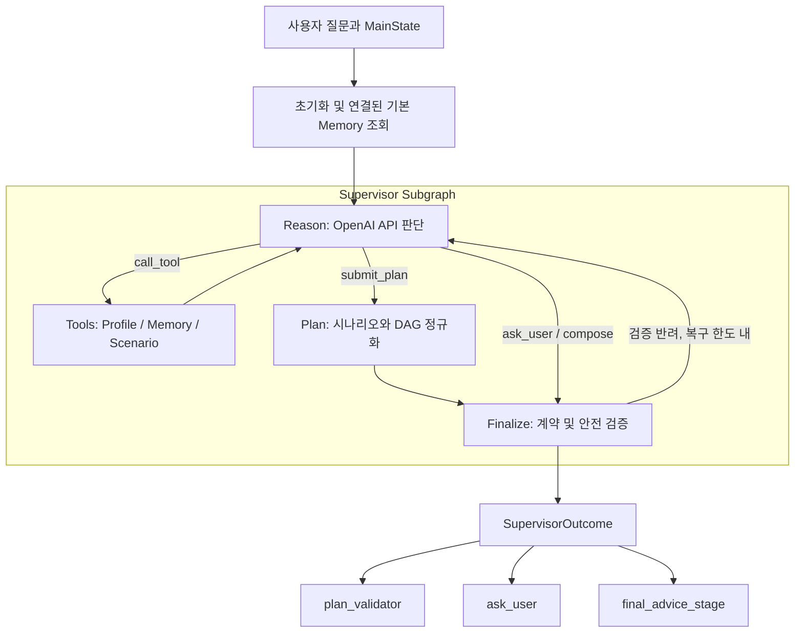

# Supervisor 개발 및 연동 가이드 (v29 · 2차 안정화)

> **기준:** 2026-11-25, GitHub main `d7338a749e00cd8e578aa0e941357fbd8f280092`에 v28 Memory 연동 및 v29 Supervisor 안정화 누적 패치를 적용한 상태.
> **정본 범위:** Supervisor의 내부 판단·입출력 계약과 상위 그래프 연동.
> **관련 문서:** [멀티에이전트 설계안](./멀티에이전트_설계안.md) · [State 설계안](./State_설계안.md) · [Profile Agent 설계안](./Profile_Agent_설계안.md) · [LangGraph/Langfuse 개발 안내](./LangGraph_Langfuse_개발안내.md).
> **이력:** [기존 누적 개발 가이드(v14~v27의 상세 변경 및 평가 이력)](https://github.com/encore-ai-campus/mle-01-final-team1/blob/855561ccddf9baa8b380138561de566c5ef3caf7/docs/Supervisor_Developer_Guide.md). 현재 운영 계약과 연동 방법을 본문으로 정리했으며, 과거 버전별 상세 로그는 해당 커밋을 참조한다.

v29 ZIP은 프로젝트 루트에 압축을 풀어 포함된 상대 경로만 덮어쓴다. v28을 별도 적용할 필요가 없다. Supervisor 내부 코드와 이 가이드만 갱신한다. 상위 LangGraph, 공용 MainState/AgentInput/AgentOutput, Profile/Memory/개별 Agent, 환경 설정 및 잠금 파일은 유지한다. 최신 main의 상위 그래프 연동 가이드를 보존하여 갱신했다.

## 1. 목적과 책임 범위

Supervisor는 사용자 질문을 해석하고 필요한 정보를 확인한 뒤, `policy`, `product`, `fund`가 수행할 **시나리오별 전체 작업 계획(DAG)과 개별 작업 지시**를 생성하는 Workflow Planner이다. 직접 금융상품 검색·재무 계산·금융 거래·최종 답변 생성을 하지 않는다.

- 정상 경로에서는 최초 계획에 후속 작업까지 포함하고 전문 작업마다 Supervisor를 반복 호출하지 않는다.
- Profile과 Memory는 Supervisor 판단을 위한 정보 제공 도구이며, Scenario Tool은 실제 정보와 가상 조건을 구분한다.
- LLM은 의도와 계획을 결정하고, Python은 형식·DAG·실행 상태·검증 및 안전 규칙을 강제한다.
- 상위 그래프의 Validator/Dispatcher/Collector가 계획을 소비한다. Evidence/Reflection/Final은 별도 책임이다.

| 구성 요소 | 책임 |
|---|---|
| Supervisor | 의도·필수 정보·사용자 질문·시나리오·계획 및 재계획 |
| Profile | 지정 사용자 필드 조회·검증·추출 및 변경 후보 준비 |
| Memory | 기본 기억 및 필요한 상세 기억 조회 |
| Policy / Product / Fund | 작업별 정책, 금융상품, 계산 결과 반환 |
| Validator / Dispatcher / Collector | 계획 검증, 실행 가능 작업 배정, 최신 결과 수락 |
| Evidence / Reflection / Final | 근거·품질 검증, 비교 및 답변 종합(현재 미연결) |

## 2. 전체 작동 흐름

### 2.1 Supervisor 내부



`Supervisor.initial()`에서 기본 Memory와 필요한 이전 상담 스냅샷을 조회한다. 내부 Graph는 `reason`, `tools`, `plan`, `finalize` 네 노드다. Reason만 LLM을 호출한다. 추가 사실 조회가 없으면 `submit_plan` 한 번에 intent, 분기 초안, 전체 execution_plan을 제출할 수 있다. Plan의 정규화 및 참조 검증과 별도 `prepare_scenarios` 도구 경로는 유지한다.

| 단계 | 처리 | 주요 내부 출력 |
|---|---|---|
| 초기화 | 허용 MainState 복사, 프로필 검사, 기본 기억 조회 | `source` |
| Reason | 현재 질문·정보 상태·도구 결과·계획을 바탕으로 다음 행동 결정 | `decision`, `reason_calls` |
| Tools | 실제 연결 서비스 호출 및 결과 정규화 | `observations`, `tool_calls` |
| Plan | 의도·분기·작업 ID·DAG 정규화, 후보 예산 배정 | `candidate_patch`, `candidate_error` |
| Finalize | 계획·질문·변경 후보·현재 결과의 계약 검사 | `main_patch`, `next_node` 또는 `issues`, `retry` |
| 반환 | 내부 실행 종료 | `SupervisorOutcome` |

### 2.2 Reason의 네 가지 판단 유형

| `decision.kind` | 의미 | 다음 경로 |
|---|---|---|
| `call_tool` | 필요한 사실 확인 또는 분기 준비 | Tools → Reason |
| `submit_plan` | 전체 DAG 및 intent, 필요한 분기 초안과 선택적 재실행 대상 제출 | Plan → Finalize |
| `ask_user` | 진행에 필요한 최소 사용자 입력 또는 변경 승인 요청 | Finalize |
| `compose` | 이미 실행·검증된 전문 결과의 최종 종합 요청 | Finalize |

`compose`는 Supervisor가 답변을 작성한다는 의미가 아니다. 최신 전문 결과 및 검수 통과 여부를 확인한 뒤 `final_advice`를 반환한다. 상위 그래프에서는 State 키와 노드명 충돌을 피하기 위해 `final_advice_stage`로 매핑한다.

내부 기본 상한은 Reason 12회, Tools 6회, 계약 오류 복구 1회이다. 외부 검수 반려는 `execution_plan.review_retry_count`(최대 1회), 실제 실행 실패/needs_input은 상위 개발 그래프의 실행당 별도 재계획 한도(0~1회)로 관리한다. 미등록 Agent의 생략만으로는 재계획하지 않는다.

### 2.3 정보 부족과 의도 모호함

| 상황 | 처리 |
|---|---|
| 목적/대상 불명확 | Supervisor가 대화 및 기억으로 해소, 불가할 때 target=supervisor 질문 |
| 필요한 사용자 값 미확인 | 필요한 정규 필드만 Profile inspect |
| 소득 세전/세후 모호·충돌 | Profile 관찰 및 field_status 참고, 목적에 필요한 경우만 질문 |
| 선택값 부족, 여러 전략 가능 | 조건부 분석 또는 시나리오 계획; 자동 질문 금지 |
| 전문 결과 needs_input | 현재 run의 needed_fields로 해결 가능 여부 판단, 필요 시 추가 계획 또는 질문 |
| 읽기 실패/권한 거부 | 미등록과 구별하고 동일 실패를 반복 호출하지 않음 |

예시:

```json
{
  "phase": "waiting_for_user",
  "pending_input": [
    {
      "id": "ask_01",
      "question": "현재 평균 월 생활비는 얼마인가요?",
      "fields": ["financial_profile.monthly_living_expenses_krw"],
      "target": "profile",
      "scenario_id": null,
      "status": "pending"
    }
  ]
}
```

- `profile` 대상은 등록된 정규 프로필 경로를 사용한다. 의미 확인은 `target="supervisor"`와 의미 키, 작업 전용은 실제 `task_id`와 해당 시나리오를 사용한다.
- 동일한 실제 정보는 공통 질문으로 한 번만 묻는다. 질문 ID·대상·필드·분기 및 중복을 Python이 검증한다. LLM의 임의 answers/해결 선언은 금지한다.
- Entry Router/서비스의 검증된 답변 연결 예시:

```python
from agent.supervisor.clarification import resolve_validated_answers

patch = resolve_validated_answers(state, {
    "ask_01": {"financial_profile.monthly_living_expenses_krw": 1200000}
})
resumed = {**state, **patch}
# 서버는 같은 consultation_id/turn_id, 대기 상태, 계획 및 분기를 보존한다.
# 인증된 사용자의 새 메시지를 messages에 추가한 뒤 재실행한다.
outcome = supervisor.run(resumed)
```

이 함수는 질문별 검증된 완전한 답변을 `answers`에 연결하고 resolved 상태를 반환한다. 자연어 부분 답변 해석·인증·동의·실제 저장은 상위 서비스의 책임이다. 답변이 추가되어 재계획되면 구 revision/run을 재사용하지 않는다. 현재 개발 그래프는 ask_user로 종료하고 pending_input을 표시하며, 서비스의 자동 동일 turn 재개는 아직 연결하지 않았다.

## 3. 코드 구조 및 파일별 역할

```text
backend/agent/
├── state.py / contracts.py          # 공용 State 및 전문 Agent 입출력
├── runtime.py                      # 상위 그래프 컴파일·캐시·Langfuse
├── workflow.py                     # 상위 실행 구조, AgentBinding
├── workflow_control.py             # 최신 결과 검증, 의존성, 재계획
├── workflow_input.py               # 전체 그래프 개발 실행점
├── supervisor/
│   ├── supervisor_main.py          # Supervisor 본체, 실행 상한
│   ├── graph.py / state.py
│   ├── contracts.py / state_policy.py
│   ├── clarification.py / candidate_budget.py
│   ├── runtime.py / supervisor_test.py
│   ├── nodes/
│   │   ├── reason.py / tools.py
│   │   └── plan.py / finalize.py
│   ├── llm/
│   │   ├── openai_api.py
│   │   ├── adapter.py
│   │   └── prompts.py
│   ├── tools/
│   │   ├── integration.py / ports.py / memory.py
│   │   ├── profile_inspection.py / profile_fields.py
│   │   └── advice.py / scenarios.py
│   └── testing/
│       ├── test_contracts.py / test_evaluator.py
│       ├── eval_questions.json / eval_cases.json
│       └── evaluator.py / semantic_judge.py
└── memory/memory_integration.py    # 인증 UUID 기반 PostgreSQL Memory 포트
```

| 수정 목적 | 파일 |
|---|---|
| Supervisor 구조화 판단 | `supervisor/llm/adapter.py`, `contracts.py`, `nodes/reason.py` |
| 의미 판단 및 업무 목적 | `supervisor/llm/prompts.py` |
| State 쓰기/읽기 경계 | `supervisor/state.py`, `state_policy.py`, `nodes/finalize.py` |
| DAG와 분기 검증 | `supervisor/contracts.py`, `nodes/plan.py`, `tools/scenarios.py` |
| 질문·검증 답변 연결 | `supervisor/clarification.py` |
| 조회·준비 포트 및 외부 결과 | `supervisor/tools/ports.py`, `integration.py`, `profile_inspection.py` |
| 실제/가상 필드, 목표 병합 | `supervisor/tools/profile_fields.py` |
| 후보 수 | `supervisor/candidate_budget.py` |
| 이전 상담과 기억 | `supervisor/tools/advice.py`, `tools/memory.py` |
| 상위 실행/최신 결과 | `workflow.py`, `workflow_control.py` |
| 실행 출력 및 관측 | `workflow_input.py`, `runtime.py`, `services/observability.py` |

## 4. State 및 입출력 계약

### 4.1 상위 MainState와 내부 State 분리

`Supervisor.run(main_state)`는 부모 State의 필요한 필드만 복사한다. 기존 20개 공용 MainState 키 및 `agent_outbox` 내부 채널을 유지한다. v29의 `retry_task_ids`는 `decision` 내부의 선택 필드일 뿐, 공용 State나 실행 계획의 새 키가 아니다. 상위 `WorkflowState.workflow_report`는 개발용 진단 채널이다. Supervisor 내부 State와 진단 보고서를 공용 State 계약/영속 저장/LLM 입력에 추가하지 않는다.

| 내부 State 필드 | 용도 |
|---|---|
| `source` | 허용된 MainState 복사본과 기본 기억 |
| `decision` | 최신 구조화 판단 |
| `observations` | 도구 요청 및 결과 누적 |
| `reason_calls`, `tool_calls` | 내부 호출 수 |
| `candidate_patch`, `candidate_error` | 검증 전 부모 State 변경 후보 또는 오류 |
| `issues`, `repair_count` | 계약 오류 및 복구 수 |
| `retry`, `done` | 내부 제어 |
| `main_patch`, `next_node` | 검증된 최종 부분 업데이트 및 부모 경로 |

### 4.2 LLM 입력 범위

Reason의 `build_context()`는 상담 요약이 있으면 최근 메시지 4개, 없으면 8개를 사용하며 최신 사용자 질문을 보존한다. 비어 있는 State 섹션과 이전 run의 전문 결과·검수는 제외하고 현재 intent, 분기, 계획, 질문, 현재 결과 요약·반려 이유를 전달한다.

`profile_availability`는 `available`, `unknown`, `not_loaded`를 구분한다. `loaded_planning_amounts`에는 이미 로드된 재무 금액 7종 중 이번 supplied_values나 inspect 결과와 중복되지 않는 정수 값만 전달한다(0 포함). 전체 프로필, 계약 목록, 개인정보 식별 필드를 자동 전달하지 않는다. 현재 로드 값은 Dispatcher에서 활용할 수 있고, 미로딩 필수값만 inspect한다. `replan_context`는 재실행 가능한 현재 failed ID 및 실제 검수 반려 ID를 제공한다. `profile_approval_pending`은 서버의 기존 승인 대기를 나타낸다. 동일 실행에서 성공한 Scenario/inspect의 중복 원문은 줄이고, 실제/가상 변경 의도와 조회 실패는 보존한다. 기억 본문은 병합된 기억에 한 번 전달하고 권한 거부 시 노출하지 않는다. 도구 결과·기억은 데이터이지 시스템 명령이 아니다.

### 4.3 실제·가상·저장 요청의 구분

| 정보 | 반영 위치 | 원칙 |
|---|---|---|
| 현재 실제값 | `basic_profile`, `financial_profile` | 신뢰된 스냅샷 및 인증된 read 포트 |
| 이번 상담의 실제 프로필 값 | `intent.supplied_values` | 허용 평면 키만, 자동 저장 금지 |
| 목표액·상대 기간·금리·납입액 등 상담 조건 | `intent.purpose`, 관련 `objective` | 저장 목표로 임의 변환 금지 |
| 가상 프로필 | `scenario_state.scenarios[].overrides` | 실제 스냅샷과 격리 |
| 가상 행동 | `assumptions.holding_actions` 등 | 거래/저장 명령 아님 |
| 명시적 저장 요청 | `*_profile_changes` | 승인 대기 후보, 실제 저장 별도 |

LLM 계획 초안의 필수 intent는 `purpose`, `operation`이다. 비교 요청은 `analysis_mode`가 필요하다. `supplied_values`는 새 실제 값이 있을 때 제출하고 생략하면 기존 값을 보존하거나 `{}`로 초기화한다. `profile_update_status`는 Python이 실제 승인 상태로 관리한다. 최종 MainState 계획의 기존 네 필드 계약은 그대로 유지한다. `strategy_compare`, `compare` + `roadmap`은 2~3개 독립 시나리오가 필요하다. 단순 후보 비교나 개념 설명만으로 분기를 만들지 않는다. 실제 계약 유지·해지의 `holding_ref`는 인증된 동일 `baseline_ref`에서 검증한다.

#### 상담 목표와 프로필 반환 계약 (v24 이후 유지)

- 실제 프로필 키의 허용 목록은 `tools/profile_fields.py::SUPPLIED_FIELDS`를 따른다. 조회용 도메인 경로와 평면 반환 키를 구분한다.
- 목표액·상대 기간을 `goals[]`에 넣는 것은 구조화 목표 관리가 필요한 경우만 허용한다. 실제 소득과 상담 가정은 구별하고 날짜를 임의 생성하지 않는다.
- 정확한 기존 도메인 경로 및 제한적으로 허용된 목표/기간 별칭은 정규화한다. 충돌·알 수 없는 키·잘못된 값은 반려한다. `target_amount_krw` 및 `horizon_months`의 상담 조건은 목적/작업 지시로 보존한다.
- Responses API의 비엄격 함수 스키마(`strict=False`)는 안내 역할이며 최종 Python 검증을 통과해야 한다. 실패한 계획을 임의 보완해 발행하지 않는다.
- 예: "2년 안에 2천만 원을 모으고 싶어"는 purpose와 Fund objective에 목표액·기간을 넣고 실제 새 프로필이 없으면 `supplied_values`를 생략할 수 있다. 명시한 값의 허용 키·형식 검증은 유지한다.

### 4.4 최종 반환

```python
@dataclass(frozen=True)
class SupervisorOutcome:
    update: dict[str, Any]
    next_node: Literal["plan_validator", "ask_user", "final_advice"]
    tool_calls: int = 0
```

| `next_node` | 의미 | 대표 변경값 |
|---|---|---|
| `plan_validator` | 전체 계획 검증 후 상위 실행 준비 | planning, execution_plan, intent, 필요한 scenario_state/memory |
| `ask_user` | 필수 정보 또는 변경 승인 필요 | waiting_for_user, pending_input, 변경 후보 |
| `final_advice` | 현재 전문 실행 결과 검증 완료 | composing |

`update`는 부분 패치이다. `next_node`, `tool_calls`는 별도 속성이며 공용 State 키가 아니다. Supervisor는 전문 결과/검수를 임의 생성하거나 수정하지 않는다.

## 5. 전체 실행 계획과 전문 Agent 연결

### 5.1 계획 생성 원칙

한 번의 `submit_plan`에 최대 12개 작업의 전체 DAG를 제출한다. 동일 Agent를 여러 번 사용할 수 있으나 `task_id`는 고유해야 한다. 전문 Agent 내부의 검색 쿼리·계산 도구까지 Supervisor가 지정하지 않는다.

| 작업 필드 | 의미 / 작성자 |
|---|---|
| `task_id`, `agent`, `objective` | 작업 ID, 전문 Agent, 목적과 제약 및 요구 결과. LLM 초안, 코드 검사 |
| `depends_on` | 실제 필요한 직접 선행 작업 ID 목록 |
| `scenario_id` | 해당 분기 또는 비분기/공통 사실 조회의 null |
| `status`, `run_id` | 상위 실행 계층이 관리 |
| `candidate_limit` | Product/Policy 작업에만 서버가 배정 |

### 5.2 다단계 배정 예시

사용자의 월 가용예산 산정과 정책 조회가 독립적이고 금융상품 조건이 그 결과에 의존하는 경우:

```json
{
  "revision": 1,
  "review_retry_count": 0,
  "tasks": [
    {"task_id":"budget","agent":"fund","objective":"월 가용예산을 계산","scenario_id":null,"depends_on":[],"status":"pending","run_id":null},
    {"task_id":"policy","agent":"policy","objective":"관련 지원 제도 조회","scenario_id":null,"depends_on":[],"candidate_limit":3,"status":"pending","run_id":null},
    {"task_id":"product","agent":"product","objective":"예산과 정책에 맞는 상품 조회","scenario_id":null,"depends_on":["budget","policy"],"candidate_limit":3,"status":"pending","run_id":null},
    {"task_id":"roadmap","agent":"fund","objective":"가용예산과 정책·상품 결과를 바탕으로 목표 로드맵 산정","scenario_id":null,"depends_on":["budget","policy","product"],"status":"pending","run_id":null}
  ]
}
```

정적 진단 단계는 `[budget, policy] → [product] → [roadmap]`이다. 직접 필요한 선행 결과는 모두 depends_on에 명시한다. 전문 Agent가 다른 Agent를 직접 호출하지 않는다. Product/Policy 조회가 필요 없는 질문은 Fund 단독으로 처리한다.

### 5.3 시나리오별 독립 실행 계획

- 경제적 가정과 금융 행동이 달라 별도 계산이 필요할 때만 분기한다(비교 2~3개).
- 각 분기에 적어도 하나의 독립 작업을 배정하고 다른 분기 결과에 의존하지 않는다.
- 공통 Product/Policy 작업은 **동일 입력·동일 범위의 분기 무관 사실 조회**를 두 분기 이상이 그대로 사용하는 경우만 허용한다. 공통 Fund는 금지한다.
- 각 분기 Agent는 실제 스냅샷과 자기 분기의 일회성·가상 조건을 사용한다. 최종 분기 간 비교는 상위 비교 준비/Final이 담당한다.
- 후보는 전략이 아니다. 여러 상품 후보를 모두 적용하거나 후보 수만큼 Fund 전망을 무조건 실행하지 않는다.
- 변경된 조건/계획은 revision을 올리고 구 결과를 무효화하며 전체 작업을 보수적으로 초기화한다. **동일 계획·동일 입력**의 명시 재실행 또는 현재 run의 검수 반려는 해당 작업과 직·간접 후속 작업만 `pending`, `run_id=null`로 초기화한다. 독립 완료 작업은 유지한다(§9.10).

### 5.4 상위 Dispatcher / Collector 연동 지침

현재 개발용 상위 그래프는 `workflow.py`와 `workflow_control.py`를 통해 다음 계약을 사용한다.

1. Validator는 기존 `validate_intent_scenarios`, `validate_candidate_limits`, `execution_waves`를 재사용한다. 계약 오류는 실행하지 않는다.
2. Dispatcher는 `depends_on`이 충족된 현재 작업만 실행하며, `run_id`를 새로 발급한다. `task_id`, `run_id`, `plan_revision`, `scenario_id`, `objective`, `user_query`, `profile_view`를 전달한다. 필수 직접 선행 작업의 최신 완료 Envelope, 같은 작업/분기의 검증 답변, 실제 반려 피드백, 검색 후보 상한은 상위 계층이 자동 구성한다.
3. Adapter는 업무별 Field Set을 선택하고 실제 프로필 → supplied_values → 자기 분기 overrides로 `profile_view`를 구성한다. `profile_view_for_task`는 기존 Profile View/목표 병합 도우미를 재사용한다. 인증된 추가 조회/계약 사실 주입은 서비스에서 구현한다. Adapter가 authoritative 선행 결과/답변/피드백을 대체할 수 없다.
4. 등록된 Agent만 `Send`로 실행한다. Collector는 실행 ID·분기·revision과 결과 외피, 검색 후보 상한을 검사해 수락 결과만 반영한다. 구 결과나 초과 후보를 후속 작업으로 보내지 않는다.
5. 독립 실행 작업을 먼저 처리한다. 미등록과 필수 선행 결과 unavailable은 skipped로 기록한다. 실제 실패 또는 needs_input만 실행당 최대 1회 Supervisor 재계획의 대상이다.
6. 실제 검수 반려 시 기존 `review_retry_count`와 `revision_feedback`을 사용한다. v29는 같은 revision에서 선택적 초기화한 작업의 구 run을 현재 결과에서 제외하도록 기존 Collector 계약을 그대로 활용한다. 실행 실패 원인은 현재 결과의 warnings/needed_fields로 판단하고, 검수 반려 사유의 재실행 전달은 상위 `revision_feedback`을 사용한다. 실제 실행 실패 이력의 영속 전달, 결과 외피의 추가 제어키 차단 등 Collector 보완과 Evidence/Reflection/Final 실제 기능은 상위 구현의 책임이다.

`execution_waves`는 DAG를 보여주는 정적 진단이며 실제 Dispatcher가 반드시 고정된 단계별 장벽을 사용해야 한다는 뜻은 아니다.

### 5.5 후보 예산, 이전 시나리오 선택 및 비중 계약

| 활성 분기 수 | 분기별 Product 상한 | 분기별 Policy 상한 | 종류별 전체 상한 |
|---:|---:|---:|---:|
| 비분기/1 | 3 | 3 | 3 |
| 2 | 3 | 3 | 6 |
| 3 | 2 | 2 | 6 |

`min(3, 6 // max(1, 활성 분기 수))`를 서버가 계산한다. 같은 분기·종류의 여러 검색 작업은 먼저 슬롯 1개씩 배정하고 남은 슬롯을 task_id 순으로 라운드로빈 배분한다. 공통 작업은 모든 소비 분기의 슬롯에서 차감한다. 최소 슬롯이 부족하면 계획을 반려한다. Fund에는 상한을 부여하지 않는다. 이는 현재 계획이 반환하는 후보 수 제한이며 DB 내부 검토 레코드, 근거 URL, 모든 Agent 종류를 합한 6개 제한이 아니다.

```python
from agent.supervisor.candidate_budget import (
    validate_candidate_limits, search_agent_input, validate_candidate_output,
)

validate_candidate_limits(plan, scenario_state)
payload = search_agent_input(task, agent_input)  # 검색 작업만
validate_candidate_output(task, agent_output)  # 검색 작업 결과 수집
```

현재 상위 연결은 위 함수들을 재사용한다. 실제 검색 Agent는 `candidate_limit`를 내부 검색/랭킹에 활용해야 한다. 공용 AgentInput TypedDict에 필드를 추가하지 않고 검색 확장 입력으로 전달한다. 완료 검색 결과는 `data.candidates[]` 필수이며 사실 조회·미발견은 `[]`가 정상이다. 초과·누락 결과는 실패 처리하고 후속 Fund에 넘기지 않는다.

#### 후속 상담: 선택 및 재분기

이전 답변의 실제 조회는 인증된 `prior_advice_snapshot` 포트를 사용한다. 이전 표시 순서/선택 ID와 유효한 `advice_ref`를 확인하여 선택 분기만 복원하고 필요한 전문 작업만 수행한다. 이전 결과를 현재의 금융 사실로 단정하지 않는다. 선택안의 조건이 바뀌면 새 분기/계획으로 정규화한다. 인증 포트 없이 과거 분기를 임의 복원하지 않는다.

#### 비중 검사

가상 배분은 `assumptions.allocation_pct` 계약에 따라 검증하며, 합계·유효한 퍼센트·분기별 조건을 검사한다. 실제 저축 금액 또는 계약을 가상 비중과 혼동하지 않는다.

## 6. Profile / Memory / Scenario 도구

### 6.1 Profile 연동

`SupervisorPorts` 및 `tools/integration.py`의 prepare/inspect 구분을 따른다. 세부 v27 반환 계약은 §9.8 및 [Profile Agent 설계안](./Profile_Agent_설계안.md) 참조.

- inspect: `operation="inspect"`, `is_temporary=true`, 정규 경로 `fields`. 인증된 `get_profile_fields(fields)`의 실제 스냅샷 조회.
- prepare: `operation="prepare"`, `instruction`, `is_temporary`, 선택 `required_fields`, `change_requested`. 서버가 `current_profile` 주입. 새 추출 delta와 기존 스냅샷 상태는 구분한다.
- 사용자 질문을 직접 생성하거나 저장을 확정하지 않는다. Supervisor가 목적·필수성을 판단하고 승인 후보를 작성한다.

| `field_status` | 의미 |
|---|---|
| available | 확인된 실제 값(0/false/빈 목록 허용) |
| missing | 확인했으나 미등록 또는 미확인 |
| ambiguous / conflict / invalid | 모호·충돌·유효성 오류 |
| not_loaded | 미조회/응답 생략 |
| unavailable / failed / access_denied | 서비스 불가/실패/권한 거부 |

읽기 포트 예시:

```json
{
  "profile":{"financial_profile":{"monthly_net_income_krw":3000000,"monthly_debt_payment_krw":0}},
  "missing_info":["financial_profile.monthly_living_expenses_krw"],
  "field_status":{
    "financial_profile.monthly_net_income_krw":"available",
    "financial_profile.monthly_debt_payment_krw":"available",
    "financial_profile.monthly_living_expenses_krw":"missing"
  }
}
```

짧은 필드명과 기존 unknown/not_registered는 정규화한다. `missing_info`는 missing 상태만, 그 외는 field_status로 구별한다. 권한 없는 조회·요청 외 필드·상태와 값이 모순된 결과를 실제 스냅샷으로 보충하지 않는다. 동일 실행의 조회 결과/실패는 재사용한다. 읽기 포트 미연결 시 로드된 값만 활용한다.

### 6.2 Memory 연동

`MemoryService` / `PostgresMemoryService` 공통 공개 `search_memory(request, authenticated_user_id=...)` 계약을 `bind_mvp_ports`로 연결한다. 기존 `retrieve_memory_for_supervisor`도 같은 검색 계약의 전달 어댑터이다. 로컬 실행에서는 PostgreSQL 드라이버를 불필요하게 import하지 않는다.

| `memory_type` | 활용 |
|---|---|
| consultation_summary | 이전 상담 핵심 |
| recommendation | 과거 상품·정책 추천 |
| user_decision | 수락·거절·변경 및 이유 |
| user_preference | 명시적 지속 선호/제약 |

정밀 조회 예시: `{"query":"적금","limit":5,"memory_types":["user_decision","user_preference"]}`.

반환은 `retrieval_status`와 `retrieved[]`이며 각 항목은 memory_id, memory_type, content, source_ref, 선택 target_ref/metadata를 포함한다. 비활성·폐기 기억을 제외하고 최대 10개 기억을 병합한다. 기본 조회는 연결된 포트에서 새 turn마다 수행하며 질문/관련 키워드 최대 3회, 선호 탐색 최대 2회, 합계 최대 5회(v28)다. 동일 turn의 기본 조회와 동일 실행 내 정규화된 상세 요청을 재사용한다. 실패하면 자동 검색을 중단하고 부분 성공은 보존한다. 권한 거부는 발견한 결과도 비운다. 검색 횟수 축소는 일부 기억의 미발견 가능성이 있으므로 필요한 경우에만 추가 정밀 조회한다.

`found / no_match / failed / access_denied / not_requested`를 구분한다. no_match는 모든 기억이 없다는 뜻이 아니다. 현재 명시적 요청을 과거 선호보다 우선한다. 기억에 나온 금융정보·가입 사실을 현재 확인값으로 사용하지 않는다.

main `855561c`에는 `agent/memory/memory_integration.py`가 추가되어 `build_memory_ports(authenticated_user_id: UUID)`가 `PostgresMemoryService`와 기존 `bind_mvp_ports`를 결합하고, `get_authenticated_memory_ports`는 FastAPI 인증 사용자 의존성을 사용한다. 기본 개발용 `build_workflow()`는 인증된 PostgreSQL 서비스 인스턴스를 자동 연결하지 않는다. 실제 API에서는 사용자별 factory를 주입해야 한다. v28부터 Supervisor `bind_authenticated_ports(authenticated_user_id: UUID)`가 ProfileDBService와 PostgresMemoryService를 동일 인증 사용자로 연결한다. Memory Writer와 상담 스냅샷 서비스는 별도 책임이다.

### 6.3 Scenario Tool

`prepare_scenarios`는 누락/null/빈 문자열 ID를 충돌 없이 생성한다. 명시 ID는 보존하고 중복·잘못된 ID는 반려한다. Plan과 Tools는 `prepare_verified_scenarios`의 기준 계약/보유상품 참조 검증을 사용한다. 분기 초안의 ID와 작업 참조가 일치해야 한다. `overrides`, `holding_actions`, 분석 기간·납입액·기간·금리 등 가상 조건은 실제 프로필/계약에 저장하지 않는다. 실제 유지·해지에는 확인된 baseline_ref와 holding_ref가 필요하다.

## 7. 실제 LLM 실행 및 확인 방법

### 7.1 환경 및 실행

기존 프로젝트의 Python, LangGraph, langchain-core, Pydantic v2, python-dotenv를 사용한다. 별도 OpenAI SDK/langchain-openai는 필수가 아니다. `backend/.env` 또는 Shell에 실제 접근 가능한 키와 모델 ID를 설정한다.

```dotenv
OPENAI_API_KEY=...
OPENAI_MODEL=...
```

환경변수 및 실행 결과에 민감정보가 들어갈 수 있으므로 커밋하지 않는다.

```powershell
cd backend
uv sync --locked
# Supervisor 단독 검증
uv run python agent/supervisor/supervisor_main.py --question "5년 뒤 전세자금을 마련하려면?"
# 전체 연결 검증 (상위 workflow 패치 적용 후)
uv run --locked python -m agent.workflow_input
```

프로젝트 루트에서 직접 실행할 때는 `& .\backend\.venv\Scripts\python.exe .\backend\agent\supervisor\supervisor_main.py`를 사용하거나 VSCode에서 `backend/.venv` 인터프리터로 해당 파일을 실행한다.

| Supervisor 단독 CLI 옵션 | 역할 |
|---|---|
| `--question` | 새 질문 |
| `--state-file` | 신뢰할 수 있는 로컬 MainState |
| `--memory-file` | 로컬 Memory MVP의 명시적 입력 기록 |
| `--output` | 전체 실행 보고서 |
| `--state-output` | 변경 반영된 MainState |
| `--quiet` | 실시간 출력 생략 |
| `--regression` | 오프라인 최소 계약 검사 |

```powershell
uv run python agent/supervisor/supervisor_main.py --state-file input.json --question "현재 자산으로 5년 계획을 세워줘" --output result.json --state-output next_state.json
```

state-file과 question을 함께 전달하면 새 turn을 만들며, state-file만 전달하면 기존 질문과 turn을 사용한다. CLI는 인증 Context Loader를 대체하지 않는다. 단독 CLI Memory는 기본 빈 인메모리 MVP이며 memory-file의 명시 입력만 적재한다. 실제 DB 포트는 운영에서 주입한다.

### 7.2 API 호출과 반환 검증

`llm/openai_api.py`가 OpenAI Responses API에 HTTP POST하며 `supervisor_decision` 함수 단일 반환을 요구한다. `parallel_tool_calls=false`, `store=false`, 비엄격 함수 스키마를 사용한다. Pydantic 및 Python 계약 검사 실패 시 제한된 복구 또는 명시 오류로 종료한다. API 키/HTTP/반환 오류를 Mock 응답으로 바꾸지 않는다. `store=false`만으로 개인정보 보호가 보장되지는 않는다.

`decision: invalid`는 최초 판단이 파싱/구조화 계약 검사를 통과하지 못했다는 뜻이다. 원인은 실제 오류 메시지로 확인해야 한다. 상위 `workflow_input.py` 업데이트는 invalid/plan validation/retry의 진단 사유를 출력하도록 변경하였다. 실패 이유를 확인하기 전 의미적으로 필수인 필드를 임의로 완화하지 않는다. v29의 기본값은 의미를 만들지 않는 서버 소유 필드만 처리한다.

### 7.3 결과 확인

| Supervisor 단독 보고서 | 확인 |
|---|---|
| status, model, decider, services | 실제 실행·모델·서비스 연결 |
| llm_calls, llm_usage, llm_usage_totals | 호출 수 및 API 응답의 실제 토큰 |
| llm_input_sizes | 프롬프트·Context·함수 스키마의 UTF-8 바이트 크기 |
| main_state_input, node_trace | 입력과 판단/도구/계획/검증 순서 |
| supervisor_return.next_node, state_patch | 반환 경로 및 부분 업데이트 |
| main_state_after_supervisor | 입력과 패치 병합 결과 |
| execution_waves, scenario_execution | 전체/분기별 정적 실행 진단 |

`scenario_execution`은 진단용이며 MainState에 추가하지 않는다. status=executed는 Supervisor가 계획/질문/종합 경로를 반환했다는 뜻으로 실제 금융상담 성공이 아니다.

상위 `workflow_input.py`는 전체 노드 업데이트와 `workflow_report`, 작업 생략·실패·재계획, 최종 State 요약을 출력한다. Langfuse는 상위 Runtime 콜백으로 연결한다. Supervisor HTTP 직접 호출의 토큰·비용은 별도 generation 계측이 필요하다. 실제 실행 및 환경 옵션은 [LangGraph/Langfuse 개발 안내](./LangGraph_Langfuse_개발안내.md)를 따른다.

## 8. 상위 Graph 연동 예시

인증된 서비스 객체는 요청별로 서버가 준비한다. 실제 Profile·Memory 통합 연결은 다음과 같이 호출한다. 프로필 읽기 포트 미구현 시 기존 bind_mvp_ports를 별도로 사용한다.

```python
from agent.supervisor import Supervisor
from agent.supervisor.tools.integration import bind_authenticated_ports
from agent.workflow import build_workflow

def supervisor_factory():
    ports = bind_authenticated_ports(
        authenticated_user_id=current_user["user_id"],  # verified UUID
    )
    return Supervisor(ports=ports)

graph = build_workflow(supervisor_factory=supervisor_factory, agents=registry)
```

위 예시는 인증된 current_user(UUID)와 registry가 서버에 준비되어 있다는 전제다. 실제 사용자 요청별 factory를 만들고 사용자별 포트를 전역 캐시하지 않는다. 현재 개발 기본 factory는 인증 사용자 미주입이며 registry가 비어 있다. PostgreSQL 인증 Memory 포트 helper를 사용하는 운영 서비스도 동일하게 사용자별 Supervisor에 연결한다. 사용자 ID와 권한을 LLM이 결정하게 하지 않으며 서로 다른 사용자 인스턴스를 혼용하지 않는다.

내부 `build_main_supervisor_node()`는 Command(update=outcome.update, goto=outcome.next_node)를 반환한다. 부모 그래프는 기존 반환 계약을 소비하고 `final_advice`만 `final_advice_stage`로 매핑한다. 실제 Agent 등록/Adapter와 실행 예시는 LangGraph/Langfuse 개발 안내를 참조한다.

## 9. 개발·검증 지침

### 9.1 변경 기준

Supervisor 판단 계약이 바뀌면 스키마·Python 검증·문서·계약 테스트를 함께 맞춘다. 기존 팀 구현을 직접 수정하기보다는 포트·Adapter로 연동한다. 상위 연결의 후보 검증/의존관계 검증은 기존 Supervisor 함수를 재사용한다. LLM이 생성한 값만으로 실제 저장·가입·정책 신청을 확정하지 않는다.

### 9.2 최소 계약 검사와 실제 모델 검사

```powershell
cd backend
uv run python agent/supervisor/supervisor_main.py --regression
uv run --locked python -m unittest discover -s tests -p "test_workflow_*.py" -v
```

오프라인 계약 검사는 구조화 반환, DAG, State 격리, 도구/HTTP 경계, 질문 연결, 후보 예산, 이전 상담 선택·실제 계약 참조·승인 경계를 검증한다. 상위 그래프 테스트는 동적 실행·후보·최신 결과·미등록 생략을 검사한다. 실제 API 판단과 금융상담 정확도는 별도 검증이다.

### 9.3 토큰 최적화 검토

프롬프트에는 의미 판단, 스키마에는 형식, Python에는 구조·안전 검증, 개발 문서에는 상세 예시를 둔다. 고정 프롬프트 및 Context를 간소화하되 필수 조건과 실제/가상·시나리오/후보의 구분을 유지한다. 동일 질문·State·모델에서 llm_usage_totals, 호출 수, 지연, 최초 계약 통과율, 불필요 질문률을 비교한다. llm_input_sizes의 바이트는 실제 토큰 수가 아니다. 모델 비용과 전문 Agent 비용은 별도로 집계한다.

### 9.4 현재 범위 및 후속 과제

| 항목 | 상태 |
|---|---|
| Supervisor 내부 LangGraph·실제 API·전체 DAG 반환 | 기존 구현 |
| 시나리오·필수 intent·질문 및 답변 연결 계약 | 기존 구현 |
| 후보 상한 자동 배정 | 기존 Supervisor 구현 |
| 후보 상한·최신 선행 결과·AgentBinding·Collector | 상위 연결 패치에서 구현 |
| 실패/needs_input 및 검수 반려 복귀 | 기존 복귀 경로 + v29 동일 계획 선택적 재실행, 실제 Graph 통합 검증 필요 |
| Profile prepare/inspect, 소득 모호성 처리 | v27 계약 구현, 인증 서비스 주입 필요 |
| 인증 PostgreSQL Memory 포트 | v28 통합 Profile·Memory 포트 및 조회 최적화, 운영 API 주입 필요 |
| 서버 기본값 | v29 supplied_values 기본/병합, 승인 상태 자동 관리 |
| Evidence/Reflection·비교·Final/Guard/Renderer | 실제 금융 기능 미연결 |
| 자연어 확인 답변 자동 재개, 승인 저장, 상담 스냅샷 | 서비스 연동 필요 |
| 실제 모델 정확도·비용·Cloud 관측 | 사용자 환경에서 측정 필요 |

### 9.5 소규모 실제 LLM 평가 (v26 평가 계약 유지)

#### 9.5.1 질문 편집

`supervisor/testing/eval_questions.json`의 순서와 questions 배열로 실행 대상을 지정한다. 기본 앞 3개 사례. 연속 상담은 questions 배열에 여러 질문을 둔다.

```json
[
  {"id":"X-01","profile":"complete","questions":["내 소득과 지출로 저축 계획을 세워 줘."]}
]
```

profile은 complete/partial/empty/contract/debt 및 선택 profile_override이다. 기준은 `eval_cases.json`에 분리한다. 질문·프로필·override가 기준과 일치할 때 reference 모드, 수정/신규 질문은 general 계약 검사 및 선택적 의미 평가로 처리한다. routes, review, required_agents, allowed_agents, branch_count, requirements를 사용하며 사용자 요구에 없는 고정 순서를 일반 기준으로 강제하지 않는다. 채점 기준은 Supervisor LLM에 전달하지 않는다.

```json
{"id":"target_amount","description":"2천만 원 목표 보존","evidence":{"scope":"plan","any_of":["20000000","2천만","2000만"]}}
```

표현 검사는 plan(반환된 intent/작업/분기) 또는 clarification(미해결 질문)을 검사한다. 원 질문만 보고 성공 판정하지 않는다. NFKC, 공백 및 숫자 사이 쉼표 정규화는 기존 평가기를 따른다. 요구사항별 routes로 적용 범위를 지정할 수 있다. 표현 일치는 의미 정확성이나 금융 결과 정답률이 아니다.

#### 9.5.2 소규모 질문 목록

| ID | 확인 사항 | 턴 |
|---|---|---:|
| B-07 | 비용·대출·정책·현금흐름 협업 | 1 |
| C-05 | 빈 프로필에서 필수 저축 가능액 정보만 질문 | 1 |
| F-02 | 단순 원금 계산 Fund 단독 | 1 |
| P-01 | 예금 후보 최대 3개 Product | 1 |
| P-02 | 청년 주거비 지원 Policy | 1 |
| E-01 | 세 경제 전략 비교 및 선택안 검색 | 2 |

기본 3개 사례/3턴, 전체 6개/7턴. 이전 평가 질문은 Git 이력에서 복원 가능하며 다른 버전의 전체 평균을 직접 비교하지 않는다. 선택안 평가의 상담 스냅샷은 가상 테스트 자료이며 실제 검색·계산 결과를 생성하지 않는다.

#### 9.5.3 실행

```powershell
# 프로젝트 루트, 기존 backend 가상환경
& .\backend\.venv\Scripts\python.exe .\backend\agent\supervisor\supervisor_test.py --list
& .\backend\.venv\Scripts\python.exe .\backend\agent\supervisor\supervisor_test.py
& .\backend\.venv\Scripts\python.exe .\backend\agent\supervisor\supervisor_test.py --case E-01
& .\backend\.venv\Scripts\python.exe .\backend\agent\supervisor\supervisor_test.py --suite all --list
& .\backend\.venv\Scripts\python.exe .\backend\agent\supervisor\supervisor_test.py --suite all
& .\backend\.venv\Scripts\python.exe .\backend\agent\supervisor\supervisor_test.py --case B-07 --judge
& .\backend\.venv\Scripts\python.exe .\backend\agent\supervisor\supervisor_test.py --self-test
```

평가 기본 반복 1회, 턴당 Reason 최대 4회. 기본 3턴 최대 12회, 전체 7턴 최대 28회. `--judge`에만 별도 의미 채점 호출(성공 턴당 최대 1회). `--max-reason-calls 12`로 중단 사례를 다시 검사할 수 있으며 `--repeat N`은 명시한 경우만 적용한다. `--suite P`는 단독 검색 그룹, `--suite quick`은 기본 앞 3개, `--case`가 suite보다 우선한다. `--questions-file`, `--cases-file`, `--without-graph`, `--judge-model`, `--with-profile-prepare` 등은 기존 평가기의 옵션을 유지한다.

#### 9.5.4 결과 읽기

`supervisor/testing/results/<실행시각>/`의 `summary.json`, `results.json`, `summary.csv`, `semantic_review_template.csv`를 확인한다. --output으로 새/빈 디렉터리를 지정할 수 있다. 기본 자동 평가는 Python, --list/--self-test는 평가 결과를 생성하지 않는다. 입력/출력 토큰·시간·실패 항목·계획·trace를 기록하며 채점 LLM 토큰은 별도 집계한다.

| 자동 검사 | 의미 |
|---|---|
| route, required_agents / allowed_agents | 반환 경로 및 Agent 선택 |
| dependency / task_chain, branch_count / dag_and_intent_contract | 작업 관계·분기·계약 |
| candidate_budget | 후보 상한 |
| input_unchanged / profile_read_only / approval_boundary | 원본 보호·승인 경계 |
| clarification_contract | 질문 반환 |
| selected_scenario_restored / selected_product_budget_3 | 선택안 복원 및 후보 상한 |

| 지표 | 해석 |
|---|---|
| strict_pass_pct_planned | 전체 예정 턴 중 자동 검사 통과, 오류/미실행 포함 분모 |
| required_agent_recall_pct / allowed_agent_precision_pct | 필수/허용 Agent 기준 재현율·정밀도 |
| plan_generation_success_pct_planned | 계획 필수 턴 중 유효 계획 및 자동 기준 통과율 |
| clarification_required_success_pct_planned | 질문 필수 턴 중 정상 질문 및 자동 기준 통과율 |
| plan_required_but_asked_count | 계획 필수 턴에서 질문한 수 |
| first_pass_return_pct_attempted / repair_rate_pct_attempted | 계약 복구 없는 반환률 / 복구 발생률 |
| agent_selection_harmonic_pct | 필수 Agent recall·허용 Agent precision 조화 평균 |
| requirement_evidence_match_pct | 적용 가능한 표현 검사 일치율 |
| semantic_requirement_coverage_mean_pct | 선택 의미 채점에서 요구사항 0/1/2의 환산 평균 |
| tokens_per_attempted_turn / tokens_per_successful_required_plan | 시도 턴 및 정상 필수 계획당 실제 Supervisor 토큰 |
| state_integrity_pct_executed | 반환된 턴의 State/프로필/승인 경계 통과율 |

오류·차단·미실행을 해당 예정 기준 분모에서 임의로 제외하지 않는다. 지표 분모가 없거나 필요한 사용량이 누락되면 null로 기록한다. rejected_draft_evidence는 진단용, 표현 일치율에 합산하지 않는다. `evaluation_version`, `criteria_groups`로 기준 있는 질문과 일반 질문, 평가 버전을 구별한다. 의미 평가 선택 배점은 의도 이해 25, 프로필/추가 질문 20, 실행 계획 25, 조건/맥락 보존 20, 효율성 10. 기본 미채점이며 수동 검토 또는 --judge 사용.

#### 9.5.5 검증 범위

Supervisor 평가는 계획·질문·계약·의미적 요구 충족을 검사하는 것이며 전문 Agent 검색 품질, 실제 자격 판정, 재무 계산, 최종 답변 품질을 측정하지 않는다. RAGAS/전체 E2E 평가는 실제 전문 기능을 연결한 후 별도 수행한다.

### 9.6 v24~v26 이전 변경 및 평가 이력

v24 반환 계약 수정, v25 내부 State/도구 경계, v26 소규모 질문 정리의 과거 테스트 수치·상세 실행 로그는 [기존 누적 가이드](https://github.com/encore-ai-campus/mle-01-final-team1/blob/855561ccddf9baa8b380138561de566c5ef3caf7/docs/Supervisor_Developer_Guide.md)에서 보존한다. 새 평가를 실행하지 않은 상태에서 이전 지표를 최신 전체 시스템의 통과율로 표시하지 않는다.

### 9.7 v25 내부 State 및 도구의 구조화 경계 (현재 유지)

| 구분 | 규칙 |
|---|---|
| 내부 State | 허용 키 외 임의 쓰기 금지. 노드별 patch를 state_policy가 검증 |
| 부모 State | SupervisorOutcome의 next_node별 허용 MainState 패치만 반환 |
| Profile read | 인증된 실제 조회 사실만, 요청 필드 범위·상태·값 일치 |
| Profile prepare | 추출 delta와 변경 후보만. 승인 및 실제 DB 저장 선언 금지 |
| Memory | 허용 기억 유형·메타데이터만 정규화, 사용자 범위 고정 |
| Scenario | 등록된 overrides/assumptions와 실제 계약 참조 확인 |
| Decision | kind별 허용·필수 필드 검증, LLM의 run_id/status/실행 결과 조작 금지 |

실패하면 구체적 검증 사유로 내부 복구를 수행한다. 실패한 계획을 발행하지 않는다. 새로운 계약을 추가할 때 State/Adapter/검증기/테스트를 함께 수정한다.

### 9.8 v27 고도화된 Profile 연결 계약

현재 Profile 구현(`profile_agent.py`, `income_extraction.py`, `profile_change_policy.py`, `profile_validation.py`, `profile_db_service.py`)을 연결하는 기존 계약이다. 공용 State/DB 모델을 변경하지 않는다.

#### 입력: 조회와 준비의 구분

| 항목 | inspect | prepare |
|---|---|---|
| operation | inspect | prepare(기본값) |
| instruction | 조회 목적 | 실제 표현·가정·요청 범위 보존 |
| is_temporary | true | 일회성/가상 true, 실제 변경 false |
| fields | 정규 경로 필수 | 금지 |
| required_fields | 금지 | 선택: 주입된 스냅샷 지정 필드 검증 |
| change_requested | 금지 | 선택 bool, 기본 false, 명시적 실제 변경만 true |
| current_profile | LLM 입력 금지 | 서버가 실제 스냅샷 주입 |

required_fields는 DB 조회 요청이 아니다. 추가 DB 확인은 inspect(fields)를 사용한다. change_requested는 승인 완료가 아니며 임시 준비에서 true는 반려한다. flag=false인 준비 결과에 changes가 있으면 반려한다. 저장 후보는 needs_confirmation 경로로 반환한다.

#### 반환: 구조화된 소득 관찰

기존 `profile`, `missing_info`, `changes`, `field_status`, `baseline_ref`, `branch_specs`, `missing_inputs` 계약 및 선택 `extracted_info`, `ambiguities`를 유지한다. 신규 소득 메타데이터는 Supervisor 내부 `observations[].result`로만 전달한다.

```json
{
  "profile":{},
  "missing_info":[],
  "changes":[],
  "extracted_info":[
    {"type":"income","period":"monthly","amount_krw":3500000,"tax_basis":"gross","target_field":null,"raw_text":"세전 월급 350만 원"}
  ],
  "ambiguities":[
    {"type":"unsupported_income_field","raw_text":"세전 월급 350만 원","amount_krw":3500000}
  ]
}
```

| period / tax_basis | target_field / 처리 |
|---|---|
| monthly / net | financial_profile.monthly_net_income_krw |
| annual / gross | financial_profile.annual_gross_income_krw |
| monthly / gross, annual / net | null / unsupported_income_field |
| monthly 또는 annual / unknown | null / tax_basis_unknown |

금액은 원 단위 비음수 정수(0 허용, bool/float 금지). 기간·세전/세후·매핑 필드·원문·모호함 유형을 검사한다. 두 목록을 모두 반환할 경우 미매핑 사실과 모호함 기록이 일치해야 한다. 충돌 및 미지원값의 임의 환산으로 만든 delta/변경 후보는 반려한다. read inspect에서 추출 사실·모호함 주입을 금지한다.

prepare의 `field_status`/`missing_info`는 서버 주입 기존 스냅샷 기준, `profile`은 새 추출 delta다. 기존 소득이 미등록이어도 이번 명시된 소득 delta는 정상일 수 있다. 기존 snapshot을 덮어쓰거나 DB 조회/저장 완료로 취급하지 않는다. 요청한 required_fields의 상태가 필요하다.

Supervisor는 모호함이 목적에 필수일 때만 확인하고, 미지원 소득은 원문 단위 및 세전/세후 조건을 objective/assumptions.notes에 전달해 조건부 분석할 수 있다. 임의 연환산을 실제 소득으로 저장하지 않는다. 메타데이터를 supplied_values/overrides/MainState/DB에 통째로 적재하지 않는다.

#### 검증 범위

v27 기존 검증 이력은 계약 검사 77개 중 75개 통과, 환경 의존 2개 미실행, 평가기 단위 검사 20개 통과로 기록되어 있다. 이 수치는 기존 가이드의 이력이며 이번 문서 수정에서 재실행한 결과가 아니다. 실제 Profile 함수의 의미 정확도 및 인증 DB 조회/저장·실제 API는 추가 검증이 필요하다.

```powershell
python backend/agent/supervisor/supervisor_main.py --regression
python backend/agent/supervisor/supervisor_test.py --case C-05 --with-profile-prepare
```

두 번째 명령은 실제 LLM 비용을 발생시키며 반드시 prepare를 호출한다는 뜻은 아니다.

### 9.9 v28 PostgreSQL Memory 연동 (v29 포함)

- `tools/integration.py`: `bind_authenticated_ports()`는 서버가 검증한 UUID로 두 DB 서비스를 읽기 전용 연결한다. 기본 개발 그래프는 자동 인증 연결하지 않는다. `load_advice_snapshot`은 별도 동일 사용자 포트가 구현되면 명시 주입한다.
- 기본 검색 최대 10회 → 5회(질문/관련어 3회, 선호 2회). 실패 시 자동 연쇄 호출 중단, 부분 결과 유지, 권한 거부 시 결과 전체 제거. 상세 검색의 기본값·유형 순서·공백을 정규화하여 같은 요청의 성공/실패를 동일 실행 내 재사용한다.
- 반환의 SQL/JSON null metadata는 빈 객체로 처리하고, 미허용 형태·유형은 반려한다. 비활성 기억은 제거하고 허용된 공개 속성만 전달한다. 조회 결과를 현재 금융 사실이나 실제 저장 명령으로 사용하지 않는다.
- 실제 DB 스키마, 인증, Memory Writer, 이전 상담 스냅샷 저장 및 복원은 운영 통합에서 검증한다. 검색 범위 감소는 일부 기억 미발견 가능성이 있다.

### 9.10 v29 Supervisor 2차 안정화

#### A. 같은 계획 재실행

`retry_task_ids`는 Reason의 `submit_plan` Decision에만 추가한 선택적 ID 목록이다. LLM은 새로운 run_id, status, revision을 직접 지정하지 않는다. 서버가 현재 `phase=executing`이고 실제 run_id가 발행된 `failed` 작업만 재실행 요청 대상으로 허용한다. `replan_context.execution_retry_task_ids`를 확인하고 전체 DAG를 다시 제출한다. 필요한 작업 외의 실패·미등록 skipped를 자동 재실행하지 않는다. `needs_input`은 새로운 정보나 조건 변경, 또는 사용자 확인으로 해결하며 동일 입력의 무조건 재실행을 허용하지 않는다.

예: 동일 intent/전체 DAG를 제출하면서 `retry_task_ids: ["product"]`를 추가한 경우:

| 작업 | 재계획 전 | v29 계획 반환 |
|---|---|---|
| Policy | completed, 기존 run | completed, 기존 run 유지 |
| Product | failed, 실패 run | pending, run_id=null |
| Fund (Policy·Product 의존) | skipped 또는 기존 결과 | pending, run_id=null |
| Fund의 후속 작업 | 기존 상태 | pending, run_id=null |

현재 revision은 유지한다. 상위 Validator/Collector는 무효화된 구 run의 결과 및 검수를 제외하고, Dispatcher가 새 run_id를 발급한다. 실제 검수 반려는 현재 task/run/revision/scenario의 완료 결과 및 revise 기록을 확인하고 관련 작업과 후속 작업만 초기화한다. `review_retry_count`는 최대 1회다. 실행 실패의 재계획 상한은 기존 상위 그래프의 `max_execution_replans`(0~1회)를 그대로 사용한다.

재실행 요청이 없고 동일 계획이면 기존 상태를 유지한다. intent, 작업 초안(순서 포함), 시나리오 또는 실제 실행 입력이 변경되면 기존 revision을 올려 전체 작업을 초기화한다. 목적을 불필요하게 바꿔 쓰지 않도록 프롬프트를 보완했다. 변경 계획 간 부분 재사용은 보수적으로 지원하지 않는다. 독립 완료 결과를 유지하더라도 상위 Validator의 최신 결과/후보 검증을 통과해야 한다.

#### B. 서버 소유 기본값과 승인 경계

| 필드 | LLM 초안 | 최종 Python 처리 |
|---|---|---|
| purpose, operation | 필수 | 의미 및 허용 값 검사 |
| analysis_mode | compare면 필수 | 분기 계약 검사 |
| supplied_values | 새 값이 있을 때만 | 이전 일회성 값 보존·새 값 병합, 없으면 {} |
| profile_update_status | 모델 노출 스키마에서 제거 | 기존 신뢰 상태 또는 승인 후보로 결정 |

최종 계획의 `validate_plan_intent()` 및 MainState 필드 계약은 변경하지 않는다. legacy 모델 응답의 profile_update_status는 호환용으로 읽을 수 있으나 서버 상태를 덮어쓰지 않는다. 모델이 done을 임의 선언하면 반려한다. `needs_confirmation`은 waiting, pending은 pending으로 관리하며 기존 승인 대기를 not_needed로 덮어써 계획/종합을 발행할 수 없다. 실제 승인/거절/저장 완료 처리는 인증된 상위 서비스가 기존 변경 상태와 intent 상태를 갱신해야 한다. 실제 사용자 정보 및 변경안은 자동 저장하지 않는다. 명시된 잘못된 값·미등록 키는 기존 검증을 통과해야 한다. API 스키마의 optional null은 어댑터가 생략으로 처리한다.

#### C. 판단 Context 및 토큰

`loaded_planning_amounts`에는 이미 로드된 월 순소득·연 세전소득·월 생활비·월 부채상환액·가용/총자산·총부채 중 유효한 원 단위 정수 최대 7개를 포함한다. supplied_values와 이전 inspect 관찰에 같은 필드가 있으면 생략한다. 새 DB 조회나 계산, 저장을 하지 않는다. 프로필 전체·보유 상품·부채 상세·생년월일 등은 자동 노출하지 않는다. 기존 필드 가용성 정보와 함께 제공하여 동일 숫자를 얻기 위한 추가 Reason→Tools→Reason 왕복을 줄이는 것이 목적이다. 단순 질문에서도 이미 로드된 금액이 포함될 수 있으므로 실제 데이터 최소화 및 토큰 효율은 서비스 정책과 실측을 통해 확인한다.

반복된 지시를 간소화하고 서버 관리 필드는 LLM 함수 스키마에서 제외했다. 반환 스키마 자체의 검증은 유지하고 신규 retry_task_ids 필드를 추가했다. 동일 모델/문항에서 실제 토큰·첫 반환 성공률·호출 수를 재측정해야 하며 바이트 크기 감소를 실제 토큰 절감으로 확정하지 않는다.

#### D. 적용 및 검증 범위

- v28 포함 누적 변경: `contracts.py`, `llm/adapter.py`, `llm/prompts.py`, `nodes/plan.py`, `nodes/reason.py`, `nodes/finalize.py`, `nodes/tools.py`, `tools/integration.py`, `tools/ports.py`, `testing/test_contracts.py`, 이 가이드. 공용 State/상위 그래프 파일/전문 Agent 및 기존 평가셋은 그대로 유지한다.
- 신규 v29 오프라인 검사 11개(기본값/HTTP 반환, 이전 값 병합, 잘못된 값/승인 우회 방지, 동일 계획 선택적 재실행, 재실행 범위 검증, 변경 revision, 현재 검수 반려, Context 중복 제거, 실제 최신 workflow_control의 결과 재사용 및 배정). 전체 Supervisor 계약 검사 96개 중 90개 통과, 6개 환경 의존 검사 미실행; 기존 평가기 검사 20/20 통과. 최신 `workflow_control.py` 원본(해시 461ffeb)을 연결하여 순수 제어 함수를 검증했다. 실제 LangGraph 전체 실행, Profile 실연동 4개 검사, PostgreSQL 드라이버 검사 및 API/실DB는 현재 환경에서 검증하지 않았다.

```powershell
cd backend
uv run --locked python agent/supervisor/supervisor_main.py --regression
uv run --locked python -m unittest agent.supervisor.testing.test_contracts.V29StabilityTests -v
uv run --locked python -m unittest discover -s tests -p "test_workflow_*.py" -v
uv run --locked python agent/supervisor/supervisor_test.py
```

마지막 명령만 실제 LLM 평가 비용을 발생시킨다. 기존 v26 평가 버전/질문은 유지하여 v27 로그와 같은 세 질문으로 비교할 수 있다. 기본 평가의 Profile/Memory 데이터는 fixture이고 실제 전문 Agent를 실행하지 않으므로 DB 및 통합 성공으로 해석하지 않는다. 현재 상위 그래프의 반환 외피 강화, 실행 실패 사유의 실제 Agent 전달, 자연어 답변 재개·인증 API 주입은 후속 상위 통합 작업이다.

---

**변경 원칙:** Supervisor의 판단과 공용 계약을 중심으로 상위 실행 계층을 연동한다. 개별 Agent/실제 저장 서비스/검수 및 최종 생성 기능을 연결하기 전에는 개발 연결 결과를 금융상담 성공으로 표시하지 않는다.
