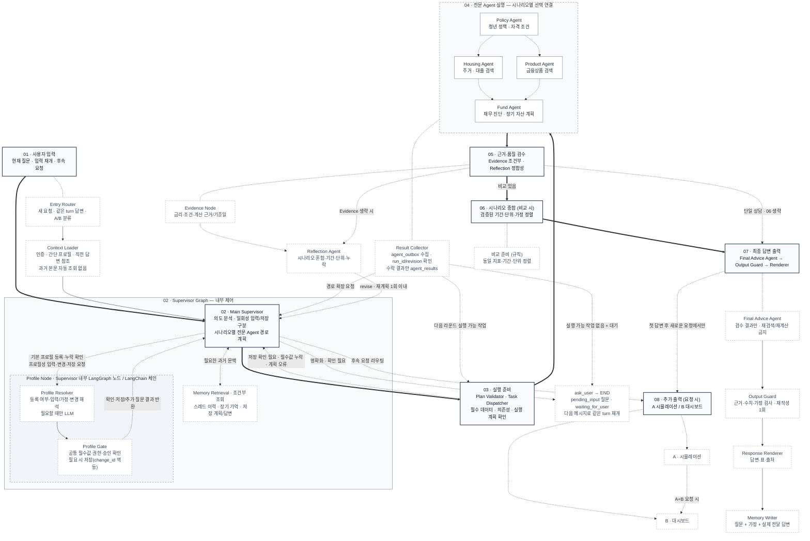
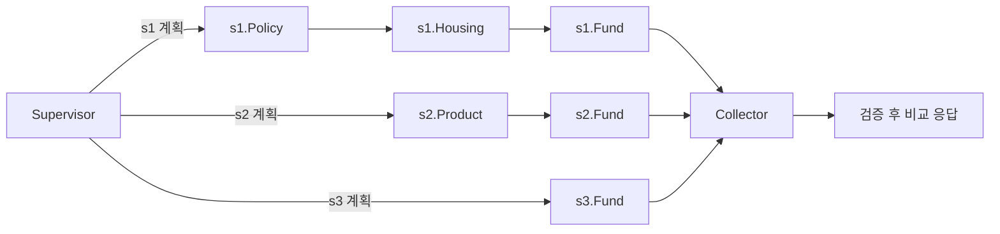

# 청년 금융 멀티에이전트 설계 메모 v3.0

> **문서 기준:** 이 메모의 **§1 그래프가 에이전트 위치·연결·분기의 단일 표준**이다. [`State_압축_설계안_v3.0.md`](./State_압축_설계안_v3.0.md)가 공용 **Main State의 타입·필드·Agent 공통 입출력 계약**을 정의한다. 이 메모는 **전문 Agent별 입력/출력 책임, 검색·계산·검증 요구, 실행 정책**을 유지한다.
>
> **이번 최소 보완:** 기존 노드·연결은 유지하고, 같은 요청의 반려 피드백 / Evidence·Reflection 판정 분리 / 과거 사용자 결정 / 주요 주장별 근거 연결만 State 문서와 맞춘다. 대시보드용 수치는 기존 `metrics[]`를 재사용하며, **검증된 결과 Snapshot과 목표 실적은 State 외부 서비스**에 둔다.

## 1. 전체 에이전트 실행 흐름

> **메인 주축:** **01 입력 → 02 Main Supervisor → 03 실행 준비(Validator/Dispatcher) → 04 전문 Agent(Policy/Housing/Product/Fund) → 05 근거·품질 검수 → 06 조건부 시나리오 종합 → 07 Final Advice + Guard + Renderer → 첫 답변 → 08 요청 시 A/B**
>
> - **Profile Node (`profile_node`)**는 02 Supervisor Graph **내부의 조건부 LangGraph 노드**다. 안쪽의 `Resolver → Gate`는 함수 또는 LangChain 체인으로 구성하며, 별도의 최상위 Agent/독립 Subgraph는 만들지 않는다. 호출 후 Supervisor로 복귀한다.
> - **Memory Retrieval**은 Supervisor가 요청하는 조회 노드다.
> - **Validator**는 개인화에 필요한 공통 프로필 값 누락이나 미처리 저장 요청을 발견하면 **Supervisor로 반환**한다. 기본 등록·갱신·공통 누락은 내부 Profile Node, 정책별 추가 정보는 해당 전문 Agent가 처리한다.
> - **사용자 입력 대기**는 `ask_user`에서 실행을 끝내고(END), 다음 메시지로 재개한다.



**그림 읽는 법**
- 굵은 실선이 메인 경로 01→08이고, 점선은 조건부 분기다. 04 내부의 점선은 고정 순서가 아니다.
- 전문 실행은 **Dispatcher → 전문 Agent → Collector → (다음 라운드면 다시 03)** 순환이다. 모든 작업이 끝나면 05로 간다.
- 비교가 없으면 06을 생략하고, 08은 첫 답변 뒤 요청할 때만 실행한다.
- **Profile Node는 Supervisor Graph 안에서만 조건부 실행**한다. Resolver → Gate는 `profile_node`의 내부 체인 표현이며 **별도 LangGraph Subgraph의 두 노드가 아니다**. 기존 Supervisor ↔ Profile 흐름과 다른 Agent의 연결은 그대로다.
- **대시보드용 Snapshot 저장은 기존 Renderer 전달 후 서비스 후처리**에서 수행한다. 새 Agent/노드를 그림에 추가하지 않고 B 요청에서는 저장된 답변 참조를 조회한다.

**Supervisor 최소 분기 규칙**

| 요청·결과 | Supervisor 결정 | 안전 검사 |
|---|---|---|
| "청년 정책 종류가 뭐야?" | Profile Node·Memory 없이 Policy 일반 안내 | 개인 프로필 없이 실행 가능 |
| "내 상황에 맞는 계획을 세워줘" (프로필 미등록) | Supervisor → 내부 Profile Node로 최소 등록 정보·필수값 확인 → 필요 시 질문 | 일단 확인된 정보로 가능한 상담은 계속 진행 |
| "월급이 올랐어. 다시 계산해줘." | 필요 시 **Supervisor 내부 Profile Node**가 새 금액·저장 의도를 확인 → `intent.supplied_values`로 재계산 | 일회성 입력은 명시적 저장 승인 없이 영속 저장하지 않음 |
| "월급을 350만 원으로 저장해줘." | Supervisor → 내부 Profile Node 확인·저장 → Supervisor 복귀 후 필요 작업 | `intent.profile_update_status`, `*_profile_changes` 확인 |
| "내년 월급이 달라지면 비교" | Supervisor가 `scenario_state.scenarios[].overrides` 설정. 실제/가상 구분이 애매하면 내부 Profile Node로 확인 | 실제 프로필 불변, 비교 기준 표시 |
| "지난번 조언을 주거 위주로 수정" | 필요한 이전 답변만 Memory 조회 후 작업 구성 | 저장된 과거 수치를 현재 사실로 단정하지 않음 |
| "방금 계획에서 저축액만 늘려줘" | `memory.last_advice_ref`로 직전 답변 조회 | Memory Writer 지연·실패와 무관하게 checkpoint 참조 가능 |
| 실행 중 필수 입력 추가 필요 | 해당 작업의 `pending_input`만 등록하고 필요한 분기로 복귀 | `task_id/run_id/plan_revision/scenario_id`로 구 결과 차단 |

### 시나리오별 경로가 달라도 되는 예시

실행 경로의 차이를 보이기 위한 가상 예시다(실제 자격 차이를 뜻하지 않음).



| 원칙 | 내용 |
|---|---|
| Profile 조건부 | **개인화에 필요한 기본 등록·공통 필수값 확인, 프로필성 입력·변경, 저장 요청, 실제/가상 구분이 모호할 때** Supervisor가 내부 노드 호출. 일반 안내에는 생략하며 단순 입력은 규칙으로 처리 가능 |
| 서로 다른 DAG | s1~s3별로 목적과 실제 필수 의존에 맞게 `execution_plan.tasks[]` 구성. 같은 Agent라도 시나리오별 독립 실행 가능 |
| 후보 후속 분기 | 검색 결과로 필요한 다른 Agent 작업이 생기면 Collector 승인 결과를 보고 Supervisor가 `tasks[]`를 조정 |
| 중간 경로 변경 | Agent가 다음 Agent를 직접 호출하지 않는다. Collector → Supervisor가 필요 작업을 추가하거나 제외 |
| 멀티홉 | Agent 간 선택·연결은 Supervisor, Neo4j 다중 관계 탐색은 각 전문 Agent 내부 |
| Policy 분리 | 정책 전용 노드·인덱스·원문 저장소를 사용하는 독립 Agent. 내부 결과 검수 가능 |
| Fund 배치 | 단독 예산 상담에서는 Fund 단독, 복합 상담에서는 필요한 선행 결과에 따라 실행 |
| 실행 장벽 | `Send` 병렬은 superstep 단위로 모인다. 지연이 문제면 시나리오 Subgraph로 확장 가능 |
| 비용 | Profile·기억 조회·비교·A/B는 필요할 때만 호출 |

**State 관리:** 각 전문 Agent의 **도메인 입출력·Local State는 그대로 독립**적이다. 공용 `MainState`의 상세 필드와 Agent 공통 Envelope는 State 압축 설계안 v3.0을 참조한다.

---

## 2. Main Supervisor
**역할:** 의도 분류 · 일회성 입력/프로필 저장 구분 · 내부 Profile Node/Memory 호출 판단 · 시나리오별 작업 계획 · 실행 조율 · 재계획

- **주요 기능**
  - 사용자 메시지를 가장 먼저 해석해 정보 확인·과거 결과 조회·전문 분석의 필요성을 판단한다.
  - 사용자 진술을 **이번 상담 값**(`intent.supplied_values`), **실제 프로필 저장 요청**(`intent.profile_update_status`), **가상 가정**(`scenario_state.scenarios[].overrides`)으로 구분한다. 임시·일회성 값은 자동 저장하지 않는다.
  - **개인화 상담에 필요한 기본 프로필 등록 여부·공통 필수값**, 새 프로필성 입력/변경, 저장 요청 또는 실제/가상 구분이 모호한 경우에만 **Supervisor 내부 `profile_node`**를 호출한다. 일반 정보 안내에는 호출하지 않는다.
  - 필요한 과거 상담·저장 계획·거절 정보를 Memory Retrieval로 조회하고, 이전 답변이 없으면 원본 없이 수정 내용을 만들어 내지 않는다.
  - 내부 Profile Node와 Memory Retrieval은 서로의 필수 선행 단계가 아니며 Supervisor가 필요에 따라 호출한다. Profile Node가 과거 기억을 직접 조회하지 않는다.
  - 비교 조건은 `scenario_state`, 실행은 `execution_plan.tasks`, 결과는 `agent_results`, 과거 맥락은 `memory`에서 참조한다.
  - 과거 계획 수정은 `memory`로 조회한 `prior_advice` View를 입력한다. **같은 요청의 검증 반려 재실행**은 직전 `review_results` 오류를 추린 `revision_feedback`(이전 실행/출력 참조·`issues[]`)으로 구분하며, 새 `run_id`를 발급한다. 입력·작업 계획 자체가 바뀐 경우에만 계획 revision을 올린다.
  - A/B 후속은 기존 답변을 기준으로 실행하고, 새 조건에 따라 필요한 작업만 추가한다.
- **그래프 연결:** 입력 → Supervisor [필요 시 **내부 Profile Node** / Memory Retrieval → Supervisor 복귀] → Validator/Dispatcher → 전문 Agent → Collector(순환) → Evidence/Reflection → (비교 시 06) → Final → Guard/Renderer. 필요한 추가 입력·경로 변경은 Supervisor로 돌아온다.
- **호출 조건:** 전문 Agent는 요청별로 선택 실행하며 모든 시나리오에 동일한 Agent 순서를 강요하지 않는다.
- **사용할 도구:** Agent·노드의 입출력 계약과 권한을 알고 **계획만** 한다. 직접 검색·계산·프로필 저장은 하지 않는다.
- **추가 메모:**

## 3. Profile Node — Supervisor 내부 LangGraph 노드 (내부 LangChain 체인 가능)
**역할:** 개인화에 필요한 기본 프로필 **등록 상태·최소값 누락 점검**, 사용자가 새로 말한 프로필성 정보의 정리, 실제 저장·변경 확인. **독립 Agent나 Supervisor 바깥의 선행 노드가 아니다.**

- **구현 형태:** Supervisor Graph에서 `supervisor → profile_node → supervisor`로 조건부 연결한다. 내부 실행은 `Resolver → Gate` 두 단계의 함수 또는 LangChain Runnable 체인으로 충분하며, **독립 LangGraph Subgraph를 만들 필요는 없다**.
- **호출 조건:** 개인화 요청에 필요한 기본 정보가 등록되지 않았거나 부족할 때, 프로필성 입력·변경을 해석할 때, 명시적 저장 요청·승인이 있을 때, 실제/가상 조건이 불명확할 때. **일반 정책 안내·관계없는 대화에는 호출하지 않는다.**
- **주요 기능**
  - **Resolver(규칙 우선, 필요 시 LLM):** 현재 `basic_profile`·`financial_profile`의 등록·누락 상태를 확인하고, 새 입력을 **일회성 실제값 / 저장 변경 / 가정**으로 구분한다. 공용 대표 필드만 정규화한다.
  - **Gate(결정론):** 해당 상담의 **공통 필수값**이 없으면 `pending_input`으로 질문한다. 사용자 저장 요청·동의가 명확할 때만 `change_id`로 중복을 방지하며 저장하고, 성공 시 새 프로필을 조회한다.
  - **분업:** 특정 Policy/Housing/Product 요건(근속 기간·소득 인정 방식 등)은 해당 전문 Agent가 필요할 때 질문하고 `extra_answers`로 사용한다. Profile Node가 공용 프로필 필드를 늘리지 않는다.
- **결과 반영:** 일회성 입력은 `intent.supplied_values`, 실제 변경은 `basic_profile_changes`/`financial_profile_changes` 및 새 `*_profile`, 저장 상태는 `intent.profile_update_status`, 추가 질문은 `pending_input`에 반영하고 **Supervisor로 복귀**한다. 가정의 `scenario_state.overrides` 구성과 전문 실행 계획은 Supervisor 책임이다.
- **대기·재개:** 확인이 필요하면 `pending_input`을 등록하고 상위 `ask_user → END`에서 질문한다. 다음 메시지는 Entry Router → Supervisor → 필요한 `profile_node` 재호출로 처리한다. `profile_node` 내부 `interrupt`는 사용하지 않는다.
- **과거 상담과의 관계:** Memory Retrieval을 직접 실행하지 않고, Supervisor가 전달한 관련 기억만 참고한다. 과거 가정을 실제 프로필로 자동 저장하지 않는다.
- **공용 State 경계:** Resolver/Gate의 중간 작업은 Local 변수나 내부 체인 반환값으로 제한한다. 새로운 최상위 State Key/전문 Agent DAG를 추가하지 않는다.
- **입출력:** State 압축 설계안 v3.0 §3.5의 내부 Profile Node 계약을 따른다. 기존 §4.2 전문 Agent 공통 입출력은 **변경하지 않는다**.
- **기본 프로필:**
- **금융 프로필:**
- **사용할 도구:**
- **추가 메모:**

### 3.1 Memory Retrieval (Supervisor의 조건부 조회 노드, 전문 Agent 아님)

- **역할:** 필요할 때만 현재 스레드의 이전 답변, 장기 기억, 저장 계획, 과거 답변·사용자 결정을 조회한다. 인증·동의·권한을 강제한다.
- **입출력:** `intent.target_advice_ref`와 `memory.last_advice_ref` 등 대상 정보를 받아, 관련 요약·원본 참조를 `memory.retrieved[]`에 담고 `memory.retrieval_status`를 갱신한다. 사용자의 과거 **추천 수락·거절·변경**이 있으면 그 항목에만 `type="user_decision"`, `target_ref`, `decision`, `reason`(사용자가 밝힌 경우), `source_ref`를 넣는다. 상세 조회 이력은 서비스 로그에서 관리한다.
- **재호출:** 최초 요청뿐 아니라 실행 도중 새로 필요한 과거 맥락에도 호출할 수 있다. 불필요한 중복 조회는 피한다.
- **오류 구분:** `found / no_match / access_denied / failed`를 구분하고, 사용자 추천 거절은 검색 실패와 구별한다. 과거 조언의 현재 유효성을 보장하지 않는다.
- **프로필 충돌:** 과거 진술을 현재 사실로 승격하지 않는다. 명시적 저장 요청이 있으면 Supervisor가 Profile을 호출한다. 기억 쓰기는 Memory Writer 책임이다.

## 4. Housing Agent
**역할:** 주택 마련 · 주거 관련 대출 조건 · 상환/자금 갭 분석

- **주요 기능:** 주거·대출 정보를 검색·분석하고 필요하면 후보를 최대 k개(기본 5) 반환한다. 주거와 무관한 질문에는 호출하지 않는다.
- **입출력:** 주거 목표·희망 조건, 사용 가능 자금·월소득·부채·월 상환액, 필요한 정책별 추가 정보와 Policy 선행 결과를 받는다. `housing_analysis`·후보·가정과 **기간·단위·근거·확인 상태**를 반환한다. 주택 총가격과 자기자금 목표는 다른 지표다.
- **사용할 도구:**
- **다른 Agent와의 연계:**
- **추가 메모:**

---

## 5. Product Agent
**역할:** 금융상품 상담 · 검색 · 조건 비교

- **주요 기능:** Neo4j의 금융상품을 조건에 맞춰 검색·비교하고 후보를 최대 k개(기본 5) 반환한다. 탐색·랭킹 알고리즘은 담당자가 설계한다.
- **입출력:** 목표·위험/유동성/상품 선호, 간단한 `profile_view`의 가용 자금, 후보·정책 선행 결과를 받는다. `candidates[]`·`comparison`·`assumptions`와 금리/한도 **기준일·조건별 충족/미확인·근거**를 반환한다. 상품 선호와 가입 자격은 구분한다.
- **검색 방식:**
- **사용할 도구:**
- **다른 Agent와의 연계:**
- **추가 메모:**

---

## 6. Fund Agent
**역할:** 재무 진단 · 복수 목표 조율 · 예산/부채 관리 · 장기 로드맵 (프로젝트 핵심)

- **주요 기능:** 월평균 소득·생활지출·부채 상환과 가용 자금으로 **여러 목표의 시점·우선순위·금액 의미를 분리**해 자산 형성 계획을 만든다. 다른 Agent 없이 단독 실행할 수 있다. 계산은 결정론적 도구를 우선한다.
- **입출력:** 유효 `goals[]`, 대표 월소득·생활비·부채 상환액·가용 자금과 선택 선행 결과(필요 시 목표 연도·가정)를 받는다. `financial_diagnosis`·`roadmap[]`·`assumptions`·`metrics[]`(값·단위·기간·계산 참조)를 반환한다.
- **사용할 도구:**
- **다른 Agent와의 연계:** Housing/Product/Policy는 필요할 때만 쓴다. 실제로 필요한 선행 결과만 `depends_on`에 명시한다. 선행이 실패·생략되면 확보한 데이터 범위에서 안내하고 한계를 표시한다.
- **추가 메모:**

---

## 7. Policy Agent
**역할:** 청년 정책 독립 검색 · 기간별 자격/조건 검토 · 정책 후보 비교

- **주요 기능:** 정책 도메인 전용 검색(Neo4j 논리 분리 + 원문 저장소)을 쓰는 **독립 전문 Agent**다. 정책이 요구하는 기준 기간·인정 방식에 따라 연령·거주·가구·소득 자격을 평가한다.
- **데이터 구성:** 정책 노드·인덱스·조건/기간 필드를 논리적으로 분리하고 원문·데이터 버전·기준일을 참조한다. 물리 DB 분리는 추후 결정한다.
- **입출력:** `profile_view`의 연령·지역·가구·주택 보유·세전 연소득(있는 경우), 필요한 후보별 `extra_answers`와 기준일·필터를 받는다. `candidates[]`, `eligibility.status`(`eligible/ineligible/needs_check`), 요건별 `checks[]`, `unverified_conditions[]`와 출처를 반환한다. 인정소득 계산은 Policy 내부 책임이다.
- **결과 경로:** 본문은 Collector 승인 후 `agent_results[policy_task_id].data`, 내부 조건별 검수는 Policy 내부 결과, 상위 검수는 `review_results`의 `target_run_id`에 연결한다.
- **사용할 도구:**
- **추가 메모:**

---

## 8. Evidence Node
**역할:** 중요 주장·계산 결과와 공식 근거의 일치 검증

- **주요 기능:** 최신 `agent_results`의 금리·한도·자격·조건·중요 수치의 출처·기준일을 확인한다. Agent 내부 경량 검사와 달리 원문·자료 시점·계산 입력과 주장의 **연결 정확성**을 본다.
- **실행 조건:** 중요한 정책·상품 조건 주장이나 계산 수치가 있거나, 근거가 오래됐거나, 수치에 근거가 없을 때만 실행한다. 대상 주장만 받는다.
- **출력:** `review_results[task_id]`의 **`target_run_id` + `evidence={status, issues[]}`**에 판정을 남긴다. `reflection` 항목을 덮어쓰지 않는다. 금리·한도·자격·핵심 수치는 Agent `data`의 개별 `evidence_ref`로 실제 원문/계산 근거, 단위·기준일·적용 조건을 대조한다. 근거가 불충분하면 `needs_check` 또는 `revise`로 처리하며 검증 통과로 위장하지 않는다.
- **내부 실행 흐름:**
- **사용할 도구:**
- **추가 메모:**

---

## 9. Reflection Agent
**역할:** 전문 결과 품질 · 시나리오 격리 · 금융 수치 정합성 검토

- **주요 기능:** Final 이전에 수락된 결과와 Evidence 결론을 확인한다. 점검 대상은 후보 적합성, **현금흐름의 기간·단위·상환 중복**, 목표 금액 의미, 시나리오 간 혼합, 가상의 실제 오용이다.
- **내부 흐름:** 시나리오별 최신 결과 View + 검수 결과 → 규칙 검사 → 필요할 때만 LLM → `pass/revise`.
- **출력:** `review_results[task_id]`의 **`target_run_id` + `reflection={status, issues[]}`**에 수정 대상과 사유를 남긴다. 기존 `evidence` 항목은 보존한다. 전체 검토는 `overall`에 검토한 `run_id` 목록과 함께 요약할 수 있다. 반려 사유는 Dispatcher가 재실행 시 `revision_feedback.issues[]`로 전달한다.
- **사용할 도구:**
- **추가 메모:** 오류 보완 재계획만 `execution_plan.review_retry_count`(최대 1)에 포함하고, 정상 경로 확장과는 구분한다. 바뀐 결과에 의존하는 작업과 그 검수만 재실행한다.

---

## 10. Final Advice Agent · Output Guard · Response Renderer

**결정:** 최종 답변은 독립 후행 **Final Advice Agent**가 담당한다. 검색·정책·자산 계획 결과를 통합하고 실천 가능한 조언을 제공하며, 재검색·새 수치 계산·재계획은 하지 않는다.

| 구성 | 내용 |
|---|---|
| 입력 | `intent`·필요한 `profile_view`·선택 `scenario_state`·Collector 수락 `agent_results`·`review_results`·이전 답변 요약(필요 시) 및 허용 근거 |
| 출력 | 공용 `final_advice`의 `summary`, `sections[]`, `warnings`로 상담 내용 작성. 섹션 내부에 **재무 진단·로드맵·주거/정책/상품 추천·시나리오 비교·이전 계획 변경 설명**을 필요한 만큼 담음. 검증 전 `validation`은 임의로 통과 처리하지 않음 |
| 이전 계획 수정 | Supervisor가 조회한 과거 답변과 변경/유지 범위로 차이를 설명. 과거 금리·자격을 현재 근거로 인용하지 않음 |
| 06 비교 준비 | 동일 단위·기준일·기간·지표 정렬은 규칙. Final은 확인 가능한 차이만 설명하고 부분 비교·임시 가정을 표시. 별도 Comparison Agent 없음 |
| Output Guard | `final_advice.sections[].metrics[]`의 `source_task_id` + **현재 `source_run_id`**와 개별 `evidence_ref`, 수치·단위·기준일, 가정/실제, `needs_check` 자격을 검사. 필요 시 재작성 1회, 이후 검증된 부분만 출력 |
| Renderer | Guard 통과한 `sections[]`를 텍스트·표·출처 링크로 표시. 시뮬레이션과 달성률은 요청할 때만 실행 |
| 대시보드 연계 | **답변 전달 후** 기존 출력 후처리 서비스가 검증된 `sections[]`(수치·로드맵·후보 비교)와 필요한 Agent 결과의 최소 부분·가정·근거 참조만 `advice_id` 기준 Snapshot으로 보관. 별도 Agent/그래프 노드·Main State Key는 만들지 않음 |
| 장기 기억 | Renderer가 실제로 전달한 질문·답변·가정을 Memory Writer가 저장. **사용자가 명시한 추천 수락·거절·변경**은 필요 시 `memory_candidates`에 대상·결정·이유·발화 참조를 선택 저장. 실패해도 전달은 막지 않으며 직전 답변은 checkpoint에서 조회 가능 |
| 모델·비용 | LLM 사용 가능. 검증된 결과·제한된 섹션·근거 ID 중심으로 응답 범위 제어 |

- **사용할 도구:**
- **추가 메모:**

## 11. 그래프 제어 노드 및 상태 쓰기 권한

**라우팅 표준은 이 메모 §1의 그래프**다. 공용 Key의 타입과 최소 필드 계약은 **State 압축 설계안 v3.0**에 있다. 전문 Agent의 공통 출력은 `agent_outbox`를 통해 모이고 Collector만 `agent_results`를 확정한다.

| 노드 | 구현 | 공용 State 책임 |
|---|---|---|
| Entry Router | 규칙 + 조건부 소형 LLM | 새 요청·대기 답변·A/B 판정, `consultation_id`·`turn_id` 관리 |
| Context Loader | 규칙 + 보안 저장소 | 간단 `basic_profile`·`financial_profile`, `memory.last_advice_ref`, 요청별 초기화/복원 |
| Main Supervisor | LLM + 규칙 | 프로필 필요성·내부 `profile_node` 호출 판단, `intent.supplied_values`·가정·`execution_plan.tasks` 조정 |
| `profile_node` (Supervisor 내부) | LangGraph 노드 안에서 Resolver(조건부 LLM) → Gate(규칙) | 기본 프로필 등록·공통 누락 확인, `intent.supplied_values`, `*_profile_changes`, 저장 상태, `pending_input`·새 프로필 |
| Memory Retrieval | 권한 검증 + 검색 | `memory.retrieval_status`·`memory.retrieved` 갱신 |
| Plan Validator | 규칙 | 필수 입력·작업 의존·시나리오 독립성 확인, 실패 시 Supervisor 반환 |
| Task Dispatcher | 규칙 | 작업별 `profile_view` 생성, `run_id` 부여, 반려 재실행 시 선택 `revision_feedback` 구성, `execution_plan.tasks[].status` 갱신·`Send` |
| 전문 Agent | Agent 내부 | 필요한 입력만 받아 `agent_outbox`에 `AgentOutput` 반환 |
| Result Collector | 규칙 | `task_id/run_id/plan_revision/scenario_id` 검증, `agent_results`, `pending_input`, 이전 출력의 조회 참조·오류 요약만 `superseded_results`에 보관 |
| ask_user | 규칙 + 템플릿 | `pending_input` 질문 출력 후 `phase=waiting_for_user`, END |
| Evidence / Reflection | 조건부 검사 | `review_results[task_id].target_run_id` 아래 `evidence`/`reflection` 판정 분리, 필요 시 재계획 요청 |
| 비교 준비 | 규칙 | 시나리오별 비교 기준 정렬, 결과는 Final에 일회성 전달 |
| Final Advice | 응답 LLM | `final_advice` 초안 작성 |
| Output Guard / Renderer | 규칙 / UI | `final_advice.validation` 검사·표시, `memory.last_advice_ref` 갱신; **전달 후 결과 Snapshot은 서비스 후처리**(State 쓰기 없음) |
| Memory Writer | 동의·중복 확인 + 저장 | 전달 완료 답변 및 사용자가 명시한 추천 결정(대상·이유·발화 참조)의 선택적 영속 저장 |
| A/B 후속 | 요청 기반 서비스·UI | `post_response`, 기준 `final_advice` 참조 |

### 11.1 Entry Router / Context Loader
- `pending_input`이 있으면 기존 질문에 대한 답변인지 새 요청인지 판단한다. 답변이면 같은 `turn_id`로 복귀하고 요청별 State를 초기화하지 않는다.
- A/B는 다음 사용자 요청으로 다시 Entry Router → Supervisor에 진입한다. 첫 답변 완료 시 자동 실행하지 않는다.
- 새 요청이라면 `intent/scenario_state/execution_plan/...`의 요청별 값을 초기화하고 `memory.last_advice_ref`만 보존한다. 프로필은 저장된 간단한 최신 스냅샷을 로드한다.

### 11.2 내부 Profile Node · 기본 등록 확인 · 입력/저장 · 입력 페이지
- **Supervisor가 개인화에 필요한 등록·공통 필수값 누락, 프로필성 입력/변경, 저장 요청에 한해 호출**하고, 처리 후 같은 Supervisor로 돌아온다. 일반 안내에는 생략한다.
- 저장된 프로필이 없거나 비어 있어도 전체 회원가입 정보를 강제로 받지 않는다. **이번 상담에 필요한 대표 필드만** 확인하고, 모르면 `pending_input`을 등록한다.
- 새 금액 등 **일회성 실제 입력은 `intent.supplied_values`**에 반영하지만, 명시적 저장 지시가 없으면 영속 프로필을 바꾸지 않는다.
- 실제 저장 변경은 `change_id, field, value, status`로 표현한다. 사용자 승인 후 저장 서비스에서 중복 방지하고 성공하면 `basic_profile`/`financial_profile`을 재조회한다.
- 단순 가상 조건은 Supervisor가 `scenario_state.scenarios[].overrides`로 관리하고 Profile Node에서 복잡한 기간 패치를 만들지 않는다.
- 필수 정보·저장 확인이 없으면 `pending_input` → 상위 `ask_user → END`. 다음 메시지는 같은 `turn_id`로 Supervisor에 들어와 필요한 `profile_node`를 다시 호출한다.
- 전문 도메인에만 필요한 일회성 값은 해당 Agent가 질문·사용하며 공용 프로필로 자동 저장하지 않는다.

### 11.2.1 Memory Retrieval
- Supervisor가 필요한 대상 ID·조회 목적을 주면 현재 스레드 답변·저장 계획·장기 기억 중 관련 내용만 검색한다.
- `memory.retrieval_status`, `memory.retrieved[]`에 최소 결과와 출처 참조를 넣는다. 조회 감사·세부 상태는 서비스 로그에서 관리한다.
- 현재 정보가 충분한 신규 상담은 호출하지 않는다.

### 11.3 Plan Validator / Task Dispatcher
- **Validator:** 작업 이름·필수 의존·사이클·시나리오 혼합을 검사한다. 프로필 저장이 완료되지 않은 작업, 상담을 확정하기에 부족한 필수 정보가 있으면 Supervisor에 반환한다.
- **Dispatcher:** 저장 프로필 + `intent.supplied_values` + 해당 시나리오 `overrides`를 합쳐 **필요 필드만** `profile_view`에 넣는다. `pending_input.answers`를 해당 작업의 `extra_answers`로 전달한다.
- Dispatch 시 `task_id, run_id, plan_revision, scenario_id`를 고정한다. 입력이 바뀌면 영향을 받는 해당 시나리오 관련 작업과 검수를 무효화하고 재실행한다. 세부 입력 해시는 공용에 두지 않는다.
- **같은 요청의 반려 재실행**이라면 Dispatcher가 **구 검수를 제거하기 전에** `agent_results`와 `review_results`에서 `revision_feedback={previous_run_id, previous_output_ref?, issues[]}`를 일회성 생성해 해당 Agent에 전달한다. 이전 결과 본문이 필요하면 권한이 있는 실행 결과 저장소/checkpoint 이력에서 참조로 조회하며, 없다면 오류 요약만 전달한다.

### 11.4 Result Collector — 유일한 공식 결과 작성자
- `agent_outbox` 출력의 `task_id/run_id/plan_revision/scenario_id`, 현재 작업 상태, `data/evidence_refs/needed_fields` 형식을 확인한 후 수락한다.
- 오래된 결과는 공용에 쓰지 않고 폐기한다. 새 실행 결과로 교체할 때 기존 실행의 `previous_output_ref`(실제 조회 가능한 경우), `reason`, 필요한 `issues[]`만 `superseded_results[old_run_id]`에 보존하고 **구 `review_results`를 무효화**한다. 오래된 `agent_results`가 잠시 남더라도 현재 계획의 `run_id`와 다르면 Final 입력에서 제외한다.
- `needed_fields`가 있으면 `pending_input.id` 기준으로 추가 질문을 등록한다. 다른 시나리오 입력을 합치지 않는다.
- 이후 라우팅: 새 작업 필요 → Supervisor / 다음 라운드 → Dispatcher / 필수 질문 대기 → ask_user / 완료 → Evidence.

### 11.5 Evidence / Reflection / Final
- Evidence는 중요한 금리·한도·자격·수치의 **개별 출처·기준일·원문 적용 조건**과 주장 일치를 검증해 `review_results[task_id].evidence`에 반영한다.
- Reflection은 월·연 금액, 생활비/부채 중복, 임시/실제 조건, 시나리오 혼합, 누락을 규칙으로 먼저 검사해 `review_results[task_id].reflection`에 반영한다. Evidence의 판정을 덮어쓰지 않으며 필요할 때만 LLM을 사용한다.
- Final은 현재 `run_id`로 수락된 `agent_results`와 해당 실행에 유효한 `review_results`만 받아 `final_advice.sections[]`를 구성한다. Guard는 핵심 수치의 `source_task_id/source_run_id`·개별 근거 ID·값을 대조한다. 확인 불가 조건은 확정하지 않는다.

### 11.6 추가 출력 A/B
- A는 사용자 요청 시 확인된 수치·가정으로 시뮬레이션 데이터를 만들고, B는 **검증된 상담 결과 Snapshot의 수치·로드맵·후보 비교·근거**를 서비스/Renderer에서 표시한다. 현재 재무 대표값은 저장 프로필에서 읽는다.
- **B 재조회:** `post_response.base_advice_ref`로 기존 Neo4j 등을 활용한 결과 저장 서비스를 조회한다. 다음 turn에서 `final_advice`가 초기화되어도 저장된 Snapshot을 사용할 수 있어야 한다. 저장 실패·삭제 등으로 조회할 수 없으면 임의 복구하지 않고 필요 시 동일 스레드 checkpoint를 확인하거나 재상담을 안내한다.
- **목표 달성률:** 서비스가 저장한 안정적인 `goal_ref`와 목표에 실제 배정된 실적(`as_of`, `actual_amount_krw`)이 있을 때만 계산한다. 계획·가정 결과나 총자산 전체를 실적으로 취급하지 않는다. 시계열/달성 기록은 `financial_profile`이나 Main State에 추가하지 않는다.
- A+B 요청일 때는 A 결과를 B에서 활용할 수 있다(가정값임을 표시). 대시보드를 독립 Agent로 만들 필요는 없다.
- `post_response`는 `{modes, base_advice_ref, result_refs}`만 유지한다. Snapshot 저장과 Memory Writer의 대화 기억 저장은 별개의 서비스 작업이며 어느 한쪽의 실패가 다른 쪽을 성공으로 위장하지 않는다.

## 12. Agent별 입출력 인터페이스 — 최종 점검

**Agent별 검색·계산·후보 판단·근거의 책임은 유지**한다. 다만 공용 State는 **간단한 대표 금액과 기본 정보만** 가지며, 정책·상품마다 필요한 추가 자격 조건은 해당 Agent의 `extra_answers`와 Local State에서 처리한다. 세전 연소득과 세후 월소득을 혼용하거나 사용자 가정을 실제 프로필로 저장하지 않는다.

**공통 원칙:** 상세 도메인 결과(`housing_analysis`, `candidates`, `eligibility`, `roadmap`, `checks`, `metrics` 등)는 **각 Agent `AgentOutput.data` 내부**에 그대로 둔다. 상위 Collector의 공통 Envelope만 State 압축 설계안 v3.0 §4.2를 따른다.

### 12.1 Agent별 required / optional 선언

요청·업무 종류마다 필요한 대표 필드를 선언한다. **일반 안내의 `required=[]`는 정상**이며, 자격 판단 시 정책 원문에서 필요한 값을 해당 Agent가 그때만 요청한다.

```yaml
housing.home_plan:
  required: [basic_profile.goals]
  optional: [financial_profile.available_assets_krw, financial_profile.monthly_net_income_krw, financial_profile.total_debt_krw]
product.product_compare:
  required: []
  optional: [basic_profile.goals, basic_profile.risk_tolerance, financial_profile.available_assets_krw]
policy.eligibility:
  required: []  # 정책별 필수 자격은 Agent의 추가 질문으로 결정
  optional: [basic_profile.age, basic_profile.region, basic_profile.owns_home, financial_profile.annual_gross_income_krw]
fund.roadmap:
  required: [financial_profile.monthly_net_income_krw, financial_profile.monthly_living_expenses_krw]
  optional: [basic_profile.goals, financial_profile.monthly_debt_payment_krw, financial_profile.available_assets_krw]
```

> `fund.roadmap`의 `required`는 **구체적인 월현금흐름 산출 작업 예시**다. 일반 재무 조언은 이 값이 없어도 부분 상담이 가능하다. Policy의 실제 정책 자격 확정은 개별 상품 원문의 필수 요건 모두 확인 후에만 `eligible`로 판정한다.

### 12.2 전문 Agent 공통 Envelope

**입력(Dispatcher → 전문 Agent):** `task_id`, `run_id`, `plan_revision`, `scenario_id`, `objective`, `user_query`, `profile_view` + 필요한 경우 `upstream_results`, `extra_answers`, `prior_advice`(과거 상담), **`revision_feedback`(같은 요청의 검증 반려 재실행)**.

**출력(전문 Agent → agent_outbox → Collector):** `task_id`, `run_id`, `plan_revision`, `scenario_id`, `status`, `summary`, `data`, `evidence_refs`, `warnings`, `needed_fields`. `data` 안의 도메인별 구조는 Agent가 관리하며, 중앙 Envelope를 임의로 늘리지 않는다.

- `task_id/run_id/plan_revision/scenario_id`는 구 실행 결과의 혼합을 막기 위한 최소 식별 값이다.
- 검색 금리·정책 요건·한도·자격·핵심 계산값은 `data`의 해당 항목에서 **값/판정·단위·기준일(해당 시)·개별 `evidence_ref`**를 연결한다. `evidence_refs`는 Neo4j·원문 저장소 또는 계산 검증에서 조회할 수 있는 참조다. 출처 ID가 **있다는 사실만**으로 Evidence를 통과시키지 않는다.
- 대시보드에 표시할 수치가 있을 때만 기존 `data.metrics[]`에 최소 `name/value/unit`을 사용한다(같은 수치를 중복 기록할 필요 없음). 기준일·실제/계획·목표 참조는 **필요한 경우에만** `as_of`·`value_kind`·`goal_ref`로 표시한다. 현재 `task_id/run_id/scenario_id`는 기존 AgentOutput 외피에서 가져온다. 전문 Agent별 다른 `data` 구조를 강제로 통합하지 않는다.
- `revision_feedback`은 `{previous_run_id, previous_output_ref?, issues[]}`만 사용한다. 이전 결과 본문은 저장소에서 필요할 때만 가져오고, 공용 `data`·Envelope를 중복 보관하지 않는다.
- `needed_fields`가 있더라도 단순 안내를 중단할 필요는 없다. 개인 **확정 자격**에 필수인데 누락된 조건만 질문하거나 `needs_check`를 표시한다.
- 병렬 Agent는 `agent_results`에 직접 쓰지 않는다. Collector에서 수락한다.

### 12.2.1 Housing / Product / Policy 후보 공통 구조

| 필드 | 의미 |
|---|---|
| `candidate_id`, `rank`, `score` | 후보 ID·순위. `score` 기준은 설명 가능하게 관리 |
| `matched_conditions[]` | 충족 조건의 `condition`, `rule`, 사용자 값(기간·세전/세후), `evidence_ref` |
| `unverified_conditions[]` | 미확인 조건과 사유. Final은 확정으로 서술하지 않음 |
| `key_attributes` | 금리·한도·혜택 등 **중요 항목별** 값·단위·`as_of`·개별 `evidence_ref`(일반 설명은 선택). 예: `annual_rate={value,unit,as_of,evidence_ref}` |
| `summary_reason` | 선택 이유 요약 |
| `search_criteria`, `near_misses[]` | 사용 조건, 근접 미충족 후보(최대 2) |

### 12.2.2 전문 Agent `data` 내부의 최소 구조

| Agent | 최소 Output | 누락 시 영향 |
|---|---|---|
| Housing | `housing_analysis`(금액 의미·기간·조건), 후보, `assumptions` | Fund가 주거비·자기자금·상환을 혼동 |
| Product | 후보 ID·조건/기준일·근거, `comparison` | 미확인 요건을 확정 추천으로 오인 |
| Policy | `candidates[]`, `eligibility.status`, 조건별 `checks[]`, `unverified_conditions[]` | 요건과 필요한 소득·가구 조건을 연결 못함 |
| Fund | `financial_diagnosis`, `roadmap[]`, `assumptions`, `metrics[]` | Final이 월/연 수치·달성 기간을 비교 못함 |

### 12.3 내부 Profile Node 및 Memory Retrieval 계약

- `profile_node`의 입력은 **기본 프로필 등록 상태·공통 필수값 확인 범위**, 프로필성 사용자 입력/실제 저장 요청, `basic_profile`·`financial_profile`, 관련 `pending_input`이다. 반환은 `intent.supplied_values`(일회성), `*_profile_changes`·새 프로필(저장 성공 시), `intent.profile_update_status`(저장 작업), 필요한 `pending_input`으로 제한한다.
- 단순 가정은 Supervisor가 `scenario_state.scenarios[].overrides`로 구성하며, 실제 데이터 저장과 분리한다. 해당 노드는 **상위 그래프의 내부 노드**이고 전문 Agent 호출 DAG에 포함하지 않는다.
- Memory Retrieval은 조회 목적·대상 답변 참조·사용자 권한을 입력받아 `memory.retrieval_status`와 `memory.retrieved[]`(요약·출처 ID)를 반환한다.

| 상황 | 내부 Profile Node 실행 | 공용 반영 |
|---|---|---|
| 일반 금융·정책 설명 | 호출 안 함 | 프로필·기억 상태 변경 없음 |
| 개인화 상담·프로필 미등록 | 현재 상담에 필요한 기본 필드만 검사 | 필요한 경우 `pending_input`(target=`profile`). 일회성 입력은 저장 없이 활용 가능 |
| 저장 요청한 월급·목표 변경 | Resolver 해석 → Gate 저장·재조회 | `*_profile_changes`, 새 프로필, `intent.profile_update_status=done` |
| 프로필성 월급 입력 후 계산 요청 | 필요한 경우 입력 의미·현재값을 확인 | `intent.supplied_values`만 사용, 영속 저장 없음 |
| 가상 미래 소득 비교 | 실제/가상 구분이 애매할 때만 호출 | Supervisor가 `scenario_state.scenarios[].overrides`만 갱신 |
| 저장 확인·공통 필수 정보 부족 | 필요한 질문만 요청하고 Supervisor 반환 | `pending_input`, 저장 중이면 `profile_update_status=waiting` |
| 과거 정보 충돌 | Supervisor의 Memory 조회 관련 부분만 참조 | 사용자 확인 없는 프로필 자동 변경 금지 |

### 12.3.1 원문 · 작업 지시 · 두 종류의 수정 문맥

전문 Agent에 전달하는 **원문(`user_query`) + 목적(`objective`) + 필요한 `profile_view` + 선행 결과** 원칙은 유지한다. **이전 상담 수정**에는 Memory 조회한 `prior_advice`의 관련 부분만 전달한다. **이번 요청의 검증 반려 재실행**에는 새 `run_id`와 선택적 `revision_feedback`(이전 출력 참조·반려 사유)을 전달한다. `revision_feedback`은 **AgentInput 일회성 필드**이며 새로운 Main State Key가 아니다. 세부 수정 판단은 Agent Local State에서 한다.

| Agent | 과거 결과가 필요할 때 넘길 View | 반환(Agent의 `data` 내부) |
|---|---|---|
| Housing | 이전 주거 비용·대출 계획의 관련 부분, 바꾸려는 주거 목표 | `housing_analysis`, 조건·수치·근거 |
| Product | 이전 제안·거절 항목, 이번 조건, 재검토 요청 | `candidates[]`, 미확인 조건 |
| Policy | 이전 안내 **당시 기준일**·요건 참조 | 현재 기준 `eligibility`·`checks`·최신 출처 |
| Fund | 이전 로드맵·우선순위·수락/거절, 변경/유지 조건 | 새 `roadmap[]`·진단·근거 |
| Final Advice | 이전 계획 관련 섹션과 새로운 검수 결과 | `final_advice.sections[]`의 변경 설명 |

### 12.4 Final Advice Agent와 화면 출력

- **입력:** 현재 요청·필요한 프로필 요약·유효 `agent_results`·`review_results`, 비교 시 `scenario_state`, 이전 상담 수정 시 `memory.retrieved`.
- **출력:** `final_advice` = `{advice_id, summary, sections[], warnings[], validation}`. `sections[]`에서 재무 진단·로드맵·정책/상품 추천·시나리오 비교·변경 요약을 필요에 따라 표현한다. 차트용 `sections[].metrics[]`는 `name/value/unit/source_task_id/source_run_id` 기본 형식을 사용한다.
- **Guard:** 주요 수치의 `sections[].metrics[].source_task_id`와 **`source_run_id`**가 현재 수락된 실행과 일치하는지, 그 값·단위·개별 `evidence_ref`·기준일·임시 가정·`needs_check` 표시가 맞는지 검사한다. 통과 후 `validation`을 반영한다.
- **Renderer:** `sections[]`를 UI에 표시하고, A/B는 자동 실행하지 않는다. 실제 답변 전달 후 출력 후처리 서비스가 검증된 결과의 최소 Snapshot을 저장하되, 근거 참조의 재조회 가능성·보존·저장 실패는 서비스에서 다룬다. `memory_candidates`를 Snapshot 저장소로 대체하지 않는다.

### 12.5 계산·근거 원칙

월현금흐름은 **세후 월소득 − 월생활비 − 월부채 원리금**을 한 번씩 차감한다. 상세 산술·조건 검색은 각 전문 Agent의 결정론적 도구로 계산하고, 중요한 수치에는 **항목별 값·단위·`evidence_ref`·기준일(해당 시)**을 연결한다. Evidence는 참조 원문·계산 입력·적용 조건을 실제 대조하고, 미확인 시 `needs_check`를 유지한다. Policy의 인정소득 규칙은 해당 정책 원문을 조회한 **Policy Agent 내부 책임**이며, 일반 프로필의 연소득만으로 모든 정책 자격을 확정하지 않는다. Final은 새로운 숫자를 계산하지 않는다.

## 13. 비용 제어 및 과도한 호출 방지

**원칙:** 규칙으로 가능한 검사·병합·출처 식별·단위/기간 확인에는 LLM을 쓰지 않는다. 전문 Agent 내부 비용은 담당자가 설계하고, 상위 그래프는 **입력 View·호출 조건·예산**만 조절한다.

### 13.1 상위 그래프의 LLM 호출

| 노드 | LLM | 제어 방식 |
|---|---|---|
| Entry Router | 조건부 소형 | 재개·후속 판정이 모호할 때만 |
| Context Loader · Validator · Dispatcher · Collector · ask_user · Memory Retrieval · Memory Writer | 없음 | 규칙·서비스. 조회 요약에 LLM이 필요하면 별도 평가 |
| Supervisor 내부 `profile_node` | 조건부 | 등록/공통 누락 점검·Gate는 규칙, Resolver 해석이 애매할 때만 LLM |
| 전문 Agent 내부 | 담당자 자율 | 상위는 구조화 입출력·후보 상한만 |
| Evidence | 조건부 | 출처·기준일 존재는 규칙, 원문 비교만 필요 시 LLM |
| Reflection | 조건부 | 규칙 우선. 복수 Agent·시나리오·원인 불명 실패 시만 LLM |
| Supervisor | 첫 처리·경로 변경 시 | 템플릿 기반 의도 분석·신호 추출, 검증된 요약만 소비, 전면 재계획 금지 |
| Final Advice | 답변마다 | 근거 화이트리스트, 구조화 출력, 섹션 상한 |
| Output Guard · Renderer | 없음 | 결정론적 검사·표시 |
| A/B | 요청 시만 | A 결정론 계산, B UI/집계 |

### 13.2 소비자별 View와 캐싱
- 전문 Agent마다 `profile_view`에 **필요한 대표 필드만** 넣고, `intent.supplied_values` 및 해당 시나리오 `overrides`를 반영한다. 일회성 `extra_answers`는 담당 작업에만 제공한다.
- 현재 실행의 `task_id/run_id/plan_revision/scenario_id`를 사용해 구 결과 수락을 막는다. 같은 요청의 반려 재실행에는 `review_results`의 오류 요약과 실제 조회 가능한 이전 결과 참조만 `revision_feedback`으로 넘긴다. 복잡한 입력 해시·프로필 기간별 기록·캐시 서명은 공용 State에 두지 않는다.
- 고정 프롬프트(Agent 등록 정보·출력 스키마)를 앞에 두고, 요청별 정보는 뒤에 둔다. `messages` 전체 대신 최근 메시지와 필요 시 `conversation_summary`를 사용한다.

### 13.3 규칙 우선 Reflection / Output Guard

- **Reflection 규칙:** 필수 `data` 누락, 후보 없음, 주요 미확인 조건, 월/연 단위 오류, 소득−생활비−상환액 중복·모순, 가상 입력 누락, 시나리오 혼합, `target_run_id` 불일치. **Evidence의 검수 결과를 보존하고 별도 `reflection` 필드로 판정**한다.
- **LLM Reflection 추가 조건:** 전문 Agent 2개 이상, 복수 시나리오, 또는 규칙 실패 원인 불명일 때만 선택 실행. 단일 작업이 규칙을 통과하면 생략 가능.
- **Output Guard:** 화면 핵심 수치는 현재 `agent_results`의 수치와 `source_task_id/source_run_id`가 일치하고, 대응하는 개별 출처·단위·기준일·`needs_check` 표기가 맞아야 한다. 재작성 1회 후에도 실패하면 검증된 부분만 안전하게 전달한다.

### 13.4 계획 템플릿과 Fast Path

| 템플릿 | 요청 유형 | 전문 작업 예시 |
|---|---|---|
| `tpl_home_plan` | 주택 마련 자금 계획 | housing → fund (Housing 결과가 실제 필요한 요청에 한함) |
| `tpl_product_search` | 금융상품 검색 | product |
| `tpl_youth_policy` | 청년 정책 조건 | policy, 필요 시 product/housing/fund |
| `tpl_budget_plan` | 저축·상환·예산 로드맵 | fund 단독 |
| `tpl_home_product` | 주거 + 상품 | housing ∥ product → 필요 시 fund |
| `tpl_scenario_compare` | 실제/임시 프로필·후보 비교 | 비교 틀만 공통, s1~s3 각자 DAG |

템플릿은 **서버 내부 실행 참고안**이며 `execution_plan`에 `template_id`를 저장할 필요가 없다. Validator는 동일하게 적용한다. 단일 Agent + 규칙 통과 + Evidence 트리거 없음이면 Evidence/Reflection LLM은 생략할 수 있다. 다만 **Final + Guard/Renderer는 항상 고정 경로**다.

### 13.5 모델 등급 분리

| 등급 | 사용 위치 |
|---|---|
| 소형 | Entry Router·요약·간단한 Profile 필드 판단 |
| 중형 | Supervisor·필요한 Reflection/Evidence |
| 응답 품질 중심 | Final Advice Agent |

모델은 성능·비용 평가로 확정하며, 모든 Agent에 고비용 모델을 강제하지 않는다.

### 13.6 서버 상한 (공용 `budgets` 장부 없음)

| 항목 | 기본 | 소진 시 |
|---|---|---|
| Reflection 오류 보완 재계획 | `execution_plan.review_retry_count` 최대 1회 | 검증된 부분만 안내 |
| Plan Validator 잘못된 계획 반복 | 서버 설정 상한 | 안전 안내/추가 질문 |
| 전문 작업 일시 오류 재시도 | 작업당 1회 | 해당 작업 실패 처리 |
| Output Guard 재작성 | 1회 | 안전 템플릿 출력 |
| 동적 확장·총 작업 수·호출 비용 | 서버 설정 | 더 이상 확장하지 않음 |
| 검색 후보 | Agent당 기본 최대 5개(최종 상위 3개) | — |
| 시나리오 | 요청 시 최대 3개 | — |
| 대화 요약 | 길이 임계값 초과 시에만 | — |
| A/B | 최초 답변에는 0회 | — |

카운터를 모두 `MainState`에 기록하지 않는다. 종료 조건은 **실행 루프 코드/서버 설정**에서 강제하며, 재개 중 유지해야 하는 Reflection 횟수만 `execution_plan.review_retry_count`에 남긴다.

### 13.7 하지 않는 것
- 시나리오를 매 turn 3개씩 만들지 않는다.
- 하위 Agent의 Cypher·도구·프롬프트를 상위 계약으로 통제하지 않는다.
- Final이 정책 재조회·새 계산·새 추천을 하지 않는다.
- 근거 없는 기간을 추정으로 메우거나 오래된 자격을 확정하지 않는다.
- 첫 답변을 기다리게 하는 A/B 계산을 실행하지 않는다.
- 목표의 과거 실적·결과 Snapshot 전체를 Main State에 담지 않는다.
- Supervisor 내부 Profile Node에서 `interrupt`로 그래프를 멈추지 않는다.

## 14. 평가 계획

**목적:** Supervisor-first 라우팅, 일회성 입력/실제 저장/가상 가정 구분, 얕은 프로필로 가능한 금융 상담 품질, 병렬 결과 최신성, 추가 질문 재개, 검증·Final 정확도를 평가한다.

### 14.1 필수 시나리오 세트

| 분류 | 테스트 예시 | 기대 결과 |
|---|---|---|
| Fund 단독 | 월 저축·상환 로드맵 | Fund만 실행, 상품 추천 없이 답변 |
| Policy 일반 안내 | "청년 전세 정책이 뭐야?" | Profile/Memory 호출 없이 설명 |
| 일회성 입력 | "월급 320만 원, 생활비 180만 원" | 필요하면 내부 Profile Node가 해석하고 `intent.supplied_values` 사용, 저장 프로필 불변 |
| 기본 프로필 등록 확인 | 저장 프로필 없이 "내 상황에 맞는 계획" 요청 | Supervisor → 내부 Profile Node → 필요한 기본값만 확인; 일반 안내는 막지 않음 |
| 실제 저장 | "월급 350만 원으로 저장해줘" | Profile 저장→새 스냅샷, `change_id` 중복 적용 0 |
| 저장 거절 | 저장 확인에 "아니" | `*_profile_changes`가 거절 처리, 기존 프로필 유지 |
| 임시 가정 | 내년 월급 350만 원 가정 | `scenario_state.scenarios[].overrides`만 변경, 실제 불변 |
| 복수 시나리오 | s1 Policy→Housing→Fund, s2 Product→Fund, s3 Fund | 서로 다른 경로, 결과 혼합 없음 |
| 경로 확장 | Housing 결과에 따라 Fund 추가 | Collector 결과→Supervisor 재계획, 불필요한 Agent 호출 없음 |
| 정책 전용 조건 | 특정 상품 근속 기간/가구 조건 요구 | `extra_answers`만 사용, 공용 프로필에 필드 추가 없음 |
| 세전/세후 구분 | 세후 월소득만 제공하고 세전 연소득 미입력 | 자격 미확인 시 `needs_check`, 자동 확정 환산 금지 |
| 누락 vs 0 | 부채 상환액 `null` | 확정 월 가용액을 임의 생성하지 않음 |
| 지출/상환 중복 | 생활비에 상환액이 포함 | 한 번만 차감, 필요 시 질문 |
| 가용액 vs 총자산 | 보증금 포함 총자산과 가용액 다름 | 총자산을 가용 자금으로 전부 사용하지 않음 |
| 부분 질문 대기 | s2만 연소득 확인 필요 | 가능한 다른 시나리오 진행, 질문 후 같은 `turn_id`로 재개 |
| 현재/이전 상담 수정 | 저장된 계획을 후속 수정 | `memory.last_advice_ref`/필요 시 조회, 과거 값 자동 최신화 금지 |
| 구 실행 결과 경쟁 | 동일 `task_id`의 과거 `run_id` 결과 | Collector에서 폐기, `review_results`도 무효화 |
| 검증 반려 재실행 | Housing의 중복 차감 오류 → Reflection `revise` | 재실행 Agent에 `revision_feedback.issues[]`와 조회 가능한 이전 출력 참조만 전달 |
| 검수 판정 보존 | Evidence `passed`, Reflection `revise`가 같은 작업에 발생 | `review_results[task_id].evidence`와 `.reflection` 모두 유지, 새 실행에서 무효화 |
| 과거 추천 거절 | 이전 추천에 대해 사용자가 이유를 밝히고 거절 | `memory.retrieved[]`로 `target_ref/decision/reason/source_ref` 조회, 검증 반려와 구분 |
| 수치별 정밀 근거 | 정책 금리의 출처·기준일 불일치 또는 오래된 run을 최종 인용 | Evidence/Guard가 `needs_check` 또는 출력 차단, 새로운 근거를 만들어 내지 않음 |
| 근거 검증 | 미존재 금리·출처·금액을 Final이 추가 | Guard가 실패시키거나 제거 |
| 가정/실제 분리 | 가정 소득과 실제 소득이 혼재 | 답변·비교에서 명확히 표시 |
| 기억 저장 | 사용자 질문·가정·전달 완료 답변 | 실제 표시한 답변만 저장, 초안은 미저장 |
| A/B 후속 | "이 조언을 그래프로" | 신규 요청으로 후속 실행, 첫 응답 시 자동 실행 없음 |
| 대시보드 수치 형식 | Fund·Housing 결과를 표/차트로 표시 | `final_advice.sections[].metrics[]`의 `name/value/unit`·현재 `source_task_id/source_run_id` 일치 |
| 검증 결과 Snapshot | 이전 turn 상담 결과로 B 요청 | 전달·검수 통과 결과만 `base_advice_ref`로 조회, 서비스 저장 실패 시 임의 복원 금지 |
| 실적 기반 달성률 | 실제 목표 진행 기록과 가상 시나리오 비교 | `goal_ref`로 확인한 실적만 달성률에 반영, 계획/총자산을 실적으로 오용하지 않음 |

### 14.2 지표

| 영역 | 지표 |
|---|---|
| 라우팅 | 첫 Supervisor 경로 정확도, 불필요 Profile/Memory 호출률, 재계획 비율 |
| 프로필·입력 | 기본 등록·필수값 검사 정확도, 실제 저장/일회성/가상 구분 정확도, 불필요 질문 비율, 재개 성공률, 중복 저장 횟수(목표 0) |
| 재무 정합성 | 세전·세후 혼용률, 생활비·상환 중복 탐지, 미확인 값 0 오용 비율 |
| 검증 | 구 `run_id` 결과 수락률(목표 0), 오래된 검수 재사용률(목표 0), 반려 사유 전달 성공률, 근거 없는 확정 주장 비율 |
| 대시보드 | 수치·단위·근거 참조 일치율, 답변 Snapshot 재조회 성공률, 실적/가정 혼동률 |
| Final | 화면 수치·출처 일치율, 실제/가정 표기 정확도, 미확인 자격 확정률 |
| 서비스 | 첫 답변 p50/p95, 총 토큰, 시나리오 실행 비용, A/B 미요청 실행률(목표 0) |

### 14.3 절제 실험 (Ablation)

| 구성 | 요소 | 확인 사항 |
|---|---|---|
| Exp-0 | 규칙 검수만 | 기준 품질·비용 |
| Exp-1 | + 조건부 Evidence | 주요 금융 주장 근거 오류 감소 |
| Exp-2 | + 조건부 Reflection LLM | 다중 Agent·시나리오 통합 오류 감소 |
| Exp-3 | + Final Advice Agent | 답변 품질 개선 대비 토큰·지연 |
| Exp-4 | + Output Guard | 수치 환각·자격 확정 차단 효과 |

실제 운영 구성은 **Final + Guard를 포함**한다. Exp-0~2는 구성별 품질 차이 측정이다.

### 14.4 측정 방법

- 공식 정책·상품의 고정 원본 스냅샷과 가상 사용자 요약 프로필로 반복한다.
- `task_id/run_id/plan_revision/scenario_id`, Collector 승인 여부, `intent.profile_update_status`, `pending_input` 재개 성공 여부, `review_results`, `final_advice.validation`을 수집한다. 민감한 원문·계좌정보는 로그에서 제외한다.
- 구조화 출력·단위·산술·근거 매핑을 자동 검사하고 답변의 이해도와 조언 과도성을 사람 평가로 검토한다.
- 회귀 테스트는 최소 3회 수행하고 외부 자료 변경과 모델 파라미터를 통제한다.

## v2.4 → v3.0 변경 이력 (State 정합화)

| 영역 | 변경 | 유지한 것 |
|---|---|---|
| 문서 책임 | §1 그래프를 **배치·연결 표준**으로 확정, 공용 타입·필드는 State 압축 설계안 v3.0에 위임 | 기존 Supervisor-first, 조건부 Profile/Memory, 전문 Agent, Final/Guard 경로 |
| 프로필·입력 | `change_signals`·기간 패치·기록 이력 참조 제거 → `supplied_values`·`profile_update_status`·`overrides`; **Profile을 Supervisor 내부 노드/체인**으로 명시 | 기본 등록·공통 누락 확인, 프로필 실제 저장/가상 구분, 필요 조건 추가 질문 |
| 전문 작업 | `work_orders`·soft 의존·입력 서명 참조 → `execution_plan.tasks[]`, `run_id`, `plan_revision` | 선택적 DAG, Policy/Housing/Product/Fund 개별 실행, Collector 단독 수락 |
| Agent별 입출력 | 공통 Envelope만 간소화하고 전문 결과를 `AgentOutput.data`에 둠 | 후보·금리·정책 자격·근거·진단·로드맵 등 Agent 도메인별 계약 |
| 검증·최종 출력 | `target_run_id`·`final_advice.sections[].metrics[].source_task_id` 채택, **`source_run_id`·항목별 근거·검증 분리·재실행 피드백 추가** | Evidence/Reflection/Final/Guard/Renderer의 역할·품질 요구 |
| 기억·후속 | `memory.last_advice_ref/retrieved/retrieval_status`, `post_response`로 축약 | 이전 상담 수정, Memory Writer, 첫 답변 후 A/B |
| 대시보드 | 기존 `metrics[]` 형식 정렬, 검증된 Snapshot/목표 실적을 **서비스 저장소**로 분리 | §1 그래프·A/B 후속 노드·Main State 20개 유지 |
| 평가 | 구형 기간 패치·신호 장부 테스트를 v3.0 입력·재개·근거 테스트로 교체 | 금융 정합성과 품질 평가, 실험 분리 |

> 과거 버전의 상세 변경 이력은 v2.4 원본에 남긴다. v3.0 구현 기준은 **이 메모 §1 그래프 + State 압축 설계안 v3.0** 두 문서다. 이때 Profile은 Supervisor Graph 내부의 조건부 `profile_node`로 구현한다.
