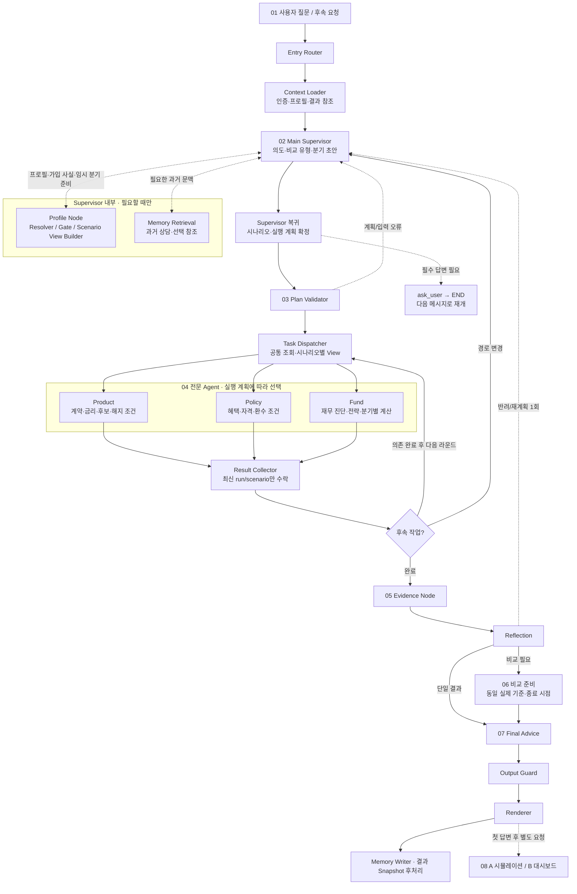

# 청년 금융 멀티에이전트 설계 메모 v3.3

> **문서 기준:** **§1 메인 그래프가 노드 위치·연결·분기·재계획의 단일 표준**이다. [`State_설계안.md`](./State_설계안.md)는 Main State 20개 Key와 Agent 입출력/재개/검증 계약을 정의한다.
>
> **이번 v3.3 업데이트:** 질문에 따라 **후보 비교 / 전략 비교 / 임시 재무 상태 비교**를 구분한다. Supervisor가 분기를 정하고, 내부 `profile_node`가 실제 가입 이력 조회 및 임시 프로필 변경 명세를 준비한다. Product/Policy의 공통 조회 결과를 활용해 Fund가 분기별 계산을 진행하고 최종 비교한다.
>
> **보존 원칙:** `Policy / Product / Fund` 3개 전문 Agent, Supervisor 내부 Profile Node, Memory Retrieval, Dispatcher/Collector, Evidence/Reflection, Final/Guard/Renderer, 후속 A/B를 유지한다. **Profile → Fund 직접 호출은 하지 않는다.** 원문 데이터는 수집·적재 후 Neo4j/원문 저장소를 통해 검색한다.

### 개발자 빠른 읽기 순서

1. **§1:** 요청 종류별 메인 흐름 / 실행 분기 / 공통 조회 재사용
2. **§2~§3:** Supervisor와 내부 Profile Node의 지시·반환 경계
3. **§4~§6:** Product·Policy·Fund의 후보·계약·재무 계산 책임
4. **§7~§12:** 협업·검증·최종 출력·입출력 계약
5. **§13~§14:** 호출 비용 제어, 회귀 테스트, 인수 조건

### 이번 변경의 핵심 결정

| 설계 질문 | 결정 |
|---|---|
| Supervisor를 더 분할할까? | 초기에는 기존 Supervisor 노드 유지, **분기 초안→프로필 준비→계획 확정** 논리 단계만 구분 |
| Profile Node가 Fund Agent를 호출할까? | **아니오.** 실제 가입 이력 조회/정규화 도구만 공유. 계산은 Fund 전문 작업 |
| 실제 프로필을 여러 개 저장할까? | **아니오.** 사용자 실제 프로필 1개 + 분기별 임시 View/변경 명세 |
| 기존 3% 적금 1년 납입은 누가 처리? | Profile은 가입·납입 **사실**, Product는 계약·해지 **조건**, Fund는 경제적 **결과** |
| 모든 상품 후보를 시나리오로 만들까? | **아니오.** 상품·정책 후보는 각 Agent 결과, 독립적인 금융 상태가 필요할 때만 시나리오 |

---

## 0. 서비스 목표와 역할 경계

> **서비스 목표:** 사용자 프로필과 정책·금융상품 데이터를 기반으로 **청년에게 적합한 지원금·세제 혜택과 대출·적금·예금 등 금융상품을 탐색·추천**하고, 필요 시 **재무 진단·목표별 자금 계획·조건부 시나리오 비교 및 목표 관리**를 제공한다.

| 구분 | 전문 Agent | 담당 범위 | 제외·경계 |
|---|---|---|---|
| **메인 ① 금융상품** | `product` · Financial Product Agent | 일반/정책 금융상품의 금리·기간·한도·가입조건·상환·예상 수익 비교(대출, 적금, 예금 등) | **부동산 매물·시세·입지 검색 제외**. 지원금·세제 혜택의 독자적 자격 해석은 Policy 담당 |
| **메인 ② 정책상담** | `policy` · Policy Agent | 중앙정부·지자체의 청년 지원금, 세액공제·비과세·이자 지원 등 **혜택 탐색·자격·예상 수혜 효과** | 은행별 금리·예금/대출 상품 비교는 Product 담당 |
| **지원/독립 재무 계획** | `fund` · Fund Agent | 소득·지출·자산·부채 진단, 목표 설정·우선순위·현금흐름/자금 계획·선택적 시나리오 | 직접 정책·상품 검색을 중복 구현하지 않음. **Fund 단독 상담 가능** |

- **주택 마련은 서비스의 금융 목표로 취급**한다. 전세대출·주택담보대출은 **Product**, 주거급여·월세 지원 등 정책 혜택은 **Policy**, 보증금·자기자금·월 상환 여력과 목표 계획은 **Fund**가 담당한다. **부동산 자체를 추천하거나 실거래·매물 데이터를 검색하지 않는다.**
- **정책 금융상품처럼 두 범위가 겹치는 경우** Product가 실제 상품 조건을, Policy가 정책 적용 자격·혜택을 평가한다. 하나의 대상이 두 결과에 나타나면 조회 가능한 `product_id`/`policy_id` 등으로 연결하고, **혜택·이자를 이중 계산하지 않는다.** 연계 데이터가 없으면 임의로 동일 상품이라고 단정하지 않는다.
- 데이터 조회는 수집·정제된 **Neo4j의 정책/상품 자료와 원문 저장소**를 기본으로 한다. 전문 Agent가 외부 기관 사이트·API를 직접 호출하는 것은 이번 기본 흐름에 추가하지 않는다. 원본의 공식 안내·신청 URL과 데이터 기준일을 함께 유지한다.
- 추천은 **가입·신청·수급 확정이 아니다**. 사용자 선택을 목표에 반영하는 일과 금융상품 계약·정책 신청 실행은 구분한다. 장기 보관 및 목표-추천 연결은 기존 서비스 저장소에서 처리한다.
- **가입 상품 현황은 대화 기억과 별개**로 사용자별 계약/가입 서비스에서 조회한다. 기존에 1년 납입한 적금은 실제 계약 스냅샷으로 보존하며, 유지·중도해지·교체는 **가상 행동만** 만든다.
- **후보(Candidate)**는 금융상품·정책 하나, **전략(Strategy)**은 조합/달성 방법, **시나리오(Scenario)**는 별도 임시 재무 상태에서 계산할 행동/가정 분기이다. 후보 각각이 시나리오가 되지 않는다.


## 1. 전체 에이전트 실행 흐름 — v3.3 단일 표준

**메인 흐름:** **01 사용자 입력 → 02 Main Supervisor(비교 수준·분기 초안) → [필요 시 내부 Profile Node/Memory] → Supervisor(시나리오 및 실행 계획 확정) → 03 Validator/Dispatcher → 04 Product/Policy/Fund 선택 실행 → Collector → 05 Evidence/Reflection → 06 비교 준비(조건부) → 07 Final/Guard/Renderer → 첫 답변 → 08 A/B(후속 요청 시)**.



**그림 읽는 규칙**

- Profile Node는 **Supervisor 안쪽의 조건부 노드 한 개**이고 Resolver/Gate/Scenario View Builder는 내부 함수/체인이다. **Profile이 Product/Policy/Fund를 직접 호출하지 않는다.**
- Product/Policy/Fund의 화살표는 **모두 동시 실행한다는 뜻이 아니다.** 작업 선택·순서·필수 선행 관계는 Supervisor의 `execution_plan.tasks[].depends_on`으로 결정한다.
- **공통 상품·정책 조회 → 각 분기별 Fund 계산**에 선후행이 있으면 Collector가 조회 결과를 확정한 다음 Dispatcher가 분기별 계산을 실행한다. 같은 Product 검색을 분기마다 반복하지 않는다.
- Collector가 `task_id/run_id/plan_revision/scenario_id`를 검증하고 `agent_results`를 수락한다. 간단한 안내는 필요하지 않은 Profile/Memory/Fund/비교를 생략한다.
- 실제 가입 계약·과거 납입 내역은 **인증된 사용자 서비스 조회**에서 가져온다. 시나리오별 `profile_view`는 Dispatcher가 필요한 값만 조립하며 실제 프로필 저장을 변경하지 않는다.
- 조건 부족·저장 확인은 기존 `pending_input → ask_user → END → 다음 메시지` 경로로 복귀한다. **신청 체크리스트/서류 관리**는 사용자가 요청할 때만 별도 서비스에서 시작한다.

### 1.1 질문 유형별 권장 경로

| 질문 유형 | Supervisor 판단 | 기본 실행 | 결과 표현 |
|---|---|---|---|
| 적금 3~5개 추천 | `candidate_compare` | Product (정책 우대 시 Policy 선택) | `data.candidates[]`, 비교표; **시나리오 없음** |
| 5,000만 원 마련 방법 | `strategy_compare` | Fund 단독 진단 → 필요 시 Product/Policy → Fund 조합 평가 | `data.strategy_options[]` 상위 최대 3개 |
| 기존 청년 적금 유지 + 추가 적금 | 기존 계약 **고정**, 추가 후보 검색 | 가입 현황 조회 → Product → 필요 시 Fund | 하나의 기준 재무 상태; **시나리오 필수 아님** |
| 3% 적금 1년 납입 후 5%로 교체? | **유지 vs 해지·교체** 별개 임시 상태 필요 | Profile 분기 준비 → Product 공통 조회 → 각 Fund 계산 | `scenario_id`별 결과 비교 |
| 소득이 달라지면 어떤가? | 같은 전략의 가정만 변경 | `scenario_state.overrides` → 영향 작업 재실행 | 가정 1~3개 비교 |
| 복수 목표를 함께 달성 | 여러 목표가 **같은 자금을 공유** | Fund 공동 제약 분석, 선택적으로 Product/Policy | 목표별 결과 + 전체 자금 합계 검증 |
| 특정 상품 신청 서류는? | 사용자가 **신청 준비 의사** 표시 | Policy/Product 안내 → 선택적 체크리스트 서비스 | 신청과 자격판정/추천 분리 |

### 1.2 시나리오 분기 준비 및 확정 절차

1. **Supervisor (초안):** 질문에서 실제·가상·저장 의도와 후보/전략/시나리오 필요성을 판단한다. `s_keep`, `s_switch`처럼 **최대 3개 분기 초안**을 생성한다. 아직 상품 금리·해지 수익을 직접 계산하지 않는다.
2. **Profile Node (조건부 준비):** 가입 현황 서비스에서 현재 계약·가입일·경과 납입 내역의 **사실**을 읽고, 분기별 `holding_actions`를 유효성 검사한다. 사용자만 알 수 있는 필수값은 질문 후보로 반환한다.
3. **Supervisor (확정):** Profile의 `baseline_ref`, `branch_specs`, `missing_inputs`를 확인해 최종 `scenario_state.scenarios[]`·`execution_plan.tasks`를 확정한다. **별도 LangGraph 노드라면 준비 응답은 기존 `scenario_state.preparation`에 임시 전달**하고 확정 시 제거한다. 새로운 Main State 최상위 Key는 만들지 않는다.
4. **Validator/Dispatcher:** 의존 순서·시나리오 격리·권한을 검사하고 실제 프로필 + 일회성 입력 + 가정 + 불변 계약 스냅샷으로 작업별 View를 구성한다.
5. **전문 Agent:** Product 계약·중도해지·신규 상품 조건, 필요할 때 Policy 우대·환수 요건을 조회. Fund는 조회 결과를 받아 분기별 동일 기간 미래 현금흐름을 계산한다.
6. **Collector/검증/비교:** 최신 실행 결과만 수락하고 기준 시점·기간·원금 중복·실제/가정 구분을 검수한 후 Final이 추천/한계를 설명한다.

### 1.3 핵심 사례: 작년부터 가입한 3% 적금 vs 신규 5% 적금

**질문:** "작년부터 3% 적금을 들었는데, 이번에 5% 2년 적금으로 바꾸면 2년 뒤 더 유리할까?"

| 처리 주체 | 필수 확인·처리 | 주의 |
|---|---|---|
| Profile Node + 가입 서비스 | 실제 가입 여부, 기존 가입일, 누적 납입원금/내역, 현재 잔액(확인 가능 시), 만기일, 정보 출처/`as_of` | "가입하고 싶다"는 가입 완료가 아님 |
| Supervisor | `s_keep`, `s_switch` 분기 및 **공통 24개월 평가 기간** | 같은 초기 재무 상태에서 출발 |
| Product | 기존 3% 약정·중도해지 이율/정산 규칙, 신규 5% 상품 존재·가입 자격·납입 한도·우대 조건 | 출시 예정·우대 미충족이면 가정/미확인 |
| Policy (필요 시) | 청년 정책 우대·지원금 환수·계약 변경 제한 | 지원금·우대금리 중복 계산 금지 |
| Fund | 기존 유지 시 24개월 후 수령/현금흐름 vs 중도해지 환급+신규 납입+잔여 현금 운용 | 기존 1년 납입원금 이중 계산 금지 |
| Reflection / Final | 동일 초기자산, 현재 기준일, 평가 종료일, 현금흐름, 실제/가정 구분 확인 후 결과 비교 | 단순 3% vs 5% 금리 차이만으로 결론 금지 |

**중요:** 5% 신규 적금은 월 납입 한도가 있을 수 있으므로 기존 해지 환급금을 전액 즉시 예치할 수 있다고 가정하지 않는다. 실제 계약·해지 환급액을 알 수 없으면 필수값만 묻거나 계산을 조건부로 제한한다.

### 1.4 복수 목표·전략·시나리오의 관계

- **Candidate:** Product/Policy 검색 목록. 같은 유형 후보 5개를 조회해도 임시 프로필 5개를 만들지 않는다.
- **Strategy:** 목표 달성 방법/상품 조합. Fund 결과 `data.strategy_options[]`에 대표 전략 최대 3개를 둘 수 있다.
- **Scenario:** `keep vs terminate+subscribe`처럼 **실제 상태를 다르게 변경한다고 가정**하거나 소득/기간 가정이 달라 독립 계산이 필요한 분기. `scenario_state.scenarios[]` 최대 3개.
- 전략을 시나리오로 실제 분기 실행했다면 `strategy_options[]`에는 결과를 **참조만** 남기며 같은 계산을 중복 보관하지 않는다. 모든 전략에 모든 시나리오를 곱하지 않고 필요한 비교 셀만 계산한다. **3개 분기 상한을 초과하면** 비교 대상을 우선순위로 줄이거나 후속 요청으로 분할한다.

---

## 2. Main Supervisor
**역할:** 의도 분류 · 일회성 입력/프로필 저장 구분 · 내부 Profile Node/Memory 호출 판단 · 시나리오별 작업 계획 · 실행 조율 · 재계획

- **주요 기능**
  - 사용자 메시지를 가장 먼저 해석해 정보 확인·과거 결과 조회·전문 분석의 필요성을 판단한다.
  - 사용자 진술을 **이번 상담 값**(`intent.supplied_values`), **실제 프로필 저장 요청**(`intent.profile_update_status`), **가상 가정**(`scenario_state.scenarios[].overrides`)으로 구분한다. 임시·일회성 값은 자동 저장하지 않는다.
  - **개인화 상담에 필요한 기본 프로필 등록 여부·공통 필수값**, 새 프로필성 입력/변경, 저장 요청 또는 실제/가상 구분이 모호한 경우에만 **Supervisor 내부 `profile_node`**를 호출한다. 일반 정보 안내에는 호출하지 않는다.
  - 필요한 과거 상담·저장 계획·거절 정보를 Memory Retrieval로 조회하고, 이전 답변이 없으면 원본 없이 수정 내용을 만들어 내지 않는다.
  - 내부 Profile Node와 Memory Retrieval은 서로의 필수 선행 단계가 아니며 Supervisor가 필요에 따라 호출한다. Profile Node가 과거 기억을 직접 조회하지 않는다.
  - 비교 조건은 `scenario_state`, 실행은 `execution_plan.tasks`, 결과는 `agent_results`, 과거 맥락은 `memory`에서 참조한다.
  - 과거 계획 수정은 `memory`로 조회한 `prior_advice` View를 입력한다. **같은 요청의 검증 반려 재실행**은 직전 `review_results` 오류를 추린 `revision_feedback`(이전 실행/출력 참조·`issues[]`)으로 구분하며, 새 `run_id`를 발급한다. 입력·작업 계획 자체가 바뀐 경우에만 계획 revision을 올린다.
  - A/B 후속은 기존 답변을 기준으로 실행하고, 새 조건에 따라 필요한 작업만 추가한다.
  - **Policy/Product의 혜택·상품 탐색을 양대 기본 선택지**로 계획하고, 단독 예산·목표 요청은 Fund만 실행한다. 주택 관련 자금 상담도 필요에 따라 Product의 대출 분석과 Fund의 자금 계획으로 처리한다.
  - 추천의 수락·거절 또는 목표 반영 요청은 대상 `advice_ref`와 해당 `candidate_id`를 확인한 **후속 사용자 입력**으로 다룬다. 추천했다는 이유만으로 목표·부채·자산을 자동 변경하지 않는다.
  - **분기 계획은 두 단계:** 먼저 사용자 요청에 맞는 유지/해지/교체 등 비교 분기를 **초안**으로 결정하고, 필요한 때에만 내부 Profile Node에 가입 현황·임시 View 준비를 요청한다(독립 노드라면 `scenario_state.preparation`으로 전달). 준비 결과를 받은 뒤 `scenario_state`·`execution_plan`을 **Supervisor가 최종 확정**한다.
  - 임시 상태의 손익을 직접 계산하지 않는다. Product의 공통 계약 조회를 재사용하고 Fund에 분기별 계산 작업을 배정한다. 시나리오가 없고 상품만 추천하는 요청에는 불필요한 분기를 만들지 않는다.

- **그래프 연결:** 입력 → Supervisor [필요 시 **내부 Profile Node** / Memory Retrieval → Supervisor 복귀] → Validator/Dispatcher → 전문 Agent → Collector(순환) → Evidence/Reflection → (비교 시 06) → Final → Guard/Renderer. 필요한 추가 입력·경로 변경은 Supervisor로 돌아온다.
- **호출 조건:** 전문 Agent는 요청별로 선택 실행하며 모든 시나리오에 동일한 Agent 순서를 강요하지 않는다.
- **사용할 도구:** Agent·노드의 입출력 계약과 권한을 알고 **계획만** 한다. 직접 검색·계산·프로필 저장은 하지 않는다.
- **추가 메모:**

## 3. Profile Node — Supervisor 내부 LangGraph 노드 (내부 LangChain 체인 가능)
**역할:** 개인화에 필요한 기본 프로필 **등록 상태·최소값 누락 점검**, 사용자가 새로 말한 프로필성 정보의 정리, 실제 저장·변경 확인. **독립 Agent나 Supervisor 바깥의 선행 노드가 아니다.**

- **구현 형태:** Supervisor Graph에서 `supervisor → profile_node → supervisor`로 조건부 연결한다. 내부 실행은 `Resolver / Gate / Scenario View Builder`의 조건부 함수 또는 LangChain Runnable 체인으로 충분하며, **독립 LangGraph Subgraph를 만들 필요는 없다**.
- **v3.3 추가 내부 기능:** 분기 비교가 필요한 경우 `Scenario View Builder` 함수를 실행한다. 구성은 `Resolver / Gate / Scenario View Builder`이며, **새로운 LangGraph 노드나 전문 Agent가 아니다**. 실제 저장 처리가 없다면 Gate의 저장 분기는 실행하지 않는다.

- **호출 조건:** 개인화 요청에 필요한 기본 정보가 등록되지 않았거나 부족할 때, 프로필성 입력·변경을 해석할 때, 명시적 저장 요청·승인이 있을 때, 실제/가상 조건이 불명확할 때. **일반 정책 안내·관계없는 대화에는 호출하지 않는다.**
- **주요 기능**
  - **Resolver(규칙 우선, 필요 시 LLM):** 현재 `basic_profile`·`financial_profile`의 등록·누락 상태를 확인하고, 새 입력을 **일회성 실제값 / 저장 변경 / 가정**으로 구분한다. 공용 대표 필드만 정규화한다.
  - **Gate(결정론):** 해당 상담의 **공통 필수값**이 없으면 `pending_input`으로 질문한다. 사용자 저장 요청·동의가 명확할 때만 `change_id`로 중복을 방지하며 저장하고, 성공 시 새 프로필을 조회한다.
- **Scenario View Builder(읽기·정규화):** Supervisor가 요청한 분기 ID와 행동 목록을 받아, 가입 현황 서비스의 `get_holdings_snapshot`/`get_contribution_history` 등으로 기존 가입 사실을 확인하고, 각 분기에 적용할 가상 변경 명세를 준비한다. 환급액·미래 수익은 계산하지 않는다.
- **공통 도구 경계:** `normalize_holding_inputs` 같은 **읽기/정규화 도구는 공유 가능**하지만 Fund Agent나 Fund의 수익·해지 계산 도구를 Profile에서 직접 호출하지 않는다. 계산은 Dispatcher가 발행한 Fund 작업으로만 수행한다.

  - **분업:** 특정 Policy/Product 요건(근속 기간·소득 인정 방식 등)은 해당 전문 Agent가 필요할 때 질문하고 `extra_answers`로 사용한다. Profile Node가 공용 프로필 필드를 늘리지 않는다.
- **결과 반영:** 일회성 입력은 `intent.supplied_values`, 실제 변경은 `basic_profile_changes`/`financial_profile_changes` 및 새 `*_profile`, 저장 상태는 `intent.profile_update_status`, 추가 질문은 `pending_input`에 반영하고 **Supervisor로 복귀**한다. 가정의 `scenario_state.overrides` 구성과 전문 실행 계획은 Supervisor 책임이다.
- **임시 분기 계약:** Profile은 `ScenarioPreparation`(공통 `baseline_ref`, `branch_specs[]`, `missing_inputs[]`)을 준비한다. 기존의 **별도 LangGraph `profile_node` 구현**에서는 `scenario_state.preparation` 임시 필드로 Supervisor에 전달하고, Supervisor가 `scenario_state.scenarios[]`를 확정하며 임시 필드는 제거한다. Supervisor가 해당 기능을 같은 노드 안의 도구로 직접 호출한다면 함수 반환값으로 전달할 수 있다. 실제 프로필·계약 기록은 복제·자동 저장하지 않는다.

- **대기·재개:** 확인이 필요하면 `pending_input`을 등록하고 상위 `ask_user → END`에서 질문한다. 다음 메시지는 Entry Router → Supervisor → 필요한 `profile_node` 재호출로 처리한다. `profile_node` 내부 `interrupt`는 사용하지 않는다.
- **과거 상담과의 관계:** Memory Retrieval을 직접 실행하지 않고, Supervisor가 전달한 관련 기억만 참고한다. 과거 가정을 실제 프로필로 자동 저장하지 않는다.
- **공용 State 경계:** Resolver/Gate 내부 계산은 로컬 변수만 사용한다. Profile이 별도 LangGraph 노드일 때 **준비된 시나리오 명세만** 기존 `scenario_state.preparation`으로 전달한다(이후 Supervisor가 제거). 새로운 최상위 Key/전문 Agent DAG는 없다.
- **입출력:** State 압축 설계안 v3.3 §3.5의 내부 Profile Node 계약을 따른다. 기존 §4.2 전문 Agent 공통 입출력은 **변경하지 않는다**.
- **기본 프로필:**
- **금융 프로필:**
- **사용할 도구:**
- **추가 메모:**

### 3.1 Memory Retrieval (Supervisor의 조건부 조회 노드, 전문 Agent 아님)

- **역할:** 필요할 때만 현재 스레드의 이전 답변, 장기 기억, 저장 계획, 과거 답변·사용자 결정을 조회한다. 인증·동의·권한을 강제한다.
- **입출력:** `intent.target_advice_ref`와 `memory.last_advice_ref` 등 대상 정보를 받아, 관련 요약·원본 참조를 `memory.retrieved[]`에 담고 `memory.retrieval_status`를 갱신한다. 사용자의 과거 **추천 수락·거절·변경**이 있으면 그 항목에만 `type="user_decision"`, `target_ref`, `decision`, `reason`(사용자가 밝힌 경우), `source_ref`를 넣는다. 상세 조회 이력은 서비스 로그에서 관리한다.
- **재호출:** 최초 요청뿐 아니라 실행 도중 새로 필요한 과거 맥락에도 호출할 수 있다. 불필요한 중복 조회는 피한다.
- **오류 구분:** `found / no_match / access_denied / failed`를 구분하고, 사용자 추천 거절은 검색 실패와 구별한다. 과거 조언의 현재 유효성을 보장하지 않는다.
- **프로필 충돌:** 과거 진술을 현재 사실로 승격하지 않는다. 명시적 저장 요청이 있으면 Supervisor가 Profile을 호출한다. 기억 쓰기는 Memory Writer 책임이다.
- 과거 상담에서 "가입했다"는 발화가 발견되어도 **실제 가입 기록의 존재·현재 상태가 증명된 것은 아니다.** 가입 현황 서비스와 최신 사용자 진술을 구분하고 불일치·미확인을 표시한다.


## 4. Financial Product Agent (`product`) — 메인 전문 Agent
**역할:** 금융상품(대출·적금·예금 등) 검색 · 적합성 검토 · 금리/한도·비용/수익 비교 · 공식 상품 정보 연결

- **주요 기능:** Neo4j에 적재된 금융상품 자료와 원문 저장소를 검색하고 목표·유동성·자금 여력에 맞는 후보를 최대 k개(기본 5) 반환한다. **상품 유형별 계산 도구**(적금/예금 만기 수령액, 대출 원리금·상환 부담 등)는 필요할 때만 사용하며, 계산의 가정과 한계를 표시한다. 탐색·랭킹 알고리즘은 담당자가 설계한다.
- **포함 대상:** 일반 적금·예금·청년 우대 금융상품, 신용대출·전세자금대출·주택담보대출 등 **금융기관이 제공하는 상품**. 주거 관련 대출도 여기서 취급한다.
- **제외 대상:** 아파트/주택 **매물 검색·시세·지역 입지·중개정보 등 부동산 자체의 상품 추천**. 정책 지원금·세액공제·비과세의 적용 자격을 독자적으로 확정하지 않는다.
- **입력:** 목표·사용 가능 자금·소득/지출·기존 부채·월 상환액 등 해당 상품에 필요한 최소 `profile_view`, 선택한 상품 유형·선호·금액·기간, 필요한 경우 Policy 선행 결과·`extra_answers`·이전 제안. 신용·담보·주거 자격에 관한 특정 조건은 상품 원문을 근거로 추가 확인한다.
- **출력:** `data.candidates[]`(상품 ID, `product_type`, 조건별 적합성/미확인, 금리·한도·만기·예상 수익/상환액, 공식 URL, 추천 이유), `comparison`, `assumptions`, 필요 시 `metrics[]`. 수치·조건에는 **단위·기준일·개별 `evidence_ref`**를 연결한다. 대출의 예상 한도·상환액은 승인 확정치가 아니다.
- **정책 연계:** 금융상품이 청년 지원정책의 대상이면 공식 참조가 확인된 `linked_policy_ids[]`를 선택적으로 반환한다. 정책 자격·보조금·감면액 검증이 필요한 경우 Supervisor가 Policy 작업을 후속 추가한다. Product 결과에는 정책 혜택을 **검증 없이 상품 수익으로 합산하지 않는다.**
- **상품 화면:** 이름·유형·금리/기간/한도 등 핵심 조건, 비교/추천 이유, 적합 여부, `official_url`(공식 안내), 가능하면 `application_url`(공식 신청·가입), 정보 기준일을 노출할 수 있게 한다. URL은 **원본 데이터에서 확인된 값만** 반환한다.
- **검색 방식:**
- **기존 계약 비교 확장:** 필요한 경우 기존 `holding_ref`가 가리키는 계약의 약정 만기·금리·우대 유지/상실 조건·중도해지 이율/정산 규칙을 실제 상품 원문/계약 기록과 대조한다. 사용자 제시 "5%"는 실제 신규 후보의 공식 정보가 확인되기 전까지 검색 조건/가정일 뿐이다.
- **실행 재사용:** 기존 계약/신규 후보 조건이 공통이면 Product 작업을 한 번 실행한다. 두 분기의 Fund 작업에 같은 수락 결과를 `upstream_results`로 재사용한다. **Product가 Fund를 직접 호출하지 않는다.**

- **사용할 도구:**
- **다른 Agent와의 연계:**
- **추가 메모:**

---

## 5. Policy Agent (`policy`) — 메인 전문 Agent
**역할:** 청년 지원정책·세제 혜택 검색 · 자격/기간 검토 · 받을 수 있는 혜택과 예상 효과 중심 추천

- **주요 기능:** 정책 전용 검색(Neo4j 논리 분리 + 원문 저장소)을 쓰는 **독립 전문 Agent**다. 청년 지원금·월세/주거비 지원·이자 지원·세액공제·비과세·기타 대상별 지원정책을 탐색하고, 단순한 자격 체크리스트 대신 **무엇을 얼마나 어떤 조건에서 지원받을 수 있는지** 설명한다.
- **데이터 구성:** 정책 노드·인덱스·조건/기간/수혜 유형을 논리적으로 분리하고 **원문·기준일·신청 기간·혜택 값/산정 방식·공식 안내/신청 URL**을 참조한다. 물리 DB 분리는 추후 결정한다.
- **자격:** 연령·거주·가구·주택 보유·세전 연소득 등 정책별 필수 요건을 **정책마다 다른 인정 방식**으로 점검한다. 미확인 필수 조건이 있으면 `eligibility.status="needs_check"`를 유지하며 필요한 값만 `extra_answers`로 요청한다. 단순 탐색 단계에서는 모든 조건을 강제로 묻지 않는다.
- **혜택:** `candidates[].key_attributes.benefits[]`에 **혜택 유형·금액/비율·지급 주기·지원 기간·적용 조건·기준일·개별 `evidence_ref`**를 가능한 범위에서 구조화한다. 정책마다 지급 형태가 다르므로 없는 값을 억지로 숫자로 만들지 않는다. 산술 근거가 있을 때만 예상 수혜액/절감액을 계산하며 **최대 지원액과 개인 예상 수혜액을 구분**한다.
- **입출력:** `profile_view`의 필요한 대표값과 `extra_answers`를 받아 `data.candidates[]`, 후보별 `eligibility.status`(`eligible/ineligible/needs_check`), 조건별 `checks[]`, `unverified_conditions[]`, `key_attributes.benefits[]`, `summary_reason`, 조회 가능한 출처·공식 URL을 반환한다.
- **Product 연계:** 정책 금융상품에 부여되는 금리 우대·보조·세제 혜택은 Policy에서 적용 자격과 혜택을 검증하고, 해당 금융상품의 이자·가입·상환 조건은 Product에서 분석한다. 확인된 `linked_product_ids[]`를 선택적으로 반환하며, 두 Agent가 같은 절감액을 독립 합산하지 않는다.
- **중도해지/교체의 정책 영향:** 청년 정책 연계 적금 등에서 해지 시 지원금 환수·우대 자격 소멸·재가입 제한이 있으면 원문 근거로 조건과 기준일을 반환한다. 해당 정책이 없으면 무조건 Policy를 실행하지 않는다.

- **결과 경로:** Collector 승인 후 `agent_results[policy_task_id].data`에 반영하며, `review_results`의 해당 `target_run_id`를 기준으로 Evidence/Reflection을 받는다.
- **사용할 도구:**
- **추가 메모:**

---

## 6. Fund Agent (`fund`) — 지원 전문 Agent / 단독 실행 가능
**역할:** 재무 진단 · 복수 목표 조율 · 예산/부채 관리 · 목표 로드맵 · 선택적 상품/혜택 적용 효과 분석

- **주요 기능:** 월평균 소득·생활지출·기존 부채 상환과 가용 자금을 바탕으로 **여러 목표의 시점·우선순위·금액 의미를 분리**해 실행 가능한 자금 계획을 만든다. **Policy/Product 호출 없이 Fund 단독**으로 예산/저축 계획을 제시할 수 있다. 계산은 결정론적 도구를 우선한다.
- **입출력:** 유효 `goals[]`, 월소득·생활비·부채 상환액·가용 자금, 필요 시 Policy의 **자격·혜택** 결과 및 Product의 **상품 조건·예상 수익/상환** 결과를 받는다. `financial_diagnosis`, `roadmap[]`, `assumptions`, 대시보드용 `metrics[]`(값·단위·기간·근거)를 반환한다.
- **계산 경계:** **실제 현금흐름**은 확인된 실제 값으로 계산하고, **신청하지 않은 지원금·가입하지 않은 상품·미실행 대출**의 효과는 `planned/assumed` 또는 가정 시나리오로 표시한다. 정책 수혜 가능성이 불명확하면 확정 소득으로 합산하지 않는다. **대출 실행금은 지원 혜택/수익이 아니라 부채**이며 상환 부담을 함께 검토한다. 이자 우대와 별도 지원금을 중복 반영하지 않는다.
- **목표 관리:** 사용자가 목표 등록·변경 또는 추천 후보의 목표 반영을 **명시적으로 요청/승인**하면 Supervisor 내부 Profile Node와 기존 목표 저장 서비스를 통해 반영한다. Fund는 반영에 필요한 새 로드맵을 계산하지만, **저장/가입/신청을 직접 실행하지 않는다.** 사용자 결정이 없는 추천은 단순 제안으로 남긴다.
- **시나리오:** 사용자가 가정/비교를 요청한 경우에만 `scenario_state`의 최대 3개 시나리오를 각각 계산한다. 승인 전 상품/정책 효과는 **가정으로만** 포함한다. 첫 답변 뒤의 A 시뮬레이션·B 대시보드 후속은 기존 요청 기반 흐름을 따른다.
- **기납입 계약 유지/해지 비교:** 두 시나리오에 같은 `holding_baseline`(가입일·납입 이력·현재 기준일)을 적용한다. Product가 조회한 실제 중도해지 환급 규칙, 신규 납입 한도/금리 조건, 필요 시 Policy 환수 조건을 적용해 동일 종료일의 **미래 순자산·현금흐름·순이익**을 결정론적 도구로 계산한다. 이미 재무 프로필 총자산에 포함된 적금 잔액을 두 번 더하지 않는다.
- **전략 후보:** 동일 재무 상태에서 상품 조합만 비교하면 `data.strategy_options[]`에 대표 전략을 넣는다. 개별 유지·해지 분기를 실제 실행했으면 Fund 외피 `scenario_id`로 결과를 구분하고, `strategy_options[]`에는 참조만 둔다.

- **사용할 도구:**
- **다른 Agent와의 연계:** Policy/Product는 필요할 때만 쓴다. 실제 필요한 선행 결과만 `depends_on`에 명시한다. 선행이 실패·생략되면 확보한 데이터 범위에서 안내하고 한계를 표시한다.
- **추가 메모:**

---

## 7. 전문 Agent 협업·추천 수락·목표 반영 규칙

| 대상/요청 | 책임 Agent | 결합 시 규칙 |
|---|---|---|
| 지원금·월세 지원·세액공제/비과세 | **Policy** | 혜택 유형·자격·금액·기간·공식 출처를 반환, 불확실하면 `needs_check` |
| 대출·적금·예금 금리·만기·가입·상환 | **Product** | 대출에는 전세/주담대 포함, **부동산 검색 제외** |
| 정책이 붙은 적금·대출 | **Policy + Product (필요 시)** | Policy는 혜택/정책 자격, Product는 실제 상품 조건; 검증된 ID·출처로 연결, **중복 혜택 집계 금지** |
| 월 예산·자산/부채·목표 로드맵 | **Fund** | 단독 실행 가능. 필요할 때만 다른 Agent의 승인 결과 참조 |
| 추천을 적용한 자금 계획 | **Fund (선택 실행)** | 아직 확정되지 않은 혜택/상품은 `planned/assumed`로만 반영 |
| 추천 수락·거절·목표 반영 | **Supervisor + Profile Node(필요 시) + 기존 서비스** | 추천에 동의했다고 자동 가입/신청하지 않음. 저장은 사용자 명시 승인 후 |
| 기존 가입 상품 유지 + 추가 적금 | **Profile 조회 + Product, 필요 시 Fund** | 기존 월 납입액 고정, 추가 가능액만 사용. 독립 시나리오 필수 아님 |
| 기존 적금 해지 후 교체 | **Profile(사실) + Product(조건) + Fund(계산)** | 두 임시 분기, 공통 계약 조회, 초기 잔액·기납입 원금 이중 계상 금지 |
| 청년 정책 관련 해지 비용 | **Policy(환수 조건) + Product(계약) + Fund(합산)** | 미확정 수급/재가입 혜택을 확정 수익으로 반영하지 않음 |


**사용자 수락 이후의 최소 흐름(새 Main State Key 없음)**

1. **추천 표시:** Final/Renderer가 검증된 후보의 `candidate_id`, 주요 혜택·조건, 적용 자격 상태, 공식 URL 및 추천 이유를 표시한다. **모든 추천마다 동의를 강제하지 않는다.**
2. **선택적 의사 확인:** 사용자가 해당 제안을 목표에 적용하거나 저장하려는 맥락이면 **“이 제안을 목표 계획에 반영할까요?”**처럼 **목표 변경에 대한 동의**를 확인한다. 자격 판단에 꼭 필요한 추가 정보와 달리 일반 추천 수락은 `pending_input`의 필수 질문으로 강제하지 않는다.
3. **다음 요청에서 대상 복원:** 사용자 수락·거절·변경은 후속 입력의 `intent.operation=continue/revise`, `intent.target_advice_ref` 또는 `memory.last_advice_ref`로 이전 `advice_ref`를 조회하고, **확인 가능한 후보 ID**와 연결한다. 이전 추천 내용을 임의로 재생성하지 않는다.
4. **실제 목표 변경:** 목표 금액·기한 등 프로필 변경이 필요하고 사용자의 저장 의사가 명확하면 **Supervisor 내부 `profile_node` → 기존 목표 저장 서비스**의 승인/재조회 규칙을 사용한다. 저장된 목표와 후보의 연계는 서비스가 안정적인 `goal_ref`·`candidate_id`로 관리하며, Main State `goals[]`에 상품별 상세 장부를 만들지 않는다.
5. **기억·상태 구분:** `Memory Writer`에는 필요한 경우 사용자 **추천 수락/거절/변경** 결정을 대상·발화 참조와 연결해 저장한다. 이 결정은 **목표 반영 성공 여부**, **실제 상품 가입**, **정책 신청/지급 확정**과 서로 다르다. 후속 Fund 계획은 저장/신청 상태가 입증되지 않으면 계획·가정으로 표시한다.

> 정밀한 동의 UI 및 영속 저장 테이블 스키마는 **서비스/프런트엔드 구현 책임**이다. 이 문서는 상담 Agent의 호출·결정·저장 경계만 정한다. `pending_input`은 정책 자격 확인·진행 불가 입력·모호한 저장 승인처럼 **필요한 확인**에만 사용한다.

---

## 8. Evidence Node
**v3.3 추가 검사:** 기존 계약의 가입일·납입 이력과 Product의 해지 정산 규칙/신규 상품 공식 조건이 Fund 계산 입력과 연결되는지 확인한다. 가정 5%를 실제 약정금리로 오인하면 `needs_check/revise`.

**역할:** 중요 주장·계산 결과와 공식 근거의 일치 검증

- **주요 기능:** 최신 `agent_results`의 **금리·한도·자격·정책 혜택(지원금/세제·이자 지원)·신청 기간·중요 수치**의 출처·기준일을 확인한다. Agent 내부 경량 검사와 달리 원문·자료 시점·계산 입력과 주장의 **연결 정확성**을 본다.
- **실행 조건:** 중요한 정책 혜택·상품 조건 주장이나 계산 수치가 있거나, 근거가 오래됐거나, 수치·공식 URL의 출처가 불명확할 때만 실행한다. 대상 주장만 받는다.
- **출력:** `review_results[task_id]`의 **`target_run_id` + `evidence={status, issues[]}`**에 판정을 남긴다. `reflection` 항목을 덮어쓰지 않는다. 금리·한도·자격·핵심 수치는 Agent `data`의 개별 `evidence_ref`로 실제 원문/계산 근거, 단위·기준일·적용 조건을 대조한다. 근거가 불충분하면 `needs_check` 또는 `revise`로 처리하며 검증 통과로 위장하지 않는다.
- **내부 실행 흐름:**
- **사용할 도구:**
- **추가 메모:**

---

## 9. Reflection Agent
**역할:** 전문 결과 품질 · 시나리오 격리 · 금융 수치 정합성 검토

- **주요 기능:** Final 이전에 수락된 결과와 Evidence 결론을 확인한다. 점검 대상은 후보 적합성, **현금흐름의 기간·단위·상환 중복**, 목표 금액 의미, 정책+상품 혜택의 중복 집계, **대출금을 지원금으로 오인하는 오류**, 수급/가입 전 가정의 실제 오용, 시나리오 간 혼합이다.
- **내부 흐름:** 시나리오별 최신 결과 View + 검수 결과 → 규칙 검사 → 필요할 때만 LLM → `pass/revise`.
- **출력:** `review_results[task_id]`의 **`target_run_id` + `reflection={status, issues[]}`**에 수정 대상과 사유를 남긴다. 기존 `evidence` 항목은 보존한다. 전체 검토는 `overall`에 검토한 `run_id` 목록과 함께 요약할 수 있다. 반려 사유는 Dispatcher가 재실행 시 `revision_feedback.issues[]`로 전달한다.
- **사용할 도구:**
- **추가 메모:** 오류 보완 재계획만 `execution_plan.review_retry_count`(최대 1)에 포함하고, 정상 경로 확장과는 구분한다. 바뀐 결과에 의존하는 작업과 그 검수만 재실행한다.
- **시나리오 비교 검수:** 동일 기준 프로필·`baseline_ref`·현재 시점·평가 종료일을 확인하고, 기존 적립금/환급금/신규 적금 납입액·월 가용액을 두 번 계산하지 않았는지 확인한다. 독립 Fund 결과의 `scenario_id`를 교차 사용하지 않는다.


---

## 10. Final Advice Agent · Output Guard · Response Renderer

**결정:** 최종 답변은 독립 후행 **Final Advice Agent**가 담당한다. 검색·정책·자산 계획 결과를 통합하고 실천 가능한 조언을 제공하며, 재검색·새 수치 계산·재계획은 하지 않는다.

| 구성 | 내용 |
|---|---|
| 입력 | `intent`·필요한 `profile_view`·선택 `scenario_state`·Collector 수락 `agent_results`·`review_results`·이전 답변 요약(필요 시) 및 허용 근거 |
| 출력 | 기존 `final_advice`의 `summary`, `sections[]`, `warnings`로 상담을 정리. **추천 섹션에만 선택적 `candidate_refs[]`**를 사용해 검증된 Policy/Product 후보를 지정. 재무 진단·목표 계획·시나리오는 필요할 때만 표시하며 검증 전 `validation` 통과 처리 금지 |
| 이전 계획 수정 | Supervisor가 조회한 과거 답변과 변경/유지 범위로 차이를 설명. 과거 금리·자격을 현재 근거로 인용하지 않음 |
| 06 비교 준비 | 동일 단위·기준일·기간·지표 정렬은 규칙. Final은 확인 가능한 차이만 설명하고 부분 비교·임시 가정을 표시. 별도 Comparison Agent 없음 |
| Output Guard | **`candidate_refs[]`의 작업·실행·후보 ID가 최신 수락 결과와 일치하는지** 검사. 기존 `metrics[]`의 작업/실행 ID·수치·근거/기준일, `needs_check`·가정/실제도 검사. 재작성 1회, 이후 검증된 부분만 출력 |
| Renderer | `candidate_refs[]`에 지정된 **검증된 후보만** 기존 `agent_results[].data.candidates[]`에서 읽어 카드/표로 표시. 혜택·조건·추천 이유·자격·확인된 공식 URL 및 실제 `evidence_ref`로 조회 가능한 근거 정보를 제공. 없는 출처/URL은 생성 금지. A/B는 요청 시만 실행 |
| 대시보드 연계 | 실제 전달 후 기존 Snapshot에 **화면에 표시한 후보의 최소 표시값·근거 참조**와 수치·로드맵을 저장. 전체 Agent 결과나 원문을 복제하지 않음. 별도 Agent/노드·State Key 없음 |
| 비교 시나리오 | 각 분기의 **동일 평가 종료일·금액 단위·근거·실제/가정 상태**를 표시하고 `metrics[].scenario_id`로 출처를 연결. Final은 Fund 결과를 다시 계산하지 않음 |

| 장기 기억 | Renderer가 실제로 전달한 질문·답변·가정을 Memory Writer가 저장. **사용자가 명시한 추천 수락·거절·변경**은 필요 시 `memory_candidates`에 대상·결정·이유·발화 참조를 선택 저장. 목표 반영 성공 및 가입/수급 완료와 혼동하지 않음. 실패해도 전달은 막지 않으며 직전 답변은 checkpoint에서 조회 가능 |
| 모델·비용 | LLM 사용 가능. 검증된 결과·제한된 섹션·근거 ID 중심으로 응답 범위 제어 |

- **사용할 도구:**
- **추가 메모:**

## 11. 그래프 제어 노드 및 상태 쓰기 권한

**라우팅 표준은 이 메모 §1의 그래프**다. 공용 Key의 타입과 최소 필드 계약은 **State 압축 설계안 v3.3**에 있다. 전문 Agent의 공통 출력은 `agent_outbox`를 통해 모이고 Collector만 `agent_results`를 확정한다.

| 노드 | 구현 | 공용 State 책임 |
|---|---|---|
| Entry Router | 규칙 + 조건부 소형 LLM | 새 요청·대기 답변·A/B 판정, `consultation_id`·`turn_id` 관리 |
| Context Loader | 규칙 + 보안 저장소 | 간단 `basic_profile`·`financial_profile`, `memory.last_advice_ref`, 요청별 초기화/복원 |
| Main Supervisor | LLM + 규칙 | 프로필 필요성·내부 `profile_node` 호출 판단, `intent.supplied_values`·가정·`execution_plan.tasks` 조정, 추천 후보 수락·목표 반영 요청을 후속 입력으로 처리 |
| `profile_node` (Supervisor 내부) | LangGraph 노드 안에서 Resolver(조건부 LLM) / Gate(규칙) / Scenario View Builder(조건부) | 기본 프로필 등록·공통 누락 확인, `intent.supplied_values`, `*_profile_changes`, 저장 상태, `pending_input`·새 프로필 |
| `Scenario View Builder` (Profile 내부 함수) | 읽기 전용 사용자 계약 조회·정규화 | 별도 노드 실행 시 기존 `scenario_state.preparation`에 중간 결과만 전달, 최종 `scenarios[]`는 Supervisor가 확정 |

| Memory Retrieval | 권한 검증 + 검색 | `memory.retrieval_status`·`memory.retrieved` 갱신 |
| Plan Validator | 규칙 | 필수 입력·작업 의존·시나리오 독립성 확인, 실패 시 Supervisor 반환 |
| Task Dispatcher | 규칙 | 작업별 `profile_view` 생성, `run_id` 부여, 반려 재실행 시 선택 `revision_feedback` 구성, `execution_plan.tasks[].status` 갱신·`Send` |
| 전문 Agent | Agent 내부 | 필요한 입력만 받아 `agent_outbox`에 `AgentOutput` 반환 |
| Result Collector | 규칙 | `task_id/run_id/plan_revision/scenario_id` 검증, `agent_results`, `pending_input`, 이전 출력의 조회 참조·오류 요약만 `superseded_results`에 보관 |
| ask_user | 규칙 + 템플릿 | `pending_input` 질문 출력 후 `phase=waiting_for_user`, END |
| Evidence / Reflection | 조건부 검사 | `review_results[task_id].target_run_id` 아래 `evidence`/`reflection` 판정 분리, 필요 시 재계획 요청 |
| 비교 준비 | 규칙 | 시나리오별 비교 기준 정렬, 결과는 Final에 일회성 전달 |
| Final Advice | 응답 LLM | `final_advice` 초안 작성 |
| Output Guard / Renderer | 규칙 / UI | `final_advice.validation` 검사·표시, `memory.last_advice_ref` 갱신; **전달 후 결과 Snapshot은 서비스 후처리**(State 쓰기 없음) |
| Memory Writer | 동의·중복 확인 + 저장 | 전달 완료 답변 및 사용자가 명시한 추천 결정(대상·이유·발화 참조)의 선택적 영속 저장 |
| A/B 후속 | 요청 기반 서비스·UI | `post_response`, 기준 `final_advice` 참조 |

### 11.1 Entry Router / Context Loader
- `pending_input`이 있으면 기존 질문에 대한 답변인지 새 요청인지 판단한다. 답변이면 같은 `turn_id`로 복귀하고 요청별 State를 초기화하지 않는다.
- A/B는 다음 사용자 요청으로 다시 Entry Router → Supervisor에 진입한다. 첫 답변 완료 시 자동 실행하지 않는다.
- 새 요청이라면 `intent/scenario_state/execution_plan/...`의 요청별 값을 초기화하고 `memory.last_advice_ref`만 보존한다. 프로필은 저장된 간단한 최신 스냅샷을 로드한다.

### 11.2 내부 Profile Node · 기본 등록 확인 · 입력/저장 · 입력 페이지
- **Supervisor가 개인화에 필요한 등록·공통 필수값 누락, 프로필성 입력/변경, 저장 요청에 한해 호출**하고, 처리 후 같은 Supervisor로 돌아온다. 일반 안내에는 생략한다.
- 저장된 프로필이 없거나 비어 있어도 전체 회원가입 정보를 강제로 받지 않는다. **이번 상담에 필요한 대표 필드만** 확인하고, 모르면 `pending_input`을 등록한다.
- 새 금액 등 **일회성 실제 입력은 `intent.supplied_values`**에 반영하지만, 명시적 저장 지시가 없으면 영속 프로필을 바꾸지 않는다.
- 실제 저장 변경은 `change_id, field, value, status`로 표현한다. 사용자 승인 후 저장 서비스에서 중복 방지하고 성공하면 `basic_profile`/`financial_profile`을 재조회한다.
- 단순 가상 조건은 Supervisor가 `scenario_state.scenarios[].overrides`로 관리하고 Profile Node에서 복잡한 기간 패치를 만들지 않는다.
- 필수 정보·저장 확인이 없으면 `pending_input` → 상위 `ask_user → END`. 다음 메시지는 같은 `turn_id`로 Supervisor에 들어와 필요한 `profile_node`를 다시 호출한다.
- 전문 도메인에만 필요한 일회성 값은 해당 Agent가 질문·사용하며 공용 프로필로 자동 저장하지 않는다.

### 11.2.1 Memory Retrieval
- Supervisor가 필요한 대상 ID·조회 목적을 주면 현재 스레드 답변·저장 계획·장기 기억 중 관련 내용만 검색한다.
- `memory.retrieval_status`, `memory.retrieved[]`에 최소 결과와 출처 참조를 넣는다. 조회 감사·세부 상태는 서비스 로그에서 관리한다.
- 현재 정보가 충분한 신규 상담은 호출하지 않는다.

### 11.3 Plan Validator / Task Dispatcher
- **Validator:** `policy/product/fund` 작업 이름·필수 의존·사이클·시나리오 혼합을 검사한다. **제거된 `housing` 작업은 허용하지 않는다.** 프로필 저장이 완료되지 않은 작업, 상담을 확정하기에 부족한 필수 정보가 있으면 Supervisor에 반환한다.
- **Dispatcher:** 저장 프로필 + `intent.supplied_values` + 해당 시나리오 `overrides`를 합쳐 **필요 필드만** `profile_view`에 넣는다. `pending_input.answers`를 해당 작업의 `extra_answers`로 전달한다.
- **가입 현황이 필요한 작업:** 서비스에서 동일 `baseline_ref` 계약 스냅샷을 조회해 `profile_view.holding_baseline` 및 해당 시나리오의 `holding_actions`를 추가한다. 분기마다 실제 프로필을 다시 저장·복제하지 않는다.
- **공통 조회/분기별 계산:** Product/Policy의 공통 수락 결과를 Fund 분기에 `upstream_results`로 재사용한다. 의존 작업이 완료되지 않은 Fund 작업을 먼저 실행하지 않는다.

- Dispatch 시 `task_id, run_id, plan_revision, scenario_id`를 고정한다. 입력이 바뀌면 영향을 받는 해당 시나리오 관련 작업과 검수를 무효화하고 재실행한다. 세부 입력 해시는 공용에 두지 않는다.
- **같은 요청의 반려 재실행**이라면 Dispatcher가 **구 검수를 제거하기 전에** `agent_results`와 `review_results`에서 `revision_feedback={previous_run_id, previous_output_ref?, issues[]}`를 일회성 생성해 해당 Agent에 전달한다. 이전 결과 본문이 필요하면 권한이 있는 실행 결과 저장소/checkpoint 이력에서 참조로 조회하며, 없다면 오류 요약만 전달한다.

### 11.4 Result Collector — 유일한 공식 결과 작성자
- `agent_outbox` 출력의 `task_id/run_id/plan_revision/scenario_id`, 현재 작업 상태, `data/evidence_refs/needed_fields` 형식을 확인한 후 수락한다.
- 오래된 결과는 공용에 쓰지 않고 폐기한다. 새 실행 결과로 교체할 때 기존 실행의 `previous_output_ref`(실제 조회 가능한 경우), `reason`, 필요한 `issues[]`만 `superseded_results[old_run_id]`에 보존하고 **구 `review_results`를 무효화**한다. 오래된 `agent_results`가 잠시 남더라도 현재 계획의 `run_id`와 다르면 Final 입력에서 제외한다.
- `needed_fields`가 있으면 `pending_input.id` 기준으로 추가 질문을 등록한다. 다른 시나리오 입력을 합치지 않는다.
- 이후 라우팅: 새 작업 필요 → Supervisor / 다음 라운드 → Dispatcher / 필수 질문 대기 → ask_user / 완료 → Evidence.

### 11.5 Evidence / Reflection / Final
- Evidence는 중요한 금리·한도·자격·지원금·세제/이자 혜택·신청 기간·수치의 **개별 출처·기준일·원문 적용 조건**과 주장 일치를 검증해 `review_results[task_id].evidence`에 반영한다. 표시할 공식 URL도 원본 참조와 일치해야 한다.
- Reflection은 월·연 금액, 생활비/부채 중복, **Policy/Product 혜택 중복 계산, 대출금의 수입 오인**, 임시/실제 조건, 시나리오 혼합, 누락을 규칙으로 먼저 검사해 `review_results[task_id].reflection`에 반영한다. Evidence의 판정을 덮어쓰지 않으며 필요할 때만 LLM을 사용한다.
- Final은 현재 `run_id`로 수락된 `agent_results`와 유효 `review_results`만 받아 `final_advice.sections[]`를 구성한다. 추천 섹션의 선택적 `candidate_refs[]`는 **현재 작업·실행·후보 ID**를 참조한다. Guard는 참조의 유효성과 핵심 수치·개별 근거·자격 상태를 대조한다. 확인 불가 조건은 확정하지 않는다.

### 11.6 추가 출력 A/B
- A는 사용자 요청 시 확인된 수치·가정으로 **지원금·감면·적금 수익·대출 상환이 있는 경우의 조건부 효과**를 구분하여 시뮬레이션 데이터를 만들고, B는 **검증된 상담 결과 Snapshot의 수치·로드맵·후보 비교·근거**를 서비스/Renderer에서 표시한다. 현재 재무 대표값은 저장 프로필에서 읽는다.
- **B 재조회:** `post_response.base_advice_ref`로 기존 Neo4j 등을 활용한 결과 저장 서비스를 조회한다. 다음 turn에서 `final_advice`가 초기화되어도 저장된 Snapshot을 사용할 수 있어야 한다. 저장 실패·삭제 등으로 조회할 수 없으면 임의 복구하지 않고 필요 시 동일 스레드 checkpoint를 확인하거나 재상담을 안내한다.
- 복수 시나리오 상담의 후속 시뮬레이션은 저장된 검증 Snapshot의 `scenario_id`·기준일·원래 가정과 현재 사실을 구분한다. 이전 가상의 상품 가입을 현재 실제 가입 기록으로 승격하지 않는다.

- **목표 달성률:** 서비스가 저장한 안정적인 `goal_ref`와 목표에 실제 배정된 실적(`as_of`, `actual_amount_krw`)이 있을 때만 계산한다. 계획·가정 결과나 총자산 전체를 실적으로 취급하지 않는다. 시계열/달성 기록은 `financial_profile`이나 Main State에 추가하지 않는다.
- A+B 요청일 때는 A 결과를 B에서 활용할 수 있다(가정값임을 표시). 대시보드를 독립 Agent로 만들 필요는 없다.
- `post_response`는 `{modes, base_advice_ref, result_refs}`만 유지한다. Snapshot 저장과 Memory Writer의 대화 기억 저장은 별개의 서비스 작업이며 어느 한쪽의 실패가 다른 쪽을 성공으로 위장하지 않는다.

## 12. Agent별 입출력 인터페이스 — 최종 점검

**Agent별 검색·계산·후보 판단·근거의 책임은 유지**한다. 다만 공용 State는 **간단한 대표 금액과 기본 정보만** 가지며, 정책·상품마다 필요한 추가 자격 조건은 해당 Agent의 `extra_answers`와 Local State에서 처리한다. 세전 연소득과 세후 월소득을 혼용하거나 사용자 가정을 실제 프로필로 저장하지 않는다.

**공통 원칙:** 상세 도메인 결과(`candidates`, `key_attributes.benefits`, `eligibility`, `comparison`, `roadmap`, `checks`, `metrics` 등)는 **각 Agent `AgentOutput.data` 내부**에 그대로 둔다. 상위 Collector의 공통 Envelope만 State 압축 설계안 v3.3 §4.2를 따른다.

### 12.1 Agent별 required / optional 선언

요청·업무 종류마다 필요한 대표 필드를 선언한다. **일반 안내의 `required=[]`는 정상**이며, 자격 판단 시 정책 원문에서 필요한 값을 해당 Agent가 그때만 요청한다.

```yaml
product.product_compare:
  required: []
  optional: [basic_profile.goals, basic_profile.risk_tolerance, financial_profile.available_assets_krw]
product.loan_compare:
  required: []  # 일반 안내·상품 후보 탐색 가능; 한도/상환 적합성은 관련 입력 필요
  optional: [basic_profile.goals, financial_profile.annual_gross_income_krw, financial_profile.total_debt_krw, financial_profile.monthly_debt_payment_krw]
policy.benefit_recommend:
  required: []  # 일반 혜택 소개도 가능
  optional: [basic_profile.age, basic_profile.region, basic_profile.owns_home, financial_profile.annual_gross_income_krw]
policy.eligibility:
  required: []  # 특정 정책의 필수 자격은 Agent가 추가 확인
  optional: [basic_profile.age, basic_profile.region, basic_profile.owns_home, financial_profile.annual_gross_income_krw]
fund.roadmap:
  required: [financial_profile.monthly_net_income_krw, financial_profile.monthly_living_expenses_krw]
  optional: [basic_profile.goals, financial_profile.monthly_debt_payment_krw, financial_profile.available_assets_krw]
```

> `fund.roadmap`의 `required`는 **구체적인 월현금흐름 산출 작업 예시**다. 일반 재무 조언은 이 값이 없어도 부분 상담이 가능하다. Policy의 실제 정책 자격 확정은 개별 정책 원문의 필수 요건 모두 확인 후에만 `eligible`로 판정한다.

### 12.2 전문 Agent 공통 Envelope

**입력(Dispatcher → 전문 Agent):** `task_id`, `run_id`, `plan_revision`, `scenario_id`, `objective`, `user_query`, `profile_view` + 필요한 경우 `upstream_results`, `extra_answers`, `prior_advice`(과거 상담), **`revision_feedback`(같은 요청의 검증 반려 재실행)**.
**v3.3 입력 확장 (새 Envelope 필수 Key 아님):** 기존 `profile_view` 내부에 필요한 경우에만 `holding_baseline`(실제 가입 참조·가입일·기납입 현황·조회 기준일·출처)과 `holding_actions`(가상 `keep/terminate/subscribe`)를 포함한다. 원본 계약·납입 장부는 영속 서비스에 두며, 실제 가입·해지 지시로 해석하지 않는다.


**출력(전문 Agent → agent_outbox → Collector):** `task_id`, `run_id`, `plan_revision`, `scenario_id`, `status`, `summary`, `data`, `evidence_refs`, `warnings`, `needed_fields`. `data` 안의 도메인별 구조는 Agent가 관리하며, 중앙 Envelope를 임의로 늘리지 않는다.

- `task_id/run_id/plan_revision/scenario_id`는 구 실행 결과의 혼합을 막기 위한 최소 식별 값이다.
- 검색 금리·정책 지원금/세제 혜택·요건·한도·자격·핵심 계산값은 `data`의 해당 항목에서 **값/판정·단위·기준일(해당 시)·개별 `evidence_ref`**를 연결한다. `evidence_refs`는 Neo4j·원문 저장소 또는 계산 검증에서 조회할 수 있는 참조다. 출처 ID가 **있다는 사실만**으로 Evidence를 통과시키지 않는다.
- 대시보드에 표시할 수치가 있을 때만 기존 `data.metrics[]`에 최소 `name/value/unit`을 사용한다(같은 수치를 중복 기록할 필요 없음). 기준일·실제/계획·목표 참조는 **필요한 경우에만** `as_of`·`value_kind`·`goal_ref`로 표시한다. 현재 `task_id/run_id/scenario_id`는 기존 AgentOutput 외피에서 가져온다. 전문 Agent별 다른 `data` 구조를 강제로 통합하지 않는다.
- `revision_feedback`은 `{previous_run_id, previous_output_ref?, issues[]}`만 사용한다. 이전 결과 본문은 저장소에서 필요할 때만 가져오고, 공용 `data`·Envelope를 중복 보관하지 않는다.
- `needed_fields`가 있더라도 단순 안내를 중단할 필요는 없다. 개인 **확정 자격**에 필수인데 누락된 조건만 질문하거나 `needs_check`를 표시한다.
- 병렬 Agent는 `agent_results`에 직접 쓰지 않는다. Collector에서 수락한다.

### 12.2.1 Product / Policy 후보 공통 구조

기존 `AgentOutput.data.candidates[]`를 그대로 사용한다. **`candidate_id`는 각 `task_id + run_id` 안에서 고유**해야 하며, 별도 화면용 후보 복제 객체는 만들지 않는다. 모든 정책·상품에 동일한 혜택/조건을 강제하거나 새로운 공용 State Key를 추가하지 않는다.

| 필드 | 의미 |
|---|---|
| `candidate_id`, `rank`, `score` | 후보 ID·추천 순위·점수. 점수의 평가 기준은 Agent 내부에서 설명 가능하게 유지 |
| `name`, `product_type` 또는 `policy_category` | 화면의 명칭 및 상품/정책 종류(해당하는 쪽만 사용) |
| `eligibility.status` | 후보별 `eligible/ineligible/needs_check`. 일반 상품은 가입 적합성 조건을 같은 방식으로 표시 가능 |
| `matched_conditions[]` | 충족 조건의 `condition`, `rule`, 사용자 값(기간·세전/세후), `evidence_ref` |
| `unverified_conditions[]` | 미확인 조건과 사유. Final은 확정으로 서술하지 않음 |
| `key_attributes` | **Product:** 금리·한도·만기·수익/상환 등. **Policy:** `benefits[]`(지원금·세제/이자 혜택의 내용·기준·출처). 중요 값에 단위·`as_of`·`evidence_ref` 연결 |
| `official_url`, `application_url` | 확인 가능한 공식 안내·신청/가입 URL. 없으면 `null` 또는 생략. 외부 검색으로 임의 합성 금지 |
| `linked_policy_ids[]`, `linked_product_ids[]` | 출처로 연결이 검증된 정책-상품 참조(있는 경우만) |
| `summary_reason` | 사용자 프로필/목표와의 관련성을 설명하는 추천 이유 |
| `search_criteria`, `near_misses[]` | 검색 조건 및 근접 미충족 후보(최대 2) |

**Policy 후보의 혜택 표현 예시 — 구조 설명용 가상값(실제 정책 아님)**

```json
{
  "candidate_id": "policy_example_01",
  "name": "가상 청년 지원 정책",
  "eligibility": {"status": "needs_check"},
  "key_attributes": {
    "benefits": [
      {
        "type": "cash_support",
        "value": 200000,
        "unit": "KRW/month",
        "duration_months": 12,
        "as_of": "2026-11-20",
        "evidence_ref": "policy_benefit_source_01"
      }
    ]
  },
  "official_url": null,
  "application_url": null,
  "summary_reason": "조건을 충족할 경우 주거비 부담 완화에 도움이 될 수 있음"
}
```

- `type`은 `cash_support`, `tax_credit`, `tax_exemption`, `interest_subsidy` 등의 예시이며 **전체 혜택 유형의 고정 enum으로 강제하지 않는다**. 정확한 절감액을 계산할 수 없는 세제 혜택은 설명·적용 조건만 담아도 된다.
- `200000`은 예시 정책의 가상 지원액일 뿐이며, **지원 확정액이 아니다**. `as_of`는 자료 기준일을 의미한다. 현재 자료가 아닌데 최신이라고 표시하지 않는다.
- 정책 혜택과 상품 조건이 동일한 경제적 효과를 설명하는 경우 두 Agent에서 **동일 금액을 합산하지 않는다**. 연결되지 않은 상품/정책의 일치 여부를 LLM이 추정하지 않는다.
- **공식 URL은 원본 적재 시점의 값**을 사용한다. 최신 유효 여부를 확인할 수 없으면 그 한계를 표시하고, 공식 안내·신청 URL이 없으면 누락으로 취급한다.

### 12.2.2 전문 Agent `data` 내부의 최소 구조

| Agent | 최소 Output | 누락 시 영향 |
|---|---|---|
| **Product** | `candidates[]`(상품 유형·조건·근거·공식 URL), `comparison`, 선택 `assumptions/metrics[]` | 대출 상환 부담과 적금·예금 기대 수익을 비교하지 못함 |
| **Policy** | `candidates[]`(후보별 `eligibility.status`, `checks[]`, `key_attributes.benefits[]`, `unverified_conditions[]`, 공식 URL) | 청년 혜택의 가치·수혜 자격·신청 경로를 설명하지 못함 |
| **Fund** | `financial_diagnosis`, `roadmap[]`, `assumptions`, `metrics[]` | 정책/상품 반영 시 월·연 수치·달성 기간과 실제/가정 구분이 어려움 |
| **Fund (시나리오 비교 시)** | 분기별 `scenario_id` 외피 + 현재부터 비교 종료일까지의 검증 가능한 `metrics[]`; 필요하면 선택 `strategy_options[]` | 분기 간 동일 시점/기존 계약의 기납입 상태를 비교하지 못함 |


### 12.3 내부 Profile Node 및 Memory Retrieval 계약
**v3.3 Profile 준비 계약:** `ScenarioPreparationRequest {purpose, branch_requests[]}` → `ScenarioPreparation {baseline_ref?, branch_specs[], missing_inputs[]}`. Profile은 가입 상태를 **조회·검사·정규화**하고 Supervisor로 전달한다(별도 LangGraph 노드에서는 기존 `scenario_state.preparation` 필드 사용). Supervisor가 최종 `scenario_state.scenarios[]`를 확정한다. 실제 필요한 계약 조건/해지금리는 Product, 계산은 Fund가 담당한다. 상세 JSON은 `State_설계안.md` §3.6을 참조한다.


- `profile_node`의 입력은 **기본 프로필 등록 상태·공통 필수값 확인 범위**, 프로필성 사용자 입력/실제 저장 요청, `basic_profile`·`financial_profile`, 관련 `pending_input`이다. 반환은 `intent.supplied_values`(일회성), `*_profile_changes`·새 프로필(저장 성공 시), `intent.profile_update_status`(저장 작업), 필요한 `pending_input`으로 제한한다.
- 단순 가정은 Supervisor가 `scenario_state.scenarios[].overrides`로 구성하며, 실제 데이터 저장과 분리한다. 해당 노드는 **상위 그래프의 내부 노드**이고 전문 Agent 호출 DAG에 포함하지 않는다.
- Memory Retrieval은 조회 목적·대상 답변 참조·사용자 권한을 입력받아 `memory.retrieval_status`와 `memory.retrieved[]`(요약·출처 ID)를 반환한다.

| 상황 | 내부 Profile Node 실행 | 공용 반영 |
|---|---|---|
| 일반 금융·정책 설명 | 호출 안 함 | 프로필·기억 상태 변경 없음 |
| 개인화 상담·프로필 미등록 | 현재 상담에 필요한 기본 필드만 검사 | 필요한 경우 `pending_input`(target=`profile`). 일회성 입력은 저장 없이 활용 가능 |
| 저장 요청한 월급·목표 변경 | Resolver 해석 → Gate 저장·재조회 | `*_profile_changes`, 새 프로필, `intent.profile_update_status=done` |
| 프로필성 월급 입력 후 계산 요청 | 필요한 경우 입력 의미·현재값을 확인 | `intent.supplied_values`만 사용, 영속 저장 없음 |
| 가상 미래 소득 비교 | 실제/가상 구분이 애매할 때만 호출 | Supervisor가 `scenario_state.scenarios[].overrides`만 갱신 |
| 저장 확인·공통 필수 정보 부족 | 필요한 질문만 요청하고 Supervisor 반환 | `pending_input`, 저장 중이면 `profile_update_status=waiting` |
| 과거 정보 충돌 | Supervisor의 Memory 조회 관련 부분만 참조 | 사용자 확인 없는 프로필 자동 변경 금지 |

### 12.3.1 원문 · 작업 지시 · 두 종류의 수정 문맥

전문 Agent에 전달하는 **원문(`user_query`) + 목적(`objective`) + 필요한 `profile_view` + 선행 결과** 원칙은 유지한다. **이전 상담 수정**에는 Memory 조회한 `prior_advice`의 관련 부분만 전달한다. **이번 요청의 검증 반려 재실행**에는 새 `run_id`와 선택적 `revision_feedback`(이전 출력 참조·반려 사유)을 전달한다. `revision_feedback`은 **AgentInput 일회성 필드**이며 새로운 Main State Key가 아니다. 세부 수정 판단은 Agent Local State에서 한다.

| Agent | 과거 결과가 필요할 때 넘길 View | 반환(Agent의 `data` 내부) |
|---|---|---|
| Product | 이전 금융상품 제안·거절 항목, 비교 대상 및 대출·적립 조건 | `candidates[]`, `comparison`, 미확인 조건 |
| Policy | 이전 정책 안내의 **당시 기준일**·혜택/요건 참조 | 현재 조회 기준의 `eligibility`·`benefits[]`·`checks`·출처 |
| Fund | 이전 로드맵·목표 우선순위·선택한 상품/혜택 및 실제 반영 여부 | 새 `roadmap[]`·진단·근거·가정 구분 |
| Final Advice | 이전 계획 관련 섹션과 새로운 검수 결과 | `final_advice.sections[]`의 변경 설명 |

### 12.4 Final Advice Agent와 화면 출력 — 최소 계약

**새 구조는 하나뿐이다:** 추천 섹션에만 `final_advice.sections[].candidate_refs[]`를 둔다. 각 참조는 아래 **3개 기존 식별자**를 사용한다.

```json
{
  "title": "추천 정책·상품",
  "candidate_refs": [
    {"source_task_id": "task_policy_01", "source_run_id": "run_policy_01", "candidate_id": "policy_001"},
    {"source_task_id": "task_product_01", "source_run_id": "run_product_01", "candidate_id": "product_001"}
  ]
}
```

- **Final Advice:** 승인·검증된 `AgentOutput.data.candidates[]`에서 보여 줄 후보(기본 상위 3개 이내)를 선택해 참조만 적는다. 후보명·혜택·금리·추천 이유·URL·원문을 `final_advice`에 재복제하지 않는다. 후보가 없는 상담은 `candidate_refs[]` 생략. 기존 `sections[].metrics[]` 및 `source_task_id/source_run_id` 계약은 유지한다.
- **Output Guard:** 참조의 `source_task_id`, `source_run_id`, `candidate_id`가 **현재 `agent_results`와 해당 실행의 `review_results`**에 맞는지 확인한다. 누락·중복·구 실행 후보는 화면에 노출하지 않는다. 미확인 자격 `needs_check`는 확인 필요로 표시할 수 있지만 수급/가입 확정이라고 쓰지 않는다. 기존 중요 수치·단위·`evidence_ref` 검사도 유지한다.
- **Renderer:** 참조한 후보의 **이름·혜택/조건·추천 이유·적합성·공식 안내/신청 URL**을 Agent 결과에서 직접 읽어 카드/표에 보여 준다. 후보별 주요 값의 `evidence_ref`는 기존 원문 조회 서비스에서 자료명·운영기관·기준일·근거 부분·원문 링크 중 **실제로 확보된 정보만** 읽는다. 자세한 근거는 필요할 때 펼쳐 보여 주면 된다. 별도 Evidence Agent나 출력용 출처 State는 만들지 않는다.
- **Snapshot:** 실제 화면에 표시한 **후보의 최소 표시값과 근거 참조**, `candidate_refs[]`, 기존 수치·로드맵만 `advice_id`로 기존 서비스에 저장한다. 과거 화면 재표시에 사용하며, 자료가 사라지거나 변경됐으면 저장 당시 정보와 현재 검증 정보를 구분한다. 전체 `agent_results`와 원문 전체를 복제하지 않는다.
- **동작 범위:** 정책·금융상품만 검색할 때 Fund·시나리오·A/B는 자동 실행하지 않는다. 목표 반영은 별도 사용자 승인 후 기존 Profile/목표 저장 서비스 경로로 처리한다.

### 12.5 계산·근거 원칙

월현금흐름은 **세후 월소득 − 월생활비 − 현재 실제 월부채 원리금**을 한 번씩 차감한다. 추천 대출의 예상 상환액과 아직 수급하지 않은 지원금은 실제 현금흐름에 자동 반영하지 않고, 필요 시 시나리오/계획에서 구분한다. 상세 산술·조건 검색은 각 전문 Agent의 결정론적 도구로 계산하고, 중요한 수치에는 **항목별 값·단위·`evidence_ref`·기준일(해당 시)**을 연결한다. Evidence는 참조 원문·계산 입력·적용 조건을 실제 대조하고, 미확인 시 `needs_check`를 유지한다. Policy의 인정소득 규칙은 해당 정책 원문을 조회한 **Policy Agent 내부 책임**이며, 일반 프로필의 연소득만으로 모든 정책 자격을 확정하지 않는다. Final은 새로운 숫자를 계산하지 않는다.

## 13. 비용 제어 및 과도한 호출 방지

**원칙:** 규칙으로 가능한 검사·병합·출처 식별·단위/기간 확인에는 LLM을 쓰지 않는다. 전문 Agent 내부 비용은 담당자가 설계하고, 상위 그래프는 **입력 View·호출 조건·예산**만 조절한다.

### 13.1 상위 그래프의 LLM 호출

| 노드 | LLM | 제어 방식 |
|---|---|---|
| Entry Router | 조건부 소형 | 재개·후속 판정이 모호할 때만 |
| Context Loader · Validator · Dispatcher · Collector · ask_user · Memory Retrieval · Memory Writer | 없음 | 규칙·서비스. 조회 요약에 LLM이 필요하면 별도 평가 |
| Supervisor 내부 `profile_node` | 조건부 | 등록/공통 누락 점검·Gate는 규칙, Resolver 해석이 애매할 때만 LLM |
| 전문 Agent 내부 | 담당자 자율 | 상위는 구조화 입출력·후보 상한만 |
| Evidence | 조건부 | 출처·기준일 존재는 규칙, 원문 비교만 필요 시 LLM |
| Reflection | 조건부 | 규칙 우선. 복수 Agent·시나리오·원인 불명 실패 시만 LLM |
| Supervisor | 첫 처리·경로 변경 시 | 템플릿 기반 의도 분석·신호 추출, 검증된 요약만 소비, 전면 재계획 금지 |
| Final Advice | 답변마다 | 근거 화이트리스트, 구조화 출력, 섹션 상한 |
| Output Guard · Renderer | 없음 | 결정론적 검사·표시 |
| A/B | 요청 시만 | A 결정론 계산, B UI/집계 |

### 13.2 소비자별 View와 캐싱
- 전문 Agent마다 `profile_view`에 **필요한 대표 필드만** 넣고, `intent.supplied_values` 및 해당 시나리오 `overrides`를 반영한다. 일회성 `extra_answers`는 담당 작업에만 제공한다.
- 현재 실행의 `task_id/run_id/plan_revision/scenario_id`를 사용해 구 결과 수락을 막는다. 같은 요청의 반려 재실행에는 `review_results`의 오류 요약과 실제 조회 가능한 이전 결과 참조만 `revision_feedback`으로 넘긴다. 복잡한 입력 해시·프로필 기간별 기록·캐시 서명은 공용 State에 두지 않는다.
- 고정 프롬프트(Agent 등록 정보·출력 스키마)를 앞에 두고, 요청별 정보는 뒤에 둔다. `messages` 전체 대신 최근 메시지와 필요 시 `conversation_summary`를 사용한다.

### 13.3 규칙 우선 Reflection / Output Guard

- **Reflection 규칙:** 필수 `data` 누락, 후보 없음, 주요 미확인 조건, 월/연 단위 오류, 소득−생활비−상환액 중복·모순, **Policy/Product 혜택 중복 계산, 대출 실행금의 수입/혜택 오인, 수급·가입 미확정 가정 혼용**, 가상 입력 누락, 시나리오 혼합, `target_run_id` 불일치. **Evidence의 검수 결과를 보존하고 별도 `reflection` 필드로 판정**한다.
- **LLM Reflection 추가 조건:** 전문 Agent 2개 이상, 복수 시나리오, 또는 규칙 실패 원인 불명일 때만 선택 실행. 단일 작업이 규칙을 통과하면 생략 가능.
- **Output Guard:** 화면 핵심 수치는 현재 `agent_results`의 수치와 `source_task_id/source_run_id`가 일치하고, 대응하는 개별 출처·단위·기준일·`needs_check` 표기가 맞아야 한다. 재작성 1회 후에도 실패하면 검증된 부분만 안전하게 전달한다.

### 13.4 계획 템플릿과 Fast Path

| 템플릿 | 요청 유형 | 전문 작업 예시 |
|---|---|---|
| `tpl_goal_finance` | 주택 마련 등 **금융 목표**에 필요한 자금 계획 | fund 단독, 대출·적금 비교가 필요하면 product → fund |
| `tpl_product_search` | 대출·적금·예금 등 금융상품 검색/비교 | product |
| `tpl_youth_policy` | 청년 지원금·세제·정책 혜택 검색/적합성 | policy, 필요 시 product/fund |
| `tpl_budget_plan` | 저축·상환·예산 로드맵 | fund 단독 |
| `tpl_policy_product` | 정책 금융상품/혜택과 금융상품 비교 | policy + product(실제 필요한 의존만), 목표 계산 시 fund |
| `tpl_scenario_compare` | 실제/임시 프로필·혜택/상품 적용 시나리오 비교 | 비교 틀만 공통, s1~s3 각자 DAG |

템플릿은 **서버 내부 실행 참고안**이며 `execution_plan`에 `template_id`를 저장할 필요가 없다. Validator는 동일하게 적용한다. 단일 Agent + 규칙 통과 + Evidence 트리거 없음이면 Evidence/Reflection LLM은 생략할 수 있다. 다만 **Final + Guard/Renderer는 항상 고정 경로**다.

### 13.5 모델 등급 분리

| 등급 | 사용 위치 |
|---|---|
| 소형 | Entry Router·요약·간단한 Profile 필드 판단 |
| 중형 | Supervisor·필요한 Reflection/Evidence |
| 응답 품질 중심 | Final Advice Agent |

모델은 성능·비용 평가로 확정하며, 모든 Agent에 고비용 모델을 강제하지 않는다.

### 13.6 서버 상한 (공용 `budgets` 장부 없음)

| 항목 | 기본 | 소진 시 |
|---|---|---|
| Reflection 오류 보완 재계획 | `execution_plan.review_retry_count` 최대 1회 | 검증된 부분만 안내 |
| Plan Validator 잘못된 계획 반복 | 서버 설정 상한 | 안전 안내/추가 질문 |
| 전문 작업 일시 오류 재시도 | 작업당 1회 | 해당 작업 실패 처리 |
| Output Guard 재작성 | 1회 | 안전 템플릿 출력 |
| 동적 확장·총 작업 수·호출 비용 | 서버 설정 | 더 이상 확장하지 않음 |
| 검색 후보 | Agent당 기본 최대 5개(최종 상위 3개) | — |
| 시나리오 | 요청 시 최대 3개 | — |
| 대화 요약 | 길이 임계값 초과 시에만 | — |
| A/B | 최초 답변에는 0회 | — |

카운터를 모두 `MainState`에 기록하지 않는다. 종료 조건은 **실행 루프 코드/서버 설정**에서 강제하며, 재개 중 유지해야 하는 Reflection 횟수만 `execution_plan.review_retry_count`에 남긴다.

### 13.7 하지 않는 것
- 시나리오를 매 turn 3개씩 만들지 않는다.
- 유사 적금 후보 5개를 **시나리오 5개로 만들지 않는다**. 기존 상품 유지 vs 해지처럼 임시 금융 상태가 달라지는 때에만 분기한다.
- Profile Node가 Fund Agent를 직접 호출하거나, 임시 행동으로 실제 가입 상품을 해지/저장하지 않는다.

- 부동산 매물·시세 검색, 상품 가입·대출 실행·정책 지원금 신청을 Agent가 대신 수행하지 않는다.
- 추천 결과를 사용자 동의 없이 영속 목표·실제 부채/소득으로 바꾸지 않는다.
- 하위 Agent의 Cypher·도구·프롬프트를 상위 계약으로 통제하지 않는다.
- Final이 정책 재조회·새 계산·새 추천을 하지 않는다.
- 근거 없는 기간을 추정으로 메우거나 오래된 자격을 확정하지 않는다.
- 첫 답변을 기다리게 하는 A/B 계산을 실행하지 않는다.
- 목표의 과거 실적·결과 Snapshot 전체를 Main State에 담지 않는다.
- Supervisor 내부 Profile Node에서 `interrupt`로 그래프를 멈추지 않는다.

## 14. 평가 계획
### v3.3 신규 비교 회귀 테스트 (기존 §14 테스트에 추가)

| ID | 요청 | 필수 판정 |
|---|---|---|
| V33-01 | 적금 후보 5개 추천 | `candidate_compare`, `scenario_state=None`, Fund 불필요 시 생략 |
| V33-02 | 기존 청년 적금 유지 + 추가 적금 검색 | 실제 월 납입액 중복 차감 없음, 시나리오 없이 후보 비교 가능 |
| V33-03 | 3% 적금 1년 가입, 유지 vs 5% 2년 신규 | 동일 실제 스냅샷/24개월 종료일, Profile의 로컬 분기 준비, 각 Fund 시나리오 분리 |
| V33-04 | 기존 가입일 미확인 | 기본 프로필에 임의 가입일을 쓰지 않고 필요한 입력만 질문/조건부 경고 |
| V33-05 | 상품 신규 5% 미출시·우대 미확정 | 실제 가입 가능한 5% 상품으로 단정하지 않음 |
| V33-06 | 신규 적금 월 납입 한도 존재 | 해지 환급금을 전부 신규 적금에 일시 예치한 것으로 계산하지 않음 |
| V33-07 | 기존 상품 정책 혜택 환수 | Policy 근거 확인, 이중 혜택 계산 없음 |
| V33-08 | 한 분기 Fund 재실행 | `run_id`·검수 갱신, 다른 분기 최신 결과 보존 |
| V33-09 | 전략 2개 × 가정 2개 | 필요 셀만 계산, 중복 전략/시나리오 결과 만들지 않음 |
| V33-10 | 단순 정책 일반 안내 | Profile Builder/가입 현황 조회/신청 체크리스트 호출하지 않음 |


**목적:** Supervisor-first 라우팅, 일회성 입력/실제 저장/가상 가정 구분, 얕은 프로필로 가능한 금융 상담 품질, 병렬 결과 최신성, 추가 질문 재개, 검증·Final 정확도를 평가한다.

### 14.1 필수 시나리오 세트

| 분류 | 테스트 예시 | 기대 결과 |
|---|---|---|
| Fund 단독 | 월 저축·상환 로드맵 | Fund만 실행, 상품 추천 없이 답변 |
| Policy 일반 안내 | "청년에게 어떤 월세 지원·세제 혜택이 있어?" | Profile/Memory 호출 없이 혜택 종류·확인 요건 설명 |
| 혜택 중심 추천 | "내가 받을 수 있는 청년 지원금은?" | Policy가 혜택 유형/금액·기간·자격·공식 URL을 함께 반환, 미확인 시 `needs_check` |
| 세제 혜택 추정 제한 | "얼마나 세금을 아낄 수 있어?" (과세 정보 없음) | 제도 혜택 설명 가능, 실제 절감액은 임의 산정하지 않음 |
| 금융상품만 추천 | "적금·예금 중 어떤 게 나아?" | Product 단독으로 조건/수익·공식 URL 비교, 부동산 검색 없음 |
| 전세대출 전환 | "전세대출 조건을 비교해줘" | **Product**가 금융상품 후보·상환 부담 분석, Housing Agent 호출 없음 |
| 정책 금융상품 연계 | 정책이 적용되는 적금/대출 | Policy(혜택/정책 자격) + Product(상품 조건), 확인된 ID로 결합하고 혜택 중복 합산 방지 |
| 일회성 입력 | "월급 320만 원, 생활비 180만 원" | 필요하면 내부 Profile Node가 해석하고 `intent.supplied_values` 사용, 저장 프로필 불변 |
| 기본 프로필 등록 확인 | 저장 프로필 없이 "내 상황에 맞는 계획" 요청 | Supervisor → 내부 Profile Node → 필요한 기본값만 확인; 일반 안내는 막지 않음 |
| 실제 저장 | "월급 350만 원으로 저장해줘" | Profile 저장→새 스냅샷, `change_id` 중복 적용 0 |
| 저장 거절 | 저장 확인에 "아니" | `*_profile_changes`가 거절 처리, 기존 프로필 유지 |
| 임시 가정 | 내년 월급 350만 원 가정 | `scenario_state.scenarios[].overrides`만 변경, 실제 불변 |
| 복수 시나리오 | s1 Policy→Product→Fund, s2 Product→Fund, s3 Fund | 서로 다른 경로, 혜택·상품/실제·가정 혼합 없음 |
| 경로 확장 | Product의 정책 연계 상품 발견 시 Policy 추가 | Collector 결과→Supervisor 재계획, 고정 Policy↔Product 순환 없음 |
| 정책 전용 조건 | 특정 상품 근속 기간/가구 조건 요구 | `extra_answers`만 사용, 공용 프로필에 필드 추가 없음 |
| 세전/세후 구분 | 세후 월소득만 제공하고 세전 연소득 미입력 | 자격 미확인 시 `needs_check`, 자동 확정 환산 금지 |
| 누락 vs 0 | 부채 상환액 `null` | 확정 월 가용액을 임의 생성하지 않음 |
| 지출/상환 중복 | 생활비에 상환액이 포함 | 한 번만 차감, 필요 시 질문 |
| 가용액 vs 총자산 | 보증금 포함 총자산과 가용액 다름 | 총자산을 가용 자금으로 전부 사용하지 않음 |
| 부분 질문 대기 | s2만 연소득 확인 필요 | 가능한 다른 시나리오 진행, 질문 후 같은 `turn_id`로 재개 |
| 현재/이전 상담 수정 | 저장된 계획을 후속 수정 | `memory.last_advice_ref`/필요 시 조회, 과거 값 자동 최신화 금지 |
| 구 실행 결과 경쟁 | 동일 `task_id`의 과거 `run_id` 결과 | Collector에서 폐기, `review_results`도 무효화 |
| 검증 반려 재실행 | Fund의 정책 혜택·상품 이자 중복 산입 오류 → Reflection `revise` | 재실행 Agent에 `revision_feedback.issues[]`와 조회 가능한 이전 출력 참조만 전달 |
| 검수 판정 보존 | Evidence `passed`, Reflection `revise`가 같은 작업에 발생 | `review_results[task_id].evidence`와 `.reflection` 모두 유지, 새 실행에서 무효화 |
| 과거 추천 거절 | 이전 추천에 대해 사용자가 이유를 밝히고 거절 | `memory.retrieved[]`로 `target_ref/decision/reason/source_ref` 조회, 검증 반려와 구분 |
| 추천 수락과 목표 반영 | 추천 적금을 목표에 적용하기로 명시적 승인 | 대상 `advice_ref/candidate_id` 확인 후 목표 저장, 단순 추천·동의만으로 가입 완료 처리 금지 |
| 추천 미동의 | 추천 후 사용자가 목표 반영 거절 | 목표·현재 프로필 불변, 결정 기록만 선택적으로 저장 |
| 공식 URL 누락/불일치 | 정책 신청 링크가 원본에 없거나 근거 불명 | 임의 URL 생성하지 않음, 제공 가능한 공식 안내 정보만 표시 |
| 최종 추천 후보 선택 | Policy/Product가 여러 후보 반환, Final은 일부만 추천 | `candidate_refs[]`로 선택한 후보만 표시하고 구 `run_id`·없는 후보·중복 참조는 Guard 차단 |
| 후보별 근거 상세 | 사용자가 추천 근거를 열어 봄 | 해당 후보의 `evidence_ref`로 원문에서 확인 가능한 자료명·기관·기준일·원문 링크만 표시 |
| 과거 추천 다시 보기 | 후속 요청에서 이전 추천 화면 재조회 | Snapshot에 보존된 **실제 표시 후보**만 복원; 원문 조회 실패 시 최신 확인인 척하지 않음 |
| 대출 원금 처리 | 추천 대출 한도를 재무 계획에 반영 | **확정 지원금·소득으로 오용 금지**, 실행 전에는 가정/계획 및 상환 비용으로 분리 |
| 첫 답변 시나리오 비강제 | "청년 정책 추천해줘" | 비교 요청이 없으면 시나리오/A·B 자동 실행 없이 추천 답변 제공 |
| 수치별 정밀 근거 | 정책 금리의 출처·기준일 불일치 또는 오래된 run을 최종 인용 | Evidence/Guard가 `needs_check` 또는 출력 차단, 새로운 근거를 만들어 내지 않음 |
| 근거 검증 | 미존재 금리·출처·금액을 Final이 추가 | Guard가 실패시키거나 제거 |
| 가정/실제 분리 | 가정 소득과 실제 소득이 혼재 | 답변·비교에서 명확히 표시 |
| 기억 저장 | 사용자 질문·가정·전달 완료 답변 | 실제 표시한 답변만 저장, 초안은 미저장 |
| A/B 후속 | "이 조언을 그래프로" | 신규 요청으로 후속 실행, 첫 응답 시 자동 실행 없음 |
| 대시보드 수치 형식 | Fund·Product/Policy 결과를 표/차트로 표시 | `final_advice.sections[].metrics[]`의 `name/value/unit`·현재 `source_task_id/source_run_id` 일치 |
| 검증 결과 Snapshot | 이전 turn 상담 결과로 B 요청 | 전달·검수 통과 결과만 `base_advice_ref`로 조회, 서비스 저장 실패 시 임의 복원 금지 |
| 실적 기반 달성률 | 실제 목표 진행 기록과 가상 시나리오 비교 | `goal_ref`로 확인한 실적만 달성률에 반영, 계획/총자산을 실적으로 오용하지 않음 |

### 14.2 지표

| 영역 | 지표 |
|---|---|
| 라우팅 | 첫 Supervisor 경로 정확도, 불필요 Profile/Memory 호출률, 재계획 비율 |
| 프로필·입력 | 기본 등록·필수값 검사 정확도, 실제 저장/일회성/가상 구분 정확도, 불필요 질문 비율, 재개 성공률, 중복 저장 횟수(목표 0) |
| 재무 정합성 | 세전·세후 혼용률, 생활비·상환 중복 탐지, 미확인 값 0 오용 비율, **정책/상품 중복 혜택 산입률, 대출 원금의 수입 오용률** |
| 검증 | 구 `run_id` 결과 수락률(목표 0), 오래된 검수 재사용률(목표 0), 반려 사유 전달 성공률, 근거 없는 확정 주장 비율 |
| 대시보드 | 수치·단위·근거 참조 일치율, 답변 Snapshot 재조회 성공률, 실적/가정 혼동률 |
| Final | 화면 수치·출처 일치율, 실제/가정 표기 정확도, 미확인 자격 확정률, **혜택 정보/공식 URL 매핑 정확도** |
| 서비스 | 첫 답변 p50/p95, 총 토큰, 시나리오 실행 비용, A/B 미요청 실행률(목표 0) |

### 14.3 절제 실험 (Ablation)

| 구성 | 요소 | 확인 사항 |
|---|---|---|
| Exp-0 | 규칙 검수만 | 기준 품질·비용 |
| Exp-1 | + 조건부 Evidence | 주요 금융 주장 근거 오류 감소 |
| Exp-2 | + 조건부 Reflection LLM | 다중 Agent·시나리오 통합 오류 감소 |
| Exp-3 | + Final Advice Agent | 답변 품질 개선 대비 토큰·지연 |
| Exp-4 | + Output Guard | 수치 환각·자격 확정 차단 효과 |

실제 운영 구성은 **Final + Guard를 포함**한다. Exp-0~2는 구성별 품질 차이 측정이다.

### 14.4 측정 방법

- 공식 정책·상품의 고정 원본 스냅샷과 가상 사용자 요약 프로필로 반복한다.
- `task_id/run_id/plan_revision/scenario_id`, Collector 승인 여부, `intent.profile_update_status`, `pending_input` 재개 성공 여부, `review_results`, `final_advice.validation`을 수집한다. 민감한 원문·계좌정보는 로그에서 제외한다.
- 구조화 출력·단위·산술·근거 매핑을 자동 검사하고 답변의 이해도와 조언 과도성을 사람 평가로 검토한다.
- 회귀 테스트는 최소 3회 수행하고 외부 자료 변경과 모델 파라미터를 통제한다.

## v3.3 최종 결정 및 동결 원칙
**v3.3 추가 확정:** 단일 실제 프로필 + 선택적 임시 프로필 View, Supervisor 2단계 계획, Profile 내부 Scenario View Builder, Product/Policy 공통 조회와 분기별 Fund 계산을 표준으로 한다. 모든 실제 가입/해지·정책 신청은 본 Agent 실행 밖의 사용자 승인 서비스에서만 수행한다.


| 현행 기준 | 내용 |
|---|---|
| 전문 Agent | **Policy(청년 정책 혜택)**·**Product(대출·적금·예금)** 양대 메인, Fund(재무·목표 계획) 지원/단독 |
| 범위 | **Housing Agent와 부동산 매물/시세 검색 제외**, 주택 마련 목표와 주거 관련 대출 분석은 유지 |
| State | 최상위 **20개 Key 유지**, `basic_profile.goals[]` 보존 및 명시적 저장/부분 수정 |
| 후보/근거 | 기존 `agent_results[task_id].data.candidates[]`와 후보별 `evidence_ref` 사용 |
| 화면 출력 | **선택적 `final_advice.sections[].candidate_refs[]` 하나만 추가**해 검증된 후보를 표시 |
| 후속 | 검증된 최소 Snapshot 재조회; 시나리오·A/B·Fund 연계는 필요할 때만 |

**앞으로 기본 설계 단계에서는** 새로운 최상위 State, 후보 복제 장부, 근거 전문 Agent, 별도 출력 노드를 추가하지 않는다. 구체적인 은행별 계산·정책별 자격은 **각 전문 Agent 내부**에서 구현하고, 프런트엔드는 **현재 검증된 결과의 표시만** 담당한다.

과거 v2.4→v3.0 및 v3.0→v3.1의 상세 변경 이력은 이전 설계 문서에 남긴다. **현행 단일 기준은 이 메모 v3.3 §1과 State v3.3**이며, 필드·그래프 세부사항은 두 문서에서 정의된 범위만 사용한다.
