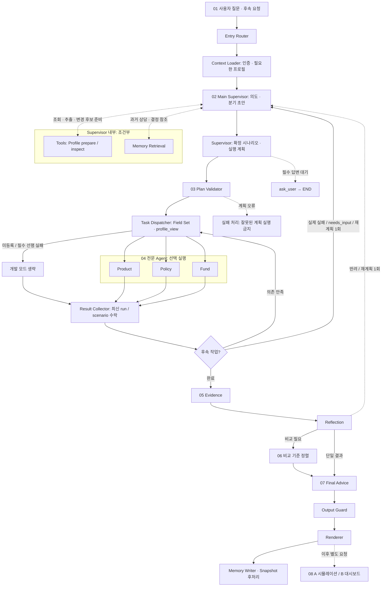

# 청년 금융 멀티에이전트 설계안

> **기준일:** 2026-11-25 (Supervisor v27 / main `855561c` 및 상위 그래프 연결 패치 적용 기준)  
> **이 문서의 정본 범위:** 노드 위치, 책임·실행 순서·실행 분기, 전문 Agent 입출력 책임과 검증·평가.  
> **MainState·결과 계약 정본:** [`State_설계안.md`](./State_설계안.md).  
> **프로필 필드·조회·수정 정본:** [`Profile_State_설계안.md`](./Profile_State_설계안.md).

**보존 원칙:** 최신 설계의 `policy/product/fund` 3개 전문 Agent, Supervisor 내부 조건부 Profile 도구, Memory Retrieval, Validator/Dispatcher/Collector, Evidence/Reflection, Final/Guard/Renderer, 요청 기반 A/B를 유지한다. **Housing Agent는 없으며**, 주택 마련은 `basic_profile.goals[]`의 금융 목표다. 별도 프로필 전용 상위 Agent나 새 최상위 State Key는 만들지 않는다.

## 0. 서비스 목표와 역할 경계

사용자의 재무 상황·목표를 바탕으로 청년 지원 정책과 대출·적금·예금 등 금융상품을 탐색하고, 선택적 자산 진단·로드맵·가정 시나리오 비교를 수행한다. 정식 신청·가입·대출 실행 서비스를 구현하는 것은 범위 밖이다.

| 담당 | Agent | 범위 | 제외 |
|---|---|---|---|
| 금융상품 | `product` | 적금·예금·신용대출·전세대출·주담대의 조건, 금리, 기간, 한도, 수익/상환 부담 | 부동산 매물·시세·입지 검색; 정책 지원금 자격 단독 확정 |
| 정책·혜택 | `policy` | 정부·지자체 지원금, 세제/이자 지원, 연령·지역·가구·소득 자격 및 수혜효과 | 은행별 계약조건 계산 |
| 재무 진단·설계 | `fund` | 소득/지출/자산/부채, 복수 목표, 저축·부채·현금흐름·목표 로드맵 | 직접 상품·정책 검색 중복 구현; 사용자 대신 계약 실행 |

공식 정책·상품 정보는 **외부 API 직접 호출이 아닌 수집·적재한 Neo4j와 원문 저장소**를 통해 조회한다. 외부 원본에서 확보한 공식 안내·신청 URL만 결과로 표시한다.

**후보 vs 전략 vs 시나리오:** 후보(`Candidate`)는 개별 정책/상품, 전략(`Strategy`)은 달성 방법·조합, 시나리오(`Scenario`)는 **서로 다른 가상 재무 상태**를 계산할 필요가 있는 분기다. 후보 수는 시나리오 수를 결정하지 않는다.

## 1. 전체 실행 그래프 — 서비스 목표

현재 개발 그래프의 실제 구현 범위는 [LangGraph_Langfuse_개발안내.md](./LangGraph_Langfuse_개발안내.md) 참조. 아래는 운영 목표 구조다.

**메인 흐름:** ① 입력 → ② Supervisor(의도·비교 수준·분기 초안) → 조건부 Profile/Memory → Supervisor(계획 확정) → ③ Validator/Dispatcher → ④ 전문 Agent → Collector → ⑤ Evidence/Reflection → ⑥ 비교 준비(선택) → ⑦ Final/Guard/Renderer → **첫 답변** → ⑧ 후속 A/B(사용자가 요청할 때만).

**그림 해석:** Dispatcher에서 세 전문 Agent로 연결된 화살표는 **항상 전부 호출한다는 뜻이 아니다**. Supervisor의 `execution_plan.tasks[].depends_on`으로 필요한 Agent만 선택·순차 또는 병렬 실행한다. Fund 단독 실행 가능. Product/Policy가 Fund를 직접 호출하지 않고 Collector가 검증한 선행 결과를 다음 라운드에 전달한다.

### 1.1 요청 유형별 경로

| 요청 | 기본 경로 | 상태 표현 |
|---|---|---|
| “요즘 청년 정책 알려줘” | Policy 단독, 프로필 없이 가능 | 일반 후보·조건부 안내 |
| 적금 추천 | Product, 정책 우대면 Policy 추가 | 후보 비교. 서버 후보 상한 적용 |
| “5,000만 원 마련 로드맵” | Fund 단독 → 필요 시 Product/Policy | 목표·지출·저축·예산, 선택 전략 |
| “기존 적금 유지+추가 적금” | 보유내역 확인 → Product, 필요 시 Fund | 동일 실제 상태, 시나리오 필수 아님 |
| “3% 적금 유지 vs 해지 후 5%” | Profile 분기 준비 → Product 공통 조건 → Fund 분기별 계산 | `s_keep`, `s_switch`의 임시 View |
| “내년 월급 350만 원이면?” | Supervisor 가정 → 필요한 Fund 재실행 | `scenario_state.overrides`만 |
| 저장 목표 하나 수정 | Profile 후보 준비 → Supervisor 승인 대기 → 별도 저장 서비스 | 다른 목표 보존 |
| “예전에 추천한 것 다시 비교” | Memory 조건부 조회 → 현재 자료 확인 → 필요 Agent | 오래된 추천/금리 무조건 재사용 금지 |

### 1.2 실제 계약과 임시 분기의 처리

1. Supervisor가 후보/전략/시나리오 수준을 먼저 판단한다. 독립 재무 상태가 필요할 때만 **최대 3개** 분기 초안을 만든다.
2. Supervisor가 내부 Profile 도구와 인증된 읽기/계약 포트를 통해 현재 실제 가입 여부·가입일·기납입 원금·납입 상태 등 **계약 사실**을 필요한 경우 확인한다. 최신 프로필 `financial_profile.holdings[]`에 필요한 값이 있어도 정밀 비교는 **인증된 계약 스냅샷 `baseline_ref`**를 우선 확인한다.
3. Profile 준비 결과는 Supervisor 내부 Tools의 `observations[].result`로 전달한다. 부모 `scenario_state.preparation`은 사용하지 않는다.
4. Supervisor가 최종 `scenario_state.scenarios[]`와 `execution_plan.tasks[]`를 확정한다. Profile은 최종 분기를 직접 확정하거나 Fund를 호출하지 않는다.
5. Dispatcher는 **동일한 실제 기준** + 사용자의 일회성 입력 + 해당 분기 `overrides` + 조회한 계약 사실 + 가상 `holding_actions`로 필요한 `profile_view`만 구성한다.
6. Product는 계약·중도해지 이율/정산·신규 상품 조건, Policy는 관련 지원/환수 조건(필요 시), Fund는 시나리오별 순자산·현금흐름·순효과를 계산한다.
7. Collector/Reflection은 동일한 기준일·종료일·시나리오 격리 및 **기납입 원금/자산 중복 반영 방지**를 검증한다. 가상 행동은 실제 해지·가입·정책 신청 명령이 아니다.

### 1.3 기존 적금 3% 유지 vs 신규 5% 교체 사례

| 단계 | 소유자 | 주요 확인 |
|---|---|---|
| 기존 가입 사실 | Profile + 사용자 계약 서비스 | 가입일, 이전 1년 납입 원금/이력, 실제 상태, 잔액·기준일·출처 |
| 분기 설정 | Supervisor | `s_keep`, `s_switch`, 동일 평가 종료일 |
| 기존·신규 계약 | Product | 현 계약 금리/해지 환급 규칙, 5% 신규 상품 **실재 여부**, 우대조건·납입 한도 |
| 청년 연계 정책 | Policy(선택) | 중도해지 시 환수·재가입 제한·우대 손실 |
| 분기 계산 | Fund | 유지·교체 시 미래 순자산/월 납입/기존 원금 단일 반영 |
| 최종 | Evidence / Reflection / Final | 실제/가정, 동일 초기 자금·기간, 근거·수치 일치 여부 |

사용자가 언급한 “신규 5%”는 **검증된 약정금리가 아니라 목표 검색 조건/가정**이다. 실제 상품이 없거나 5% 달성 조건을 모르면 확정 수익으로 표시하지 않는다.

## 2. Main Supervisor

**책임:** 전체 요청 해석, 후보/전략/시나리오 선택, 필요한 Profile/Memory 호출 판단, `execution_plan` 구성·조정, 전문 Agent 결과 재계획, 추천 수락 후 목표 반영 처리의 상위 조율.

- 추가 사실 조회가 없으면 LLM의 `submit_plan` 한 번으로 전체 DAG를 제출한다. 규칙 전용 Fast Path는 후속 최적화다.
- 새로운 프로필 입력은 **일회성 실제 정보 / 저장 변경 / 미래 가정**을 구분한다.
- Profile은 조건부 prepare/inspect, Memory는 연결 시 기본 조회 및 필요 시 추가 조회. 일반 안내는 프로필 없이 가능하다.
- Profile은 변경 후보만 반환하고 Supervisor가 승인 대기 상태를 구성한다. 실제 저장·삭제는 인증/승인/버전 검증 서비스의 책임이다.
- 상품 추천에 동의했다는 표현은 곧바로 **상품 가입/정책 신청 완료가 아니다**.
- 전문 실행은 `policy/product/fund`, 선행 의존은 `depends_on`. Fund만으로 충분하면 추가 검색 금지.
- Collector의 추가 검색/재계획 요청을 받아 실제 필요한 범위로만 확장한다.
- **프로필 전체를 LLM에 넣고 필드를 하나하나 찾아 읽게 하지 않는다.** 계획은 업무 목적 중심으로 작성하고, 필드 선별은 **코드 기반 Dispatcher**가 담당한다.

## 3. Profile — Supervisor 내부 조건부 도구

Profile은 **Supervisor 내부 조건부 도구/포트**다. 현재 내부 Graph는 Reason/Tools/Plan/Finalize 4노드이며 Tools에서 호출한다. 아래 단계는 논리적 역할이다.

| 내부 단계 | 호출 조건 | 반환·State 영향 | 금지 |
|---|---|---|---|
| Resolver | 발화 추출·검증 | profile delta/missing_info/extracted_info/ambiguities | 직접 intent 쓰기 |
| Gate | 명시 실제 변경 요청 | changes 후보 반환 | 직접 저장·승인 완료 선언 |
| Scenario View Builder | 유지/해지 등 임시 금융 상태 비교 필요 | `baseline_ref`, `branch_specs`, `missing_inputs` 준비 결과 | 검색·이자 계산·Fund 직접 호출 |

**Profile State 및 Tool의 세부 계약은 [`Profile_State_설계안.md` §4~§6](./Profile_State_설계안.md)을 정본으로 한다.** 이 문서에서는 필드 정의를 복제하지 않는다. 현재 Profile MVP의 조회·추출·검증은 코드 기반이다. 모호한 자연어의 해석과 추가 질문의 필요성은 Supervisor가 판단한다.

- Profile 도구는 읽기·변경 후보 준비만 수행한다. 실제 쓰기는 별도 인증·승인·change_id·버전 검증 서비스에서 처리한다.
- `MainState.basic_profile`과 `financial_profile`은 저장 서비스와 공통 `BasicProfile`/`FinancialProfile` 타입을 재사용한다. Agent별 LLM 입력은 Dispatcher가 병합·선별한 일부 `profile_view`다.
- 필수 공통 누락이면 `pending_input → ask_user → END`로 끝내고 서비스 Entry Router 연동 후 다음 메시지에서 같은 `turn_id`로 재개한다. 현재 개발 실행점은 질문 출력 후 종료한다. 전문 정책·금융상품의 일회성 세부 자격은 해당 Agent가 요청.
- 저장된 `goals[]`는 새 turn에 유지하며, 일부 목표 수정은 `goal_id`로 대상을 식별한다. 저장 목표의 `goal_ref = goal_id`, 저장 계약의 `holding_ref = holding_id` 규칙은 프로필 정본을 따른다.
- 실제 계약 스냅샷과 기억은 다르다. 기억/문장만으로 가입 완료·해지 완료를 선언하지 않는다.

### 3.1 Memory Retrieval — 조건부

- Memory 포트가 연결되면 turn 기본 조회, 추가 조회는 필요한 경우만. 기본 개발 그래프는 인증된 Memory 인스턴스 미주입. main의 `agent/memory/memory_integration.py`에 인증 UUID 기반 PostgreSQL 포트 생성 기능이 추가되었다. 실제 서비스에서 인증된 사용자별 Supervisor factory/포트를 주입해야 한다.
- `memory.retrieval_status`: `not_requested / found / no_match / failed / access_denied`. 관련 일부와 참조만 보관.
- 현재 금융자산·계약·가입 상태를 기억 내용으로 업데이트하지 않는다. 실제 사실은 Profile/가입 서비스에서 확인.
- Memory Writer는 **실제 사용자에게 전달된 답변**과 필요한 결정만 기록한다.

## 4. Financial Product Agent (`product`)

- 적금/예금/대출 상품 검색·비교, 금리·한도·만기·신규 조건·공식 URL 제공. 서버 `candidate_limit` 준수(§13.3).
- 필요 시 `profile_view`의 목표·가용자금·소득·부채 일부와 기존 `holdings`를 받되, **전체 금융 프로필을 일괄 프롬프트 입력으로 사용하지 않는다**.
- 기존 적금 갈아타기에서는 `holding_ref`에 연결된 계약 조건·중도해지 이율·환급 방식·우대 소멸 조건을 확인한다. 신규 5%는 검색 조건일 뿐 사실로 확정하지 않는다.
- `data.candidates[]`: 상품 ID, `product_type`, 자격/미확인 조건, 금리·기간·한도·예상 수익/상환액, `summary_reason`, 공식 URL, 자료 기준일·개별 `evidence_ref`.
- 정책 우대는 `linked_policy_ids[]`로 검증 가능한 경우에만 연결. 지원/세제 혜택을 Product 단독으로 합산해 확정하지 않는다.
- Product가 Fund를 직접 호출하지 않고, **공통 계약 조회 결과 1회**를 Collector → Dispatcher로 전달해 분기별 Fund가 재사용한다.

## 5. Policy Agent (`policy`)

- 지원금·월세지원·주거비·세액공제·비과세·이자 지원 등 **정책 혜택과 자격**을 독립적으로 검색·평가.
- 필요한 연령/지역/가구/무주택/소득 요건만 `profile_view`로 받는다. 청년 정책의 세전 인정소득과 세후 생활 현금흐름을 혼동하지 않는다.
- 정책별 필수 조건이 불명확하면 `eligibility.status="needs_check"`, `checks[]`, `unverified_conditions[]`. 무조건 등록 단계에서 모두 물어보지 않는다.
- `data.candidates[].key_attributes.benefits[]`에 혜택 유형/금액·비율/지급 주기/기간/적용 요건, 산정 기준일·근거를 가능한 범위에서 구성. **정책 최대 지원액과 사용자 예상 수혜액**을 구분.
- 검증된 `linked_product_ids[]`만 Product와 연결하고, 금리/혜택 중복 합산을 금지한다.
- 중도해지 시 지원금 환수·우대 자격 소멸·재가입 제한이 있는 경우 공식 원문에 근거해 반환한다.

## 6. Fund Agent (`fund`) — 단독 실행 허용

- 사용자의 실제 월소득·생활비·부채 상환액·총자산·가용 자금을 활용한 **현금흐름 진단**, 복수 목표 간 자금/우선순위 조율, 저축·부채 계획·로드맵.
- **Product/Policy 없이도 작동**하며 계산은 가능하면 결정론적인 Python Tool 사용.
- Policy/Product의 수락된 결과를 사용할 때만 의존성 추가. 정책 혜택, 예상 가입 수익, 대출 실행은 `planned/assumed` 또는 조건부로 분리한다.
- 실제 납입 중인 적금의 월 납입액이 있다면 **새로 저축할 수 있는 여력** 분석에서 차감/구분하되, 자산 총액·적금 잔액·기납입 원금을 중복 계산하지 않는다.
- `data`: `financial_diagnosis`, `roadmap[]`, 선택 `strategy_options[]`, 표시용 `metrics[]`, `assumptions`, 위험·불확실성.
- 임시 `s_keep/s_switch`는 동일 실제 기준 자산·계약 이력을 사용하고 Product 해지 규칙 및 필요 시 Policy 환수 조건을 받아 동일 평가 기간의 **미래 순자산·현금흐름·순효과**를 계산.
- 목표 등록/수정·추천 반영 승인·금융상품 실제 가입은 Fund가 직접 실행하지 않는다.

## 7. 협업·추천 수락·목표 반영

| 대상 | 기본 담당 | 결합 원칙 |
|---|---|---|
| 정책 지원금·세액공제 | Policy | 자격·혜택·기간·근거, 조건 미확인 `needs_check` |
| 적금·예금·대출 | Product | 계약조건·금리·예상 수익·상환액, 매물 검색 제외 |
| 정책 금융상품 | Policy + Product | 정책 혜택과 상품 자체 금리·가입조건을 구분, 중복 계산 금지 |
| 목표 로드맵 | Fund | 상품/정책 검색 불필요한 경우 단독 |
| 보유 적금 유지+신규 | Profile 조회 + Product, 필요 시 Fund | 기존 납입액을 고정, 신규 가용액만 사용 |
| 기존 적금 해지·교체 | Profile(사실) → Product(조건) → Fund(계산) | 동일 계약 기준일·종료일, 임시 분기만 |
| 추천 선택·목표 반영 | Supervisor + Profile 도구 + 저장 서비스 | 추천 수락 ≠ 목표 저장 ≠ 가입/신청 완료 |

사용자가 추천에 동의했을 때 필요하면 **“이 후보를 목표 계획에 반영할까요?”**라고 묻는다. 추천을 보여줄 때마다 승인 질문을 강제하지 않는다. 목표 수정은 승인한 `goal_id`만 변경하고, 실제 계약/정책 신청 실행은 하지 않는다. 나중에 사용자 결정을 복원할 때는 `advice_ref`, `candidate_id`, `goal_id` 같은 검증 가능한 참조를 사용한다.

## 8. Evidence Node

- 핵심 금융 주장(지원액·지원기간·가입 자격, 금리·대출 한도·예상 상환액 등)의 **개별 근거·기준일·원문/계산 입력** 확인.
- 기존 계약 가입일/납입 이력, Product 해지/신규 조건, Fund 계산의 연결을 확인. 조건 없이 제시된 신규 5%를 실제 약정금리로 취급하면 `needs_check` 또는 `revise`.
- `review_results[task_id].target_run_id` 아래 `evidence={status,issues[]}`만 쓰고 Reflection 항목을 지우지 않는다.
- 경량 형식 검사는 규칙으로, 근거 추론이 필요할 때만 LLM을 쓴다.

## 9. Reflection Agent

- 기간·금액·단위, 월 부채 상환 중복, **정책 혜택과 상품 이자 중복 합산**, 대출 원금을 지원금/소득으로 착각, 미가입/미수급을 실제로 표현, 서로 다른 `scenario_id` 결과 혼합 등을 검사한다.
- Evidence의 결과를 보존하면서 `review_results[task_id].reflection={status,issues[]}`를 기록한다.
- 동일 `baseline_ref`·실제 시점·평가 종료일, 기존 원금·해지 환급액·신규 적금 납입의 1회 반영을 검증한다.
- 반려 시 `revision_feedback.issues[]`로 재실행에 전달. 오류 보완 재계획 원칙 1회. 변경된 결과의 검수는 기존 상태 재사용 금지.

## 10. Final Advice · Output Guard · Renderer

| 구성 | 역할 |
|---|---|
| Final Advice | 수락된 전문 결과를 종합해 `final_advice.summary/sections[]/warnings` 작성. **재검색·재계산·새 후보 생성 금지** |
| 비교 준비 | 서로 다른 시나리오의 동일 종료일·단위·지표·실제/가정 구분을 규칙으로 정렬. 별도 Comparison Agent 없음 |
| Output Guard | `candidate_refs`의 `source_task_id/source_run_id/candidate_id` 최신성, 근거·금액·자격 `needs_check`, 가상/실제 혼합 점검. 재작성 최대 1회 |
| Renderer | 검증된 후보 참조에서 핵심 정보·추천 이유·자격·공식 URL·근거를 카드/표로 표시. 임의 URL 생성 금지 |
| 전달 후 처리 | `memory.last_advice_ref`·필요한 Memory Writer·검증 결과 Snapshot을 **서비스 후처리**로 기록. 사용자 후속 A/B는 별도 요청에서만 |

최종 출력의 참조·수치 형식은 [`State_설계안.md` §5](./State_설계안.md)를 따른다. 대시보드의 시계열·목표 실적은 MainState 밖의 서비스 저장소에서 관리한다.

## 11. 그래프 제어·상태 쓰기 권한

| 노드 | 주요 읽기/쓰기 |
|---|---|
| Entry Router | 새 turn/추가 답변/A·B 구분, `turn_id` |
| Context Loader | 인증 검증, 필요한 기본·금융 프로필 스냅샷 로딩, 새 turn 필드 초기화 |
| Supervisor | `intent`, `scenario_state` 최종 확정, `execution_plan` 작성/재계획 |
| 내부 Profile 도구 | 내부 observations에 추출/누락/변경 후보/소득 관찰 반환. Supervisor만 MainState 패치 작성 |
| Memory Retrieval | 포트 반환을 Supervisor가 `memory.retrieval_status`/`retrieved`로 정규화 |
| Plan Validator | intent·분기·DAG·서버 후보 상한 검증 |
| Dispatcher | Field Set 어댑터, run_id, 필수 선행 결과·검증 답변·반려 피드백·후보 상한 전달 |
| 전문 Agent | `agent_outbox`만 작성 |
| Collector | 최신 Envelope·후보 상한 검사, 상태 갱신 및 실제 실패/필수값 부족 재계획 요청 |
| Evidence/Reflection | `review_results`에 순차로 독립 판정 |
| Final/Guard/Renderer | 최종 초안·검증·화면 렌더·`last_advice_ref` |
| Memory Writer / A·B | 실제 전달 답변 기억 후보·후속 저장/조회(조건부) |

병렬 노드가 reducer 없는 같은 Key를 동시에 수정하지 않는다. `agent_outbox`는 Collector가 소비하고 초기화한다. 요청별 State 초기화는 Entry/Loader가 명시적으로 수행한다.

## 12. 전문 Agent별 입력·출력 계약

### 12.1 필요한 프로필을 LLM이 하나씩 조회하지 않는 구조

**결정:** 같은 논리 스키마 `BasicProfile`/`FinancialProfile`을 DB와 MainState에서 사용하되, **LLM에 모든 필드를 주지 않는다**.

1. Supervisor가 작업 목적·Agent를 결정한다.
2. Dispatcher가 작업별 **Field Set**을 코드의 허용 목록에서 선택한다(예: Fund는 월소득·생활비·부채·목표).
3. State에 있는 값은 재사용하고 필요한 미로딩 값만 인증된 **Profile Read Tool**로 일괄 조회한다. 실제값 → `intent.supplied_values` → 선택 분기 `overrides`를 병합한다. 목표는 의도에 따라 병합하고 일회성 `age`는 Policy View에만 허용한다.
4. 병합한 유효값에서 허용 필드만 투영한다. 각 Agent LLM은 이 `profile_view`만 받으며 **한 항목씩 읽는 Tool 호출 루프**를 수행하지 않는다.
5. 특수 정책 조건이나 계약 해지·기납입 기록은 목적에 맞는 별도 도구/사용자 질문으로 보완한다. 저장은 별도 Profile Write Tool과 승인 절차에서만.

작업별 Field Set 표·Tool 인자·Python 예시는 프로필 정본을 따른다. 메인 State의 필드를 Agent별로 중복 선언하지 않는다. 일반 안내·Product 후보 검색·Policy 혜택 소개는 `required=[]`가 정상이다. 구체적인 Fund 월 현금흐름은 세후 월소득·생활비·확인된 부채상환액이 필요하다. Policy의 확정 자격은 개별 원문 요건을 모두 확인한 경우만 가능하다.

### 12.2 전문 Agent 공통 Envelope

**입력:** `task_id, run_id, plan_revision, scenario_id, objective, user_query, profile_view, upstream_results?, extra_answers?, prior_advice?, revision_feedback?`. 분기라면 기존 `profile_view` 안에 `holding_baseline?`, `holding_actions?`를 포함한다(별도 필수 Envelope Key 아님). 검색 작업은 서버 `candidate_limit` 확장 입력을 받는다.

**출력:** `task_id, run_id, plan_revision, scenario_id, status, summary, data, evidence_refs[], warnings[], needed_fields[]`. Collector가 일치 검증 후 `agent_results`에 채택한다.

**공통 후보 구조:** 검색 완료 결과는 `data.candidates[]`가 필수이며 후보 없음·사실 조회는 빈 배열이다. 초과 결과는 Collector에서 반려한다. `data.candidates[]`의 `candidate_id`는 `task_id + run_id` 내에서 고유하다. 기존 후보 계약을 유지하며 별도 화면용 후보 장부는 만들지 않는다.

| 항목 | 최소 계약 |
|---|---|
| 식별·추천 | `candidate_id`, `name`, 해당 `product_type/policy_category`, 필요 시 `rank/score`, `summary_reason` |
| 조건 | `eligibility.status`, `matched_conditions[]`, `unverified_conditions[]`; Policy의 `checks[]` |
| 핵심 속성 | Product 금리·한도·만기·수익/상환; Policy `key_attributes.benefits[]`. 중요 값에 `value/unit/as_of/evidence_ref` 연결 |
| 링크·근거 | 원본 `official_url/application_url`, 확인된 `linked_policy_ids[]/linked_product_ids[]`, 조회 가능한 근거 참조 |
| 선택적 검색 문맥 | `search_criteria`, `near_misses[]`(선택, 최대 2는 서비스 목표). 추천 후보 상한을 우회하기 위해 사용하지 않음. 없는 값·URL을 생성하지 않음 |

Product의 `comparison`, 선택 `assumptions/metrics[]`를 유지한다. Policy의 혜택 종류는 고정 enum으로 제한하지 않는다. 확정 수치·자격은 해당 원문과 조건의 연결이 검증되어야 한다.

**Fund 데이터:** `data.roadmap[]`, 선택적 `data.strategy_options[]`, 차트가 필요한 지표만 `data.metrics[]`. `actual/estimated/planned/assumed` 구분을 유지한다. Fund 단독이면 Product/Policy 후보 배열을 강제로 만들지 않는다.

### 12.3 두 종류의 수정 문맥

- 이전 **상담 수정**: `prior_advice`/`memory.last_advice_ref`로 조회한 과거 답변.
- 같은 **요청의 검증 반려**: `revision_feedback` = `{previous_run_id, previous_output_ref?, issues[]}`. 과거 본문이 필요하면 존재하는 저장 참조만 조회.

두 개를 동일한 수정/반려 신호로 혼동하지 않는다.

## 13. 비용·지연·보안 제어

### 13.1 노드별 LLM 호출 기준

| 노드 | LLM 사용 | 제어 |
|---|---|---|
| Entry Router | 조건부 소형 | 새 요청/재개/후속 판정이 모호할 때만 |
| Context Loader · Validator · Dispatcher · Collector · ask_user · Memory Retrieval/Writer | 없음 | 규칙·서비스·허용 목록·조회 |
| Profile 내부 도구 | 현재 MVP는 규칙 기반 | 조회·추출·검증·변경 후보 준비; 승인 저장은 별도 서비스 |
| Supervisor | 의도·경로 변경 시 중형 | 템플릿·필요 요약 사용; 전체 재계획 반복 금지 |
| 전문 Agent | 담당자 설계 | 입력·출력 계약, 후보·작업 상한 준수 |
| Evidence / Reflection | 조건부 중형 | 규칙 우선; 원문 대조·복합 결과·시나리오·원인 불명 오류에만 LLM |
| Final Advice | 응답 품질 중심 | 검증된 결과·근거·제한된 섹션만 |
| Output Guard / Renderer | 없음 | 규칙 검증·표시 |
| A/B | 요청 시만 | A 결정론 계산, B UI/집계 |

모델 등급은 성능·비용 평가로 확정한다. 일반 안내에서는 개인정보 조회를 생략하고, 업무별 View와 동일 기준 계약 Snapshot을 재사용한다. 공통 Product/Policy 결과는 수락 후 각 Fund 작업이 사용한다. 고정 프롬프트와 요청별 데이터를 분리하고, 전체 대화 대신 필요한 최근 메시지·요약만 전달한다. 서버 인증 사용자로 조회 범위를 제한하며 임의 사용자 ID·원시 Cypher·개인정보 경로를 LLM에 허용하지 않는다.

### 13.2 계획 템플릿과 Fast Path

| 템플릿 | 기본 실행 |
|---|---|
| `tpl_goal_finance` | Fund, 필요 시 Product → Fund |
| `tpl_product_search` | Product |
| `tpl_youth_policy` | Policy, 필요 시 Product/Fund |
| `tpl_budget_plan` | Fund |
| `tpl_policy_product` | Policy + Product, 목표 계산이 필요한 경우 Fund |
| `tpl_scenario_compare` | 시나리오별 DAG, 공통 조회 재사용 |

아래 템플릿은 후속 최적화용 참고안이며 현재는 Supervisor가 전체 DAG를 생성한다. 템플릿은 서버 내부 참고안이며 `template_id`를 MainState에 추가하지 않는다. 단일 작업·규칙 통과·근거 검사 트리거 없음이면 Evidence/Reflection의 LLM을 생략할 수 있다. Final → Guard → Renderer는 유지한다.

### 13.3 서버 상한과 실패 처리

| 항목 | 기본 상한 / 처리 |
|---|---|
| Reflection 오류 보완 재계획 | `review_retry_count` 1회; 소진 시 검증된 부분만 안내 |
| Validator 계획 오류 | 현재 상위 Validator는 계약 오류를 반려하고 실행을 중단. Supervisor 내부 계획 복구 1회와 구분 |
| 전문 작업 오류 / 필요 정보 | 독립 작업 처리 후 개발 그래프 실행당 Supervisor 재계획 최대 1회. 미등록 skipped는 재계획 제외 |
| Guard 재작성 | 1회; 계속 실패하면 안전 템플릿/검증된 부분만 출력 |
| 동적 확장·전체 작업 수·호출비용 | Supervisor 작업 최대 12개, 내부 Reason 12회·Tool 6회·계약 복구 1회. 그래프 실행 재계획 0~1회 |
| 후보 수 | Product/Policy 각각 분기당 `min(3, 6 // 활성 분기 수)`(비분기=1), 종류별 최대 6개. 공통 검색은 소비 분기마다 차감. Fund 제외 |
| 시나리오 / 요약 / A·B | 최대 3개 / 길이 임계값 초과 시 / 첫 답변 0회 |

공용 `budgets` 장부를 추가하지 않는다. 요청하지 않은 신청 체크리스트, 금융계약 실행, 정책 신청, 부동산 매물 검색은 범위 밖이다.

## 14. 평가 계획 및 수용 기준

### 14.1 필수 회귀 테스트

| ID | 사례 | 통과 조건 |
|---|---|---|
| V33-01 | 적금 추천 | 비분기 검색 상한 3개; Fund는 필요 시만 |
| V33-02 | 기존 적금 유지 + 추가 가입 | 기존 월 납입액 중복 차감 없음; 시나리오 필수 아님 |
| V33-03 | 1년 납입한 3% 적금 유지 vs 5% 2년 신규 | 같은 실제 기준·24개월 평가 종료일; 두 Fund 결과 분리 |
| V33-04 | 기존 가입일 미확인 | 임의 생성 금지; 필요한 값만 질문하거나 조건부 안내 |
| V33-05 | 신규 5% 미출시/우대 미확인 | 실제 가입 가능·확정 수익으로 표시하지 않음 |
| V33-06 | 신규 적금 월 납입 한도 | 환급금 전액을 신규 적금에 일시 예치한 것으로 계산하지 않음 |
| V33-07 | 정책 혜택 환수 | Policy 근거 확인, 혜택 중복 계산 없음 |
| V33-08 | 한 분기 조건 변경 | 구 revision/run·검수 무효화, 새 run 적용. 변경 작업만 선별 재실행은 후속 최적화 |
| V33-09 | 전략 2개 × 가정 2개 | 필요한 셀만 계산; 중복 전략/시나리오 결과 없음 |
| V33-10 | 일반 정책 안내 | Profile Builder·가입 조회·신청 체크리스트 호출 없음 |

### 14.2 공통 수용 기준

| 영역 | 필수 사례 |
|---|---|
| 기본/라우팅 | 무프로필 일반 안내, Fund 단독, 전세대출 Product 실행, `housing` 금지, Collector 결과 기반 경로 확장 |
| 정책·상품 | 혜택·금액·기간·공식 URL·근거·`needs_check`, 세제 추정 제한, 세전·세후 구분, 정책/상품 중복 집계 금지 |
| 프로필·저장 | 공통 타입, 병합 후 필요한 Field Set만 전달, 일회성 `age`, `null/0/[]`, 승인·거절·멱등성·버전 충돌, 목표/보유상품 참조 ID 통일 |
| 재무 정확성 | 총자산≠가용자금, 생활비·상환·저축 중복 차감 금지, 대출 원금은 소득/지원금 아님, 목표 실적과 계획/가정 구분 |
| 재개·기억 | 같은 `turn_id`/대상 작업 복원, 부분 질문 대기, 과거 답변·추천 결정 조회, 추천 수락≠목표 저장≠가입 |
| 실행·검증 | 공통 조회 재사용, 구 run/scenario 결과 거부, Evidence/Reflection 독립 판정, 반려 사유 전달, 동일 baseline/기간 비교 |
| 최종·후속 | 최신 검증 후보만 `candidate_refs`, 수치/근거/URL 환각 차단, 실제 전달 결과만 기억·Snapshot 저장, 실패 시 허위 복원 금지, A/B 후속만 실행 |

### 14.3 평가 지표와 실험

| 영역 | 주요 측정값 |
|---|---|
| 라우팅·프로필 | 첫 경로 정확도, 불필요 Profile/Memory 호출률, 재계획률, 불필요 질문률, 재개 성공률, 중복 저장 횟수(목표 0) |
| 재무 | 세전/세후 혼용률, 지출·상환 중복 탐지, 미확인값 0 오용률, 혜택 중복 산입률, 대출금 소득 오용률, 분기 계산 오류율 |
| 검증·출력 | 구 `run_id` 수락/구 검수 재사용률(목표 0), 반려 전달 성공률, 근거 없는 확정 주장 비율, 자격·수치·단위·공식 URL 일치율 |
| 후속·서비스 | Snapshot 재조회 성공률, 실적/가정 혼동률, 첫 답변 p50/p95, 총 토큰·호출 수·시나리오 비용, A/B 미요청 실행률(목표 0) |

**Ablation(비교 실험):** Exp-0 규칙 검수 → Exp-1 +조건부 Evidence → Exp-2 +조건부 Reflection LLM → Exp-3 +Final → Exp-4 +Guard. 각 단계의 근거 오류·시나리오 통합 오류·답변 품질·토큰/지연을 비교한다. 실제 운영은 Final과 Guard를 포함한다.

**측정 방법:** 고정된 공식 정책/상품 스냅샷과 가상 사용자 프로필로 회귀 테스트를 최소 3회 수행한다. 모델 파라미터·외부 자료를 통제하고 `task_id/run_id/plan_revision/scenario_id`, Collector 승인, 저장/재개 상태, 검수와 `final_advice.validation`을 기록한다. 구조화 출력·산술·근거는 자동 검사하고 설명 품질은 사람 평가로 검증한다. 민감한 계좌·원문 정보는 로그에 남기지 않는다.

---

**최종 결정:** 사용자 실제 프로필은 **하나**, 시나리오의 다른 값은 **임시 View**, Policy/Product/Fund는 **필요할 때만 선택 실행**, 전문 Agent의 LLM은 **선별된 프로필 View만** 사용한다. 이 문서에서 프로필 상세 필드·수정 API를 중복 정의하지 않는다.
